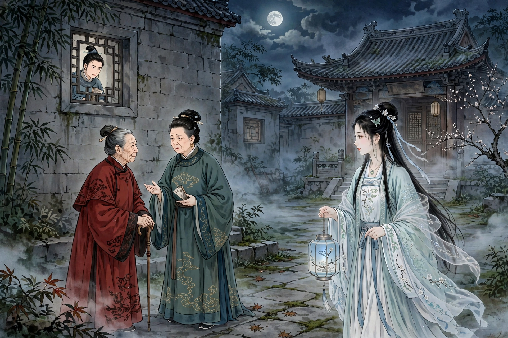
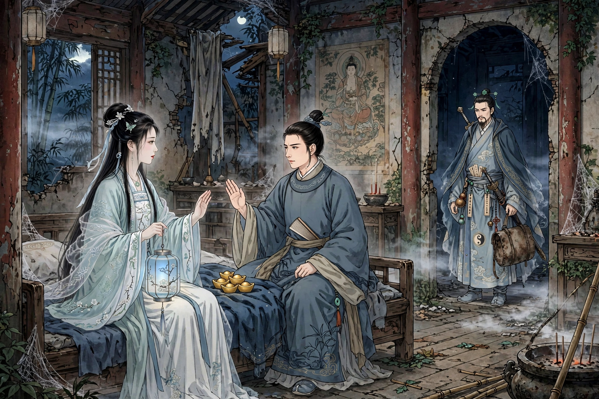

# Nie Xiaoqian: Rescue at Lanruo Temple

Source: "Nie Xiaoqian" from Liaozhai Zhiyi by Pu Songling (Qing dynasty). This is a faithful English retelling by Muse, with the same plot, characters and ending as the original.

Illustrations are AI-generated, not photos. The same character (Nie Xiaoqian, Ning Caichen, Yan Chixia) keeps the same face and costume across all images.

Publishing status: Chinese version submitted to Toutiao account "浠水文艺" on 2026-10-27 15:28, under review. WeChat Official Account publishing will be handled separately by the user on a fixed-IP server. The X version below is on hold until the user's newly registered X account can log in.

---

Source: "Nie Xiaoqian" from Liaozhai Zhiyi by Pu Songling (Qing dynasty). This is a faithful English retelling by Muse, with the same plot, characters and ending as the original. Illustrations are AI-generated.

Ning Caichen, a man from Zhejiang, was generous, upright and proud of never being tempted by beauty. On a trip to Jinhua, finding city lodgings too expensive, he stayed at the ruined Lanruo Temple north of the city. Only the south room was still locked and kept; there he met Yan Chixia, a scholar from Qin who spoke plainly and honestly.

One night Ning heard voices north of his room. Through a stone window he saw a courtyard where a woman in her forties and an old woman in red talked under the moon about Xiaoqian, who was late. Then a girl of seventeen or eighteen, of surpassing beauty, arrived. The old woman praised her as a figure from a painting. Ning took them for neighbours and went back to sleep.

*Image 1: North courtyard at night at Lanruo Temple, Xiaoqian with a lantern, the woman in her forties, the old woman in red, and Ning Caichen peeking from the window*

Later that night the girl came to his bedroom and offered herself. Ning refused sternly, saying one misstep would ruin honour and shame. She left, returned, and put a gold ingot on his bedding. Ning threw it into the courtyard, saying ill-gotten wealth would soil his bag. Ashamed, she picked it up and whispered that he must be made of iron and stone.

*Image 2: Temple night, Xiaoqian, Ning Caichen, gold ingots on the bed, and Yan Chixia at the doorway with his sword bag*

Next morning a scholar from Lanxi and his servant, lodging in the east wing for the exams, died overnight, each with a tiny hole like a needle prick in the sole of the foot, bleeding slightly. In the evening Yan returned and said it was a ghost. Ning, naturally outspoken, did not much care.

At midnight the girl came again and told the truth. She was Nie Xiaoqian, dead at eighteen, buried beside the temple, forced by a demon to do lowly service. When there was no one left to kill in the temple, a night-fork demon would come. Staying in Yan's room could save him, she said, because Yan was a strange man she dared not approach. Her method was to prick a lover's foot with a needle while he was dazed, then take his blood for the demon to drink; or to leave gold that was not gold but a rakshasa ghost bone, which could cut out a man's heart and liver. Both were bait for men's tastes. She wept and begged Ning to take her rotten bones home and bury them safely, saying only the white poplar with a crow's nest on top marked her grave. Ning promised.

The next day Ning invited Yan early, prepared wine and food, and insisted on sharing his room despite Yan's love of quiet. Yan warned him never to open his box or bundle, or both would suffer. That night Yan put his box on the window and snored like thunder. Near the first watch a shadow peered in with glittering eyes. Suddenly something burst from the box, bright as white silk, broke the stone window lattice, shot out and vanished like lightning. Yan woke, took from the box a small sword, about two inches long and as thin as a leek leaf, sniffed it in the moonlight and said it smelled of a demon. He was a swordsman, he admitted; had the stone lattice not blocked it, the demon would have died on the spot, though it was still wounded. Ning respected him all the more.

Next morning there was blood outside the window, and north of the temple among many wild graves stood the white poplar with the crow's nest. As Ning prepared to leave, Yan gave him a worn leather sword bag, saying it would keep evil spirits away, but refused to teach him the sword, saying Ning was still a man of wealth and rank, not of that path. Ning pretended a sister was buried there, dug up Xiaoqian's bones, wrapped them in clothes, and took them home by boat. He buried her outside his study in the countryside and prayed that, buried near his little house where her songs and weeping could be heard, she would no longer be bullied by fierce ghosts, offering her a bowl of thin gruel and begging her not to mind its plainness.

After the prayer a voice called, "Wait, let us go together!" It was Xiaoqian, in daylight more beautiful than ever, skin like rosy clouds, feet like fine bamboo shoots. She thanked him, saying ten deaths could not repay his faithfulness, and asked to go home to meet his parents, even as a concubine or maid. Ning took her to his study, told his mother first, and warned her not to tell his long-sick wife for fear of frightening her. Xiaoqian entered, knelt, and told his mother she was alone in the world, far from parents and brothers, and wished to take up broom and dustpan to repay Ning. His mother, seeing how lovely she was, dared to speak, but said she had only this one son to carry on the family line and dared not let him marry a ghost. Xiaoqian replied she had no second thought, and asked to treat Ning as a brother, serve his parents morning and evening. His mother, moved by her sincerity, agreed. At once Xiaoqian went to the kitchen to cook for his mother and made the beds, as if she had long lived there.

At dusk his mother, afraid, sent her away without a bed. Xiaoqian understood, left, and hesitated outside the study, afraid to enter. Ning called her and she said the room had sword energy in it; that was why she had not met him on the road. Ning moved the sword bag to another room, and she came in and sat by the candle, long silent. She asked if he read at night, saying she had once recited the Shurangama Sutra and had mostly forgotten it, and asked to borrow a copy to study with him at leisure. She sat silently until nearly the second watch, then, urged to go, said sadly that a lonely soul in a strange land feared the wild graves. Ning said the study had no other bed and brother and sister should keep their distance. She rose, frowning as if to weep, walking slowly away, and vanished down the steps. Ning pitied her and wanted to keep her on another bed, but feared his mother's anger. Every morning she greeted his mother, brought water for washing, and worked below, obeying his mother in everything; every evening she retired, stopped at the study to recite sutras by candlelight, and left sadly only when Ning was about to sleep.

Before this, Ning's wife had been ill and bedridden, and his mother had been worn out with care; with Xiaoqian she was much eased and grateful. Day by day his mother loved her as her own child, forgot she was a ghost, and could not bear to send her away at night, keeping her to sleep and rise together. At first Xiaoqian ate and drank nothing; after half a year she gradually took thin gruel. Mother and son doted on her, avoided the word ghost, and others could not tell. Soon Ning's wife died. His mother secretly wished to take Xiaoqian as a daughter-in-law, but feared it might harm her son. Xiaoqian, sensing this, told his mother she had lived there over a year and her heart should be known: she followed Ning only because she did not want to harm travellers, and because Ning was so upright that heaven and men admired him; she wished only to stay with him for a few years, to gain a title of honour and bring glory to her grave. His mother knew she meant no harm, but feared for the family line. Xiaoqian said children are given by heaven, and Ning's fortune book had three sons who would honour the family; marrying a ghost would not take that away. His mother believed her and discussed it with her son. Ning was glad, and they set a feast and told relatives. When someone asked to see the bride, Xiaoqian came out in splendid dress; the whole hall was stunned, and instead of suspecting a ghost, they suspected a fairy. Relatives of all five degrees of kinship brought gifts and vied to meet her. She was good at painting orchids and plum blossoms, and repaid visitors with small paintings, which they treasured.

*Image 3: At Ning's home, Xiaoqian serving, Ning's mother, Ning Caichen, and his sick wife in bed*

One day, head bowed by the window, lost in thought, she suddenly asked where the sword bag was. Ning said it was sealed away because she feared it. She said she had long breathed living breath and should no longer fear it, and it should be hung at the head of the bed. Asked why, she said for three days her heart had pounded without stopping; she feared the Jinhua demon, hating her escape, would soon find her. Ning brought the bag. She examined it again and again and said it was a sword fairy's bag for holding human heads, so worn, who knew how many it had killed, and even looking at it now made her skin crawl. She hung it up. The next day she had it moved to hang over the door, sat by the candle at night, and told Ning not to sleep. Suddenly something fell like a flying bird. Xiaoqian hid in fright behind a curtain. Ning saw a thing like a night-fork, with lightning eyes and a bloody tongue, glittering eyes, reaching out to seize, advancing to the door, then pausing, lingering, gradually approaching the bag and clawing at it as if to tear it apart. The bag suddenly gave a clatter, grew as big as a large basket, and a ghostly thing thrust out half its body, dragged the night-fork in, and all fell silent; the bag shrank back as before. Ning was amazed. Xiaoqian came out, delighted, saying all was well. Together they looked inside the bag: only several dou of clear water.

*Image 4: Final sword-bag night, Xiaoqian hiding behind a curtain, Ning Caichen, and the demon in black reaching for the sword bag*

Some years later Ning passed the jinshi examination. Xiaoqian bore him a son. After he took a concubine, Xiaoqian and the concubine each bore another son, and all rose in office with good reputations.

---

## X thread draft (on hold, each post under 280 characters)

(each post under 280 characters, in order)

1/ The ghost who refused to kill: Nie Xiaoqian, from Pu Songling's Liaozhai Zhiyi. A faithful retelling, by Muse. Illustrations are AI-generated. 🧵
2/ Ning Caichen, upright and proud of never being tempted by beauty, lodged at ruined Lanruo Temple near Jinhua because city rooms were too dear.
3/ There he met Yan Chixia, a plain-spoken scholar from Qin. At night, through a stone window, Ning saw two women talking of a late girl named Xiaoqian.
4/ That night the beautiful girl came to his room. He refused her, threw her gold ingot into the courtyard, and called it ill-gotten wealth.
5/ Next morning a Lanxi scholar and his servant died in the east wing, each with a needle-like hole in the sole of the foot. Yan said: a ghost.
6/ At midnight Xiaoqian confessed. Dead at 18, buried by the temple, forced by a demon to prick lovers' feet and take their blood, or leave rakshasa bone-gold to cut out hearts.
7/ She begged Ning to take her bones home. Her grave: the white poplar with a crow's nest. He promised, and shared Yan's room for safety.
8/ That night a sword burst from Yan's box, bright as silk, and wounded the peeping demon. Yan was a swordsman. He gave Ning his worn sword bag.
9/ Ning buried Xiaoqian outside his study and prayed she would no longer be bullied by fierce ghosts. She appeared in daylight, more beautiful than ever.
10/ At his home she served his mother and sick wife, cooked, made beds, recited sutras by candlelight, and after half a year began to eat thin gruel.
11/ His wife died. Xiaoqian said Ning's fortune book held three honourable sons; marrying a ghost would not take that away. His mother agreed. Guests took her for a fairy.
12/ The Jinhua demon came for her at night, a night-fork with lightning eyes. It clawed at the sword bag. The bag swelled, dragged it in, and shrank back. Inside: only clear water.
13/ Years later Ning passed the jinshi exam. Xiaoqian bore a son; after he took a concubine, she and the concubine each bore another son. All rose in office. End.
