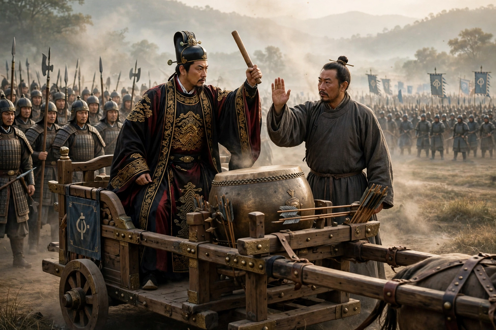
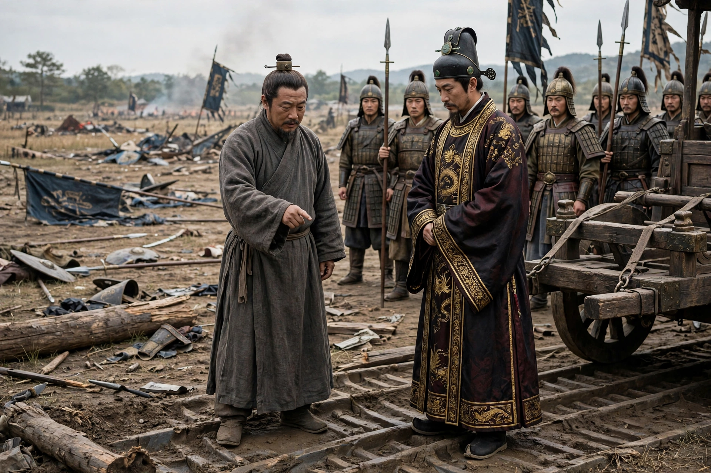

# 曹刿论战：三通鼓后才追齐军

本文改写自《左传·庄公十年》中的《曹刿论战》，是Muse翻译的古文改白话讲述，原意不改，情节不增不减，只把文言换成今天的话来讲。全篇只写曹刿见鲁庄公、长勺交战和战后解释，不加人物，不改结局，请往下看。

鲁庄公十年的春天，齐国军队来攻打鲁国。鲁庄公准备迎战，曹刿请求求见鲁庄公。同乡的人对他说：“掌权的人会谋划这件事，你又何必参与呢？”曹刿说：“掌权的人目光短浅，不能深谋远虑。”于是他进去见鲁庄公，问：“凭什么作战？”鲁庄公说：“吃穿这些安身的东西，我不敢自己独占，一定拿来分给别人。”曹刿回答：“小恩小惠没有遍及百姓，百姓不会跟从。”鲁庄公说：“祭祀用的牲畜、玉器和丝帛，我不敢虚报数目，一定用诚信来对待。”曹刿回答：“小小的诚信还没有让神相信，神不会保佑。”鲁庄公说：“大大小小的案件，我虽然不能一一明察，但一定按实情来处理。”曹刿回答：“这是尽心为百姓做事的表现，可以凭这个打一仗。作战的话，请让我跟从。”

鲁庄公就让曹刿和他同乘一辆战车，在长勺作战。鲁庄公准备击鼓进军，曹刿说：“还不可以。”齐国军队击了三次鼓，曹刿说：“可以了。”齐军大败。鲁庄公准备驾车追击，曹刿说：“还不可以。”他下车查看齐军车轮碾过的痕迹，又登上车前横木向远处眺望，说：“可以了。”于是鲁军追击齐军。

打胜以后，鲁庄公问他其中的缘故。曹刿回答：“打仗靠的是勇气。第一次击鼓，勇气振作起来；第二次击鼓，勇气就衰减了；第三次击鼓，勇气就耗尽了。敌人的勇气耗尽了，我们的勇气正旺盛，所以打胜了。大国的情况难以预测，恐怕有埋伏。我看到他们的车轮痕迹混乱，望见他们的旗帜倒伏下来，所以才追击他们。”

以上白话讲述由人工智能翻译整理，配图为人工智能生成示意图，人物为历史人物形象示意，并非真实肖像；原文出自《左传·庄公十年》，底本以古诗文网所载《曹刿论战》为准。

原文（节选自古诗文网所载）：十年春，齐师伐我。公将战。曹刿请见。其乡人曰：“肉食者谋之，又何间焉？”刿曰：“肉食者鄙，未能远谋。”乃入见。问：“何以战？”公曰：“衣食所安，弗敢专也，必以分人。”对曰：“小惠未徧，民弗从也。”公曰：“牺牲玉帛，弗敢加也，必以信。”对曰：“小信未孚，神弗福也。”公曰：“小大之狱，虽不能察，必以情。”对曰：“忠之属也，可以一战。战则请从。”公与之乘。战于长勺。公将鼓之，刿曰：“未可。”齐人三鼓，刿曰：“可矣。”齐师败绩。公将驰之。刿曰：“未可。”下视其辙，登轼而望之，曰：“可矣。”遂逐齐师。既克，公问其故。对曰：“夫战，勇气也，一鼓作气，再而衰，三而竭，彼竭我盈，故克之。夫大国难测也，惧有伏焉。吾视其辙乱，望其旗靡，故逐之。”
