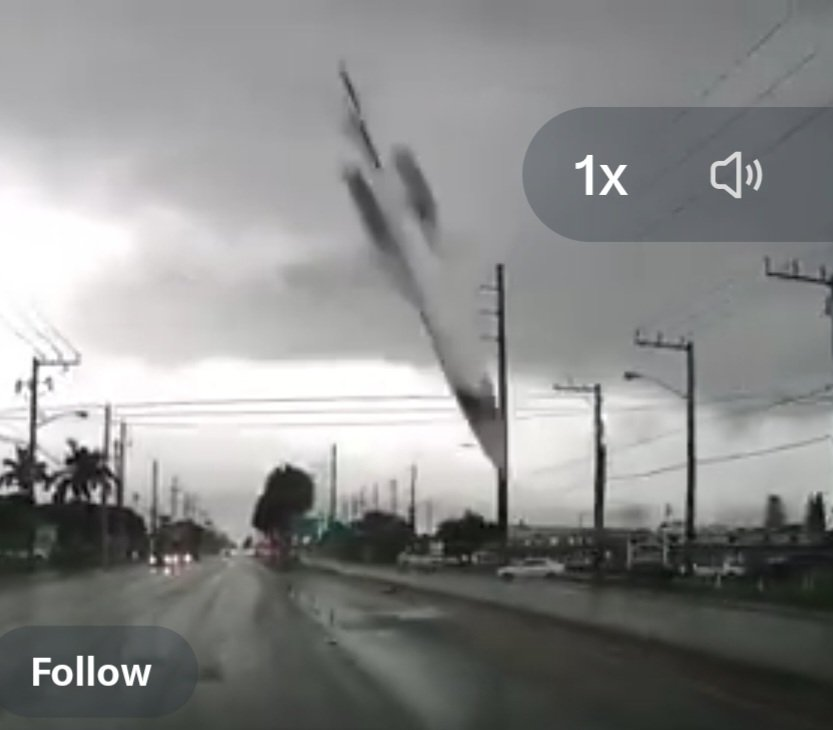
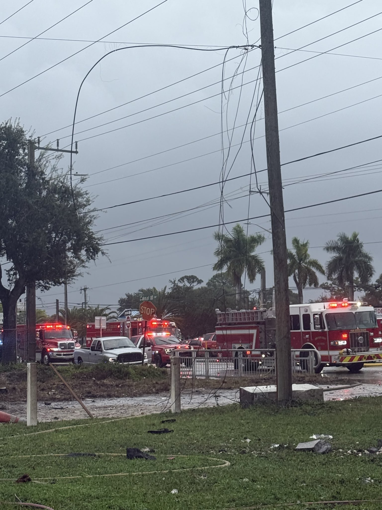
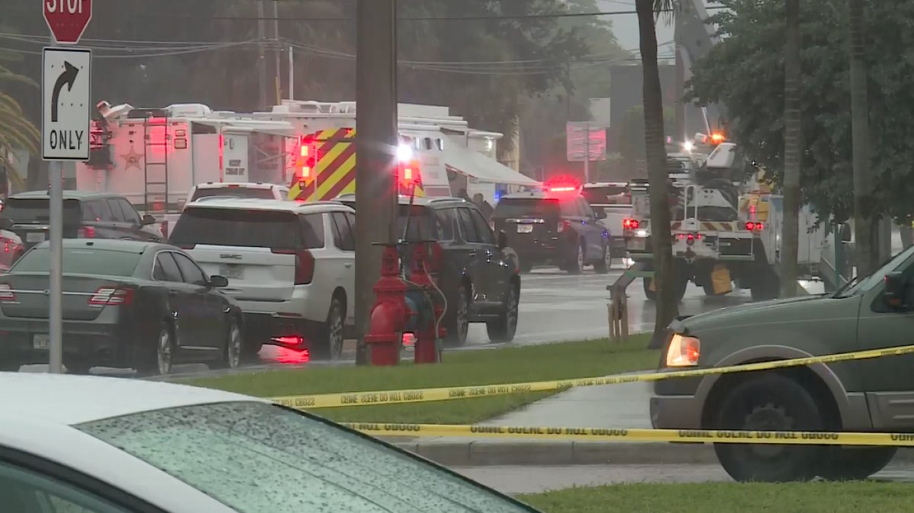

# 美国公务机坠毁9人遇难：最后77秒，机上还有两个孩子

11月1日早上，奥斯汀，Adam Robinson一家上了飞机。

他带着妻子Helen Sharp，4岁的Emma，2岁的Charlie，还有照顾孩子的保姆Anita Maria Apellido Cetina，以及两位朋友Rachael Reed和Charmi Fehr。他们要去巴哈马的北伊柳塞拉，度假。

开飞机的是55岁的机长Jeff Gregory。副驾驶20岁，叫Nathalia Gadelha Filgueiras，17岁就拿到了私人飞行执照，飞了约1300小时。她家里人说，她从小就想当飞行员。

这架飞机是Learjet 60，注册号N722BD，2004年造，Aurora Aviation以Upper Jets的名义运营。10月31日它从小石城调机到奥斯汀，11月1日约9时37分中部时间起飞，先爬到41000英尺，到了佛罗里达附近，降到35000英尺。

然后，事情在不到一分钟里急转直下。

约12时47分，机组报告：轻度晴空结冰，中度颠簸，高度上下浮动约700英尺。随后他们说遇到了降水，管制员批准爬升到37000英尺。批准后不到30秒，机组报告下降，发出mayday，接着是超速下降。

流传的空管录音里，副驾驶的声音一次次报出下降率和倾斜角度，管制员一直在回应。这段录音不是NTSB的官方文字记录，各家转录的措辞略有出入，但时间对得上：从35000英尺左右，到最后记录的8750英尺，约一分钟，下降率一度超过每分钟32000英尺。

图：飞机大角度俯冲并拖出烟迹，视频封面帧，来源X Jason Schryer帖子，版权不明、原始拍摄者未确认。

约12时50分，飞机撞上棕榈滩县军事小径附近的路面，起火，爆炸，撞出一个大坑。

撞击点离一处移动房屋社区只有几英尺。最近的两户，差一点就被直接撞上。约400至600名居民被疏散，电力和水管受损，军事小径部分路段预计关闭数周。地面没有人死亡，1名驾车离开现场附近的人腿部受伤。

图：消防车在封路现场，草地上散落残骸，来源X PBC Fire Rescue帖子，版权不明、原始拍摄者未确认。

图：雨中应急车辆、警戒带和现场人员，来源X WPTV帖子链接卡片图，版权不明、原始拍摄者未确认。

11月2日，家属发表联合声明，第一次把这9个名字放在一起。官方的正式名单还在等法医确认，但家属的这份声明，是目前最完整的名单。

11月2日下午，NTSB委员Tom Chapman在西棕榈滩开了首次简报。他说了一句很谨慎的话：有证据表明，飞机在撞击前已有部分解体。但他马上补了一句，哪些部件分离还没确认，解体是不是原因，更没定论。

现场约20名调查员。残骸散在约0.5英里×0.4英里的范围里，球场、商铺、住宅和休闲场地附近都有碎片，而且碎片很小。撞击坑里积了水，回收很困难。维修记录显示飞机曾装过驾驶舱语音记录仪，但它还在不在机上、能不能找回来，没人知道。

天气也是个问号。机组报告的是轻度、可应对的晴空结冰，外界温度约零下47摄氏度。当地当时有雷暴危险天气 advisory 在生效，地面阴天有雨和闪电。但NTSB说，还没确认飞机是否进入了活跃雷暴，也没确认它在高空到底遇到了什么天气。管制员此前提醒过，转向弗里波特方向天气不佳；那个转向到底是管制员指令还是机组主动，NTSB还在查。

11月2日，有人为这9个人做了弥撒。家属的声明里没有指控，只有破碎的心。

原因还没出来。初步报告还要等几周，最终结论可能要一两年。在那之前，任何把结冰、颠簸、雷暴或解体直接说成原因的说法，都是在替调查提前下结论。

这个故事的结尾，现在还写不出来。它要等NTSB的下一份报告，等法医的正式名单，等那个不知道还在不在的记录仪。
