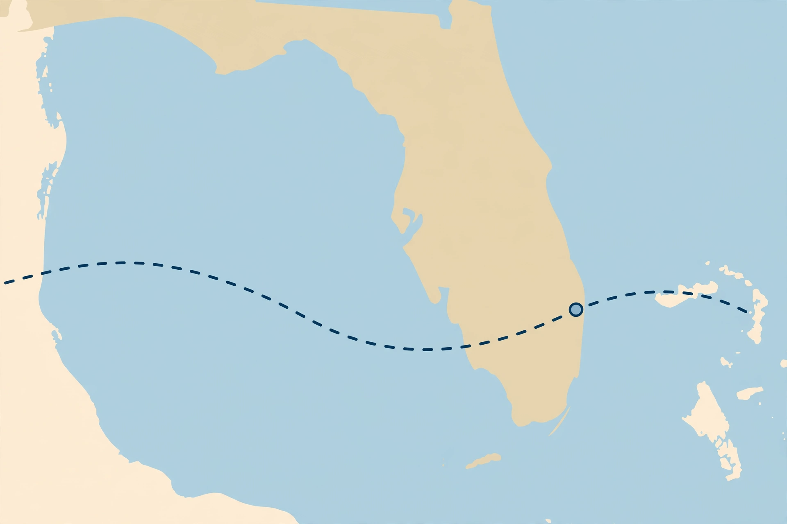
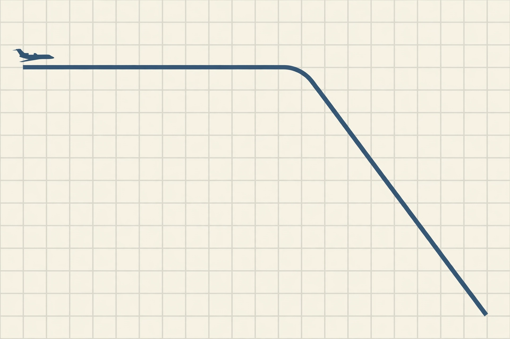

# 佛罗里达公务机坠毁：机上9人全部遇难，NTSB主导调查，事故原因未定

**新闻稿，2026年11月2日整理。以下已确认的事实与尚未确认的说法分开写，事故原因以美国国家运输安全委员会（NTSB）的调查结论为准，本文不预断原因。**

## 已确认：时间、地点、航线、遇难人数

美国东部时间2026年11月1日约12时50分，一架Learjet 60公务机在佛罗里达州棕榈滩县坠毁。美国联邦航空管理局（FAA）说，飞机坠落在克雷斯特黑文（Cresthaven）附近的居民区，地点在军事小径（Military Trail）介于克雷斯特黑文大道与北第10大道之间，靠近格林埃克斯（Greenacres）和棕榈泉（Palm Springs），在西棕榈滩机场以南约4英里处，是一片非建制地区。飞机撞击后起火，碎片散落范围广，社交媒体上的现场画面显示多处起火和一个撞击坑，棕榈滩县警长办公室封闭了该段军事小径的全部车道。

飞机注册号为N722BD，2004年制造的Learjet 60，序列号60-271，FAA登记的持有人为特拉华州一家有限责任公司。FAA说，飞机从得克萨斯州奥斯汀-伯格斯特龙国际机场起飞，目的地是巴哈马北伊柳塞拉机场。美国交通部长肖恩·达菲确认，机上9人全部遇难，并称这是一场“可怕的悲剧”。截至11月1日晚间的报道，机上9人的身份、乘客与机组人数构成尚未公布，地面是否有人伤亡尚未确认，附近移动房屋社区约600名居民因调查需要被疏散（该疏散人数为当时报道，尚未见NTSB正式确认）。

## 飞行轨迹：先降到35000英尺，随后急速下降

Flightradar24的记录说，飞机于世界协调时15时37分从奥斯汀起飞，向东飞往巴哈马，飞行早期曾在约41000英尺巡航；17时35分在那不勒斯附近开始下降到35000英尺；17时48分曾短暂爬升，随后进入陡峭的向右下降。Flightradar24收到的最后高度数据为17时49分22秒的8750英尺，下降过程中报告的垂直下降率超过每分钟32000英尺。ADS-B Exchange的追踪数据被多家媒体引用，说飞机在信号中断前约1分钟内下降了约27000英尺（约8230米）。这些是飞行追踪数据，不是NTSB的最终结论，两种数据口径不同，本文同时列出，不把它们拼成一条确定的高度曲线。

## 空管录音：已流传，但不是官方结论

在X上流传的空管录音（LiveATC.net收录、Flightradar24复核的部分内容）显示，机组曾报告结冰、中度颠簸和降水，请求“更好的飞行条件”，并请求爬升到37000英尺。另一段在X上广泛转发的55秒录音（Heated Reports制作的波形视频，非坠机实拍）中，飞行员发出Mayday呼叫，报告下降率从每分钟10000英尺上升到20000英尺、再到22000英尺，机身倾斜60度，空管回答“高度由你自行决定”“我在这里陪着你，跟我说话”，随后通讯中断。X帖子中还提到，飞行员此前报告机外温度约零下47摄氏度。

**必须说明：以上录音内容是流传的空管录音和媒体转述，不是NTSB发布的正式通话记录，也不能据此认定事故原因。** 结冰、颠簸、天气是否导致失控，NTSB尚未作出结论。11月1日西棕榈滩地区天气为阴天、有雨和闪电，东风约15英里/小时、阵风25英里/小时，能见度7英里，附近曾有较强雷雨单体——这些是当时的天气报告，不是原因认定。

## 调查：NTSB主导，11月2日计划开记者会

FAA和NTSB正在调查，NTSB主导调查并提供后续更新，FAA提供支持。NTSB已派出调查组，调查人员于11月1日和11月2日上午陆续抵达现场，并计划于11月2日（周一）在西棕榈滩举行媒体简报会，具体时间和地点在11月1日晚间的报道中尚未公布。调查将涉及飞行数据、空管通话、天气、飞机系统和维护记录等，本文整理时尚未见NTSB发布的初步原因。

有媒体引用NTSB记录和飞行安全基金会数据说，这是美国今年境内伤亡第二惨重的空难，仅次于今年6月密苏里州巴特勒跳伞飞机坠毁事故（12人死亡），也是涉及Learjet 60的最严重事故——该比较为媒体引用数据，本文仅作转述，不作独立核实。

## 相关视频（外链，非本仓库复制）

- 触发本稿的X帖子：Little Lee 小李子（@LittleLee_x），2026年11月2日8时37分（页面未注明时区），https://x.com/LittleLee_x/status/2117053556599521674
- 该帖引用的空管录音波形视频：Heated Reports，https://x.com/heatedreports/status/2116994731741954133/video/1 （画面为黑色背景上的绿色音频波形和英文通话字幕，非坠机实拍）
- 同一账号此前的相关帖子（截断显示，称坠机时间为11月1日中午12时50分左右）：https://x.com/LittleLee_x/status/2117017507009786370

## 本仓库视频（人工智能生成示意图，非实拍）

<video src="../video/route-schematic.mp4" controls width="640"></video>

上面视频为本仓库自制的航线示意图动画（10秒，缓慢拉远），仅用于示意奥斯汀—西棕榈滩—巴哈马的方向关系，**不是坠机实拍，不是飞行记录仪画面，不含爆炸画面**。GitHub页面上如不能直接播放，可下载 `video/route-schematic.mp4` 查看。

## 来源

- 美国联邦航空管理局（FAA）事故声明，经《今日美国》/《棕榈滩邮报》报道：https://www.usatoday.com/story/news/nation/2026/11/01/florida-plane-crash-learjet-palm-beach/92552816007/
- CNN报道（机上人数、航线、调查、NTSB记录比较）：https://www.cnn.com/2026/11/01/us/south-florida-plane-crash?cid=external-feeds_iluminar_meta
- Flightradar24博客（航迹、高度、空管录音复核、飞机信息）：https://www.flightradar24.com/blog/flight-tracking-news/major-incident/learjet-60-crashes-near-west-palm-beach-florida/
- 新华社纽约11月1日电，经新浪新闻转载（时间、遇难、疏散、空管录音、航线）：https://k.sina.cn/article_1644114654_61ff32de02002ctc2.html?from=news&subch=onews
- X帖子Little Lee 小李子（触发本稿，空管录音55秒视频链接）：https://x.com/LittleLee_x/status/2117053556599521674

**编辑说明：** 本稿由Muse根据上述公开报道整理，配图和视频均为人工智能生成的示意图/示意动画，已在图注和视频说明中注明，不是现场照片或实拍视频；未复制新闻机构或X上的现场照片、视频文件，相关实拍和录音请通过上面外链查看原文。机上人员身份、地面伤亡、事故原因等未确认信息，本文均按“尚未确认/尚未公布”处理，待NTSB后续通报后再更新。
