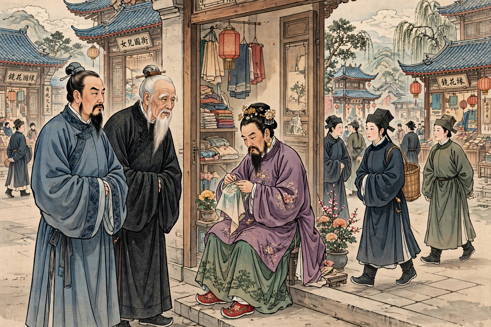
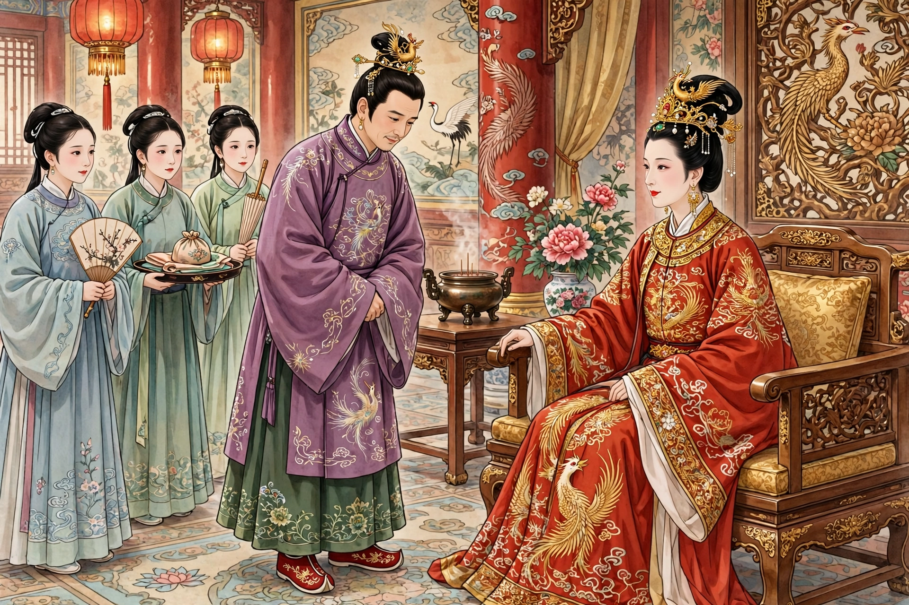
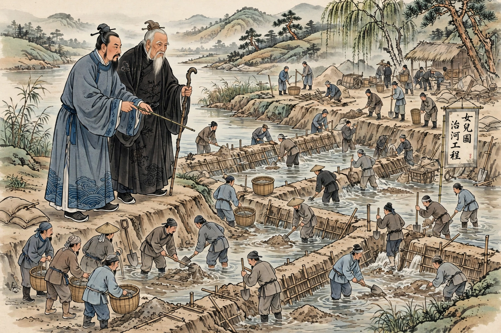
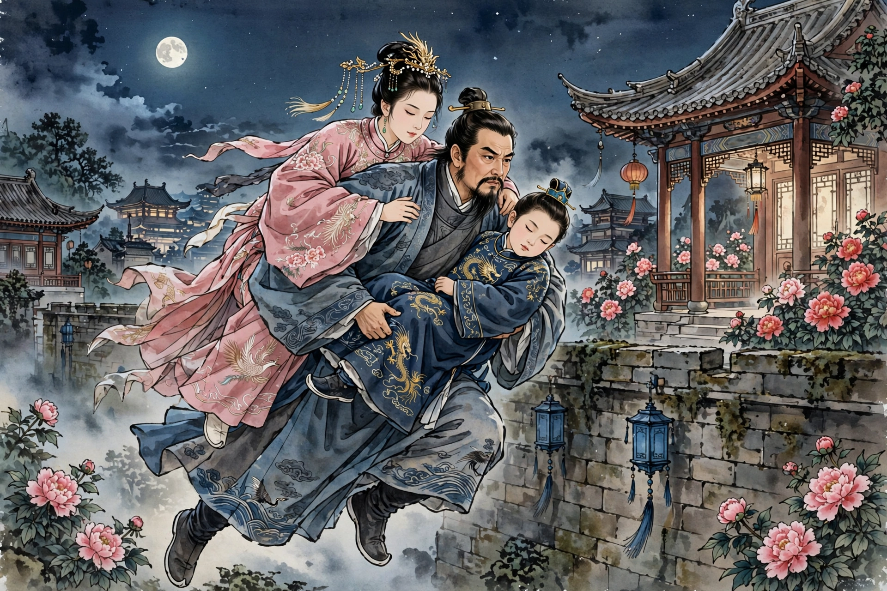

# 女儿国：林之洋被立为王妃，唐敖治河救人

出处：《镜花缘》第三十二回至第三十七回，清代李汝珍著。本篇由 Muse 改编为白话故事，情节、人物、结局均按原著，不增删，不改动。

配图为人工智能生成示意图，不是照片。同一个人（唐敖、林之洋、多九公、女儿国国王、世子阴若花）在各图中保持同一张脸、同一套衣服。

发布状态：头条号“浠水文艺”已于 2026-10-28 11:55 提交发布，状态为审核中，公开链接待审核通过后补充。

---

出处：《镜花缘》第三十二回至第三十七回，清代李汝珍著。本篇由Muse改编为白话故事，情节、人物、结局均按原著，不增删，不改动。当前做的是古文改白话系列，讲女儿国男女颠倒、林之洋被封王妃、唐敖治河救人的故事，配图为人工智能生成示意图。请看。

唐敖、林之洋、多九公乘船在海外行走，行了几日，到了女儿国泊岸。唐敖起初不敢登岸，因为他听说唐太宗命唐三藏西天取经，路过女儿国时几乎被国王留下。多九公解释说：这个女儿国不是那个女儿国，这里历来本有男子，男女配合，只是男子反穿衣裙，在家里管内事，女子反穿靴帽，在外面管外事，内外的分工和别处正好相反。这里最喜欢打扮妇人，喜欢缠足，脂粉是少不了的。

唐敖和多九公登岸一看，果然处处颠倒：外表穿男装的人，不论老少，都没有胡须，说话却是女音，身段瘦小，袅袅婷婷；外表穿女装的人，却多半是男子。有一名中年男子坐在小户人家门内做针线、绣花：青丝黑发油亮，梳着盘龙鬏，鬓旁珠翠，耳上坠着八宝金环，穿玫瑰紫长衫、葱绿裙子，裙下露出三寸金莲、大红绣鞋，满面脂粉，却长着一部络腮胡子，声音老声老气，像破锣一样，反骂唐敖是“妇人”“蹄子”，说他面上有须、穿衣戴帽，是混充男人。街上的女装男子举止和别处妇人一样，裙下露出小小金莲，腰肢颤巍巍，躲躲闪闪，娇羞作态，也有怀抱、领着小儿的；其中中年女装男子有的胡须多，有的胡须少，有的全无胡须，为充少妇而把胡须拔得一毛不存，唐敖和多九公戏称为“人鞟”，有的用药染黑，面上有墨痕，戏称为“墨猪”。唐敖和多九公还看了为河道壅塞所张的榜文，唐敖因此先注意到这个国家的河患。

*图1：女儿国街头，唐敖、多九公看做针线的女装男子，女装男子与男装女子同街*

林之洋带着货单进城卖货，先到几个行店，恰逢当地缺货；因为价钱给得过少，又拿到大户人家；大户指引他去国舅府，说府中人多，须用的货物必多。货单上主要是脂粉、梳篦等妇女所用之物，具体问价的有胭脂、香粉、头油、头绳，按担计算，翠花、绒花、香珠、梳篦，按盒计算。在国舅府，管门人把货单呈进，里面传话：连年国主采选嫔妃，正须此货。内使拿着货单，带林之洋穿过几层金门、许多玉路，到了内殿门首。内使多次往返问价后说：国主大约多寡不等都要买些，但价钱问来问去恐怕有讹错，必须面讲；又说国主因为林之洋是天朝妇人，天朝是上邦，所以命他进内，并嘱咐“须要小心”。

林之洋见了国王：国王虽有三十岁以外，生得面白唇红，极其美貌，十指尖尖拿着货单，问遍各样价钱，一面问话，一面细细上下打量。宫娥请用膳后，国王吩咐内使把货单存下，先去回复国舅，命宫娥款待天朝妇人酒饭，自己转身回宫。饭后几个宫娥把林之洋带到一座楼上；随后许多宫娥跑上楼，口呼“娘娘”，叩头叩喜，又捧来凤冠霞帔、玉带蟒衫、裙裤簪环首饰，不由分说把他内外衣服脱净。细问宫娥才知道：国王已将他封为王妃，等选了吉日就要进宫。林之洋被留下的缘故，是他面如傅粉，又在厌火国被烧去了胡须，被国王当作年轻的天朝妇人；唐敖在先前也已担心“他们要把他当作妇人”。

宫娥预备香汤替他洗浴，换袄裤，穿衫裙，一双“大金莲”暂且穿上绫袜；头上梳鬏儿，搽许多头油，戴凤钗；搽一脸香粉，嘴唇染得通红；手戴戒指，腕戴金镯；安好床帐请他上坐。林之洋如做梦、如酒醉，只是发愣。接着几个中年宫娥身高体壮、满嘴胡须走来，其中白须宫娥手拿针线，跪禀“奉命穿耳”。四个宫娥紧紧扶住林之洋。白须宫娥先把右耳穿针处用手指碾几碾，一针穿过；林之洋大叫“疼杀俺了”，往后一仰，幸被扶住；左耳同样用手碾几碾，一针直过，林之洋喊叫连声。两耳穿过后用铅粉涂上，揉几揉，戴上一副八宝金环。

接着是第一次缠足。黑须宫人手拿一匹白绫，跪禀“奉命缠足”；两个宫娥跪地扶住“金莲”，脱去绫袜；黑须宫娥取矮凳坐下，把白绫从中撕开，先把林之洋右足放在自己膝盖上，用白矾洒在脚缝内，把五个脚趾紧紧靠在一处，又把脚面用力曲作弯弓一般，就用白绫缠裹；才缠两层，就有宫娥拿针线上来密密缝口，一面狠缠，一面密缝。林之洋身旁有四个宫娥紧紧靠定，两个宫娥扶脚，丝毫不能转动。缠完只觉脚上如炭火烧一般阵阵疼痛，不觉心酸，放声大哭“坑死俺了”。两足缠过后，众宫娥草草做一双软底大红鞋替他穿上。林之洋随即央求宫娥在国王面前方便，说自己本是有妇之夫，怎作王妃，两只大脚如多年未曾岁考的游学秀才，放荡惯了，何能拘束，只求早放出去；宫娥回答：国主已吩咐把足缠好就请娘娘进宫，此时谁敢乱言。

夜间林之洋被两足疼醒，把白绫左撕右解，费尽力气扯下，十个脚趾个个舒开，觉得如秀才免了岁考般松动，沉沉睡去。次日黑须宫娥要再缠足，见两足已脱精光，连忙启奏；国王命保母过来重责二十，并在彼严行约束。保母是长须妇人，手捧约三寸宽、八尺长的竹板，带四个微须妇人手下；手下拖翻林之洋，褪下里衣，保母举板向屁股、大腿一路打去。刚打五板，已肉绽皮开、血溅茵褥，保母怕打到二十会伤贵体、误吉期，托缠足宫人转奏；国王问王妃此后可遵约束，如痛改前非即免责放起，林之洋怕打，只得说“都改过了”。众人歇手，擦血迹，国王赐棒疮药和一盏定痛人参汤；敷药、吃汤后立时止痛，缠足宫娥把足重新缠好，教他下床来往走动。宫娥搀着走几步，棒疮虽好，两足甚痛，刚要坐下就有人要启奏，只得勉强走来走去如挣命一般；夜间不时疼醒，整夜不能合眼，日夜都有宫娥轮流坐守，从无片刻离人。林之洋此时只觉“湖海豪情，变作柔肠寸断”。

众宫人今日也缠，明日也缠，并用药水熏洗，未及半月，已把脚面弯曲折作两段，十指俱已腐烂，日日鲜血淋漓。林之洋在疼痛中被宫娥又搀着行走，气恼夹攻，暗想与其零碎受苦不如一死，奔到床前坐下，任凭解劝，口口声声只教保母去奏国王，情愿立刻处死，若要缠足至死不能，并摔脱花鞋，把白绫用手乱扯。保母启奏后奉国王命到楼上说：王妃不遵约束，不肯缠足，即将其足倒挂梁上。林之洋已将生死付之度外，说“越教俺早死，俺越感激，只求越快越好”。刚把两足用绳缠紧已痛上加痛，吊起后身子悬空，眼中金星乱冒，满头昏晕，冷汗直流，两腿酸麻；只等气断身亡，不料越吊越明白，两足如刀割针刺，咬牙左忍右忍不住，杀猪般喊叫，只求国王饶命；保母启奏后放下。从此林之洋只得耐心忍痛，不敢违拗；宫娥为早见功效、讨国王欢喜，更不顾死活用力狠缠；他屡次要寻自尽，无奈众人日夜提防，真是求生不能、求死不得。不知不觉，足上腐烂血肉都变成脓水流尽，只剩几根枯骨，两足甚觉瘦小；头上乌云用各种头油搽得光鉴，身上每日香汤熏洗打磨干净，两道浓眉修得弯弯如新月，再加朱唇点血脂，映着粉面，满头朱翠，倒也窈窕。保母启奏“足已缠好”，国王亲自上楼看，见他面似桃花、腰如弱柳、眼含秋水、眉似远山，越看越喜，从身边取出一挂真珠手串替他亲自戴上，拉起，携手并肩坐下，又把金莲细细观玩，头上身上各处闻一遍，抚摸半晌。林之洋满面羞惭，满面通红，坐立不安，羞愧要死。国王回宫后选定吉期，明日进宫，并命理刑衙门释放罪囚。林之洋盼唐、多二人来救而毫无影响，想起妻子心如刀割，哭了一夜；两只“金莲”已被缠得骨软筋酥，如酒醉般毫无气力，每逢行动总要宫娥搀扶。次日吉期，宫娥绝早替他开脸、梳裹、搽胭抹粉更比往日殷勤；“金莲”虽觉微长，但缠得弯弯，下面衬高底，穿一双大红凤头鞋倒也不大不小；身上穿蟒衫，头戴凤冠，浑身玉佩叮当，满面香气扑人。各王妃来贺喜，下午宫娥替他穿戴齐整，伺候进宫；宫人执珠灯跪禀吉时已到，请娘娘先升正殿伺候国主散朝以便行礼进宫，请升舆。林之洋如头顶打霹雳，魂灵吓飞，仍被宫娥不由分说搀扶下楼，上了凤舆，无数宫人簇拥到正殿，国王已散朝，里面灯烛辉煌；林之洋颤颤巍巍如鲜花一枝走到国王面前，弯腰，拉袖，深深万福叩拜，各王妃也上前叩贺。正要进宫，忽听外面闹闹吵吵，喊声不绝，国王惊疑不止。

*图2：宫中，凤冠霞帔的林之洋与女儿国国王，宫娥在旁*

林之洋当晚未归，唐、多二人提灯笼上岸找，城门已闭；次日又寻访，仍无踪影；第三日带几个水手分头寻找，也是枉然；一连找数日如石沉大海，吕氏同婉如哭得死去活来。后来多九公分头打听，恰遇国舅府中内使，才知林之洋因国王看货欢喜，留在宫内封为贵妃，因脚大，奉命把足缠好方择吉日成亲，脚已裹好，国王择定明日进宫；吕氏听罢哭晕。吕氏向唐、多二人叩头求救丈夫之命。多九公说：他已恳内使求国舅转奏，情愿把船上货物尽数孝敬，赎林之洋出来；内使虽转求，但国舅因吉期已定，万难挽回，不肯转奏。唐敖想出的办法是写几张哀怜呈词到各衙门递去，希望遇到忠正大臣敢向国王直言谏诤；二人分写几张，连饭也不敢吃就进城，但遇衙门就递，结果里面看过仍旧发出，说“这不干我们衙门之事，你到别处递去”，一连几十处都是如此，饿着跑到日暮回船。多九公又提议：倘能另改吉期，就用船上货物银钱到邻邦，尽其所有馈送那国王，恳其代为转求；但二人进城打听时，四处传说今日国主收王妃进宫、释放罪囚、各官都叩贺去了，唐、多二人只觉心冷如冰。

二人在茶坊遇起课的人，唐敖抽签问这段婚姻可能不成、在难中的人可逃得出否；起课的人说“红鸾”发现，该有婚姻之喜，但遇“空亡”，虚而不实，将来各栖一枝，不能鸾凤和鸣；又说此人灾难已满，指日即有救星，但要脱火坑还须耽搁十日。随后二人见国舅内使押着几十担礼物过去，打听得是国舅因今日王妃进宫，送礼预备王妃赏赐宫人。信步又到张挂榜文处，唐敖猛然心急，把榜揭下。看守人役问他是何处妇人，擅揭此榜，榜上话可看明；众百姓闻有人揭榜登时四方轰动，老老少少无数百姓围观。唐敖朗声说：他姓唐，乃天朝人氏，从外洋至此，治河一道天朝无人不晓；今路过贵邦，见国王榜上备言连年水患、人民被害，如邻邦君王治得河道，小民得免水患，情愿纳贡臣服，若邻邦臣民能治得河道，财宝禄位悉听择取，说得甚觉诚恳，因此不辞劳瘁特来治河，与百姓除患。许多百姓跪地求天朝贵人大发慈心，早赐救拔。唐敖说：他虽能治河，但财宝禄位天朝那样不有，这些都不要；只要百姓依他一事，他就即日兴工。百姓问何事，唐敖说：小可有个妻舅，前因卖货进宫，现被国王立为王妃，吉期定于今日；百姓如要治河，大家即到朝前哭诉，放了此人，他即兴工；如国王不以民命为重，不肯放他，纵让财宝如山他亦不愿，只好回乡去了。围观百姓一闻此言齐声喊，齐向朝门而去；人役也去回本官。看榜人役备轿马把唐敖送到迎宾馆，多九公充作仆人跟在后面。

多九公私下问唐敖果然晓得治河否，唐敖说小弟并未做过外工朋友，那知治河；此番揭榜虽觉孟浪，但因要救舅兄，不得已做了“火烧眉毛，且顾眼前”之计；此时众百姓前去，大约国王难违众情，必是暂缓吉期；明日小弟看过河道，只好设法酌量；倘舅兄五行有救，自然机缘凑巧，河道成功；如光景不佳，不能结局，即烦九公把船上货物馈送邻邦，求其拯救。

国王正受嫔妃朝贺，忽闻朝门喊声惊疑不止；宫人奏国舅有要事面奏，国王命众人暂避，传国舅进。国舅奏：天朝妇人揭榜，能修河道，因主上把他亲戚立为王妃，意欲恳求释放才能兴工；众百姓现聚数万人齐集朝门，吁求主上俯念数十万生灵为重，释放此人以便即日兴工，救拔生民免于涂炭。国王说：我国向例凡庶民人家从无再醮之妇，何以孤家身为人君反令王妃违此定例？国舅说：他已剀切晓谕百姓“向来国中庶民既婚后尚且不准改节，何况君上乃一国之主，岂有放回王妃之理”，但百姓因吉期虽是今日，王妃尚未进宫，与业已进宫不同，所以才敢吁恳施恩。国王无言可答，忖多时说：既如此，卿就出去回复众民，说寡人业已进宫，今日不能启奏，到了明日木已成舟，众百姓也不能求我释放，我也有词可托了。国舅再三恳求，国王执意不肯，国舅退出回复众人；众百姓惟恐到了明日就难挽回，登时鼓噪，乱乱轰轰喊成一片。国王听见外面如此心中害怕，明知自己理亏，意欲释放又难割舍；忽听外面人声渐渐闹进宫来，发恨说索性“一不做二不休”，命值殿尉官率领军兵十万立时征剿；尉官点兵，四面枪炮声震山摇地动。众百姓不肯退，说与其日后丧在鱼鳖之口，不如今日被国主杀了倒也干净，哭哭啼啼，喊声震天。国舅见百姓势头已急，惟恐人多激变，吩咐众兵无许动手伤人，又再三劝百姓散去，说老夫自然替你们转奏，务将揭榜人留下修治河道，明日府中候信，老夫自有道理；百姓这才慢慢散去，尉官收兵。国王见百姓已散随即进宫，命林之洋并肩坐了，映灯光细看，见林之洋体态轻盈、娇羞满面、愁锁蛾眉，十分美貌，心中大喜，看自鸣钟后娇声说：你同我已订“百年之好”，为何面带愁容？你今得了如此遭际也不枉托生女身一场，你今做了我国第一等妇人还有什么不足？日后倘能生得儿女享福日子正长；你与其矫揉造作装作男人，倒不如还了女装同我享受荣华；我们且饮两杯。宫人赐许多珠宝金银，酒席齐备。林之洋心如死灰，想起妻女如万箭攒心，又连日茶饭不吃，精神恍惚，四肢无力，接喜酒杯时战战兢兢，浑身发抖，酒杯如千斤之重递不过去，勉强时四肢发酸，手一松酒杯落在桌上；宫娥又斟一杯，他又把酒洒了，众宫娥只得替他代敬国王；国王命人也给林之洋斟一杯放在唇边，勉强饮了，随后又一杯以为成双之意。林之洋素日酒量虽大，但近来腹中空虚，饮过只觉天旋地转，幸而还未醉倒；国王又饮数杯，命人把表取过看一看，吩咐撤去筵席，桃腮带笑、醉眼朦胧说“天不早了，我同你睡罢”；众宫人把林之洋外面衣裙宽了，首饰除去，国王也宽外面衣服，伸玉手携林之洋手腕上了牙床，放下鲛绡帐，竟自睡了。叙事者在此处写“这里国王业已成亲”。

唐敖在迎宾馆等候，几个年老百姓从朝中回来把尉官点兵征剿的话说了，唐敖惊慌失色；国舅差内使押送铺盖，拨许多人役伺候，说今日天晚不能过来，明日上朝见过国主就来面商修治河道。次日守候国舅到夜深也不见来，多九公打听得众百姓已把国舅府围得水泄不通，在那里候信；又次日清晨，多九公说林之洋同国王成亲今已两日，再过几日倘恭喜怀了身孕，唐敖是国王妻妹婿，岂不要送喜蛋。国舅那边：自安顿众百姓后次日上朝，国王只推有病总不见面，国舅急得走出走进毫无主意，又闻府中已被众百姓团团围住专等治河回音，又不敢回府，又恐唐敖走脱，派许多兵役在城门把守，又差人时刻送酒送菜到迎宾馆，挑几担鱼肉鸡鸭送到唐敖船上。第二日天将发晓，国王起来大为不乐，把国舅宣来问揭榜妇人可在否；国舅奏此人现在宾馆，因国主没有示下，大约今日就要回去。国王说：他果能治河，我念生灵为重原可施恩把王妃释放；不知他治的究竟如何，莫若着他河路治好，再放王妃回去；倘修治不善，不能完功，虚费银两，即将王妃留在此处，日后照数拿银来赎；国舅以为何如？国舅满心欢喜说：主上如此办理，既不虚糜帑项，又安众民之心，倘河道成功也除通国大患，真是一举两便；国王说就照此办去。国舅到迎宾馆见唐敖，寒暄后却另作一套说法：昨日众百姓齐集朝门备言贵人因念敝邦水患特来救援，老夫适值朝中有事不能趋陪；至令亲因在王府卖货忽染重恙，现在仍未获痊，俟略将养自然即送归舟；至立王妃之说系小民讹传，断断不可轻信；但治河一事不知贵人有何高见？唐敖答：贵邦河道受病之由小子尚未目睹，不敢谬执臆见；若论大概情形，当年治河的莫善于禹，吾闻禹疏九河，这个“疏”字却是治河主脑：疏通众水，使之各有所归，所谓“来有来源，去有去路”，根源既清，中无壅滞，自然不至为患；将来还望国舅大人指教。国舅连连点头。

国舅次日陪唐敖出城看河一连两日。唐敖说：此河受病处就是前日所说那个“疏”字缺了；两边堤岸高如山陵，河身既高且浅，形像如盘，受水无多以至为患；总因水大时惟恐冲决漫溢，且顾目前之急，不是筑堤就是培岸，水小时并不预为设法挑挖疏通，水势略大又复培壅，年复一年河身日见其高；若以目前形状而论就如以浴盆置于屋脊之上，一经漫溢以高临下，四处皆为受水之区，平地即成泽国；若要安稳必须把浴盆埋在地中，盆低地高既不畏冲决，再加处处深挑，以盘形变成釜形，受水既多自然可免漫溢之患。国舅称浴盆屋脊之说尤其对症，真是指破迷团，求贵人大发恻隐早赐拯拔，免“屋脊”之祸，水由地中行，永庆安澜。唐敖又说：当地向来铜钱甚少，兼且禁用利器以杜谋为不轨，国中所用大约竹刀居多，惟富家间用银刀亦甚希罕，所有挑河器具一概不知；幸而船中带有生铁，制造尚易。施工之难在于堤岸日积月累培壅过高，下面虽可深挑而出土费事，倘能集得数十万人夫一面深挑，一面去其堤岸，使两岸之土不致壅积方能易于藏事；国舅说人夫只管放心，此地河道为患已久，居民被害已深，闻贵人修治河道虽士商人等亦必乐于从事，况又发给工钱饭食。关于东首刷淤处，唐敖说：凡河有淤沙，如欲借水势顺溜刷淤，河形必须如矢之直，其淤始能顺溜而下；昨看那处河路不直，多有弯曲，其淤遇弯即停，何能顺溜而下；再者刷淤处不但要直，并且还要由宽至窄，由高到低，其淤始得走而不滞；假如西边之淤要使之东去，其西口面如宽二十丈，必须由西至东渐渐收缩不过数丈，是宽处之淤使由窄路而出，再能西高东低，自然势急水溜，到了出口时就如万马奔腾一般，其淤自能一去无余；今那处不但处处弯曲，而且由窄至宽，事机先已颠倒，以为越宽越畅，那知水由窄处流到宽处业已散漫无力，何能刷淤，无怪越积越厚，水无去路。国舅连连点头，问开工吉期；唐敖说此时必须先造器具，明日国舅多派工匠过来，俟器具造齐再择吉期开工。唐敖把器具样儿画出，托多九公照应把铁发来；次日许多工人传到，唐敖把样儿一一指点，登时开炉打造；众工人虽系男装，究竟是些妇女，心灵性巧，只消略为指点全都会意，不过两三日都造齐备，择了开工吉期。开工当日国舅同至河边，唐敖命人逐段筑起土坝：先把第一段之水车到第二段坝内，即将第一段挖深通，就把第二段土坝推倒，将水放入第一段新挑深坑之内，再挑第三段，逐段都动起工来，总是尽力深挑；后来所挖之土一时难上岸，仍命工人把筐垂入坑内，用辘轳搅上，每取土一筐要费许多气力；好在众百姓年年被水患闹怕，此番动工举国之人齐来用力，一面挑河，一面起堤，不上十日早已完工；又把各处来源去路也都挑挖疏通。唐敖指点监工，早起晚归，日夜辛勤，人人感仰；早有几个老者出来攒凑银钱，仿照唐敖相貌立了一个生祠，又竖一块金字匾额，上写“泽共水长”四个大字。

*图3：河边，唐敖、多九公指点工人分段筑坝深挑疏浚*

林之洋那日同国王成亲，上了牙床，忽然想起当日在黑齿国妹夫同他玩笑说他被女儿国留下，今日果然应了；那时九公曾说设或女儿国将你留下你却怎处，他随口答“他如留俺，俺给他一概弗得知”，这话也是无心说出，其中定有机关；今日国王既要同他成亲，莫若他就装作木雕泥塑，给他们弗得知，同他且住几时，看他怎样。他心心念念只想回家，想起妻子身如针刺，泪似涌泉；又想自从到此被国王缠足、穿耳、毒打、倒吊种种辱没，九死一生，国王恁般狠毒明是冤家对头，躲还躲不来，怎敢亲近；灯光下看国王虽是少年美貌，只觉从美貌中透出一股杀气，虽不见他杀人，那种温柔体态倒像比刀还觉利害，越看越怕，惟恐日后命丧他手，更是心冷如冰，体软如绵；一连两夜国王费尽心机，终成画饼；国王虽觉扫兴气恼，因河道一事究竟牵挂，不敢把他奈何；后来同国舅议定治河一事，思来想去留此无用，只得把他送归楼上，索性把缠足、抹粉一切工课也都蠲了；林之洋得了这道恩赦，虽未得归故乡，暂且脚下松动。众宫娥知他日后仍回天朝，并非本国王妃，那个肯来照管，往往少饭无茶，十分懈怠；幸亏世子日日前来照应，茶饭始得充足。

世子先后来送信：儿臣闻得天朝有位唐贵人来此治河，俟河道治好，父王即送阿母回去，望阿母放心；林之洋把世子搀起细问才知揭榜一事，垂泪说蒙小国王念他被难前来送信，倘骨肉团圆惟有焚香报大德，妹夫河道治完还求送他一信，更望在老国王跟前替他美言，早放他回去。世子替林之洋揩泪说阿母不须悲伤，再去探听，如有佳音即来送信。将及半月，两足虽已如旧，但穿上男鞋竟瘦了许多。世子匆匆走来说：唐贵人已将工程办完，今日父王出去看河十分欢喜，因唐贵人乃天朝贵客，特命合朝大臣、许多鼓乐护送归舟，并送谢仪万两；闻得明日即送阿母回船。林之洋欢喜说自老国王送回楼上，蒙小国王百般照应，明日回去不知甚时相见，只好将来再报大情。世子随即跪下垂泪求救：世子自从八岁蒙父王立储至今六载；不幸前岁嫡母去世，西宫阿母专宠，意欲其子继立，屡次陷害儿臣，幸而命不该绝；近日父王听信谗言，痛恨儿臣，亦有要杀儿臣之意；此时若不远走，久后必遭毒手；况父王指日即往轩辕祝寿，内外臣仆莫非两宫羽翼；儿臣年纪既幼，素日只知闭户读书，又无心腹，安能处处防备，一经疏虞性命难保；阿母如肯垂怜，明日回船将儿臣携带同去，倘脱虎穴自当衔环结草以报大恩。林之洋说：我们家乡风俗与女儿国不同，若到天朝须换女装，小国王作男子惯了怎能改得，就是梳头、裹脚也不容易；世子说儿臣情愿更改，只要逃得性命就是跟着阿母粗衣淡饭也情愿。林之洋说他带小国王同去，宫娥看见这便怎处，莫若等他回船，小国王暗地逃去岂不是好；世子连连摇头。林之洋后来又说：只要小国王办得严密，他自遵命；世子起初的计划是明日阿母上轿，儿臣暗藏轿内即可出去，但因耳目众多未能同去，才改约牡丹楼、十日为限。

次日国王命人备轿送林之洋回船，并命众宫娥替林之洋改换男装，伺候上轿；世子在旁看见人众惟有垂泪，十分着急，忙到轿前附耳说：此时耳目众多不能同去，儿臣之命全仗阿母相救，若出十日之外恐不能见阿母之面，儿臣住在牡丹楼，切须在意；送了几步，哽咽而去。林之洋回到船上，原来国王昨日备了鼓乐，已将唐敖、多九公护送回来；林之洋见唐、多二人惟有再三拜谢，吕氏、婉如、兰音也都相见，真是悲喜交集。林之洋说妹夫到海外原为游玩，那知是他救命恩人；他在那里受罪本要寻死，因得梦兆必有仙人相救才忍耐，今仙人还不赏光，却亏妹夫救他出来。多九公说这是林兄吉人天相，当日路过黑齿唐兄曾有“以德报德”之话，今日果然应了。唐敖问舅兄为何步履甚慢，难道国王果真要你缠足；林之洋又好笑又愧恨说：他把他硬算妇人做老婆也罢了，偏偏还要穿耳缠足，两脚好像才出阁的新妇，又像新进馆的先生，这些时好不拘束；偏那宫人要早见功，又用猴骨熬汤替他熏洗，今虽放得照旧，奈被猴骨洗得倒像多吃两杯，只觉害酒软弱，至今还是无力；当日上去卖货曾有一个喜蛛落在脚上，那知却是这件喜事。婉如说爹爹耳上还有一副金环，替你取下来；林之洋说那穿耳宫娥也不顾死活，揪着耳朵就是一针，今日想起还觉痛；这总怪厌火国囚徒把他胡须烧去，嘴上光光的，国王只当他年轻，才有这番灾难。林之洋又问闻得国王昨日送妹夫回船还有谢仪一万两可送来么，唐敖说久已送来。林之洋把世子屡次送信、诸事照应并后来求救各话备细说了。

唐敖说世子既有患难我们自应设法救他，况待舅兄如此多情尤当“以德报德”，且世子若非情急岂肯把现成国王弃了，反去改换女装投奔他邦；我们必须把他救出方可起身。多九公说“以德报德”自应如此，但如何设法必须商酌万全才好举行；林兄在宫多日路径最熟可有妙计？唐敖问这位世子可像歧舌世子，如会骑射就易设法；林之洋说世子虽是男装，他是女人，未必晓得骑射，妹夫如真心救他他倒有计，除了妹夫别人都不能；唐敖问何妙计，林之洋说据他主意：到了夜晚妹夫把他驮上一同攛进王宫，把世子救出岂不是好；唐敖问王宫甚大，世子住处舅兄知道么，林之洋说世子送他时说住在牡丹楼，他们那里牡丹甚高，到了开时都是登楼看牡丹，到彼只检牡丹多处找他自然见面。唐敖说今晚且同舅兄攛进王宫看是如何再作计较。多九公反对说林兄因感世子之情、唐兄只知惟义是趋，都是忿不顾身，竟把王宫内院视为儿戏；彼处既是宫院外面岂无兵役把守，里面岂无人夫巡逻，二位进去设被捉获不知又有什么良策，据老夫愚见还需慢慢商量，如此大事岂可造次；唐敖说小弟同舅兄至彼自然加意小心，相机而行，岂敢造次，九公只管放心。到了下午用过晚饭，唐敖换一件短衣，林之洋也把衣服换了；因向日所穿旧鞋甚觉宽大，即命水手上去另买一双合脚的；结束停当，天已昏黑。吕氏恐丈夫上去又惹是非，再三苦劝，林之洋不肯听，即同唐敖别了多九公踱进城来。走了多时到王宫墙下，四顾无人，唐敖驮了林之洋，将身一纵攛上墙头，四处眺望；只听里面梆铃之声络绎不绝，随即越过几层高墙，梆铃之声渐觉稀少；唐敖说此处鸦雀无闻甚觉清静，大约已到内院；林之洋说迎面这些树木想是牡丹楼，下去看看。唐敖随即攛入院内，林之洋轻轻跳下，方才脚踹实地，不防树林跳出两只大犬狂吠不止，把二人衣服咬住；更夫闻犬吠一齐提灯笼如飞而至。唐敖措手不及，连忙摔脱恶犬，将身一纵攛上高墙。众人赶到林之洋跟前提灯照，说原来是为女盗；内中有个宫人说你们不可胡说，这是国王新立王妃，不知为何这样打扮夤夜至此必有缘故，国主正在夜宴且去奏闻请令定夺；随即启奏，立刻带到艳阳亭。国王一见登时把怜香惜玉之心又从冷处热转过来说：孤家已命人送你回去，此时你又自来是何意见？林之洋无言可答惟有发愣。国王笑道：我知你意了，你舍不得此处富贵又来希冀孤家宠幸，你既有此美意我又何必固却，只要你从此把足缠小自然施恩收入宫内，你须自己要好莫像从前任性，将来，自有好处；吩咐宫人即送楼上改换女装，仍派从前宫娥照旧伺候，俟足缠好随即奏闻以便择吉入宫。众宫娥把林之洋搀到楼上，香汤沐浴，换了衣履，仍旧梳头、缠足。林之洋心想今日虽又被难，喜得妹夫未被捉获，他今攛在墙上必探他的住处前来相救；他且用话把宫人惊吓惊吓，省得两足又要吃苦；因说他今日情愿进宫，恨不能两足缠小好同国王成亲，不劳诸位混来动手，你们待他有情义他日后进宫也有情义，你们待他利害少不得他有报仇日子，他要得起时来莫讲你们几个臭宫娥，就是各宫王妃他要他命他也脱不过的。众宫娥听了，因想起当日启奏打肉各事惟恐记恨，一齐叩头只求王妃高抬贵手莫记前仇。林之洋说他只论以后不讲从前，你们莫怕只管起来，你们教他莫记前仇只要依他三件事。众宫娥说任凭多少无有不遵，不知那三件只管吩咐。林之洋说：第一件缠足、搽粉各事他自动手不准你们费心，可依得？众人说依得。第二件世子如来同他说话不劳你们立在眼前，可依得？众人说依得，请问第三件呢？林之洋说这里楼房许多你们另住一间，不要同他一房，这件可依得？众人默默无言。林之洋说想是怕他一人在内夜间逃走，也罢他在里间居住你们都在外间，里间楼窗每到夜晚你们上锁，把钥匙领出，这样严紧难道还不放心，他要逃走今日也不来了。众宫娥都一齐应这件也依得。于是忙忙乱乱各去张罗床帐，林之洋假意用力把脚裹了，众人才放心。天有二更众宫娥把楼窗锁好，领了钥匙各去睡了，不多时齁声如雷。将及三鼓林之洋睡在床上忽听楼窗有人弹指声，忙到窗前轻轻问外面是妹夫么；唐敖说他自从摔脱恶犬攛在高墙，后来见众人把你送到楼上他也就跟来，此时众人已睡，你作速开门随我回去；林之洋说楼窗上锁不能开放，若惊醒他们加意防备更难脱身，据他主意妹夫且去，明日他同小国王商量计策，你只看楼上挂有红灯即来相救，速速去罢；唐敖答应，只听嗖的一声去了。次日世子闻知前来探望，林之洋告知详细；世子感激涕零说恰好明日乃儿臣诞辰，阿母可吩咐宫娥备宴与儿臣庆寿，把宴送至儿臣那边自有道理；林之洋点头即命宫人预备送去。天将掌灯世子命宫人邀楼上众宫娥前去吃酒，众人闻世子赏宴个个欢喜都要争去，林之洋随命众人去了。世子见宫娥全到忙到楼上开了楼窗挂起红灯，忽从房上攛进一人；世子知是唐敖连忙倒身下拜；唐敖忙搀起问这位莫非就是世子么，林之洋连连点头；唐敖说事不宜迟我们走罢；于是把林之洋驮在背上，怀中抱了世子，将身一纵跳在墙上，一连越过几层高墙才攛到宫外；放下世子，林之洋也从肩上跳下。幸有微月上升尚不甚黑，三人一齐趱行，越过城池来到船上，见了多九公随即开船。世子换了女装，拜林之洋为父、吕氏为母；见了婉如、兰音十分相契。多九公问起名姓才知世子姓阴名若花。唐敖听见“花”字猛然想起当日梦中之事。

*图4：夜里，唐敖驮林之洋、抱世子翻墙出宫，牡丹楼在旁*

（全文按原著第三十二回至第三十七回情节逐段讲述，未删人物、未删情节、未改结局。配图为人工智能生成示意图，不是照片。）
