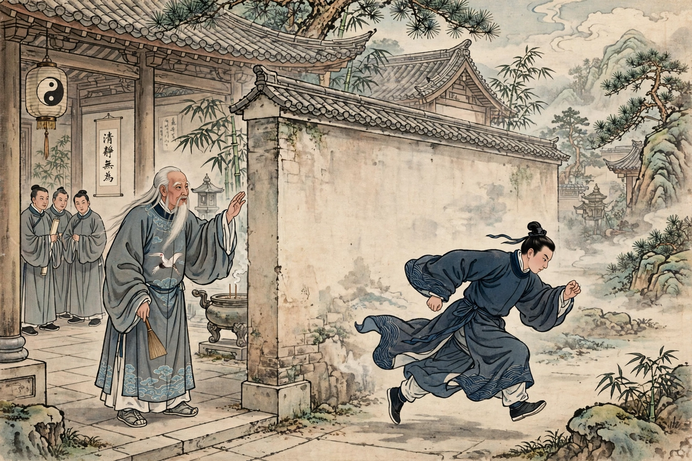

# 崂山道士

出处：《聊斋志异·崂山道士》，清代蒲松龄著。本篇由Muse翻译为白话故事，情节、人物、结局均按原著，不增删，不改动。古文改白话讲王生慕道、砍柴、学穿墙、回家撞墙的故事，配图为人工智能生成示意图。请看。

县里有个王生，在家里排行第七，是官宦人家的子弟。他从小就仰慕道术，听说崂山上有很多仙人，就背着书箱前去游访。他登上一座山顶，上面有一座道观，非常幽静。有一位道士坐在蒲团上，白发垂到衣领，神采却很爽朗明亮。王生叩拜他，和他谈话，道士讲的道理非常玄妙。王生请求拜他为师，道士说：“恐怕你娇生惯养，不能吃苦。”王生回答说：“能吃苦。”道士的门人很多，到了傍晚都聚集来了，王生一一向他们行礼，于是就留在了道观里。

清晨，道士叫王生去，给他一把斧子，让他跟着众人去砍柴。王生恭敬地接受了教导。过了一个多月，他的手脚都磨出了厚茧，实在受不了这种苦，心里暗暗有了回去的念头。一天晚上回来，看见有两位客人正和师父一起喝酒，天已经黑了，还没有点灯烛。师父就剪了一张纸，像镜子一样贴在墙上，过了一会儿，月光明亮地照满了屋子，连细小的毛发都能照见。众门人都围着观看，奔走着听。有一位客人说：“这样好的夜晚、这样好的音乐，不能独自享用。”于是在桌上拿起酒壶，分给众弟子，还嘱咐大家尽情喝醉。王生心里想：七八个人，一壶酒怎么能分给所有人呢？于是大家各自找了杯盏，争着喝干，生怕酒壶喝空了，可是来回倒酒，酒竟然一点也没有减少，他心里觉得奇怪。过了一会儿，有一位客人说：“承蒙赐给月明的照亮，就这样静静地喝，未免太寂寞了，何不把嫦娥叫来呢？”于是把一根筷子扔进了月光里。只见一位美人从光中走出来，起初还不到一尺长，到了地上就和人一样高了。她细腰秀颈，翩翩起舞，跳的是《霓裳舞》。跳完之后，她唱道：“仙仙乎！而还乎！而幽我于广寒乎！”她的声音清脆高远，响亮得像箫管一样。唱完之后，她盘旋着升起来，跃到桌子上，大家惊讶地回头一看，她已经又变回了一根筷子。三个人都大笑起来。又有一位客人说：“今晚最快乐，可是我已经不胜酒力了，能不能送我在月宫里喝酒呢？”三个人就把席子移过去，渐渐进入了月光里。众人看着三个人，坐在月光里喝酒，眉毛胡子都看得清清楚楚，就像影子在镜子里一样。过了一会儿，月光渐渐暗下来，门人点着蜡烛进来，只见道士一个人坐着，客人已经不见了。桌子上吃剩的菜果还在；墙上的月亮，不过是一张圆圆的纸，像镜子一样罢了。道士问众人：“喝够了吗？”众人说：“够了。”道士说：“够了，就应该早点睡觉，不要耽误了砍柴。”众人都答应着退下了。王生暗暗羡慕，回家的念头就此打消了。

又过了一个月，苦实在忍受不了了，可是道士并没有传授他一点法术。他心里等不下去了，就辞别说：“弟子走了几百里路，来向仙师学习，即使不能得到长生之术，或者稍微学到一点，也足以安慰求教的心了。如今过了两三个月，不过是早上砍柴、晚上回来。弟子在家里，没有体会过这种苦。”道士笑着说：“我本来就说你不能吃苦，现在果然如此。明天早上就送你回去。”王生说：“弟子干活已经很多天了，师父稍微传授一点小法术，这趟来也就不算白来了。”道士问：“想求什么法术？”王生说：“每次看见师父走过的地方，墙壁都不能阻隔，只要得到这个法术就足够了。”道士笑着答应了他。于是传给他一个口诀，让他自己念完咒，喊道：“进去！”王生面对着墙，不敢进去。道士又说：“试着进去。”王生果然从容地往前走，到了墙边就被挡住了。道士说：“低着头一下子进去，不要犹豫！”王生果然离开墙几步，奔跑着进去，到了墙边，墙像空无一物一样；回头一看，自己的身体果然已经在墙外了。他非常高兴，进去拜谢师父。道士说：“回去以后应当洁身自持，否则法术就不灵验。”于是资助他路费，送他回家。到了家里，他自己夸耀遇到了仙人，坚硬的墙壁也不能阻挡他，妻子不相信。王生就照着原来的样子做，离开墙几尺，奔跑着进去；头撞上了硬墙，猛地一下跌倒了。妻子扶着看他，额头上肿起一个大包，像大鸡蛋一样。妻子讥笑他。王生渐渐生气了，只骂老道士没有良心罢了。异史氏说：听说这件事，没有不大笑的，可是不知道世上像王生这样的人实在不少。现在有个粗鄙的人，喜欢毒疮的毒却害怕药石，于是就有人舔吸他的痈疽，进献逞威作暴的法术，来迎合他的心意，欺骗他说：“拿着这个法术往前走，就可以横行而没有阻碍。”起初试用，未尝没有一点小效果，于是就以为天底下这么大，都可以这样走了，势必不到撞上硬墙、跌倒了才肯罢休。

---

注：正文换行与原文段落完全一致，共 3 段，段内不另起行；图片只插在段落之间，不插断段内句子。
