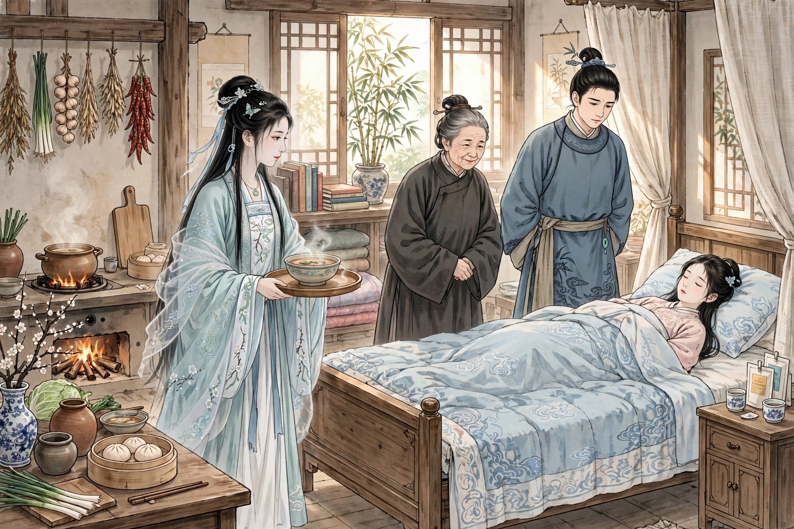
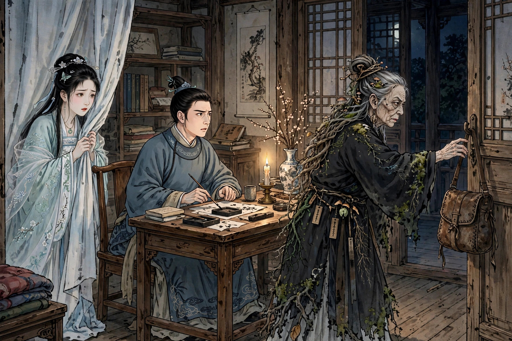

# 聂小倩：兰若寺的人鬼相救

出处：《聊斋志异·聂小倩》，清代蒲松龄著。本篇由 Muse 改编为白话故事，情节、人物、结局均按原著，不增删，不改动。

配图为人工智能生成示意图，不是照片。同一个人（聂小倩、宁采臣、燕赤霞）在各图中保持同一张脸、同一套衣服。

发布状态：头条号“浠水文艺”已于 2026-10-27 15:28 提交发布，状态为审核中，公开链接待审核通过后补充。微信公众号发布由用户用固定 IP 的服务器另行处理，本仓库不负责该渠道。X 英文版待用户新注册账号能登录后再发布。

---

出处：《聊斋志异·聂小倩》，清代蒲松龄著。本篇由Muse改编为白话故事，情节、人物、结局均按原著，不增删，不改动。当前做的是古文改白话系列，讲人鬼相救、仗剑除妖的故事，配图为人工智能生成示意图。请看。

宁采臣是浙江人，性格慷慨豪爽，讲究廉洁自重，常常对人说：“我这一生，从没有贪恋过女色。”有一次他到金华去办事，走到城北的郊外，在兰若寺卸下行装住下。寺里的殿塔还很壮丽，可是蓬蒿长得没过了人，好像已经很久没有人来往。东西两边的僧舍，门都虚掩着，只有南边一间小屋子，门锁还像新的一样。宁采臣又看殿东边角落，修竹不过合抱粗，台阶下有个大池子，野藕已经开了花。他很喜欢这里的幽静。正赶上学使巡视，城里的客店房价昂贵，他想着住在这里也方便，便在寺里散步，等僧人回来。

到了傍晚，有个书生来，开了南边小屋的门。宁采臣上前行礼，说明自己想借宿的意思。书生说：“这里没有房主，我也是寄居在这里的。你如果能忍受荒凉，早晚能得到你的指教，那就太好了。”宁采臣很高兴，便用草铺在地上当床，用木板支起来当桌子，打算长住下去。当天夜里，月光明亮高洁，清光像水一样，两个人并肩坐在殿廊上，各自报了姓名。书生自称姓燕，字赤霞。宁采臣怀疑他是来应试的书生，可是听他的口音，一点也不像浙江人。问他，他自称是秦地人，说话很朴实诚恳。两个人说到没话可说，才拱手告别，各自回房睡觉。

宁采臣刚到新地方，久久睡不着，听见屋北有人低声说话，像是有一家人住在那里。他起身，伏在北边墙的石窗下，悄悄往外看。只见短墙外有一个小院子，有个四十多岁的妇人，还有一个老妇人，穿着红色的衣服，插着蓬乱的头饰，背已经驼了，年纪很大，两个人在月下低声说话。妇人说：“小倩怎么这么久还不来？”老妇人说：“大概就快来了。”妇人说：“莫非她对姥姥有什么怨言吗？”老妇人说：“没听说，只是神色好像有点忧愁。”妇人说：“这丫头不该结交好朋友！”话还没说完，有一个十七八岁的女子来了，容貌艳丽绝伦。老妇人笑着说：“背后不说人。我两个正谈到你这个小妖婢，你悄悄来了，一点声响都没有，幸亏没有说你的短处。”又说：“小娘子真是画中人，纵使老身是男子，也要被你勾去魂魄了。”女子说：“姥姥不夸我，还有谁说我好呢？”妇人和女子又说了些什么，宁采臣听不清。他以为是邻居的家眷，就不再听了，回去睡觉。又过了一会儿，才寂静无声。

*图1：兰若寺北院月下，小倩提灯、四十多岁的妇人、红衣老妇、窗后偷看的宁采臣*

宁采臣正要睡去，觉得有人来到他的卧房。急忙起来仔细看，原来是北院那个女子。他惊讶地问她，女子笑着说：“月夜睡不着，愿意和你亲近亲近。”宁采臣正色说：“你应当顾忌别人的议论，我也害怕别人的闲话。稍微一失足，廉耻道德就丧失了。”女子说：“夜里没有人知道。”宁采臣又呵斥她。女子徘徊着，好像还有话要说，宁采臣喝道：“快走！不然，我就叫南舍的书生知道了。”女子害怕了，才退了出去。走到门外，她又返回来，把一锭金子放在褥子上。宁采臣拿起金子，扔到庭院的台阶上，说：“不义之物，玷污我的行囊！”女子惭愧地出去，拾起金子，自言自语说：“这个人真是铁石心肠。”

*图2：兰若寺夜里，小倩、宁采臣、桌上的金铤、门口提着剑囊的燕赤霞*

第二天清晨，有个兰溪的书生，带着一个仆人来应试，住在东厢房，到了夜里突然死了。他的脚心有个小孔，像锥子刺的一样，细细地有血流出来。大家都不知道是什么缘故。过了一夜，他的仆人也死了，症状也是一样。到了傍晚，燕生回来了，宁采臣问他，燕生认为是鬼怪。宁采臣生性刚直坦率，并不太在意。

到了半夜，女子又来了，对宁采臣说：“我见过的人很多了，从没有像你这样刚直的人。你真是圣贤，我不敢欺骗你。我叫聂小倩，姓聂，十八岁就夭折了，葬在寺旁边，却被妖物威胁，驱使着做低贱的差事。现在寺里没有可以杀的人了，恐怕就要派夜叉来了。”宁采臣惊骇地问她有什么办法。女子说：“和燕生同住一室，就可以免祸。”宁采臣问：“为什么不迷惑燕生呢？”女子说：“他是奇人，我不敢靠近。”宁采臣问：“迷惑人是怎么做的呢？”女子说：“和我亲近的人，我暗暗用锥子刺他的脚，他就迷迷糊糊了，我就吸他的血去供妖怪喝。或者用金子，那金子不是真的金子，而是罗刹鬼的骨头，留下来就能截取人的心肝。这两种办法，都是投合人的喜好罢了。”宁采臣感谢她，问她防备的日期，她回答说就在明天夜里。临别时，她哭着说：“我堕入深海，求岸不得。郎君的义气直冲云霄，一定能救我脱离苦海。如果你肯把我的朽骨装进袋子，带回去安葬在家里，那就是再造之恩了。”宁采臣毅然答应了她。又问她葬在哪里，女子说：“只要记住，白杨树上，有乌鸦巢的那棵就是了。”说完出门，忽然就不见了。

第二天，宁采臣怕燕生外出，一早就去邀请他，辰时以后备好酒菜，留意观察燕生。已经约好同住，燕生推辞说自己性情喜欢清静。宁采臣不听，强行把卧具搬来。燕生不得已，把床移过来和他同住。燕生嘱咐说：“我知道你是大丈夫，仰慕我的心意很迫切。只是我有些心里话，一时不便说明。千万不要翻看我的箱子包袱，违背了，两个人都不利。”宁采臣恭敬地接受了教诲。

到了夜里，各自睡觉。燕生把箱子放在窗上，躺下不久，鼾声像打雷一样，宁采臣睡不着。将近一更的时候，窗外隐隐有人影。不久，靠近窗子来窥视，目光闪烁不定。宁采臣害怕了，正要喊燕生，忽然有个东西从箱子里裂开出来，光亮像一匹白绸，撞断了窗上的石棂，忽然射出去，马上又收了回来，好像闪电熄灭了一样。燕生醒来起身，宁采臣假装睡觉，偷看他。燕生捧着箱子检查，取出一件东西，对着月亮嗅看，白光晶莹，长约二寸，粗细像韭菜叶一样。过后，又用几层包好，仍然放在破箱子里，自言自语说：“什么老妖怪，竟然这样大胆，弄坏了我的箱子。”于是又躺下睡觉。宁采臣觉得很奇怪，便起来问他，并且把自己看到的告诉他。燕生说：“既然我们相知相爱，我怎么敢深深隐瞒。我是剑客。如果不是石棂挡了一下，妖怪当时就该死了，虽然这样，也受了伤。”宁采臣问：“包着的是什么东西？”燕生说：“是剑。刚才闻它，有妖气。”宁采臣想看一看，燕生慷慨地拿出来给他看，闪闪发光的一把小剑。于是宁采臣更加敬重燕生。

第二天，看窗外，有血迹。宁采臣便走出寺北，看见荒坟累累，果然有一棵白杨树，乌鸦巢在树顶上。等到谋划已经完成，宁采臣收拾行装要回家。燕生设下送别的酒席，情义深厚，拿破革囊送给宁采臣，说：“这是剑袋，珍藏起来，可以远离魑魅。”宁采臣想跟他学习剑术。燕生说：“像你这样讲信义、性格刚直，是可以学这个的。可是你还是富贵场中的人，不是学这条路的人。”宁采臣便假托说有个妹妹葬在这里，把女子的骨头掘出来，用衣被收敛好，雇船带回家。宁采臣的书斋临近郊野，便在书斋外营建坟墓，把她安葬在那里，祭奠并祝告说：“可怜你孤单的魂魄，葬在我的小屋旁边，你的歌声哭声我都能听见，大概就不会被凶鬼欺凌了。这一杯浆水请你喝，虽然并不醇美，希望你不要嫌弃。”祝告完了，往回走。后面有人喊：“等一等，一起走！”回头一看，正是小倩。她高兴地感谢说：“你的信义，就是为你死十次，也报答不了。请让我跟你回去，拜见公公婆婆，就是给你做妾、做侍女，我也不后悔。”仔细看她，肌肤映着流霞，脚翘得像细笋，白天端详她，娇艳更加绝伦。于是和她一起到了书斋。宁采臣嘱咐她坐着稍等，自己先进去告诉母亲。母亲愕然。当时宁采臣的妻子久病，母亲嘱咐不要说，怕惊吓了她。说话的时候，女子已经飘然走了进来，拜伏在地上。宁采臣说：“这就是小倩。”母亲惊得顾不上说话。女子对母亲说：“孩儿飘然一身，远离父母兄弟。蒙公子庇护，像雨露滋润肌肤，愿意拿着簸箕扫帚，来报答他的高义。”母亲见她姿态可爱，才敢和她说话，说：“小娘子惠顾我的儿子，老身高兴得不得了。只是我平生只有这一个儿子，要靠他继承宗祧，不敢让他娶鬼做妻子。”女子说：“孩儿实在没有二心。泉下人既然不被老母信任，请让我把他当哥哥，依傍高堂，早晚侍奉，可以吗？”母亲怜悯她的诚恳，答应了她。她立刻想拜见嫂子，母亲推辞说嫂子有病，才作罢。女子立刻走进厨房，代替母亲做饭，走进房间铺床，好像早就住在这里一样。

到了傍晚，母亲害怕她，推辞着叫她回去睡觉，不给她设床褥。女子窥知母亲的心意，立刻就走了。经过书斋想进去，却退了回来，在门外徘徊，好像有所畏惧。宁采臣喊她，女子说：“屋里有剑气，令人害怕。以前在路上没有和你见面，正是这个缘故。”宁采臣明白是革囊，便取下来，挂到别的房间，女子才进来，坐在烛光下。过了很久，一句话也不说。久了，问他：“夜里读书吗？我小时候诵读《楞严经》，现在大半都忘记了。请你找一卷，夜里空闲时，就向哥哥请教。”宁采臣答应了。她又坐着，默默无言，到了二更将尽，还不说走。宁采臣催她。她忧愁地说：“异乡的孤魂，很害怕荒坟。”宁采臣说：“书斋里没有别的床铺，而且兄妹也应当避嫌。”女子站起来，容貌皱眉想要哭泣，脚步迟缓懒散，从容出门，走下台阶就不见了。宁采臣暗暗怜悯她，想留她在别的床上住宿，又害怕母亲责怪。女子每天清晨去拜见母亲，捧着洗脸水给母亲洗漱，下堂做事，没有不顺承母亲心意的。黄昏告退，总是经过书斋，在烛光下诵经。觉得宁采臣要睡觉了，才惨然离去。

*图3：宁家，小倩侍奉、宁母、宁采臣、卧床的病妻*

先前，宁采臣的妻子病废，母亲操劳得受不了。自从有了女子，母亲轻松了很多，心里感激她。日子渐渐熟悉了，母亲亲爱她像亲生的一样，竟然忘记她是鬼，不忍心晚上叫她走，留她一起起居。女子刚来时不曾吃喝，半年以后渐渐喝稀粥。母亲和儿子都很溺爱她，避讳说她是鬼，别人也分辨不出来。不久，宁采臣的妻子去世了。母亲暗中有娶女子做儿媳的意思，可是又怕对儿子不利。女子微微窥知了母亲的心意，乘空闲告诉母亲说：“住了一年多，应当知道孩儿的心意。我不愿意祸害行人，所以跟着郎君来。我没有什么别的想法，只是因为公子光明磊落，被天人所钦慕，实在想依附他三几年，借此博得封诰，来光耀泉下的坟墓。”母亲也知道她没有恶意，只是害怕不能延续宗嗣。女子说：“子女全凭上天所授。郎君的福籍上注定有三个能光大宗族的儿子，不会因为娶鬼做妻子就被夺走。”母亲相信了她，和儿子商议。宁采臣很高兴，于是摆设酒席，告诉亲戚朋友。有人请求见一见新妇，女子慨然穿着华丽的衣服出来，满堂的人都惊呆了，反而不怀疑她是鬼，怀疑她是仙。于是五服之内的亲戚眷属，都拿着礼物来贺喜，争着拜见她。女子擅长画兰花梅花，常常拿尺幅的画来酬答，得到的人都珍藏起来，认为很荣耀。

有一天，女子低着头坐在窗前，怅然若失。忽然问：“革囊在哪里？”宁采臣说：“因为你害怕它，所以封存在别的地方。”女子说：“我受了生气已经很久，应当不再害怕了，应该取来挂在床头。”宁采臣问她的意思，女子说：“三天以来，心里怦怦跳个不停，恐怕金华的妖物，因为恨我远逃，恐怕早晚要找来。”宁采臣果然拿了革囊来。女子反复审视，说：“这是剑仙用来装人头的，破败到这个地步，不知道杀了多少人！我今天看着它，肌肤还起鸡皮疙瘩。”于是悬挂起来。第二天，又叫把革囊移到门上悬挂，夜里对着烛光坐着，约定宁采臣不要睡觉。忽然有个东西，像飞鸟一样落下，女子惊慌地躲到夹幕中间。宁采臣看那东西，形状像夜叉，眼睛像闪电，舌头是血红的，目光闪烁，伸手抓拿着向前走，走到门口却停下脚步。徘徊了很久，渐渐靠近革囊，用爪子抓取，好像要把革囊抓裂。革囊忽然格然响了一声，变得大得可以装一筐东西，恍惚有个鬼物，突出半个身子，把夜叉揪了进去，声音就寂静了，革囊也立刻缩回原来的样子。宁采臣惊讶诧异。女子也出来了，大喜说：“没有祸患了！”一起看革囊里面，只有清水几斗罢了。

*图4：终局剑囊夜，小倩躲在帘后、宁采臣、黑衣姥姥伸手抓剑囊*

几年以后，宁采臣果然考中进士。女子生了一个儿子。宁采臣纳妾以后，女子和妾又各生了一个儿子，都做官有了声名。

（全文按原著情节逐段讲述，未删人物、未删情节、未改结局。）
