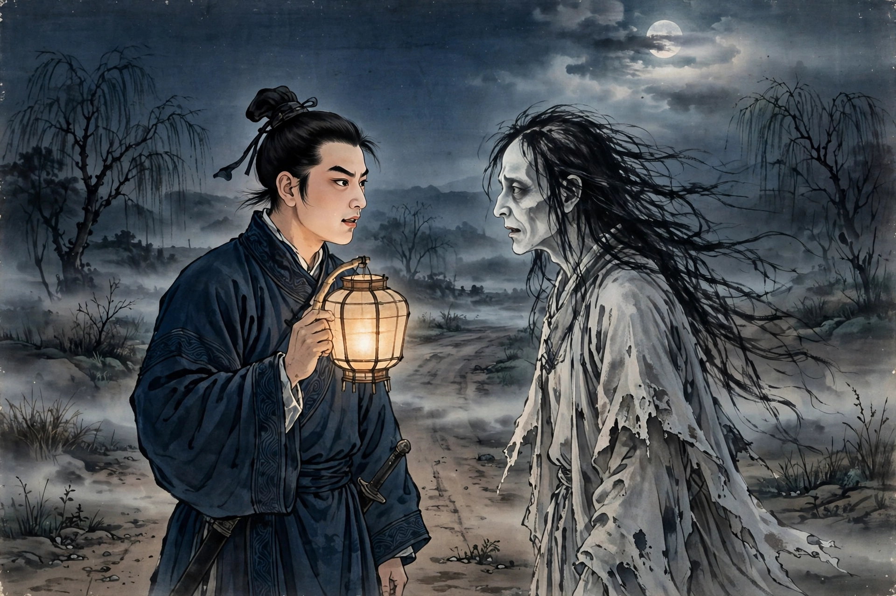
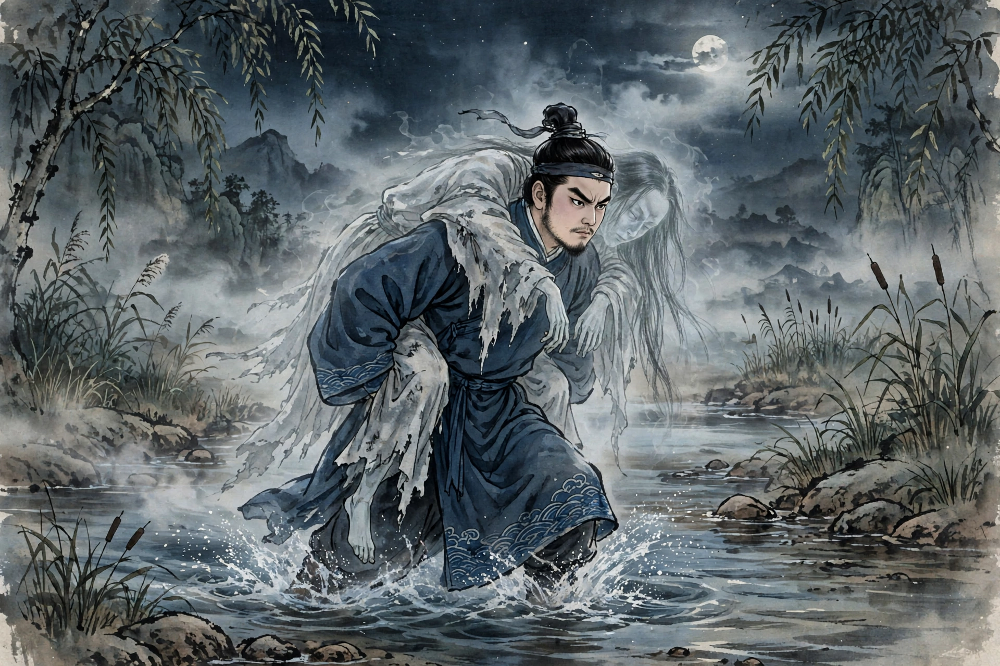
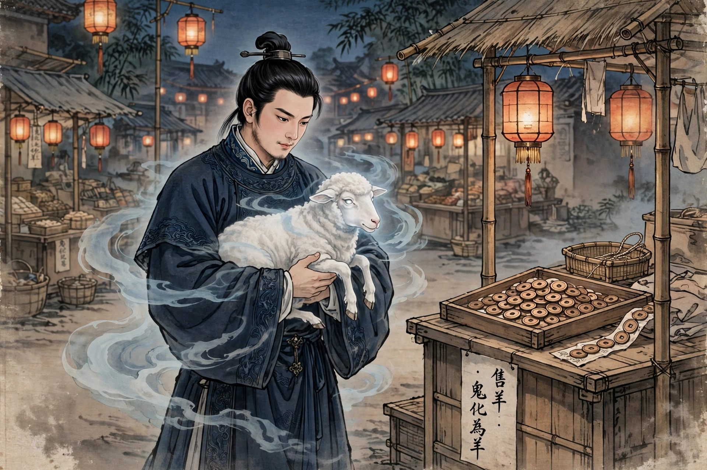

# 宋定伯捉鬼

出处：《搜神记·宋定伯捉鬼》，晋代干宝著。本篇由 Muse 翻译为白话故事，情节、人物、结局均按原著，不增删，不改动。

配图为人工智能生成示意图，不是照片。人物只有宋定伯和鬼（鬼后来化为羊），两人在 3 张图中都出场，宋定伯深蓝袍、黑发髻，鬼灰白破衣、长发苍白。

发布状态：头条号“浠水文艺”待发布，见本文末尾更新。

---

出处：《搜神记·宋定伯捉鬼》，晋代干宝著。本篇由Muse翻译为白话故事，情节、人物、结局均按原著，不增删，不改动。当前做的是古文改白话系列，讲夜行遇鬼、担鬼卖鬼的故事，配图为人工智能生成示意图。请看。

南阳的宋定伯年轻的时候，有一天夜里走路，遇见了一个鬼。宋定伯问他：“你是谁？”鬼说：“我是鬼。”鬼反过来问宋定伯：“你又是谁？”宋定伯欺骗他说：“我也是鬼。”鬼问：“你要到什么地方去？”宋定伯回答说：“要到宛市去。”鬼说：“我也要到宛市去。”于是两个人一起走了几里路。

*图1：夜路相遇，宋定伯与鬼面对面，宋定伯提灯，鬼面色苍白、长发、灰白破衣*

鬼说：“步行太累了，可以轮流互相背着走，怎么样？”宋定伯说：“很好。”鬼就先背着宋定伯走了几里路。鬼说：“你太重了，恐怕不是鬼吧？”宋定伯说：“我是新鬼，所以身体重。”轮到宋定伯背鬼，鬼几乎没有重量。像这样轮流背了好几次。

宋定伯又说：“我是新鬼，不知道鬼害怕什么、忌讳什么？”鬼回答说：“只是不喜欢人的唾沫。”于是两个人一起继续走。

路上遇到了河水，宋定伯让鬼先渡过去，听着鬼渡水，一点水声也没有。宋定伯自己渡过去，水哗啦啦地发出声响。鬼又问：“为什么有声音？”宋定伯说：“我是刚死不久的人，不熟悉渡水，所以才有声音，不要见怪。”

*图2：渡水担鬼，宋定伯背着鬼涉水，鬼几乎无重，宋定伯涉水有声*

走着走着，快要到宛市了，宋定伯便把鬼背在肩上，紧紧地抓住它。鬼大声惊叫，声音咋咋地响，哀求着要下来。宋定伯不再听他的话，一直把他背到宛市中间，才把他放下来，放在地上，鬼就变成了一只羊，宋定伯便把羊卖了。宋定伯害怕它再变化，就朝它身上吐了唾沫。卖羊得了钱一千五百文，于是离开了。当时有这样的话：“宋定伯卖鬼，得钱千五。”

*图3：宛市卖羊，宋定伯抱着化为羊的鬼，桌上有铜钱*

（全文按原著情节逐段讲述，未删人物、未删情节、未改结局。）
