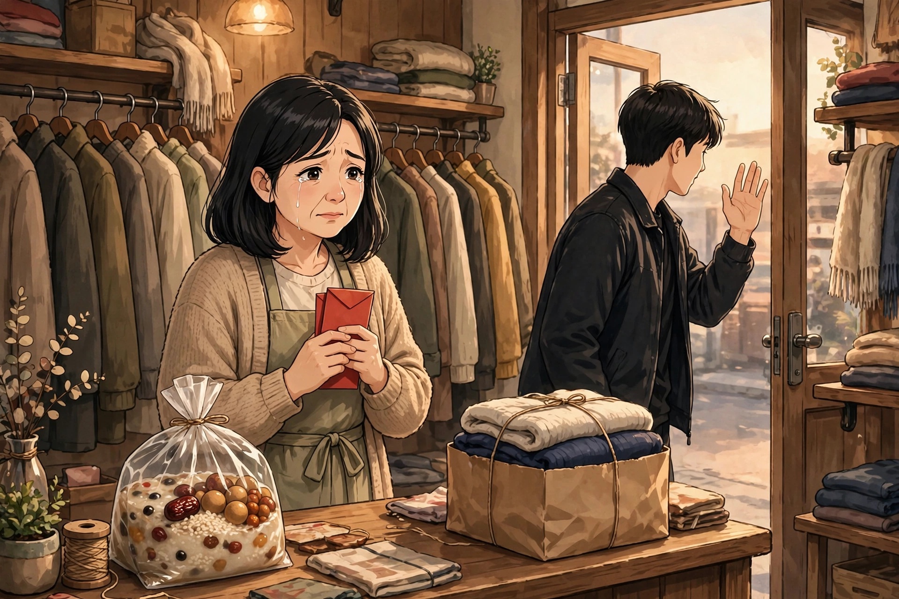

出处：2026年10月20日极目新闻、山东商报·山海新闻报道的朱学巍与王书明故事。本篇先由Muse写成文言文，再译为白话故事，情节、人物、结局均按报道，不增删，不改动。配图为人工智能生成示意图。请看。

朱学巍是武汉人，今年四十一岁，在武汉市洪山区南湖经营一家叫“马丁有品”的服装店，大家叫她朱朱姐。王书明是山东烟台人，今年二十六岁。他小时候因为发烧生病，治疗后留下了后遗症，走路踉跄，说话口齿不清，手部活动也受限。

八年前，王书明刚离开老家到市区打拼，白天上班，晚上摆地摊，身上没钱，生活过得很拮据。他发了一个短视频，说自己没钱吃饭了。朱学巍看到后，心里很难受，就私信他，加了微信，直接给他转了五百元，让他把生活过好一点。王书明起初坚决不肯接受，因为他不想依靠任何人，朱学巍劝了他很久，他才松口收下，还和她约好，等月底发了工资就把钱还给她。

到了月底，王书明真的准时把钱转了回来，朱学巍却始终没有点击收款。她知道这个年轻人正处在人生最艰难的阶段，只希望这点微薄的支持能帮他多撑一段路。为了表达谢意，王书明把家里种的十几箱苹果寄给了朱学巍。此后八年里，两人一直保持着联系。朱学巍会给王书明和他的家人寄一些衣服，王书明则会把苹果、樱桃、海鲜等家乡特产寄往武汉，两人还互相留言打气，八年来从未断过。

一次聊天时，王书明得知“姐姐过得不太好”，于是决定专程从烟台飞到武汉，只为见上一面。他飞行一千一百七十公里，走进朱学巍经营的服装店，只在店里停留了五分钟，怕给她添麻烦，就匆匆离开了。临走前，他留下了一袋八宝粥，直到走出很远，才发微信告诉她，八宝粥袋子里藏着一个装着一千元的红包，希望朱学巍过好一点，给孩子买点好吃的。

朱学巍得知八宝粥袋子里藏着红包的瞬间，当场情绪失控落泪，店内在场的同事也被这份真挚的情谊打动。朱学巍说，自己的经济条件总归要比王书明好一些，实在不忍心收下他的钱。她多次想要把一千元退还给王书明，却被对方拒绝。于是，朱学巍提前订好武汉本地特色的虾店，把定位发给王书明，执意要请他吃饭。她说：“这个红包我绝对不会花，会永远珍藏起来。”如今，王书明在做电动车行业，生活慢慢好了起来，他也带着自己的发小一起工作，要把朱学巍的善意传递下去。他说：“我有肉吃，他就有汤喝。”临走前，王书明向朱学巍发出邀请，请她到烟台看看。朱学巍又特意从店里为他准备了一包新衣服，让他穿着新衣服回烟台。店员朱丽珍在店里工作了九年，她说，朱学巍平时经常帮助他人，谁遇到困难她都会帮，“她做人做事一直这样。”

（全文按报道情节讲述，未增人物、未改结局。配图为人工智能生成示意图，不是新闻照片，也不是当事人真实肖像。）