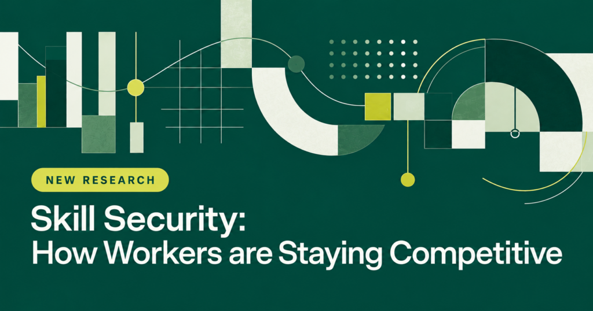

# 三分之一职场人承认夸大技能 — README（非正文内容）

- 状态：待审核
- 方向：职场技能
- 日期：2026-11-06
- 正文文件：公众号/2026/11/06/三分之一职场人承认夸大技能.md
- 正文篇幅：1251 字（不含图片 markdown，不含空白字符）；关键词“夸大技能”出现 7 次，密度 2.24%
- 文言稿：本地留存于 ~/workspace/wechat-official-account/2026-11-06-kuada-jineng/文言.md，不进正文，不上 GitHub

## 标题选项

1. 夸大技能：每3个职场人就有1个承认（主标题；数字 + 痛点 + 结果；关键词在标题前 4 字）
2. 36%职场人承认夸大技能：约6400万人曾假装很懂
3. 夸大技能背后：93%美国职场人说谋职比五年前更难

## 关键词

- 关键词：夸大技能
- 出现位置：标题（主标题前 4 字）、正文开头 100 字内（第 1 句）、正文第 3、5、6、7 段、结尾段（最后一段）；全文密度 2.24%

## 参考文献

1. Addison Group 新闻稿《Skill Security Report: 1 in 3 Have Faked It》，2026-10-27
   https://addisongroup.com/insights/americans-faked-it-to-stay-competitive-at-work/
2. Addison Group 报告全文页《2026 Skill Security Report & Career Trends》，2026 年 10 月
   https://addisongroup.com/insights/resources/2026-skill-security-report-career-trends-addison-group/

## 已核实事实（均已对照上述两个来源逐项核对）

- 36% 的美国劳动人口承认曾夸大知识、技能或工作经验，原因是竞争压力之下要显得有能力、跟得上；按报告推算约等于 6400 万人。
- 93% 的在职和求职美国人说，过去五年里谋求一份成功职业至少有一个方面变得更难了；93% 约等于 1.66 亿人。
- 68% 面临至少一项技术导致的技能过时挑战。
- 72% 表达了某种职业焦虑或脆弱感；58% 对自己能否随着职业所需技能的变化而适应下来没有信心。
- 83% 的人在过去一年里至少采取了一个行动来保持竞争力；其中 43% 自学了怎么使用一种 AI 工具，是报告统计到的最常见的单项技能提升行动。
- 63% 的人说自己曾在没有完全准备好的情况下接下了一项职业挑战。
- 76% 的人说自己因为压力做过至少一件事；在这些人当中，47% 夸大了自己的知识、技能或经验。
- 报告在“夸大”项下还列出：25% 曾在工作中假装听懂了某件事，24% 在简历或面试中夸大了技能或经验，17% 曾假装会用某项技术或工具。
- 报告在“没有完全准备好就接下挑战”项下还列出：45% 接了自己不会做的工作、边做边学，36% 在不符合多数任职条件的情况下投了简历，27% 用 AI 完成了一件自己不确定能否独立完成的事。
- 代际对照：夸大过知识、技能或经验的比例，Z 世代 51%，千禧一代 54%，X 世代 37%；在不符合多数任职条件的情况下投过简历的比例，Z 世代 47%，千禧一代 33%，X 世代 30%。
- “技能保障”定义为持续积累保持竞争力所需的技能；报告称职业安全感越来越取决于适应能力。
- 95% 的在职和求职美国人说，至少一种雇主支持会让他们对未来五年的职业发展更有信心。
- 三类雇主支持：65% 想要晋升或流动机会，63% 想要学习与发展机会，51% 想要更明确的方向和反馈；学习与发展机会具体包括 38% 想要更多在工作中学习新技能的机会，29% 想要更多职业发展或认证资源，28% 想要学习如何有效使用 AI 的培训。
- 调查方法：Wired Research 于 2026 年 8 月 28 日至 9 月 2 日通过网络调查完成，以邮件邀请访问 1000 名 18 岁及以上的美国成年人，其中 656 人处于就业或求职状态；主样本抽样误差正负 3.1%，在职或求职样本正负 3.8%；按 66% 的在职或求职比例、对照 2025 年美国人口普查成年人口 269,763,509 人推算，在职或求职的美国成年人约为 1.78 亿人。
- 本调查是美国调查，数字说的是美国职场人，不是中国，也不是全球；正文第 1 段已明确说明。

## 更正记录（简报与原始来源不一致处，已按原始来源更正）

- 来源日期：任务简报称 2026-11-02，实为二次报道日期；原始新闻稿落款为 2026 年 10 月 27 日，正文与本 README 均按 2026-10-27。
- 95% 与 63% 学习发展：新闻稿页未出现这两个数字，但在报告全文页核实存在，已保留，依据改为报告全文页。
- Z 世代 51% 夸大、47% 投不合条件之职：新闻稿页未出现，在报告全文页代际对照表核实存在，已保留；另补充千禧一代与 X 世代对照数字。
- 47% 有两个不同口径：因压力行事者中 47% 夸大；Z 世代投不合条件之职 47%。正文两处分开写明口径，不混用。
- 63% 有两个不同含义：未备而受任 63%；想要学习与发展机会 63%。正文两处分开写明，不混用。
- 25%、24%、17% 与 45%、36%、27% 为报告在 47% 与 63% 项下并列列出之数字，正文用“报告在……项下还列出”表述，不断言其分母为 47% 或 63% 人群。

## 未核实 / 未采用项

- 无。所有进入正文的数字均已在上述两个 Addison Group 原始来源中核实；未采用任何无法溯源的数字、姓名、对话或方法步骤。

## 图片

- 共 1 张：三分之一职场人承认夸大技能-1.png
- 插入位置：第 2 段（背景数字段）之后、第 3 段（压力与行动段）之前，正文内以  嵌入。
- 图片来源：源文章原图，Addison Group 新闻稿页头图
  - 来源页：https://addisongroup.com/insights/americans-faked-it-to-stay-competitive-at-work/
  - 图片地址：https://addisongroup.com/wp-content/uploads/2026/10/Skill-Security-Research-Banner-1-1024x538.png
  - 内容：深绿底抽象图表图形，英文标题“NEW RESEARCH / Skill Security: How Workers are Staying Competitive”，无人物、无实拍照片；已用 muse.read 读回核验。
  - 版权状态未核实、先行配用；如出现版权问题即替换。
  - 说明：源文章只配这一张原图，按 skill 规则只用原图，不生成 AI 图。本图不是实拍照片，不是文中人物，不代表任何真实职场人。
- AI 图片：无（有原图，不生成）。

## 写作过程

- 先写文言稿（本地 文言.md），再译成白话文，最后逐句对照原始来源核对白话文，修正了 47% 与 63% 的双口径表述和分母问题。
- 无字数目标；无个人观点、无说教、无道德结尾；无二维码、无转化引导。
