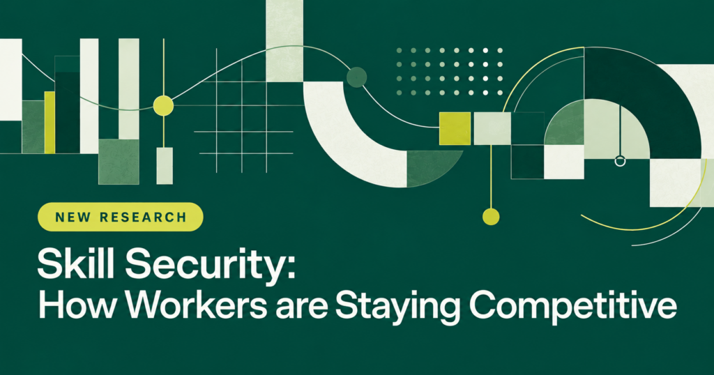

夸大技能，正在成为美国职场一个摆上台面的数字。Addison Group 2026年10月27日发布的《技能保障报告》（Skill Security Report）显示，36%的美国劳动人口承认，自己曾夸大知识、技能或工作经验，原因是竞争压力之下，要显得有能力、跟得上。这36%按报告推算，约等于6400万人。这是一份美国调查，说的是美国职场人，不是中国，也不是全球。

报告先给出了一组背景数字。93%的在职和求职美国人说，过去五年里，谋求一份成功职业至少有一个方面变得更难了；68%面临至少一项技术导致的技能过时挑战；72%表达了某种职业焦虑或脆弱感；58%对自己能否随着职业所需技能的变化而适应下来没有信心。

报告说，正是这种压力，让一部分人选择了“先假装，直到真的做到”，也就是夸大技能；更多人选择了行动。83%的人在过去一年里至少采取了一个行动来保持竞争力，其中43%自学了怎么使用一种AI工具，这是报告统计到的最常见的单项技能提升行动。与此同时，63%的人说，自己曾在没有完全准备好的情况下接下了一项职业挑战。

76%的人说，自己因为压力做过至少一件事。在这些人当中，47%夸大了自己的知识、技能或经验，也就是夸大技能。报告在“夸大”这一项下还列出：25%曾在工作中假装听懂了某件事，24%在简历或面试中夸大了技能或经验，17%曾假装会用某项技术或工具。报告在“没有完全准备好就接下挑战”这一项下还列出：45%接了自己不会做的工作、边做边学，36%在不符合多数任职条件的情况下投了简历，27%用AI完成了一件自己不确定能否独立完成的事。

夸大技能的比例，代际之间也有差别。报告的对照表显示，夸大过知识、技能或经验的比例，Z世代是51%，千禧一代是54%，X世代是37%；在不符合多数任职条件的情况下投过简历的比例，Z世代是47%，千禧一代是33%，X世代是30%。

报告把“技能保障”定义为持续积累保持竞争力所需的技能——与夸大技能相对，职业安全感越来越取决于适应能力。

面对夸大技能背后的压力，报告也问了职场人希望雇主做什么。95%的在职和求职美国人说，至少一种雇主支持会让他们对未来五年的职业发展更有信心。报告列出的三类支持是：65%想要晋升或流动机会，63%想要学习与发展机会，51%想要更明确的方向和反馈。学习与发展机会具体包括：38%想要更多在工作中学习新技能的机会，29%想要更多职业发展或认证资源，28%想要学习如何有效使用AI的培训。

这份报告由Wired Research在2026年8月28日至9月2日通过网络调查完成，以邮件邀请的方式访问了1000名18岁及以上的美国成年人，其中656人处于就业或求职状态，主样本抽样误差为正负3.1%，在职或求职样本为正负3.8%。报告按66%的在职或求职比例、对照2025年美国人口普查成年人口269,763,509人推算，在职或求职的美国成年人约为1.78亿人。夸大技能的36%、自学AI工具的43%、想要学习与发展机会的63%，都来自这同一份美国调查。
