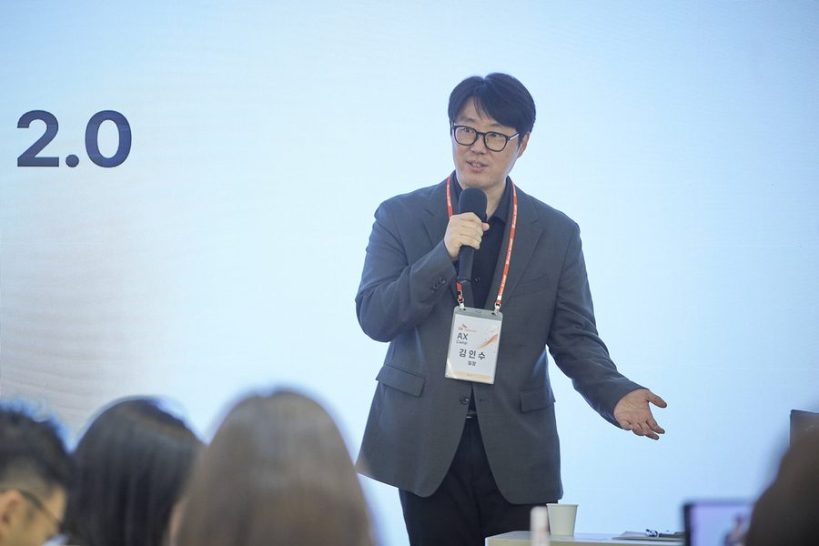

一人一个AI助手，SK电讯从今年3月开始这样做：每个员工自己搭一个贴合本职工作的AI助手。到10月底，4000多人搭出来了，约1500个助手在公司里被经常使用。

数字来自SK电讯10月30日在京畿道利川人才开发院的说明会。公司常任员工约4800人，以今年上半年计，搭过助手的人超过八成。助手干的活很具体：汇总整理周报、核对票据信息、可视化网络数据。

这个项目，是首席执行官Chung Jae-hun下达的。公司下一步要把重心从个人使用转向组织协同，围绕AI重新设计工作方式。

下半年，公司推三个项目：AX推动工作组，负责公司层面的AI转型难题；AX沙盒，把已有工作方式围绕AI从头重新设计；AX催化剂计划，把成功的AI使用经验传给其他员工。9月，10名主动使用AI并用到工作中的员工被选为首批催化剂。

数据安全上，公司开发了一项名为Z.E.Z（Zero Exposure Zone，零暴露区）的技术，并已申请专利：个人信息等敏感原始数据放在单独区域安全管理，只把工作需要的处理结果——元数据、计算值——传给AI。

公司说，推进AI转型躲不开J曲线：刚引入时，工作上难免遇到实际困难，之后生产力会大幅上升。方向是“从个人到组织，从方便到实用”，下一步是“AX创新2.0”，围绕AI重新设计组织的工作流程与协作方式。

一人一个AI助手，先是每个人自己搭、自己用，再是整个组织围着助手改工作方法。
