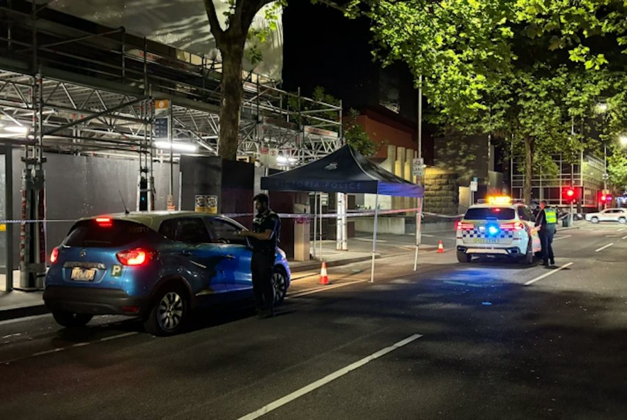
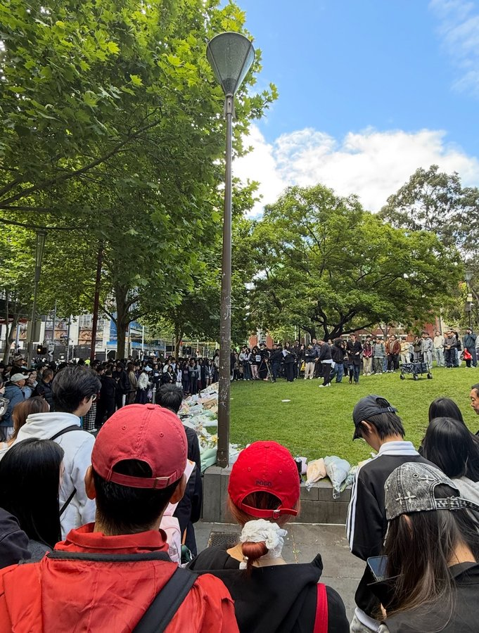
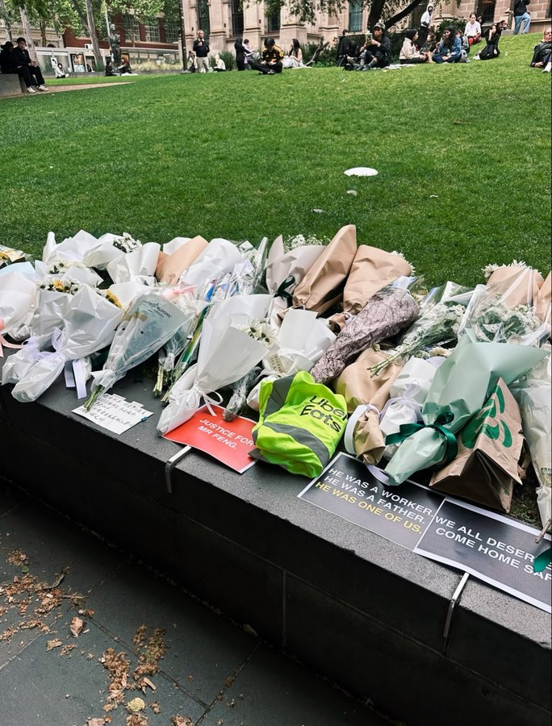

2026年11月6日晚约8时10分，澳大利亚墨尔本市中心弗雷德里克街，维多利亚女王市场附近，47岁中国籍熊猫外卖骑手冯建明和另一名34岁骑手发现一名陌生男子在摆弄他们的车，两人上前交涉，发生冲突。冯建明胸口被刺，当场身亡；另一名骑手也被刺伤，送医后没有生命危险。

有目击者称，冯建明进餐厅取餐时，外面一名流浪汉故意推倒了他的电动自行车，冯建明出来理论，对方突然拔刀刺向他的胸口。中刀后，冯建明仍走回餐厅想取餐，似乎没意识到自己伤得有多重。11月7日上午，维州警方逮捕了一名51岁的男子，他来自富茨克雷，目前仍被羁押，警方表示不再寻找其他涉案人员，案件按凶杀案调查。

冯建明47岁，来自陕西，2017年来到澳大利亚，9年没有回过国。妻子和两个20多岁的孩子还在国内，他是家里的主要经济支柱，还要供养中风后住在养老院的父亲。同事说，他生活节俭，挣的钱几乎都寄回了国内。有餐厅店主说，他每次取餐都会帮忙重新系紧袋子。

11月7日，中国驻墨尔本总领馆发布通报：6日晚，一名中国公民在墨尔本市区不幸遇害身亡，犯罪嫌疑人已被当地警方缉拿归案。总领馆已启动领事保护应急机制，要求警方全力彻查此案，依法、公正处理，严惩肇事凶手，并已与家属取得联系，协助善后。

熊猫外卖由中国留学生刘科路2017年在英国诺丁汉创立，主要服务海外华人。事发后，平台7日上午发声明，对骑手离世深感悲痛，称已成立专项小组核实身份；7日晚再次回应：承担家属赴澳的交通费用、丧葬费用及必要的善后支出，另给家属一笔抚恤金；下周在墨尔本组织骑手面对面沟通会，听取配送安全、平台政策方面的意见；已向保险公司报告，协助家属申请理赔；为家属联系独立律师并承担费用。平台同时表示，因餐品遭遇盗抢、或骑手为保障自身安全无法完成配送，平台不会要求骑手承担餐品损失或处罚。

但“熊猫外卖骑手需自行赔付配送途中被偷、被抢的外卖餐品”的话题，在事发后引发了不少讨论和质疑。冯建明的朋友涂先生向红星新闻表示，平台罚款政策比较严格，餐被偷了或者撒了，外卖员需要全额赔付，冯建明的外卖被流浪汉抢了，他要拿回来，间接导致了后面的事情。那一带此前也发生过抢外卖的情况。

11月7日下午5时许，数百名华人在维多利亚州立图书馆门前集会，悼念冯建明。草坪上摆满了鲜花和白色蜡烛，有人手写书信；遇害地点也有人送花。

现场的标语写着：“没有一单外卖值得一条人命”“我们需要一个更安全的墨尔本”“他送餐为了支付孩子学费，却再也没有回家”。有人要求对熊猫外卖的政策进行独立审查。墨尔本唐人街商业协会为冯建明的家属发起募款，已筹得7000多美元，帮助家属赴澳及办理丧葬。

