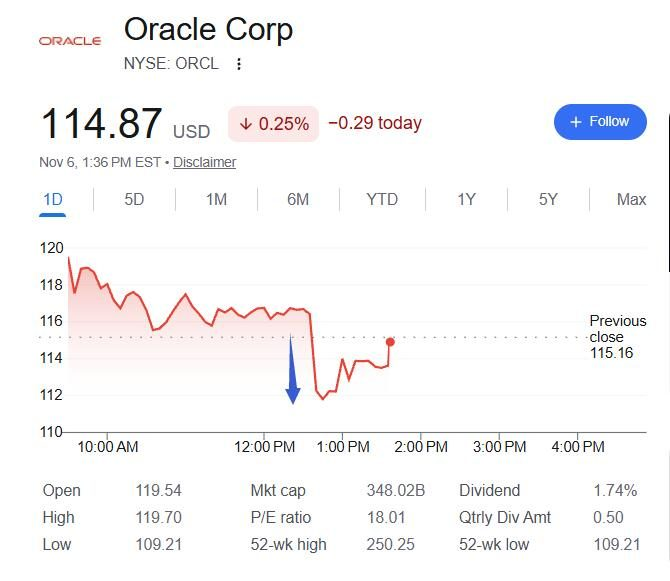
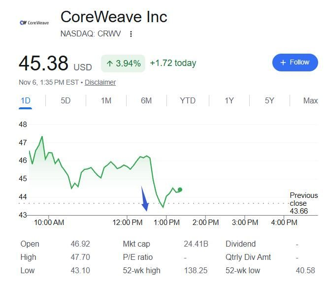

美东时间11月6日周五，彭博报道，微软近几个月已开始逐步关闭从甲骨文租用的部分计算资源，并决定不再续签相关合同。甲骨文提供的服务器搭载的是上一代英伟达芯片，随着微软的AI工作负载不断变化，这些算力已不符合微软的技术规格，价值随之下降。

这份合作始于2023年。当时微软向甲骨文租用算力，支持带AI功能的新版必应搜索。那时AI算力供不应求，微软作为全球最大的云服务商之一，反而向竞争对手租服务器，一度被视为行业里的罕见安排。合同金额双方均未披露。

消息传出后，甲骨文股价盘中迅速跳水：盘初一度涨3.8%，随后掉头转跌，日内跌幅接近5.2%，最低触及109.21美元，创52周新低，较6月高点250.25美元跌去一半以上。尾盘股价收复多数失地，收盘微涨0.8%，报116.10美元。

微软拒绝对此事置评。甲骨文方面强调，其AI基础设施需求依然强劲，包括对较早一代GPU的需求。公司今年9月曾披露，正在以较原始合同价格高出20%的溢价，续签四年前购入的GPU租赁合同。

微软的收缩不只针对甲骨文。此前一天的报道称，在已承诺投入逾800亿美元向其他云公司租用算力后，微软对“新云”供应商的高成本和交付延误感到不满，正在加强审查、退出高风险项目，并内部讨论是否暂缓签署新的合作协议。微软决定不行使Nscale得州数据中心项目的额外扩容选择权，并已退出Nscale在英国埃塞克斯郡洛顿的旗舰数据中心项目。受消息影响，早盘曾涨9.3%的CoreWeave短线转跌，盘初大涨的IREN、Nebius涨幅也大幅收窄。

消息传出的前一天，纳斯达克综合指数跌5.5%，费城半导体指数跌12%，为2020年3月以来最差单日表现。甲骨文截至8月31日的剩余履约义务、即已签约未确认收入为6640亿美元，其中OpenAI约占一半。另据《金融时报》报道，甲骨文还取消了向腾讯出租先进AI芯片的约70亿美元合同。彭博此前指出，全球AI计算能力仍然供不应求，微软调整外部算力采购策略，并不意味着AI算力需求已经见顶。
