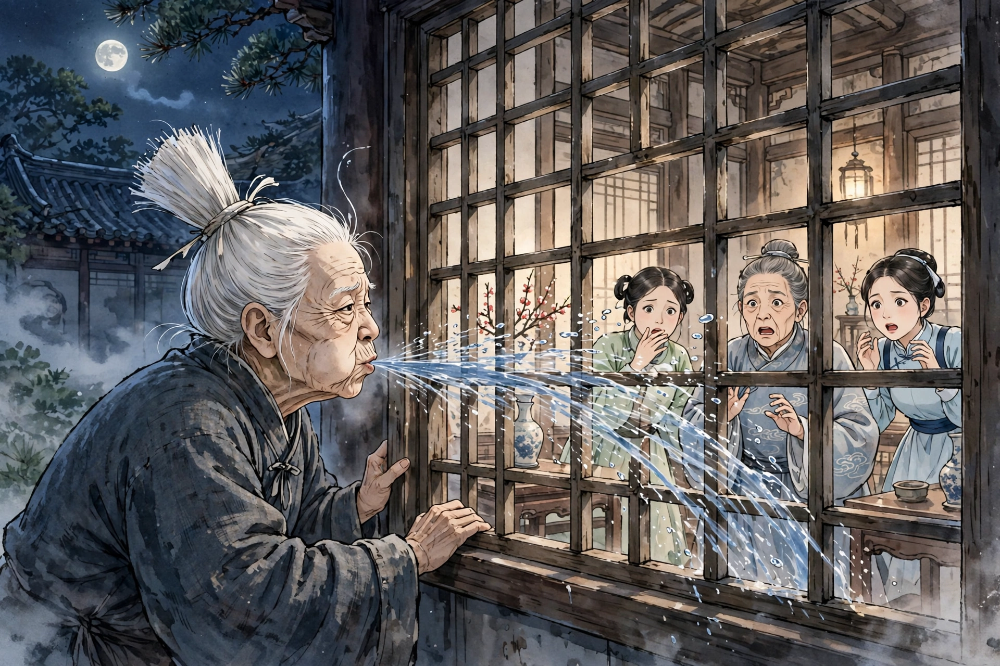

# 004 喷水

莱阳的宋玉叔先生在做部曹官的时候，租住的宅子十分荒凉破落。一天夜里，两个婢女陪着太夫人睡在厅堂上，听见院子里有扑扑的声音，就像裁缝喷水时发出的声音。太夫人催婢女起来，在窗户上抠个小洞往外偷看，只见一个老妇人，身材矮小，驼着背，白发像扫帚一样，头顶挽着一个发髻，长约二尺，在院子里绕着圈走，时快时慢地迈着鹤一样的步子，一边走一边喷水，水源源不断地喷出来。婢女惊愕地回去禀告。太夫人也惊起身来，两个婢女扶着她在窗下一起观看。老妇人忽然逼近窗户，直接往窗棂里面喷水；窗纸破裂，三个人都倒了下去，而家里人却不知道。天亮太阳升起来了，家里人都聚了过来，敲门没有人应答，这才惊骇起来。撬开门进去，只见一主二婢并排死在一间屋子里。其中一个婢女胸膈下面还温热。扶她起来灌救，过了一会儿她醒了过来，于是讲述了自己所看见的情形。先生回来后，悲哀愤恨得要死。仔细追查老妇人消失的地方，挖到三尺多深，渐渐露出白发；再往下挖，挖出一具尸体，就像所见到的老妇人的样子，面部肥肿得像活人一样。先生下令击打尸体，骨肉都烂了，皮里面全是清水。

## 原文

莱阳宋玉叔先生为部曹时，所僦第，甚荒落。一夜，二婢奉太夫人宿厅上，闻院内扑扑有声，如缝工之喷水者。太夫人促婢起，穴窗窥视，见一老妪，短身驼背，白发如帚，冠一髻，长二尺许，周院环走，疏急作鹤步，行且喷，水出不穷。婢愕返白。太夫人亦惊起，两婢扶窗下聚观之。妪忽逼窗，直喷棂内；窗纸破裂，三人俱仆，而家人不之知也。东曦既上，家人毕集，叩门不应，方骇。撬扉入，见一主二婢，骈死一室。一婢鬲下犹温。扶灌之，移时而醒，乃述所见。先生至，哀愤欲死。细穷没处，掘深三尺余，渐露白发；又掘之，得一尸，如所见关，面肥肿如生。令击之，骨肉皆烂，皮内尽清水。
