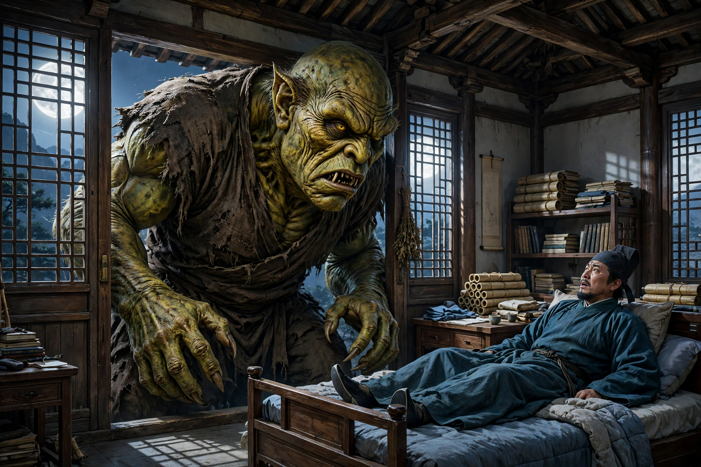
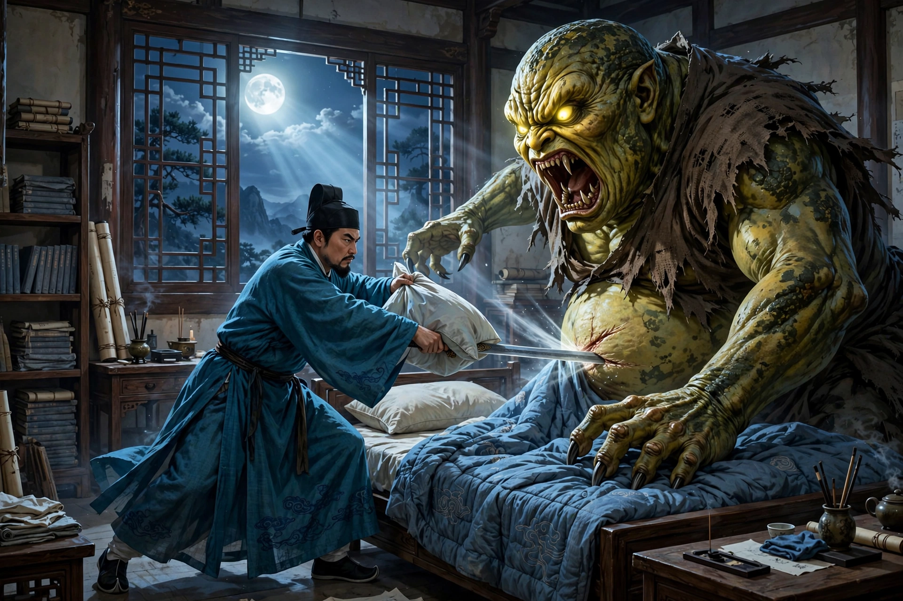

# 007 山魈

孙太白曾经讲过这样一件事：他的曾祖父当年在南山柳沟寺里读书。麦收时节他回了一趟家，过了十多天才回来。打开书斋的门，只见桌案上积满了灰尘，窗户间结满了蛛丝。他叫仆人打扫清除，一直忙到晚上，才觉得屋里清爽，可以坐下来了。于是他拂拭床榻，铺好被褥，关上门睡觉，这时月光已经照满了窗户。他在床上翻来覆去过了很久，四周万籁俱寂。忽然听到风声隆隆作响，山门被吹得豁然作响。他暗想，可能是寺里的僧人没有关好门。正想着，风声渐渐逼近住处，一会儿，房门就被吹开了。他大为疑惑。还没想明白，风声已经进了屋子；又有铿铿作响的靴子声，渐渐靠近卧室的门。他心里开始害怕起来。一会儿，卧室的门也被打开了。他抬眼一看，一个大鬼弯着腰挤了进来，猛地站到床前，几乎和房梁一样高。它的脸像老瓜皮的颜色；目光闪烁着，向屋里四处张望；张开像盆一样大的巨口，牙齿稀疏，长约三寸；舌头动着，喉咙里发出呵喇呵喇的声音，响声连着四面墙壁。孙公害怕到了极点；又想到在这样咫尺之地，实在无处可逃，不如趁势刺它一下。于是他悄悄抽出枕头底下的佩刀，猛地拔出来向它砍去，砍中了它的肚子，发出像敲打石罐一样的声音。鬼大怒，伸出巨大的爪子来抓孙公。孙公稍微缩了缩身子。鬼抓住了被子，揪着被子愤愤地走了。孙公跟着被子跌落到地上，趴在地上大声呼喊。家人们拿着火把奔来聚集，却见门还是像原来一样关着，只好推开窗户进来，看到情形大为惊骇。把他扶着拉着上了床，他才讲出事情的缘故。大家一起验看，只见被子夹在卧室门的缝隙里。打开门仔细照看，只见爪痕大得像簸箕，五个手指抓过的地方都穿透了。到了天亮，他不敢再留下来，背着书箱回家了。后来问寺里的僧人，也再没有发生过其他怪事。

## 原文

孙太白尝言：其曾祖肄业于南山柳沟寺。麦秋旋里，经旬始返。启斋门，则案上尘生，窗间丝满。命仆粪除，至晚始觉清爽可坐。乃拂榻陈卧具，扃扉就枕，月色已满窗矣。辗转移时，万籁俱寂。忽闻风声隆隆，山门豁然作响。窃谓寺僧失扃。注念间，风声渐近居庐，俄而房门辟矣。大疑之。思未定，声已入屋；又有靴声铿铿然，渐傍寝门。心始怖。俄而寝门辟矣。忽视之，一大鬼鞠躬塞入，突立榻前，殆与梁齐。面似老瓜皮色；目光睒闪，绕室四顾；张巨口如盆，齿疏然长三寸许；舌动喉鸣，呵喇之声，响连四壁。公惧极；又念咫尺之地，势无所逃，不如因而刺之。乃阴抽枕下佩刀，遽拔而斫之，中腹，作石缶声。鬼大怒，伸巨爪攫公。公少缩。鬼攫得衾捽之，忿忿而去。公随衾堕，伏地号呼。家人持火奔集，则门闭如故，排窗入，见状大骇。扶曳登床，始言其故。共验之，则衾夹于寝门之隙。启扉检照，见有爪痕如箕，五指著处皆穿。既明，不敢复留，负笈而归。后问僧人，无复他异。
