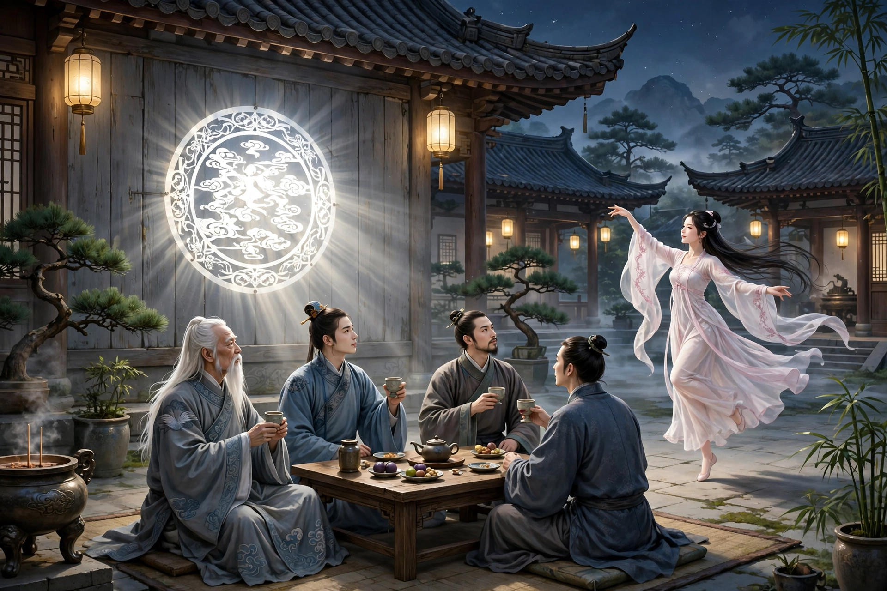

# 015 崂山道士

县里有个王生，在家里排行第七，是官宦人家的子弟。他从小向往修道，听说劳山上有很多仙人，就背着书箱去游访，登上一座山顶，看见一座道观，十分幽静。一位道士坐在蒲团上，白发垂到领口，神态却爽朗超迈。王生上前叩问，和他交谈，道理讲得十分玄妙，就请求拜他为师。道士说：“只怕你娇生惯养，吃不了苦。”王生回答：“能吃苦。”道士的门人很多，傍晚都聚齐了，王生一一向他们行礼，就留在观里。

第二天清晨，道士叫王生去，交给他一把斧头，让他跟着众人去砍柴，王生恭敬地接受了教导。过了一个多月，手脚都磨出了厚茧，实在受不了这份苦，心里暗暗有了回去的念头。一天晚上回来，看见两个人正和师父一起喝酒，天已经黑了，还没有点灯烛，师父就剪了一张纸，像镜子一样贴在墙上，不一会儿，月光明亮地照在墙上，连细小的毛发都能照得清清楚楚，众门人都围过来奔走观看。一位客人说：“这样好的夜晚，这样的乐事，不能不一起享受。”于是从桌上拿起一壶酒，分给众徒弟，还嘱咐大家尽情喝醉。王生心里想：七八个人，一壶酒怎么够分？于是大家各自找来盅碗，争着先喝干，只怕酒壶喝空了，可是来回倒酒，酒竟然一点也不减少，心里觉得奇怪。不一会儿，一位客人说：“承蒙赐给月明的照亮，就这样静静地喝酒，为什么不把嫦娥叫来呢？”于是把筷子掷到月亮里，只见一位美人从光中走出来，起初还不到一尺高，落到地上，就和常人一样高了，细腰秀颈，翩翩起舞，跳起霓裳舞。接着她唱道：“仙仙乎，而还乎，而幽我于广寒乎？”她的声音清亮高远，响亮得像箫管。唱完，盘旋着飞起，跃到桌子上，大家惊讶地回头一看，她已经又变成了一根筷子，三个人都大笑起来。又一位客人说：“今晚最快乐了，只是酒力不胜了，能不能请你们到月宫里为我送行呢？”三个人移动座位，渐渐走进月亮里，众人看见三个人坐在月亮里喝酒，眉毛胡子都看得清清楚楚，就像影子映在镜子里一样。过了一会儿，月亮渐渐暗了，门人点起烛来，只见道士一个人独坐，客人们已经不见了。桌上的菜果还留着，墙上的月亮，不过是一张圆得像镜子的纸罢了。道士问众人：“喝够了吗？”大家说：“够了。”道士说：“够了就该早点睡，不要耽误了砍柴。”众人都答应着退下了。

王生暗自羡慕，回去的念头就此打消了。又过了一个月，苦得实在忍受不了，而道士却一点法术也不传授，心里再也等不下去了，就辞别说：“弟子走了几百里，来向仙师求学，即使不能得到长生之术，多少学一点，也能安慰求教的心，如今过了两三个月，不过是早上砍柴、晚上回来，弟子在家里，还不懂得这种苦。”道士笑着说：“我本来就说你不能吃苦，如今果然是这样，明天早上，就打发你走。”

王生说：“弟子干活多日，师父多少教一点小本事，这一趟来也不算白来。”道士问他求什么法术？王生说：“每次看见师父走过的地方，墙壁都不能阻隔，只要得到这个法子，就够了。”道士笑着答应了。于是传给他口诀，叫他自己念完咒，喊道：“进去！”王生对着墙不敢进去，道士又说：“试着进去。”王生果然从容地走进去，到了墙边就被挡住了。道士说：“低着头一下子冲进去，不要迟疑徘徊。”王生果然离开墙几步，奔跑着冲进去，到了墙边，墙像是空无一物，回头一看，果然已经到了墙外。大喜过望，进来拜谢。道士说：“回去应当清净持守，不然就不灵验。”于是给了他路费，打发他回家。

到了家里，王生自夸遇见了仙人，坚硬的墙壁也不能阻挡他，妻子不相信，王生就照着做过的样子，离开墙几尺，奔跑着冲进去；头撞上硬墙，一下子跌倒了，妻子扶起他一看，额头上鼓起一个大包，像大鸡蛋一样。妻子取笑他，王生又惭愧又气愤，只骂老道士没有良心罢了。

异史氏说：听说这件事，没有不大笑的，却不知道世上像王生这样的人，正是很多。如今有个粗俗的人喜欢害人的毒药却害怕治病的药石，于是就有人去舔痈舔痔，进献逞威作暴的法术，来迎合他的心意，哄骗他说，拿着这个法术往前走，就可以横行无阻，起初试一试，未尝没有一点小效果，于是就以为天下之大，都可以这样走下去了，势必不到撞上硬墙、跌倒在地，是不会停下来的。

## 原文

邑有王生行七，故家子。少慕道，闻劳山多仙人，负笈往游，登一顶，有观宇，甚幽。一道士坐蒲团上，素发垂领，而神观爽迈。叩而与语，理甚玄妙，请师之。道士曰：“恐娇惰不能作苦。”答言：“能之。”其门人甚众，薄暮毕集，王俱与稽首，遂留观中。

凌晨，道士呼王去，授以斧，使随众采樵，王谨受教。过月馀，手足重茧，不堪其苦，阴有归志。一夕归，见二人与师共酌，日已暮，尚无灯烛，师乃剪纸如镜，粘壁间，俄顷，月明辉壁，光鉴毫芒，诸门人环听奔走。一客曰：“良宵胜乐，不可不同。”乃于案上取壶酒，分赉诸徒，且嘱尽醉。王自思：“七八人，壶酒何能遍给？”遂各觅盎盂，竞饮先釂，惟恐樽尽，而往复挹注，竟不少减，心奇之。俄一客曰：“蒙赐月明之照，乃尔寂饮，何不呼嫦娥来？”乃以箸掷月中，见一美人，自光中出，初不盈尺，至地，遂与人等，纤腰秀项，翩翩作霓裳舞。已而歌曰：“仙仙乎，而还乎，而幽我于广寒乎？”其声清越，烈如箫管。歌毕，盘旋而起，跃登几上，惊顾之间，已复为箸，三人大笑，又一客曰：“今宵最乐，然不胜酒力矣，其饯我于月宫可乎？”三人移席，渐入月中，众视三人坐月中饮，须眉毕见，如影之在镜中。移时，月渐暗，门人然烛来，则道士独坐，而客杳矣。几上肴核尚存，壁上月，纸圆如镜而已。道士问众，“饮足乎？”曰：“足矣。”“足宜早寝，勿误樵苏。”众诺而退。

王窃忻慕，归念遂息。又一月，苦不可忍，而道士并不传教一术，心不能持，辞曰：“弟子数百里，受业仙师，纵不能得长生术，或小有传习，亦可慰求教之心，今阅两三月，不过早樵而暮归，弟子在家，未谙此苦。”道士笑曰：“我固谓不能作苦，今果然，明早，当遣汝行。”

王曰：“弟子操作多日，师略授小技，此来为不负也。”道士问何术之求？王曰：“每见师行处，墙壁所不能隔，但得此法，足矣。”道士笑而允之。乃传以诀，令自咒毕，呼曰：“入之！”王面墙不敢入，又曰：“试入之。”王果从容入，及墙而阻。道士曰：“俯首骤入，勿逡巡。”王果去墙数步奔而入，及墙，虚若无物，回视，果在墙外矣。大喜，入谢。道士曰：“归宜洁持，否则不验。”遂资斧遣之归。

抵家自诩遇仙，坚壁所不能阻，妻不信，王效其作为，去墙数尺，奔而入；头触硬壁，蓦然而踣，妻扶视之，额上坟起如巨卵焉。妻揶揄之，王惭忿，骂老道士之无良而已。

异史氏曰：闻此事，未有不大笑者，而不知世之为王生者，正复不少。今有伧父喜疢毒而畏药石，遂有舐痈吮痔者，进宣威逞暴之术，以迎其旨，绐之曰，执此术也以往，可以横行而无碍，初试，未尝不小效，遂谓天下之大，举可以如是行矣，势不至触硬壁而颠蹶，不止也。
