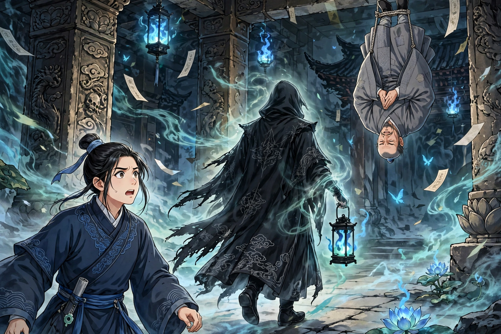

# 023 僧孽

有个姓张的人突然死了，跟着鬼差去了阴间，见到了冥王。冥王查了生死簿，大怒，说鬼差抓错了人，责令把他送回去。张某下殿的时候，私下求鬼差带他参观一下冥狱。鬼差带着他走遍九幽，刀山、剑树，一一指给他看。最后到了一处地方，有个和尚被绳子穿过大腿倒吊着，痛得号叫不止。走近一看，原来是他的哥哥。张某又惊又悲，问：“他犯了什么罪，才到这个地步？”鬼差说：“他做了和尚，到处募化钱财，全都拿去淫乐赌博，所以受这个罚。要脱离这苦难，必须他自己忏悔。”张某活过来之后，怀疑哥哥已经死了。当时他哥哥住在兴福寺，于是他前去探望。一进门，就听见哥哥号痛的声音。走进屋里，只见哥哥大腿间生了疮，脓血溃烂，把脚挂在墙上，样子正像阴间倒吊的情形。张某骇然问他是怎么回事。哥哥说：“这样挂着还稍稍好受些，不然就痛彻心腑。”张某便把自己在阴间看到的情形告诉了他。和尚听了大为惊骇，从此戒了荤酒，虔诚地诵经念咒。半个月就好了，从此成了持戒的僧人。

异史氏说：“鬼狱渺茫，恶人常常拿这个来为自己开脱；却不知道明处的灾祸，就是暗处的惩罚。难道不值得害怕吗？”

## 原文

张姓暴卒，随鬼使去，见冥王。王稽簿，怒鬼使误捉，责令送归。张下，私浼鬼使，求观冥狱。鬼导历九幽，刀山、剑树，一一指点。末至一处，有一僧孔股穿绳而倒悬之，号痛欲绝。近视，则其兄也。张见之惊哀，问：“何罪至此？”鬼曰：“是为僧，广募金钱，悉供淫赌，故罚之。欲脱此厄，须其自忏。”张既苏，疑兄已死。时其见居兴福寺，因往探之。入门，便闻其号痛声。入室，见疮生股间，脓血崩溃，挂足壁上，宛冥司倒悬状。骇问其故。曰：“挂之稍可，不则痛彻心腑。”张因告以所见。僧大骇，乃戒荤酒，虔诵经咒。半月寻愈。遂为戒僧。

异史氏曰：“鬼狱渺茫，恶人每以自解；而不知昭昭之祸，即冥冥之罚也。可勿惧哉！”
