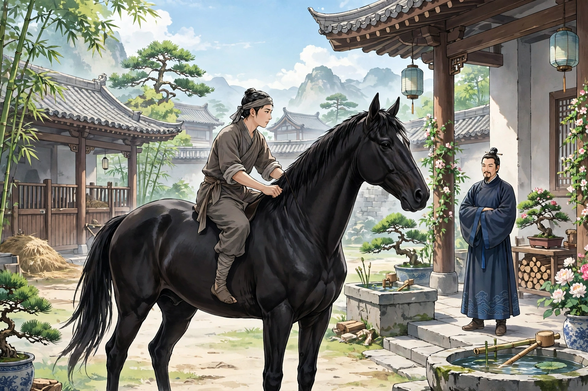
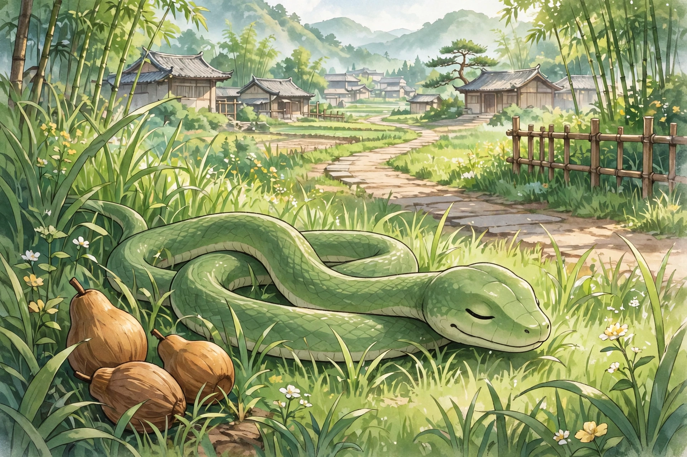

# 026 三生

刘孝廉能记得前身的事。他和先父文贲兄是同年，曾经历历地讲过。第一世做缙绅，行为多有玷污。六十二岁死了，初见冥王，冥王待他像乡里的先生一样有礼，赐他坐下，拿茶给他喝。他瞥见冥王盏里的茶色清澈，自己的盏里却浊得像酒。暗暗怀疑，迷魂汤莫非就是这个？趁冥王转过头去，他把盏拿到案角倒了，假装已经喝尽。

一会儿查他前生的恶行记录，冥王大怒，命令群鬼把他拖下去，罚他做马。立刻有厉鬼把他押走。走到一家，门槛很高，过不去。正犹豫的时候，鬼用力打他，痛得他跌倒。自己一看，身子已经在马槽下面了。只听见人说：“黑马生小马驹了，是公的。”心里很明白，却不能说话。觉得非常饿，不得已，就向母马求奶。过了四五年，身子长得高大。很怕鞭打，看见鞭子就害怕逃跑。主人骑他，一定盖上障泥，缓缓地勒着缰绳慢慢走，还不算太苦；只有奴仆和养马的人，不加鞍具就骑着走，两只脚踝夹击，痛彻心腑。于是愤怒得很，三天不吃东西，就死了。

到了冥司，冥王查他罚期未满，责备他逃避，剥了他的皮革，罚他做狗。他心里懊丧，不想走。群鬼乱打他，痛极了逃到野外。自己想不如死了，愤而投向绝壁，跌倒不能起来。自己一看，身子伏在洞里，母狗舔他、护着他，才知道身子已经又生在人世了。稍稍长大，看见秽物也知道脏，然而闻着却香，只是立下念头不吃。做狗一年多，常常愤恨想死，又怕被治逃避之罪。而主人又养着他不肯杀。于是故意咬下主人大腿上的一块肉，主人大怒，用杖打死了他。

冥王审问情形，恼他狂暴，笞打几百下，让他做蛇。关在幽暗的屋子里，暗得不见天日。闷得很，沿着墙爬上去，穿洞出屋。自己一看，身子伏在茂草里，果然已经是蛇了。于是立志不残害生灵，饿了就吞木头的果实。积了一年多，常常想自尽不行，害人而死也不行，想求一个好好死去的办法却没有得到。一天卧在草里，听见车子经过，立刻出来挡在路上，车子驰过压着他，断成两截。

冥王惊讶他来得这么快，于是他趴在地上自己剖白。冥王因为他是无罪被杀而原谅他，准他满了期限再做人，这就是刘公。刘公生下来就能说话，文章书史，看过就能背诵。辛酉年考中孝廉。常常劝人：骑马一定要厚厚地盖上障泥；用腿夹的刑罚，比鞭打更厉害。

异史氏说：“毛角一类的动物里，竟有王公大人在其中。之所以这样，是因为王公大人里面，原本也未必没有毛角一类的在其中。所以卑贱的人行善，就像求花而种树；尊贵的人行善，就像花已开而培土：种树的可以长大，培土的可以长久。不然，就会拉盐车、受羁绊，和它们一起做马。不然，就会吃秽物、受烹割，和它们一起做狗。再不然，就会披鳞甲、葬在鹤鹳肚里，和它们一起做蛇。”

## 原文

刘孝廉，能记前身事。与先文贲兄为同年，尝历历言之。一世为搢绅，行多玷。六十二岁而殁，初见冥王，待如乡先生礼，赐坐，饮以茶。觑冥王盏中茶色清彻，己盏中浊如醪。暗疑迷魂汤得勿此乎？乘冥王他顾，以盏就案角泻之，伪为尽者。

俄顷稽前生恶录，怒命群鬼捽下，罚作马。即有厉鬼絷去。行至一家，门限甚高，不可逾。方趦趄间，鬼力楚之，痛甚而蹶。自顾，则身已在枥下矣。但闻人曰：“骊马生驹矣，牡也。”心甚明了，但不能言。觉大馁，不得已，就牝马求乳。逾四五年间，体修伟。甚畏挞楚，见鞭则惧而逸。主人骑，必覆障泥，缓辔徐徐，犹不甚苦；惟奴仆圉人，不加鞯装以行，两踝夹击，痛彻心腑。于是愤甚，三日不食，遂死。

至冥司，冥王查其罚限未满，责其规避，剥其皮革，罚为犬。意懊丧不欲行。群鬼乱挞之，痛极而窜于野。自念不如死，愤投绝壁，颠莫能起。自顾则身伏窦中，牝犬舐而腓字之，乃知身已复生于人世矣。稍长，见便液亦知秽，然嗅之而香，但立念不食耳。为犬经年，常忿欲死，又恐罪其规避。而主人又豢养不肯戮。乃故啮主人脱股肉，主人怒，杖杀之。

冥王鞫状，怒其狂猘，笞数百，俾作蛇。囚于幽室，暗不见天。闷甚，缘壁而上，穴屋而出。自视则身伏茂草，居然蛇矣。遂矢志不残生类，饥吞木实。积年余，每思自尽不可，害人而死又不可，欲求一善死之策而未得也。一日卧草中，闻车过，遽出当路，车驰压之，断为两。

冥王讶其速至，因蒲伏自剖。冥王以无罪见杀原之，准其满限复为人，是为刘公。公生而能言，文章书史，过辄成诵。辛酉举孝廉。每劝人：乘马必厚其障泥；股夹之刑，胜于鞭楚也。

异史氏曰：“毛角之俦，乃有王公大人在其中。所以然者，王公大人之内，原未必无毛角者在其中也。故贱者为善，如求花而种其树；贵者为善，如已花而培其本：种者可大，培者可久。不然，且将负盐车，受羁馽，与之为马。不然，且将啖便液，受烹割，与之为犬。又不然，且将披鳞介，葬鹤鹳，与之为蛇。”
