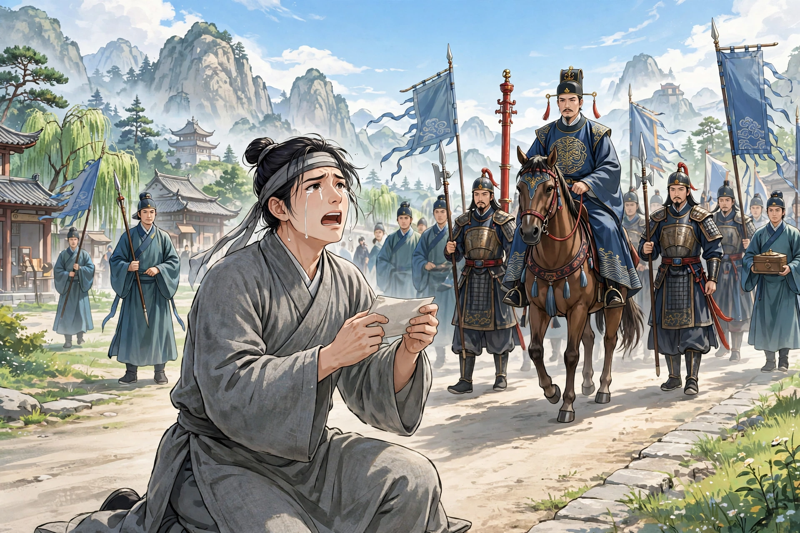

# 033 成仙

文登的周生和成生从小一起读书，结成了生死之交。成生家贫，所以一年到头都依附着周生生活。按年龄周生年长，成生称周生的妻子为嫂子。逢年过节成生都上堂拜见，就像一家人一样。周生的妻子生了孩子，产后突然去世。后来周生又娶了王氏，成生因为年纪小，从来没有请求见过她。有一天，王氏的弟弟来看望姐姐，在内室摆酒。成生正好来了。家人通报，周生坐着命人请他进来。成生不进去，告辞走了。周生把酒席移到外舍，追上他把他请了回来。刚坐下，就有人报告别墅的仆人被县令重打了。原来先前黄吏部家的放牧佣人，让牛踩了周生的田地，因此互相辱骂。放牧佣人跑去告诉主人，主人捉了周生的仆人送官，于是被打了一顿。周生问清缘故，大怒说：“黄家的放猪奴仆，怎么敢这样！他的先辈曾为我祖父服役；刚一得志，就没人管了吗！”气得胸口发闷，愤然起身，要去找黄家算账。成生按住他劝阻说：“这是一个强横的世界，本来就没有是非可讲。何况如今的官吏有一半是不拿矛和弓的强盗呢？”周生不听。成生再三劝阻，甚至哭了出来，周生才作罢。怒气始终不能消解，翻来覆去一夜没睡。对家人说：“黄家欺负我，就是我的仇人，姑且先放一放。县令是朝廷的官，不是权势人家的官，纵然有争执，也应当双方对质，怎么能像狗听人驱使一样？我也要告他的佣人，看他怎么处置。”家人都怂恿他，计议就定了。写好状子去见县令，县令撕了状子扔在地上。周生大怒，出言冒犯县令。县令羞恼，于是把他逮捕关了起来。

辰时过后，成生去看望周生，才知道他进城打官司。急忙赶去劝阻，周生已经在监狱里了。成生顿足，没有办法。当时抓获了三名海盗，县令和黄家贿赂嘱托他们，让他们诬称周生是同党。按供词上奏，革去了周生的顶戴衣冠，拷打得非常惨。成生进了监狱，和周生相对凄然。商量着去京城告御状。周生说：“我身陷重牢，像鸟在笼子里；虽然有个弱弟弟，也只够给我送牢饭罢了。”成生挺身自任说：“这是我的责任。困难而不去急救，还要朋友做什么！”于是动身。周生的弟弟拿盘缠追送他，他已经走远了。到了京城，没有门路告状。听说皇帝将要出猎，成生预先藏在木市中；等皇帝经过，伏地起舞哀号，于是得到了准许。由驿站送下来，交给部院审理奏报。这时已经过了十个多月，周生已经被诬供判了死刑。部院接到皇帝的批示，大为吃惊，重新提审亲自审问。黄家也吃惊，谋划杀死周生。于是贿赂狱吏，断绝他的饮食；弟弟来送饭，也被严厉禁止。成生又到部院喊冤，才得到提审，周生已经饿得起不来了。部院大人大怒，把狱吏杖打死了。黄家大为恐惧，拿出几千两银子，嘱托营救脱身，因此得以含糊其辞地题请免罪。县令因为枉法被拟定流放。周生被放回家，更加肝胆相照地对待成生。

成生经历了这场官司诉讼，对世情完全灰了心，邀请周生一起隐居。周生沉溺于年轻的妻子，总是迂回地笑他。成生虽然不说话，但心意非常坚决。分别之后，成生几天都不来。周生派人到他家里打听，家人正怀疑他在周生那里；两边都不见，才起了疑心。周生心里知道有异常，派人四处寻访，寺观山谷，几乎找遍了。时常用金帛周济他的儿子。又过了八九年，成生忽然自己来了，戴着黄巾、穿着道袍，俨然一副道骨仙风的样子。周生高兴地拉着他的手臂说：“你到哪里去了，害得我找得几乎遍了？”成生笑着说：“孤云野鹤，栖息没有定所。分别以后幸好还顽健。”周生命人摆酒，略叙别情，想要给他换下道装。成生笑着不说话。周生说：“愚蠢啊！怎么把妻儿抛弃得像破鞋一样？”成生笑着说：“不是这样。人要抛弃我，我又能抛弃谁呢。”问他栖息在哪里，回答说在劳山的上清宫。不久两人抵足而睡，周生梦见成生赤身伏在自己胸口，气得透不过来。惊讶地问他做什么，成生全然不回答。忽然惊醒过来，呼喊成生不应；坐起来寻找，茫然不知他到哪里去了。定了好一会儿，才发觉自己睡在成生的床上，惊骇地说：“昨晚没有喝醉，怎么颠倒到这里来了！”于是呼喊家人。家人点灯来看，俨然就是成生。周生本来胡须很多，用手自己捋一捋，却稀疏得没有几根。拿镜子自己照一照，惊讶地说：“成生在这里，我到哪里去了！”随即大悟，知道成生用幻术招引他隐居。想要回到内宅，弟弟因为他的相貌不同，禁止他不许向前。周生也没有办法自证身份。就命仆人骑马去寻找成生。几天后，进入劳山。马跑得快，仆人跟不上。在树下休息，看见道士往来很多。其中一个道人看着周生，周生就向他打听成生。道士笑着说：“听说过他的名字，好像在上清宫。”说完，就径直走了。周生目送他，看见一箭之外，他又和一个人说话，也没有说几句话就走了。和他说话的人渐渐走近，原来是同社的生员。看见周生，惊愕地说：“几年不见，人们都说你到名山学道，如今还游戏人间吗？”周生讲述了自己的奇遇。生员惊讶地说：“我刚才遇见他，还以为是你呢。走开没有多久，也许还不远。”周生大为惊异，说：“怪哉！怎么自己的面目当面见了却不认识？”仆人寻到，急忙追赶，竟然没有踪迹。一望辽阔，进退难以自主。自己想着无家可归，于是决意穷追到底。而险路再也不能骑马，就把马交给仆人带回去，迤逦自己前往。远远看见一个童子独坐，走近问路，并且告诉他缘故。童子自称是成生的弟子，代为挑着衣粮，引导他一起走。披星戴月，走了很远，三天才到，又不是世人所说的上清宫。当时是十月中旬，山花满路，不像初冬的样子。童子进去通报客人，成生立刻出来，才认出自己的形貌。拉着手进去，摆酒宴谈。看见异彩的禽鸟，驯服得不怕人，声音像笙簧一样，时常来在座上鸣叫。心里非常惊异。然而尘俗的念头急切，没有心思留连。地下有两个蒲团，拉着他并坐。到了二更以后，万虑都寂静了，忽然好像打了一个盹，身体觉得和成生换了位置。怀疑着，自己捋一捋颔下，却是浓密的胡须如故了。天亮以后，豁然想着回去。成生坚决留他。过了三天，才说：“请让我睡一会儿，早早送你走。”刚一合眼，听见成生喊道：“行装已经准备好了。”于是起身跟着他走。

所走的路全然不是旧路，觉得没有多久，家乡已经在望了。成生坐在路旁等候，让他自己回家。周生强留他不得，于是踽踽独行到了家门。敲门没有人应答，想要翻墙，觉得身体飘得像叶子一样，一跃就过去了。接连越过几重墙，才到了卧室，灯烛明亮，妻子还没有睡，低声和人说话。舔破窗纸窥看，原来妻子和一个厮仆一起饮酒，样子非常亲狎。于是怒火如焚；计议要掩捕，又怕孤身一人难以取胜。于是悄悄脱身出来，奔去告诉成生，并且请求他帮助。成生慨然跟着他来，直抵内寝。周生举起石头砸门，里面非常慌张；砸得越急，里面关得越紧。成生用剑一拨，哗地一声顿时打开。周生奔进去，仆人冲门逃走。成在门外，用剑击他，断了他的肩臂。周生抓住妻子拷问，才知道被收监时她就已经和仆人私通了。周生借剑砍下她的头，把肠子挂在庭院的树上。于是跟着成生出来，寻找道路回去。忽然一下子醒来，原来身体还在卧榻上，惊讶地说：“怪梦参差，叫人骇惧！”成生笑着说：“你以为是梦的才是真，你以为是真的倒成了梦。”周生愕然问他。成生拿出剑给他看，溅血还存在。周生惊惧得几乎要死，暗暗怀疑成生张大其词作幻术。成生知道他的心意，于是催促收拾行装送他回家。慢慢走到里门，成生说：“从前那一夜，倚剑相待的地方，不就是这里吗！我厌恶见到污浊，请在这里等你；如果过了下午你还不来，我自己就走了。”周生到了家里，门户萧索，好像没有人居住。回到弟弟家里。弟弟看见哥哥，眼泪立刻落下，说：“哥哥走后，盗贼夜里杀了嫂子，剖肠而去，惨酷得可哀悼。到现在官府还没有捕获。”周生像从梦中醒来，于是把实情告诉他，告诫他不要追究。弟弟错愕了很久。周生问起自己的儿子，就命老媪抱来。周生说：“这个襁褓中的孩子，是宗族血脉所系，弟弟要好好照看他。哥哥要辞别人世了。”于是起身，径直出去。弟弟涕泪追挽，周生笑着走开不顾。到了野外，看见成生，和他一起走。远远回头说：“忍事最乐。”弟弟想要说话，成生大袖一举，就看不见了。弟弟怅然站了好一会儿，痛哭着回去了。

周生的弟弟朴实迟钝，不善于经营家人生计，过了几年，家里更加贫穷。周生的儿子渐渐长大，不能请老师，就自己教他读书。一天，早上到书斋，看见案头有一封信，封缄得很牢固，签题写着“仲氏启”。仔细看，是哥哥的笔迹；打开来看，却空无所有，只看见指甲一枚，长约两指。心里奇怪。把指甲放在砚台上，出去问家人是从哪里来的，都没有人知道。回来看时，砚石灿灿发光，化成了黄金。大惊。用它试铜铁，都是一样。由此大富。用一千两金子赐给成生的儿子，因此相传两家有点金术。

## 原文

文登周生，与成生少共笔砚，遂订为杵臼交。而成贫，故终岁常依周。以齿则周为长，呼周妻以嫂。节序登堂，如一家焉。周妻生子，产后暴卒。继聘王氏，成以少故，未尝请见之也。一日，王氏弟来省姊，宴于内寝。成适至。家人通白，周坐命邀之。成不入，辞去。周移席外舍，追之而还。甫坐，即有人白别业之仆，为邑宰重笞者。先是，黄吏部家牧佣，牛蹊周田，以是相詬。牧佣奔告主，捉仆送官，遂被笞责。周詰得其故，大怒曰：“黄家牧猪奴，何敢尔！其先世为大父服役；促得志，乃无人耶！”气填吭臆，忿而起，欲往寻黄。成捺而止之，曰：“强梁世界，原无皂白。况今日官宰半强寇不操矛弧者耶？”周不听。成谏止再三，至泣下，周乃止。怒终不释，转侧达旦。谓家人曰：“黄家欺我，我仇也，姑置之。邑令为朝廷官，非势家官，纵有互争，亦须两造，何至如狗之随嗾者？我亦呈治其佣，视彼将何处分。”家人悉怂恿之，计遂决。具状赴宰，宰裂而掷之。周怒，语侵宰。宰惭恚，因逮系之。

辰后，成往访周，始知入城讼理。急奔劝止，则已在囹圄矣。顿足无所为计。时获海寇三名，宰与黄赂嘱之，使捏周同党。据词申黜顶衣，搒掠酷惨。成入狱，相顾凄酸。谋叩阙。周曰：“身系重犴，如鸟在笼；虽有弱弟，止足供囚饭耳。”成锐身自任，曰：“是予责也。难而不急，乌用友也！”乃行。周弟赆之，则去已久矣。至都，无门入控。相传驾将出猎，成预隐木市中；俄驾过，伏舞哀号，遂得准。驿送而下，著部院审奏。时阅十月余，周已诬服论辟。院接御批，大骇，复提躬谳。黄亦骇，谋杀周。因赂监者，绝其食饮；弟来馈问，苦禁拒之。成又为赴院声屈，始蒙提问，业已饥饿不起。院台怒，杖毙监者。黄大怖，纳数千金，嘱为营脱，以是得朦胧题免。宰以枉法拟流。周放归，益肝胆成。

成自经讼系，世情尽灰，招周偕隐。周溺少妇，辄迂笑之。成虽不言，而意甚决。别后，数日不至。周使探诸其家，家人方疑其在周所；两无所见，始疑。周心知其异，遣人踪迹之，寺观壑谷，物色殆遍。时以金帛恤其子。又八九年，成忽自至，黄巾氅服，岸然道貌。周喜把臂曰：“君何往，使我寻欲遍？”笑曰：“孤云野鹤，栖无定所。别后幸复顽健。”周命置酒，略道间阔，欲为变易道装。成笑不语。周曰：“愚哉！何弃妻孥犹敝履也？”成笑曰：“不然。人将弃予，其何人之能弃。”问所栖止，答在劳山之上清宫。既而抵足寝，梦成裸伏胸上，气不得息。讶问何为，殊不答。忽惊而寤，呼成不应；坐而索之，杳然不知所往。定移时，始觉在成榻，骇曰：“昨不醉，何颠倒至此耶！”乃呼家人。家人火之，俨然成也。周固多髭，以手自捋，则疏无几茎。取镜自照，讶曰：“成生在此，我何往！”已而大悟，知成以幻术招隐。意欲归内，弟以其貌异，禁不听前。周亦无以自明。即命仆马往寻成。数日，入劳山。马行疾，仆不能及。休止树下，见羽客往来甚众。内一道人目周，周因以成问。道士笑曰：“耳其名矣，似在上清。”言已，径去。周目送之，见一矢之外，又与一人语，亦不数言而去。与言者渐至，乃同社生。见周，愕曰：“数年不晤，人以君学道名山，今尚游戏人间耶？”周述其异。生惊曰：“我适遇之，而以为君也。去无几时，或当不远。”周大异，曰：“怪哉！何自己面目觌面而不之识？”仆寻至，急驰之，竟无踪兆。一望寥阔，进退难以自主。自念无家可归，遂决意穷追。而怪险不复可骑，遂以马付仆归，迤逦自往。遥见一童独坐，趋近问程，且告以故。童自言为成弟子，代荷衣粮，导与俱行。星饭露宿，逴行殊远，三日始至，又非世之所谓上清。时十月中，山花满路，不类初冬。童入报客，成即遽出，始认己形。执手入，置酒宴语。见异彩之禽，驯人不惊，声如笙簧，时来鸣于座上。心甚异之。然尘俗念切，无意留连。地下有蒲团二，曳与并坐。至二更后，万虑俱寂，忽似瞥然一盹，身觉与成易位。疑之，自捋颔下，则于思者如故矣。既曙，浩然思返。成固留之。越三日，乃曰：“乞少寐息，早送君行。”甫交睫，闻成呼曰：“行装已具矣。”遂起从之。

所行殊非旧途，觉无几时，里居已在望中。成坐候路侧，俾自归。周强之不得，因踽踽至家门。叩不能应，思欲越墙，觉身飘似叶，一跃已过。凡逾数重垣，始抵卧室，灯烛荧然，内人未寝，哝哝与人语。舐窗以窥，则妻与一厮仆同杯饮，状甚狎亵。于是怒火如焚；计将掩执，又恐孤力难胜。遂潜身脱扃而出，奔告成，且乞为助。成慨然从之，直抵内寝。周举石撾门，内张皇甚；擂愈急，内闭益坚。成拨以剑，划然顿辟。周奔入，仆冲户而走。成在门外，以剑击之，断其肩臂。周执妻拷讯，乃知被收时即与仆私。周借剑决其首，罥肠庭树间。乃从成出，寻途而返。蓦然忽醒，则身在卧榻，惊而言曰：“怪梦参差，使人骇惧！”成笑曰：“梦者兄以为真，真者乃以为梦。”周愕而问之。成出剑示之，溅血犹存。周惊怛欲绝，窃疑成譸张为幻。成知其意，乃促装送之归。荏苒至里门，乃曰：“畴昔之夜，倚剑而相待者，非此处耶！吾厌见恶浊，请还待君于此；如过晡不来，予自去。”周至家，门户萧索，似无居人。还入弟家。弟见兄，双泪遽堕，曰：“兄去后，盗夜杀嫂，刳肠去，酷惨可悼。于今官捕未获。”周如梦醒，因以情告，戒勿究。弟错愕良久。周问其子，乃命老媪抱至。周曰：“此襁褓物，宗绪所关，弟好视之。兄欲辞人世矣。”遂起，径出。弟涕泗追挽，笑行不顾。至野外，见成，与俱行。遥回顾曰：“忍事最乐。”弟欲有言，成阔袖一举，即不可见。怅立移时，痛哭而返。

周弟朴拙，不善治家人生计，居数年，家益贫。周子渐长，不能延师，因自教读。一日，早至斋，见案头有函书，缄封甚固，签题“仲氏启”。审之，为兄迹；开视，则虚无所有，只见爪甲一枚，长二指许。心怪之。以甲置研上，出问家人所自来，并无知者。回视，则研石灿灿，化为黄金。大惊。以试铜铁，皆然。由此大富。以千金赐成氏子，因相传两家有点金术云。
