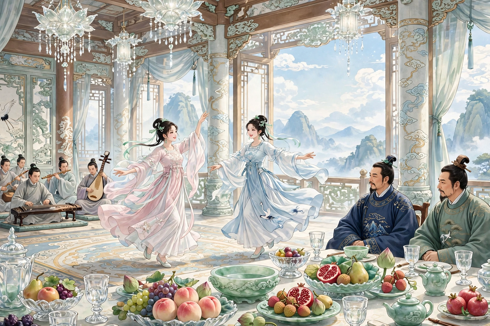

# 085 道士

韩生出身世家，喜欢待客。同村的徐氏，常常在他席上饮酒。一次宴会的时候，有个道士在门口托着钵化缘。家人给他钱和粮食，他都不接受；也不离去。家人恼怒了，回去不再理他。韩生听见敲打剥落的声音很久，询问家人，家人把情形告诉了他。话还没有说完，道士竟然进来了。韩生请他坐下。道士向主人和客人都举手行了一礼，就坐下了。略微盘问，才知道他起初住在村东的破庙里。韩生说：“您什么时候栖居在东边的道观里，我竟然不知道，实在缺少了地主的礼数。”道士回答说：“野人新到这里，没有交游。听说居士挥霍大方，很想求一杯酒喝。”韩生命令举杯。道士很能豪饮。徐氏看见他衣服肮脏破旧，很是傲慢，不怎么以礼相待。韩生也像对待远方客人一样对待他。道士一连喝了二十多杯，才告辞离去。

从此每次宴会，道士总是来到，遇到吃的就吃，遇到喝的就喝，韩生也渐渐厌烦他来得频繁。饮酒的时候，徐氏讥讽他说：“道长天天做客人，难道不做一次主人吗？”道士笑着说：“道人和居士是一样的，只不过是两肩扛着一张嘴罢了。”徐氏渐渐对答不上来。道士说：“虽然如此，道人怀着诚意已经很久了，一定会竭力做一杯水的报答。”喝完之后，嘱咐说：“明天中午请赏光前来。”第二天，两人相约同去，还怀疑他不会设宴。走去，道士已经在路上等候；一边说话一边走，已经到了寺门。进门一看，院落焕然一新，连绵的楼阁像云蔓一样。两人大为惊奇，说：“很久不到这里了，是什么时候新建的？”道士回答说：“竣工不久。”等进了屋子，陈设华丽，连世家都没有。两人都肃然起敬。刚刚坐下，端酒上菜的，都是十六岁的机灵童子，穿着锦衣红鞋。酒菜芳香美味，极其丰盛。吃完饭，另有小菜上来。珍贵的果子大多叫不出名字，装在水晶玉石的器皿里。光芒照着几案床榻。用玻璃盏斟酒，围有一尺左右。道士说：“叫石家姊妹来。”童子去了不久，两个美人进来了。一个细长，像弱柳；一个身材短，年纪最小；妩媚动人，两人都绝美。道士就让她们唱歌助酒。年纪小的拍着板唱歌，年长的和着洞箫，声音清细。唱完之后，道士举起酒杯催促干杯，又命令遍饮。问美人说：“很久不跳舞了，还能跳吗？”于是有僮仆在筵席下铺开地毯，两个女子对舞，长衣纷乱拂动，香尘四散；舞罢，斜靠在画屏上。两人都心旷神飞，不觉喝醉了。

道士也不顾客人，举杯喝尽，起身对客人说：“暂且请你们自己斟酒，我稍稍休息一下，马上就回来。”说完就走了。南屋墙壁下面，设着一张螺钿床，女子铺上锦褥，扶道士躺下。道士就拉着年长的女子一起睡，命令年少的女子站在床下给他抓痒。两人看到这个情形，很不平。徐氏就大喊：“道士不得无礼！”前去要搅扰他。道士急忙起身逃走了。徐氏看见少女还站在床下，趁着醉意把她拉到北边的床上，公然拥着睡下。看床上的美人，还睡在绣床上，徐氏看着韩生说：“您为什么太迂腐？”韩生于是直接登上南边的床；想要亲近，而美人睡去了，拨也拨不动。于是抱着她一起睡了。天亮了，酒和梦都醒了，觉得怀里的冷东西冰人；一看，原来是抱着长石头睡在青石台阶下面。急忙看徐氏，徐氏还没有醒；看见他枕着遗屙的石头，酣睡在破败的厕所里。把他踢起来，两人互相惊异。四处一看，只有一庭荒草、两间破屋罢了。

## 原文

韩生，世家也。好客。同村徐氏，常饮于其座。会宴集，有道士托钵门上。家人投钱及粟，皆不受；亦不去。家人怒，归不顾。韩闻击剥之声甚久，询之，家人以情告。言未已，道士竟入。韩招之坐。道士向主客皆一举手，即坐。略致研诘，始知其初居村东破庙中。韩曰：「何日栖鹤东观，竟不闻知，殊缺地主之礼。」答曰：「野人新至，无交游。闻居士挥霍，深愿求饮焉。」韩命举觞。道士能豪饮。徐见其衣服垢敝，颇偃蹇，不甚为礼。韩亦海客遇之。道士倾饮二十余杯，乃辞而去。

自是每宴会，道士辄至，遇食则食，遇饮则饮，韩亦稍厌其频。饮次，徐嘲之曰：「道长日为客，宁不一作主？」道士笑曰：「道人与居士等，惟双肩承一喙耳。」徐渐不能对。道士曰：「虽然，道人怀诚久矣，会当竭力作杯水之酬。」饮毕，嘱曰：「翌午幸赐光宠。」次日，相邀同往，疑其不设。行去，道士已候于途；且语且步，已至寺门。入门，则院落一新，连阁云蔓。大奇之，曰：「久不至此，创建何时？」道士答：「竣工未久。」比入其室，陈设华丽，世家所无。二人肃然起敬。甫坐，行酒下食，皆二八狡童，锦衣朱履。酒馔芳美，备极丰渥。饭已，另有小进。珍果多不可名，贮以水晶玉石之器。光照几榻。酌以玻璃盏，围尺许。道士曰：「唤石家姊妹来。」童去少时，二美人入。一细长，如弱柳；一身短，齿最稚；媚曼双绝。道士即使歌以侑酒。少者拍板而歌，长者和以洞箫，其声清细。既阕，道士悬爵促酹，又命遍酌。顾问美人：「久不舞，尚能之否？」遂有僮仆展氍毹于筵下，两女对舞，长衣乱拂，香尘四散；舞罢，斜倚画屏。二人心旷神飞，不觉醺醉。

道士亦不顾客，举杯饮尽，起谓客曰：「姑烦自酌，我稍憩，即复来。」即去。南屋壁下，设一螺钿之床，女子为施锦裀，扶道士卧。道士乃曳长者共寝，命少者立床下为之爬搔。二人睹此状，颇不平。徐乃大呼：「道士不得无礼！」往将挠之。道士急起而遁。见少女犹立床下，乘醉拉向北榻，公然拥卧。视床上美人，尚眠绣榻，顾韩曰：「君何太迂？」韩乃径登南榻；欲与狎亵，而美人睡去，拨之不转。因抱与俱寝。天明，酒梦俱醒，觉怀中冷物冰人；视之，则抱长石卧青阶下。急视徐，徐尚未醒；见其枕遗屙之石，酣寝败厕中。蹴起，互相骇异。四顾，则一庭荒草，两间破屋而已。
