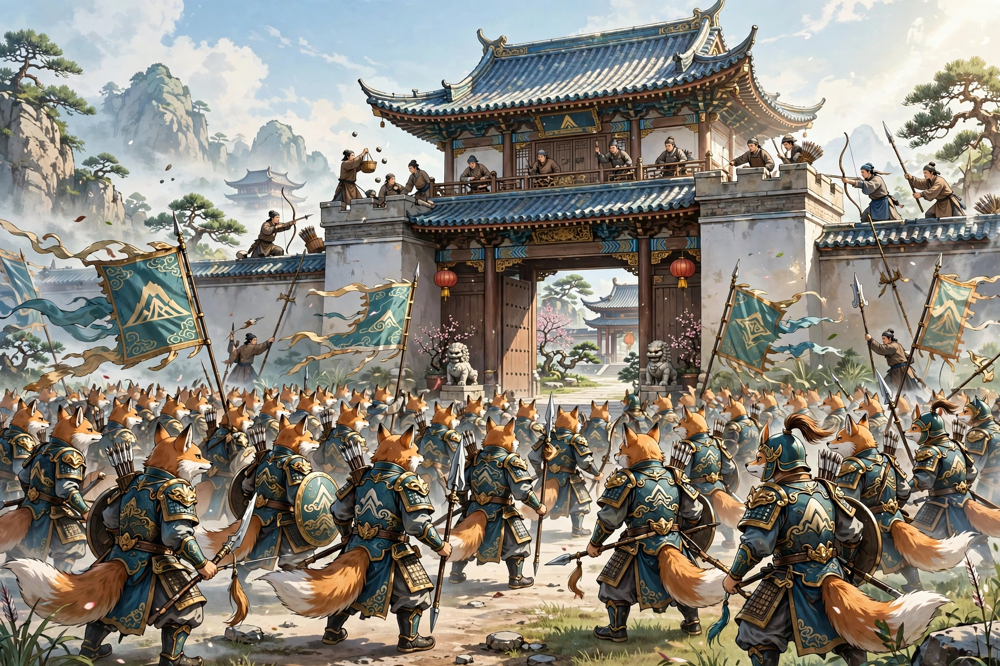

# 086 胡氏

直隶有一户大户人家，想要聘请老师。忽然有一个秀才，亲自上门自荐。主人请他进来。言谈爽朗，于是彼此相知相悦。秀才自称姓胡，主人于是收下拜师礼，把他请到馆里。胡先生教课很勤奋，学识渊博，不是一般读书人可比。然而他时常出游，总是到了深夜才回来；门明明关得严严的，听不见敲门声，他却已经在屋里了。大家于是惊讶地以为他是狐狸。然而察看胡先生的意思本来并不恶劣，主人优待看重他，不因为怪异就废弃礼数。

胡先生知道主人有个女儿，想要结为姻亲，多次暗示，主人假装不明白。一天，胡先生请假离去了。第二天，有客人来拜访，把黑色的牲口拴在门口。主人迎接他进来。客人年纪五十多岁，衣鞋鲜洁，神情很是恬静文雅。坐下之后，自己说明来意，才知道是为胡先生做媒。主人沉默了很久，说：“我和胡先生，交情已经非常深厚，何必结为婚姻呢？况且小女已经许配人家了。请替我谢绝胡先生。”客人说：“确实知道令爱待聘，为什么拒绝得这么坚决？”再三说着，而主人不答应。客人面有惭色，说：“胡先生也是世家大族，为什么就一下子不如先生呢？”主人直言告诉他说：“实在没有别的意思，只是厌恶他不是同类罢了。”客人听了发怒；主人也发怒，互相侵犯更加急迫。客人起身，抓主人。主人命令家人用棍棒驱逐他，客人就逃走了。遗下一头驴，看它，毛色黑色，披着耳朵、长着长尾巴，是个大东西。牵它不动，驱赶它就随着手倒下，发出喓喓的声音，原来是草虫罢了。

主人因为他的话而忿怒，知道一定会结仇，就戒备起来。第二天，果然有狐兵大批到来：有的骑马，有的步行，有的拿戈，有的拿弩，马嘶人喊，声势汹汹。主人不敢出来。狐狸扬言要烧毁房屋，主人更加害怕。有强健的人，率领家人呐喊着冲出来，飞石射箭，两方互相冲击，彼此都有损伤。狐狸渐渐退败，纷纷撤走了。遗下一把刀在地上，亮得像霜雪一样；走近拾起来，原来是高粱叶。众人笑着说：“本事不过如此罢了。”然而担心他们再来，更加防备。第二天，众人正在聚在一起说话，忽然一个巨人从天而降：高一丈多，身宽几尺；挥着像门一样的大刀，追着人杀。众人拿着箭石乱打他，他跌倒死了，原来是个草扎的人。众人更加轻视他们。狐狸三天不再来，众人也稍微松懈。主人恰好上厕所，忽然看见狐兵，张弓挟箭而来，乱射他；箭都集中在臀部。主人大为害怕，急忙喊众人奔来打斗，狐狸才离去。拔下箭来看，都是蒿草梗。像这样一个多月，来去没有规律，虽然不很害人，但天天戒严，主人深受其苦。

一天，胡生率领众人到来。主人亲自出来，胡生望见了，躲在众人中间。主人呼唤他，不得已，才出来。主人说：“我自认为对先生没有失礼的地方，为什么要兴兵呢？”群狐想要射箭，胡生制止了他们。主人走近握住他的手，邀请他进入原来的书斋，摆酒款待。从容地说：“先生是通达的人，应当体谅我。凭我们的情好，难道不乐意攀附婚姻吗？只是先生的车马、宫室，大多和人不相同，弱小的女儿跟着去，即使先生也应当知道这是不行的。况且谚语说：‘瓜果生摘下来的，不合口味。’先生又何必这样做呢？”胡生非常惭愧。主人说：“不要紧，旧日的交好还在。如果不嫌弃我尘俗，我门墙下的幼子，年纪十五岁了，愿意坦腹订亲。不知道有没有相配的人呢？”胡生高兴地说：“我有个小妹妹，比公子小一岁，很不丑陋。用来侍奉箕帚，怎么样？”主人起身拜谢，胡生回拜。于是互相劝酒，非常欢乐，以前的嫌隙都忘记了。命令摆上酒浆，遍赏随从的人，上下都欢乐安慰。于是详细询问住处，打算送上聘礼。胡生推辞了。天黑后点上蜡烛，喝醉了才离去。从此就安定下来了。

一年多，胡生没有来。有人怀疑他的约定是假的，而主人坚决等待着。又过了半年，胡生忽然来了。问候寒温之后，就说：“妹妹已经长成了。请占卜良辰，派她去侍奉公婆。”主人高兴，就一同定下日期离去了。到了夜里，果然有车马送新妇到来。嫁妆丰盛，摆在屋里几乎满了。新妇见公婆，温柔美丽异常。主人大喜。胡生和一个弟弟来送女儿，谈吐都很风雅，又善于饮酒。天亮了才离去。新妇还能预知年岁的丰收凶荒，所以谋生的计策，都以她的话为准。胡生兄弟以及胡老太太，时常来看望女儿，人人都见过她们。

## 原文

直隶有巨家，欲延师。忽一秀才，踵门自荐。主人延入。词语开爽，遂相知悦。秀才自言胡氏，遂纳贽馆之。胡课业良勤，淹洽非下士等。然时出游，辄昏夜始归；扃闭俨然，不闻款叩而已在室中矣。遂相惊以狐。然察胡意固不恶，优重之，不以怪异废礼。

胡知主人有女，求为姻好，屡示意，主人伪不解。一日，胡假而去。次日，有客来谒，絷黑卫于门。主人逆而入。年五十余，衣履鲜洁，意甚恬雅。既坐，自达，始知为胡氏作冰。主人默然，良久曰：「仆与胡先生，交已莫逆，何必婚姻？且息女已许字矣。烦代谢先生。」客曰：「确知令媛待聘，何拒之深？」再三言之，而主人不可。客有惭色，曰：「胡亦世族，何遽不如先生？」主人直告曰：「实无他意，但恶非其类耳。」客闻之怒；主人亦怒，相侵益亟。客起，抓主人。主人命家人杖逐之，客乃遁。遗其驴，视之，毛黑色，批耳修尾，大物也。牵之不动，驱之则随手而蹶，喓喓然草虫耳。

主人以其言忿，知必相仇，戒备之。次日，果有狐兵大至：或骑或步，或戈或弩，马嘶人沸，声势汹汹。主人不敢出。狐声言为屋，主人益惧。有健者，率家人噪出，飞石施箭，两相冲击，互有夷伤。狐渐靡，纷纷引去。遗刀地上，亮如霜雪；近拾之，则高粱叶也。众笑曰：「技止此耳。」然恐其复至，益备之。明日，众方聚语，忽一巨人自天而降：高丈余，身横数尺；挥大刀如门，逐人而杀。群操矢石乱击之，颠踣而毙，则刍灵耳。众益易之。狐三日不复来，众亦少懈。主人适登厕，俄见狐兵，张弓挟矢而至，乱射之；集矢于臀。大惧，急喊众奔斗，狐方去。拔矢视之，皆蒿梗。如此月余，去来不常，虽不甚害，而日日戒严，主人患苦之。

一日，胡生率众至。主人身出，胡望见，避于众中。主人呼之，不得已，乃出。主人曰：「仆自谓无失礼于先生，何故兴戎？」群狐欲射，胡止之。主人近握手，邀入故斋，置酒相款。从容曰：「先生达人，当相见谅。以我情好，宁不乐附婚姻？但先生车马、宫室，多不与人同，弱女相从，即先生当知其不可。且谚云：『瓜果之生摘者，不适于口。』先生何取焉？」胡大惭。主人曰：「无伤，旧好故在。如不以尘浊见弃，在门墙之幼子，年十五矣，愿得坦腹订下。不知有相若者否？」胡喜曰：「仆有弱妹，少公子一岁，颇不陋劣。以奉箕帚，如何？」主人起拜，胡答拜。于是酬酢甚欢，前郤俱忘。命罗酒浆，遍犒从者，上下欢慰。乃详问居里，将以奠雁。胡辞之。日暮继烛，醺醉乃去。由是遂安。

年余，胡不至。或疑其约妄，而主人坚待之。又半年，胡忽至。既道温凉已，乃曰：「妹子长成矣。请卜良辰，遣事翁姑。」主人喜，即同定期而去。至夜，果有舆马送新妇至。奁妆丰盛，设室中几满。新妇见姑嫜，温丽异常。主人大喜。胡生与一弟来送女，谈吐俱风雅，又善饮。天明乃去。新妇且能预知年岁丰凶，故谋生之计，皆取则焉。胡生兄弟以及胡媪，时来望女，人人皆见之。
