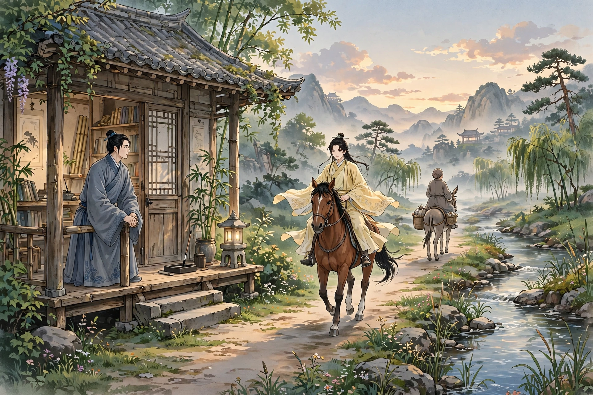
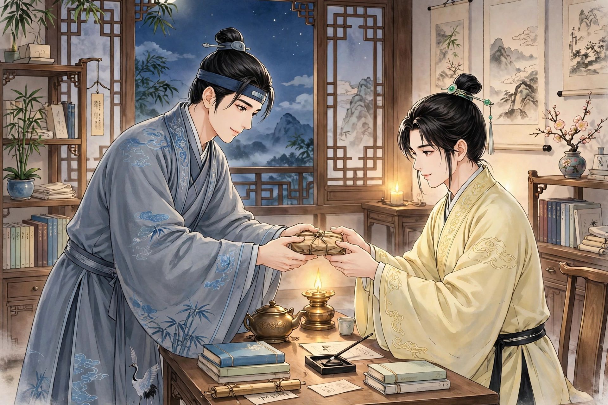
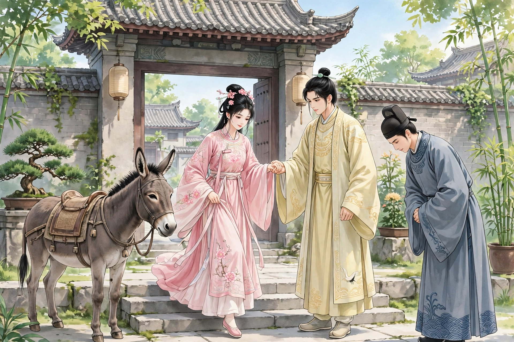
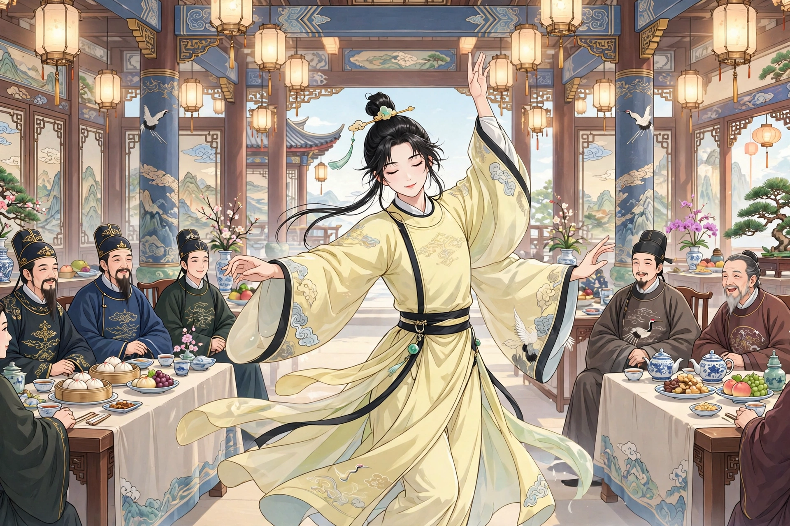

# 093 黄九郎

何师参，字子萧，在苕溪东边读书，门临旷野。薄暮时偶然出门，看见一位妇人骑驴而来，一位少年跟在她后面。妇人大约五十多岁，意态清雅超俗。再看少年，年纪十五六岁，风采胜过美丽的女子。何生素来有断袖的癖好，看见他，神魂都出了窍；踮着脚目送着，直到影子消失才回家。第二天，他早早等候着。落日昏暗的时候，少年才经过。何生曲意迎合，笑着问他从哪里来。回答说是“外祖家”。何生请他到书斋里稍稍休息，少年推辞说没有空闲；坚决拉他，才进去了。略坐一会儿就要告辞，怎么也挽留不住。何生拉着他的手送他，殷勤嘱咐他顺路时过来。少年连连答应着去了。何生从此凝神思念如渴，往来眺望，脚步没有停歇的时候。

一天，太阳衔着半轮红日，少年忽然来到。何生大喜，请他进来，命令书馆的童子行酒。问他的姓名，回答说：“姓黄，排行第九。还是童子，没有字。”问：“往来为什么这样频繁？”说：“母亲在外祖家，常常生病，所以多次去探望。”酒喝了几巡，想要告辞离去。何生拉住他的手臂遮留下来，锁上了门。九郎无可奈何，红着脸又坐下来。挑灯一起谈话，温柔得像处子一样；可是话语涉及游戏调笑，便含羞转脸向着墙壁。没过多久，何生引他同床共寝。九郎不答应，坚决以睡相不好为借口推辞。强求了再三，才解开上下衣裳，穿着裤子躺在床上。何生熄了灯，过了一会儿，移过去与他同枕，曲着手臂搭在他的大腿上亲昵地抱着他，苦苦请求亲近。九郎生气地说：“因为您是风雅之士，所以才与您往来；竟然做出这样的事来，这是像禽兽一样相处、像野兽一样相爱啊！”没过多久，晨星闪烁，九郎径直离去了。何生恐怕他就此断绝，又等候着他，来回踱步凝神盼望，眼睛都望穿了北斗。过了几天，九郎才来到。何生高兴地迎接他并谢罪；强拉他进书斋，催促他坐下谈笑，暗自庆幸他不记恨旧事。没过多久，何生脱鞋登床，又抚摸亲近他。九郎说：“缠绵的心意，已经刻在肺腑里了，可是亲爱何必非要在这里呢？”何生用甜言蜜语纠缠，只求亲近一次他的肌肤。九郎答应了他。何生等他睡着了，暗地里亲近轻薄他。九郎醒来，拉起衣服急忙起身，趁夜逃走了。何生闷闷不乐，像是失落了什么，忘记吃饭、废弃睡眠，一天比一天憔悴。只是每天派书斋的童子去探察他的行踪。

一天，九郎从门前经过，就想径直离去。童子拉着他的衣服把他带了进来。看见何生清瘦憔悴，九郎大惊，慰问他。何生如实告诉了他实情，眼泪随着话语涔涔落下。九郎细声说：“我的一点心意，实在是因为相爱对弟弟没有益处，而对兄长有害处，所以才不这样做。您既然喜欢这样，我又何必吝惜呢？”何生大喜。九郎走后，他的病顿时减轻，几天就痊愈了。九郎果然来了，于是两人亲密相处，说：“如今勉强顺从您的意思，希望不要把这当作常事。”接着说：“想要有所求，您肯出力吗？”问他是什么事，回答说：“母亲患心痛病，只有太医齐野王的先天丹可以治疗。您与他交好，应当能够求到。”何生答应了他。临走时又嘱托。何生进城求药，到了傍晚交给了他。九郎高兴，双手接过称谢。又强与他亲近。九郎说：“不要这样纠缠，我谨慎地为您谋一位佳人，胜过弟弟万万倍了。”何生问是谁。九郎说：“有位表妹，美貌无双。如果您有意，我可以为您做媒。”何生微笑着不回答。九郎带着药就走了。三天后九郎才来，又求药。何生恨他来得迟，话语中多有讥讽责备。九郎说：“本来是不忍心害您，所以疏远您；既然不蒙您体谅，请不要后悔。”从此宴会没有空闲的夜晚。

每三天一定来讨一次药。齐野王奇怪他要得这样频繁，说：“这种药从来没有服用超过三剂的，为什么久久不见好转？”于是包了三剂一并交给他。又看着何生说：“您的神色黯淡，是生病了吗？”说：“没有。”为他诊脉，惊讶地说：“您有鬼脉，病在少阴，不自己谨慎的话就危险了！”何生回去告诉了九郎。九郎叹息说：“真是良医啊！我其实是狐，早就担心不能给您带来福气。”何生怀疑他在欺骗，藏起他的药，不全部给他，担心他不再来了。没过多久，果然病了。请齐野王来诊视，说：“先前不说实话，如今魂气已经游荡在荒野之中，秦缓又怎么能有办法呢？”九郎每天来探望侍候，说：“不听我的话，果然到了这个地步！”何生不久就死了。九郎痛哭着离去了。

在此之前，邑里有位某太史，年少时与何生一起读书；十七岁就考中翰林。当时秦藩贪婪暴虐，而贿赂通达朝中士大夫，没有一个人敢说。太史直言上疏弹劾他的罪恶，因为越级而被罢免。秦藩升任本省巡抚，天天伺机寻找太史的过失。太史年少时颇有英名，曾经得到叛王的青睐，于是秦藩买到了他从前与叛王往来的书信，胁迫太史。太史害怕了，自缢而死。夫人也投缳自尽。太史过了一夜忽然醒来，说：“我怎么成了子萧呢？”追问他，所说的话都是何家的事，才明白他是借尸还魂。留他留不住，他跑回了旧宅。巡抚怀疑他是假冒，一定要陷害他，派人向太史索要千金。太史假装答应，心里忧闷得要死。忽然听说九郎来了，高兴地与他一起谈话，悲喜交集。又想要重新亲近。九郎说：“您有三条命吗？”太史说：“我后悔活着劳苦，不如死了安逸。”九郎忧愁地思索着。过了一会儿说：“幸好又重新相聚。您空着没有配偶，先前说的表妹，聪慧美丽又多谋略，一定能够分担忧愁。”太史想要见一见她的容貌。说：“不难。明天她将陪伴老母经过这条路，您假装是弟弟的哥哥，我假装口渴求水喝。您说‘驴子丢了’，她就会答应了。”计议已定就告别了。

第二天正午，九郎果然陪着女郎从门外经过。太史拱手絮絮叨叨地与她说话。略微看女郎一眼，眉目秀美，身姿曼妙，确实像仙人一样。九郎要茶喝，太史请他进来喝。九郎说：“三妹不要见怪，这位哥哥是我的盟友，不妨稍稍休息一下。”扶她下来，把驴系在门上进去了。太史亲自起来煮茶敬客。因为看着九郎说：“您先前说的话还不足以形容，如今我找到死的地方了。”女郎似乎明白了他的话是针对自己说的，离开座位站起来，嘤喔地说：“走吧！”太史向外张望说：“驴子大概丢了！”九郎急忙奔驰出去，太史抱住女郎求合，女郎脸色变得紫青，窘迫得像被拘押的囚犯，大呼九兄，没有应答。说：“您自己有妻子，为什么要丧失别人的廉耻呢？”太史自己陈述没有妻子，女郎说：“能够对着山河发誓，不让我像秋天的扇子一样被抛弃，那就只听您的命令了。”太史就对着明亮的太阳发誓。女郎不再拒绝。事情完毕，九郎来了。女郎脸色严肃地责备他。九郎说：“这是何子萧，从前的名士，如今的太史。与兄长最为交好，他这个人可以依靠。即使听到妗母那里，也不会见怪。”到了傍晚，太史邀留他们不让离去。女郎担心姑母惊怪。九郎挺身自己担当，骑着驴径直离去了。过了几天，有位妇人带着婢女经过，年纪四十多岁，神情意态，很像三娘。太史叫女郎出来偷看，果然是母亲。母亲一瞥看见女郎，奇怪地问：“怎么会在这里？”女郎羞惭不能回答。太史请她进来，拜见并告诉了她。母亲笑着说：“九郎孩子气，怎么又不再商量了？”女郎自己走进厨房，设食供养母亲，吃完就离去了。

太史得到了美丽的配偶，很合心意；可是恶劣的情绪萦绕心怀，常常愁眉苦脸满面忧色。女郎问他，太史详细讲述了事情的始末。女郎笑着说：“这件事九兄一个人就可以解决，您忧愁什么呢？”太史追问缘故。女郎说：“听说巡抚沉溺于声歌而喜欢顽童，这些都是九兄擅长的。投他所好献给他，怨恨可以消除，仇也可以报复。”太史担心九郎不肯。女郎说：“只管请求他可怜您。”第二天，太史看见九郎来了，弯着腰迎接他。九郎惊讶地说：“两世的交情，只要能够为您效力，就是头顶脚跟都不敢吝惜。为什么忽然做出这种姿态对着人呢？”太史把谋划全部告诉了他。九郎面有难色。女郎说：“我失身于郎君，是谁造成的呢？如果让他在中途凋零丧命，我又置身何处呢？”九郎不得已，答应了他。太史暗中与他谋划，写信给交好的王太史，把九郎送了过去。王太史领会了他的意思，大摆宴席，邀请巡抚来饮酒。命令九郎装扮成女郎，跳天魔舞，宛然就是一位美女。巡抚被迷惑了，急忙向王太史请求，想要用重金购买九郎，只怕不能如愿。王太史故意沉思着为难他。拖延了很久，才把太史的命令传达进去。巡抚高兴，先前的嫌隙顿时消释。自从得到九郎，动息不相离；侍妾十多人，都看得如同尘土。九郎的饮食供具如同王者；赏赐的金子数以万计。半年后，巡抚病了。九郎知道他离冥路不远了，于是载着金帛，假装回家回到太史家。不久巡抚死了。九郎拿出钱财，建造房屋、置办器物，蓄养婢女仆人，母亲、儿子和妗母都住在一起了。九郎出门时，车马十分齐整，人们不知道他是狐。我还有一篇“笑判”，一并记在这里：

男女同居，是夫妇的大伦；燥湿互通，是阴阳的正窍。迎风待月，尚且有放荡不检的讥讽；断袖分桃，难免有掩鼻的丑闻。人一定是力士，鸟道才敢生生开辟；洞不是桃源，渔篙难道允许误入？如今某人从下流而不知返回，舍弃正路而不走。云雨还没有兴起，就上下其手；阴阳颠倒背离，居然表里为奸。华池置于无用的地方，谬说老僧入定；蛮洞是不毛之地，于是让眇帅称戈。把赤兔系在辕门，像要射戟；探大弓于国库，直要斩关。或是监内的黄鳝，昨夜访求知交；分明是王家的朱李，来生索取钻报。那黑松林里戎马顿来，固然相安无事；如果黄龙府的潮水忽然到来，又怎么抵御呢？应当断掉他钻刺的根，兼塞住他送迎的路。

## 原文

何师参，字子萧，斋于苕溪之东，门临旷野。薄暮偶出，见妇人跨驴来，少年从其后。妇约五十许，意致清越。转视少年，年十五六，丰采过于姝丽。何生素有断袖之癖，睹之，神出于舍；翘足目送，影灭方归。次日，早伺之。落日冥蒙，少年始过。生曲意承迎，笑问所来。答以「外祖家」。生请过斋少憩，辞以不暇；固曳之，乃入。略坐兴辞，坚不可挽。生挽手送之，殷嘱便道相过。少年唯唯而去。生由是凝思如渴，往来眺注，足无停趾。

一日，日衔半规，少年歘至。大喜，要入，命馆童行酒。问其姓字，答曰：「黄姓，第九。童子无字。」问：「过往何频？」曰：「家慈在外祖家，常多病，故数省之。」酒数行，欲辞去。生捉臂遮留，下管钥。九郎无如何，頳颜复坐。挑灯共语，温若处子；而词涉游戏，便含羞，面向壁。未几，引与同衾。九郎不许，坚以睡恶为辞。强之再三，乃解上下衣，著裤卧床上。何灭烛，少时，移与同枕，曲肘加髀而狎抱之，苦求私昵。九郎怒曰：「以君风雅士，故与流连；乃此之为，是禽处而兽爱之也！」未几，晨星荧荧，九郎径去。生恐其遂绝，复伺之，蹀躞凝盼，目穿北斗。过数日，九郎始至。喜逆谢过；强曳入斋，促坐笑语，窃幸其不念旧恶。无何，解屦登床，又抚哀之。九郎曰：「缠绵之意，已镂肺鬲，然亲爱何必在此？」生甘言纠缠，但求一亲玉肌。九郎从之。生俟其睡寐，潜就轻薄。九郎醒，揽衣遽起，乘夜遁去。生邑邑若有所失，忘啜废枕，日渐委悴。惟日使斋童逻侦焉。

一日，九郎过门，即欲径去。童牵衣入之。见生清癯，大骇，慰问。生实告以情，泪涔涔随声零落。九郎细语曰：「区区之意，实以相爱无益于弟，而有害于兄，故不为也。君既乐之，仆何惜焉？」生大悦。九郎去后，病顿减，数日平复。九郎果至，遂相缱绻，曰：「今勉承君意，幸勿以此为常。」既而曰：「欲有所求，肯为力乎？」问之，答曰：「母患心痛，惟太医齐野王先天丹可疗。君与善，当能求之。」生诺之。临去又嘱。生入城求药，及暮付之。九郎喜，上手称谢。又强与合。九郎曰：「勿相纠缠，谨为君图一佳人，胜弟万万矣。」生问谁。九郎曰：「有表妹，美无伦。倘能垂意，当报柯斧。」生微笑不答。九郎怀药便去。三日乃来，复求药。生恨其迟，词多诮让。九郎曰：「本不忍祸君，故疏之；既不蒙见谅，请勿悔焉。」由是燕会无虚夕。

凡三日必一乞药。齐怪其频，曰：「此药未有过三服者，胡久不瘥？」因裹三剂并授之。又顾生曰：「君神色黯然，病乎？」曰：「无。」脉之，惊曰：「君有鬼脉，病在少阴，不自慎者殆矣！」归语九郎。九郎叹曰：「良医也！我实狐，久恐不为君福。」生疑其诳，藏其药，不以尽予，虑其弗至也。居无何，果病。延齐诊视，曰：「曩不实言，今魂气已游墟莽，秦缓何能为力？」九郎日来省侍，曰：「不听吾言，果至于此！」生寻卒。九郎痛哭而去。

先是，邑有某太史，少与生共笔砚；十七岁擢翰林。时秦藩贪暴，而赂通朝士，无有言者。公抗疏劾其恶，以越俎免。藩升是省中丞，日伺公隙。公少有英称，曾邀叛王青盼，因购得旧所往来札，胁公。公惧，自经。夫人亦投缳死。公越宿忽醒，曰：「我何子萧也。」诘之，所言皆何家事，方悟其借躯返魂。留之不可，出奔旧舍。抚疑其诈，必欲排陷之，使人索千金于公。公伪诺，而懮闷欲绝。忽通九郎至，喜共话言，悲欢交集。既欲复狎。九郎曰：「君有三命耶？」公曰：「余悔生劳，不如死逸。」九郎悠懮以思。少间曰：「幸复生聚。君旷无偶，前言表妹，慧丽多谋，必能分懮。」公欲一见颜色。曰：「不难。明日将取伴老母，此道所经。君伪为弟也兄者，我假渴而求饮焉。君曰『驴子亡』，则诺也。」计已而别。

明日亭午，九郎果从女郎经门外过。公拱手絮絮与语。略睨女郎，娥眉秀曼，诚仙人也。九郎索茶，公请入饮。九郎曰：「三妹勿讶，此兄盟好，不妨少休止。」扶之而下，系驴于门而入。公自起瀹敬。因目九郎曰：「君前言不足以尽，今得死所矣。」女似悟其言之为已者，离榻起立，嘤喔而言曰：「去休！」公外顾曰：「驴子其亡！」九郎火急驰出，公拥女求合，女颜色紫变，窘若囚拘，大呼九兄，不应。曰：「君自有妇，何丧人廉耻也？」公自陈无室，女曰：「能矢山河，勿令秋扇见捐，则惟命是听。」公乃誓以皦日。女不复拒。事已，九郎至。女色然怒让之。九郎曰：「此何子萧，昔之名士，今之太史。与兄最善，其人可依。即闻诸妗氏，当不相见罪。」日向晚，公邀遮不听去。女恐姑母骇怪。九郎锐身自任，跨驴径去。居数日，有妇携婢过，年四十许，神情意致，雅似三娘。公呼女出窥，果母也。瞥睹女，怪问：「何得在此？」女惭不能对。公邀入，拜而告之。母笑曰：「九郎稚气，胡再不谋？」女自入厨下，设食供母，食已乃去。

公得丽偶，颇快心期；而恶绪萦怀，恒蹙蹙有懮色。女问之，公缅述颠末。女笑曰：「此九兄一人可得解，君何懮？」公诘其故。女曰：「闻抚公溺声歌而比顽童，此皆九兄所长也。投所好而献之，怨可消，仇亦可复。」公虑九郎不肯。女曰：「但请哀之。」越日，公见九郎来，肘行而逆之。九郎惊曰：「两世之交，但可自效，顶踵所不敢惜。何忽作此态向人？」公具以谋告。九郎有难色。女曰：「妾失身于郎，谁实为之？脱令中途雕丧，焉置妾也？」九郎不得已，诺之。公阴与谋，驰书与所善之王太史，而致九郎焉。王会其意，大设，招抚公饮。命九郎饰女郎，作天魔舞，宛然美女。抚惑之，亟请于王，欲以重金购九郎，惟恐不得当。王故沉思以难之。迟之又久，始将公命以进。抚喜，前郤顿释。自得九郎，动息不相离；侍妾十余，视同尘土。九郎饮食供具如王者；赐金万计。半年，抚公病。九郎知其去冥路近也，遂辇金帛，假归公家。既而抚公薨。九郎出资，起屋置器，畜婢仆，母子及妗并家焉。九郎出，舆马甚都，人不知其狐也。余有「笑判」，并志之：

男女居室，为夫妇之大伦；燥湿互通，乃阴阳之正窍。迎风待月，尚有荡检之讥；断袖分桃，难免掩鼻之丑。人必力士，鸟道乃敢生开；洞非桃源，渔篙宁许误入？今某从下流而忘返，舍正路而不由。云雨未兴，辄尔上下其手；阴阳反背，居然表里为奸。华池置无用之乡，谬说老僧入定；蛮洞乃不毛之地，遂使眇帅称戈。系赤兔于辕门，如将射戟；探大弓于国库，直欲斩关。或是监内黄鳣，访知交于昨夜；分明王家朱李，索钻报于来生。彼黑松林戎马顿来，固相安矣；设黄龙府潮水忽至，何以御之？宜断其钻刺之根，兼塞其送迎之路。
