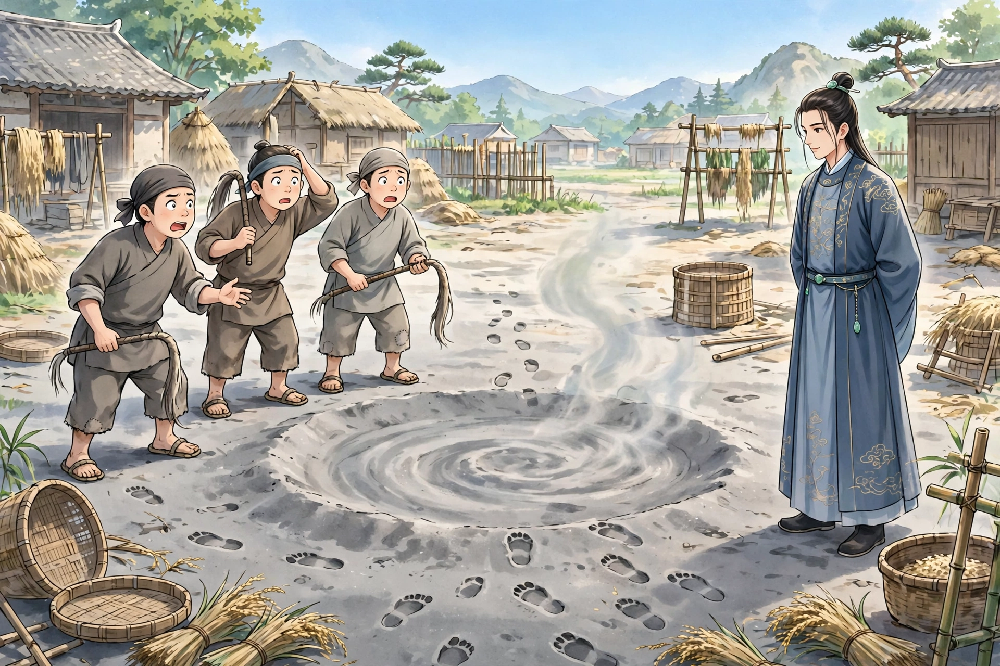

# 098 单道士

韩公子，是邑里的世家子弟。有一位单道士，擅长戏法，公子喜爱他的法术，把他当作座上客。单道士与人一起行走坐卧，常常忽然不见。公子想要传授他的法术，单道士不肯。公子坚决恳求他。单道士说：“我不是吝惜我的法术，是恐怕败坏我的道术。所传授的人如果是君子就可以；不然，有人借此去行窃了。公子固然不必担心这个，可是或者出门看见美丽的人而喜欢，隐身进入别人的闺房，这是助长恶事、宣扬淫乱啊。我不敢遵命。”公子不能勉强他，心里却恼怒他，暗中与仆人们谋划鞭打羞辱他。恐怕他逃匿，就用细灰尘铺在麦场上：想着旁门左道能够隐形，可是脚步所到之处一定有印迹，可以随着印迹的地方急忙击打。于是诱骗单道士前往，派人拿着牛鞭站着鞭打他。单道士忽然不见了，灰上果然有脚印，左右的人乱打，一会儿就迷乱了。

公子回家，单道士也到了。对众仆人说：“我不能再住下去了！向来劳烦服侍，如今就要告别，应当有所报答。”从袖子里拿出美酒一盛，又探得菜肴一簋，一并陈列在几案上。陈列完毕，又探取；一共探取了十多次，案上已经摆满了。于是邀请众人饮酒，都喝醉了；又一一收回袖子里。韩公子听说他的奇异，让他再表演戏法。单道士在墙上画了一座城，用手推敲，城门顿时打开。于是把行囊衣服箱子里的东西，全都扔进门里，就拱手告别说：“我走了。”纵身跳进城里，城门就合上了，道士顿时杳无踪影。

后来听说他在青州的市集上，教儿童在手掌上画墨圈，对着人戏谑地抛去，随着抛去的地方，或者脸上或者衣服上，圈子就脱落下去，印在上面。又听说他擅长房中术，能够用下部吸烧酒，吸尽一器。公子曾经亲自试验他。

## 原文

韩公子，邑世家。有单道士，工作剧，公子爱其术，以为座上客。单与人行坐，辄忽不见。公子欲传其法，单不肯。公子固恳之。单曰：「我非吝吾术，恐坏吾道也。所传而君子则可；不然，有借此以行窃者矣。公子固无虑此，然或出见美丽而悦，隐身入人闺闼，是济恶而宣淫也。不敢从命。」公子不能强，而心怒之，阴与仆辈谋挞辱之。恐其遁匿，因以细灰尘布麦场上：思左道能隐形，而履处必有印迹，可随印处急击之。于是诱单往，使人执牛鞭立挞之。单忽不见，灰上果有履迹，左右乱击，顷刻已迷。

公子归，单亦至。谓诸仆曰：「吾不可复居矣！向劳服役，今且别，当有以报。」袖中出旨酒一盛，又探得肴一簋，并陈几上。陈已，复探；凡十余探，案上已满。遂邀众饮，俱醉；一一仍内袖中。韩闻其异，使复作剧。单于壁上画一城，以手推挝，城门顿辟。因将囊衣箧物，悉掷门内，乃拱别曰：「我去矣。」跃身入城，城门遂合，道士顿杳。

后闻在青州市上，教儿童画墨圈于掌，逢人戏抛之，随所抛处，或面或衣，圈辄脱去，落印其上。又闻其善房中术，能令下部吸烧酒，尽一器。公子尝面试之。
