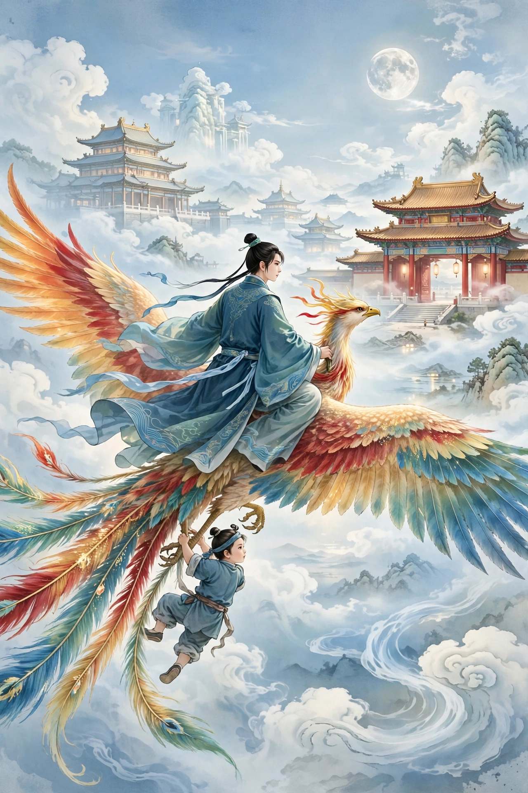

# 099 白于玉

吴青庵名筠，年轻时就小有名气。葛太史读过他的文章，常常赞叹。葛太史托与自己交好的人把吴青庵请到家里，观察他的言谈风采，说道：“哪有像吴生这样有才华，却长久贫贱的人呢？”于是托邻里好友转告说：“只要青庵奋发志气、直上云霄，我就把女儿嫁给他，侍奉他的起居。”当时太史有个女儿，美貌绝伦。吴生听说了，非常高兴，也十分自信。不久秋试落榜，他便派人对太史说：“富贵本来就是命中注定的，只是迟早不可预知罢了。请等我三年，三年不成，再把女儿嫁出去也不迟。”从此他更加刻苦用功。

一天夜里，月光明亮，有一位秀才前来拜访，皮肤白皙，留着短须，腰身细瘦，指甲很长。问他从哪里来，他自称：“姓白，字于玉。”两人略略交谈，谈话令人心胸开阔。吴生喜欢他，便留他一起住宿。天快亮时白于玉要走，吴生嘱咐他顺路时常来。白于玉感念他情意深厚，愿意就此借住下来，约定了日子便告别了。到了约定的日子，白于玉先派一个青衣仆人送来炊具。不一会儿，白于玉到了，骑着一匹像龙一样的骏马。吴生另外安排了一处房子给他住。白于玉命仆人把马牵走。从此两人朝夕相处，十分投合。吴生看白于玉读的书，都不是平常所见的书，也完全没有应试的文章，惊讶地问他。白于玉笑着说：“各人有各人的志向，我不是追求功名的人。”夜里白于玉常常请吴生饮酒，拿出一卷书给他，都是吐纳养生的法术，吴生大多不理解，便当作迂阔的东西搁置一旁。有一天白于玉对吴生说：“从前给你的那卷书，是《黄庭经》的要道，是成仙的阶梯。”吴生笑着说：“我急需的不是这个。况且求仙的人必须断绝情缘，让万念都寂灭，我这个毛病却做不到。”白于玉问：“为什么？”吴生说是因为担心子嗣。白于玉问：“为什么久久不娶妻？”吴生笑着说：“‘寡人有疾，寡人好色。’”白于玉也笑着说：“‘王请不要喜好小色。’你喜欢的是什么样的女子？”吴生把实情都告诉了他。白于玉怀疑那女子未必真有那么美。吴生说：“这是远近都共知的，不是我的眼光低贱。”白于玉微微一笑，作罢了。第二天，白于玉忽然收拾行装说要告别。吴生凄然地和他说话，絮絮叨叨说个不停。白于玉便命童子先背着行装走。两人依依不舍。忽然看见一只青蝉鸣叫着落在案桌上，白于玉告辞说：“车已经驾好了，请就此告别。如果你想念我，就拂拭我睡过的床榻，躺上去睡。”吴生正想再问，转眼之间，白于玉已经变得像手指那么小，飘然跨上蝉背，鸣叫着飞走了，杳然没入云中。吴生这才知道他不是寻常人，错愕了很久，怅然若有所失。

过了几天，细雨忽然纷纷落下，吴生思念白于玉的心情格外迫切。他看着白于玉睡过的床榻，上面有细碎的老鼠脚印，便慨然打扫干净，铺上席子就睡在上面。不久，看见白家的童子来邀请他，吴生欣然跟去了。不一会儿，有一只桐凤飞集而来，童子捉住它对吴生说：“黑夜的路难走，可以乘它代步。”吴生担心它太小，不能承受。童子说：“试着乘上去。”吴生照他说的去做，坐上去宽宽绰绰，大有余地，童子也附在它的尾巴上；只听戛然一声，凌空升上天际。不久，看见一座朱红的大门。童子先下来，扶着吴生也下来。吴生问：“这是什么地方？”童子说：“这是天门。”门边有一只巨大的老虎蹲伏着。吴生害怕，童子用身体挡住他。只见处处风景，都与人世不同。童子领他进入广寒宫，宫里用水晶作台阶，行人走在上面像在镜子里一样。两棵桂树参天合抱；花香随风飘来，香气不断。亭台楼阁都是红窗，不时有美人出入，容貌秀美、骨格清俊，世上再没有能与她们相比的。童子说：“王母的宫殿比这里还要美丽。”只是恐怕主人等候太久，来不及流连，便领着吴生匆匆走出来。过了一会儿，看见白于玉在门口等候。两人握手进去，只见檐外清水白沙，涓涓流淌；白玉砌成的台阶和雕花的栏杆，几乎让人疑心是月宫。刚坐下，就有十六岁的美丽侍女来奉上香茶。过了一会儿，白于玉命人斟酒。有四位美人，收起衣襟、佩环作响，在左右侍奉。吴生刚觉得背上微微发痒，美人就用纤细的手指和长长的指甲，伸进衣服替他搔痒。吴生觉得心神摇荡，无处安放。不久微微醉了，渐渐不能自持，笑着回头看美人，搭讪着和她们说话。美人们总是笑着躲开。白于玉命她们唱歌劝酒。一位穿绛色轻纱的美人，举杯向客人敬酒，便在筵席前宛转地清歌。其余的美人吹着竹管伴奏，还有一位穿紫衣的美人，和一位穿淡白色软纱的美人，在暗处吃吃地笑着，互相推让，不肯上前。白于玉命她们一人敬一杯酒、唱一支歌。穿紫衣的美人便来把盏。吴生借着接杯的机会，戏弄地挠了挠她纤细的手腕。女子笑着失手，酒杯倾倒坠落。白于玉责备她。女子拾起酒杯含笑，低着头细声说：“冷得像鬼的手一样香，硬要来捉住人家的手臂。”白于玉大笑，罚她自己唱歌并且跳舞。舞罢，穿淡白色衣服的美人又飞来一杯酒。吴生推辞说不能喝。捧着酒面有愧色，便勉强喝了。仔细看这四位女子，风姿翩翩，没有一个不是绝世佳人。吴生忽然对主人说：“人间的绝色美人，我求一个都难；你聚集了这么多群芳，能让我真正销魂吗？”白于玉笑着说：“你心中本来就有佳人，这些又怎么值得你看在眼里呢？”吴生说：“我今天才知道自己见识狭窄。”白于玉便把众女子都招来，让吴生自己选择。吴生颠倒犹豫，不能自己决定。白于玉因为紫衣美人与他有过把臂的情分，便让她铺被侍奉客人。不久两人衾枕相爱，极尽缠绵。吴生向她索要赠物，女子脱下金手钏交给他。忽然童子进来说：“仙凡道路不同，你应该马上回去。”虎啸声骤然响起，吴生惊慌地逃窜而去。只见下面深不见底，脚已经奔跑着坠落。猛然一惊醒来，只见朝阳已经红了。吴生正要起身穿衣，觉得有东西腻腻地附在褥子中间，一看，是那只钏。心中更加觉得奇异。从此他先前的念头冷淡下来，常常想去寻找赤松子遨游，只是还因为子嗣问题而忧虑。过了十多个月，白天睡得正酣，梦见紫衣女子从外面走来，怀里用襁褓包着一个婴儿说：“这是你的骨肉。天上难以留下这样的东西，特地送给你。”于是把婴儿放在床上，拉过衣服盖住，匆匆要走。吴生强留她欢好。她说：“前一次是成婚，这一次是永别，百年的夫妻之情，都尽在这两次了。你如果有志向，也许还有相见的时候。”吴生醒来，看见婴儿躺在褥子中间，便用襁褓包好告诉母亲。母亲高兴，雇了乳母哺育他，取名梦仙。吴生于是派人告诉太史，说自己已经要隐去了，请太史另外为女儿选择好人家。太史不肯。吴生坚决推辞。太史告诉女儿，女儿说：“远近没有不知道女儿的身体已经许给吴郎的了。现在改嫁，就是事奉两个丈夫。”于是把这个意思告诉吴生。吴生说：“我不但没有志向追求功名，也断绝了对燕好的情意。之所以没有马上入山，只是因为有老母在。”太史又来商量。女儿说：“吴郎贫穷，我甘愿吃粗茶淡饭；吴郎离去，我侍奉他的母亲：一定不改嫁别人。”派人往返三四次，始终没有谈成，于是选择日子，备好车马妆奁，嫁到吴生家里。吴生感念她的贤惠，敬爱到了极点。女子侍奉婆婆孝顺，曲意承顺，超过了贫家女子。过了两年，母亲去世，女子变卖妆奁置办丧具，没有一样不尽礼。吴生说：“得到你这样的妻子，我还有什么忧虑！只是想着一人得道，可以拔宅飞升。我将要远去了，一切都托付给你。”女子坦然，竟然不挽留。吴生便离去了。

女子在外料理生计，在内教训孤儿，井井有条，很有办法。梦仙渐渐长大，聪慧绝伦。十四岁时，以神童的身份考中乡试；十五岁进入翰林院。每当朝廷褒封亲属时，因为不知道母亲的姓氏，只封葛母一人罢了。到了霜降露冷、祭祀先人的时候，梦仙总是问父亲在哪里，母亲便把实情都告诉他。于是他想弃官去寻访父亲。母亲说：“你父亲出家时，到现在已经十多年了，想来已经成仙，到哪里去寻找呢？”后来梦仙奉旨祭祀南岳，途中遇到强盗。危急之中，一位道人仗剑进来，强盗全都溃散，包围才解开。梦仙感激他，赠送金子，道人不接受。道人拿出一封信，嘱托说：“我有一位故人，与大人同乡，麻烦代我问候一声。”问他叫什么名字，道人回答说：“王林。”梦仙想起村里没有这个名字。道士说：“草野微贱的人，贵官自然不认识。”临走时，道人拿出一只金钏说：“这是闺阁中的东西，道人拾到它，也没有用处，就拿来报答你。”梦仙一看，上面镶嵌雕镂得精美绝伦。怀揣着回去交给夫人。夫人喜爱它，命好工匠依着样式配造，始终赶不上它的精巧。遍问村里人，也没有叫王林的人。梦仙私下拆开那封信，上面写着：“三年鸾凤，分拆各天；葬母教子，全靠你的贤惠。没有什么可以报答你，奉上药丸一颗；剖开吃下去，可以成仙。”后面写着“琳娘夫人妆次”。读完，不明白是什么人，便拿去告诉母亲。母亲拿着信哭泣说：“这应当是你父亲家里的回信。琳，是我的小名。”这才恍然明白“王林”是拆字谜。梦仙悔恨不已。又把钏拿给母亲看。母亲说：“这是你母亲的遗物。你父亲在家的时候，曾经拿给我看过。”又看那药丸，像豆子那么大。梦仙高兴地说：“我父亲是仙人，吃了它一定能够长生。”母亲没有马上吞下，收起来藏好。恰逢葛太史来看外甥，女子念着吴生的信，便进献丹药为太史祝寿。太史剖开药丸分着吃下去。顷刻之间，精神焕发。太史当时已经七十岁，龙钟老态很严重；忽然觉得浑身力气充盈在肌肤之间，便丢下轿子步行，走得健步如飞，家人们屏住呼吸才赶得上。过了一年，都城发生火灾，大火整日不熄。夜里不敢睡觉，大家都聚集在庭院中。只见火势蔓延，渐渐烧到邻舍。一家人徘徊犹豫，不知怎么办。忽然夫人臂上的金钏，戛然一声响，脱离手臂飞去。望去，金钏大得有好几亩；团团覆盖在宅子上，形状像月亮的栏杆；钏口降落在东南角，清清楚楚可以看见。众人大惊。不一会儿，火从西边来，靠近栏杆就斜着越向东边。等到火势远去，大家私下以为钏已经丢失、不可再得；忽然看见红光骤然收敛，金钏铮然一声落在脚下。都城里延烧民房数万间，左右前后，都化为灰烬，只有吴家没有受损，唯独东南角的一座小阁，化为乌有，正是钏口没有覆盖到的地方。葛母年纪五十多岁，有人看见她，还像二十多岁的人。

## 原文

吴青庵筠，少知名。葛太史见其文，每嘉叹之。托相善者邀至其家，领其言论风采。曰：“焉有才如吴生，而长贫贱者乎？”因俾邻好致之曰：“使青庵奋志云霄，当以息女奉巾栉。”时太史有女绝美。生闻大喜，确自信。既而秋闱被黜，使人谓太史：“富贵所固有，不可知者迟早耳。请待我三年，不成而后嫁。”于是刻志益苦。

一夜，月明之下，有秀才造谒，白皙短须，细腰长爪。诘所来，自言：“白氏，字于玉。”略与倾谈，豁人心胸。悦之，留同止宿。迟明欲去，生嘱便道频过。白感其情殷，愿即假馆，约期而别。至日，先一苍头送炊具来。少间，白至，乘骏马如龙。生另舍舍之。白命奴牵马去。遂共晨夕，忻然相得。生视所读书，并非常所见闻，亦绝无时艺。讶而问之。白笑曰：“士各有志，仆非功名中人也。”夜每招生饮，出一卷授生，皆吐纳之术，多所不解，因以迂缓置之。他日谓生曰：“曩所授，乃黄庭之要道，仙人之梯航。”生笑曰：“仆所急不在此。且求仙者必断绝情缘，使万念俱寂，仆病未能也。”白问：“何故？”生以宗嗣为虑。白曰：“胡久不娶？”笑曰：“‘寡人有疾，寡人好色。’”白亦笑曰：“‘王请无好小色。’所好何如？”生具以情告。白疑未必真美。生曰：“此遐迩所共闻，非小生之目贱也。”白微哂而罢。次日，忽促装言别。生凄然与语，刺刺不能休。白乃命童子先负装行。两相依恋。俄见一青蝉鸣落案间，白辞曰：“舆已驾矣，请自此别。如相忆，拂我榻而卧之。”方欲再问，转瞬间，白小如指，翩然跨蝉背上，嘲哳而飞，杳入云中。生乃知其非常人，错愕良久，怅怅自失。

逾数日，细雨忽集，思白綦切。视所卧榻，鼠迹碎琐；慨然扫除，设席即寝。无何，见白家童来相招，忻然从之。俄有桐凤翔集，童捉谓生曰：“黑径难行，可乘此代步。”生虑细小不能胜任。童曰：“试乘之。”生如所请，宽然殊有余地，童亦附其尾上；戛然一声，凌升空际。未几，见一朱门。童先下，扶生亦下。问：“此何所？”曰：“此天门也。”门边有巨虎蹲伏。生骇惧，童一身障之。见处处风景，与世殊异。童导入广寒宫，内以水晶为阶，行人如在镜中。桂树两章，参空合抱；花气随风，香无断际。亭宇皆红窗，时有美人出入，冶容秀骨，旷世并无其俦。童言：“王母宫佳丽尤胜。”然恐主人伺久，不暇留连，导与趋出。移时，见白生候于门。握手入，见檐外清水白沙，涓涓流溢；玉砌雕阑，殆疑桂阙。甫坐，即有二八妖鬟，来荐香茗。少间，命酌。有四丽人，敛衽鸣珰，给事左右。才觉背上微痒，丽人即纤指长甲，探衣代搔。生觉心神摇曳，罔所安顿。既而微醺，渐不自持，笑顾丽人，兜搭与语。美人辄笑避。白令度曲侑觞。一衣绛绡者，引爵向客，便即筵前宛转清歌。诸丽者竹管敖尚有汪紫衣人，与一淡白软绡者，吃吃笑暗中，互让不肯前。白令一酌一唱。紫衣人便来把盏。生托接杯，戏挠纤腕。女笑失手，酒杯倾堕。白谯诃之。女拾杯含笑，俯首细语云：“冷如鬼手馨，强来捉人臂。”白大笑，罚令自歌且舞。舞已，衣淡白者又飞一觥。生辞不能酹。捧酒有愧色，乃强饮之。细视四女，风致翩翩，无一非绝世者。遽谓主人曰：“人间尤物，仆求一而难之；君集群芳，能令我真个销魂否？”白笑曰：“足下意中自有佳人，此何足当巨眼之顾？”生曰：“吾今乃知所见之不广也。”白乃尽招诸女，俾自择。生颠倒不能自决。白以紫衣人有把臂之好，遂使襆被奉客。既而衾枕之爱，极尽绸缪。生索赠，女脱金腕钏付之。忽童入曰：“仙凡路殊，君宜即去。”虎哮骤起，生惊窜而去。望之无底，而足已奔堕。一惊而寤，则朝暾已红。方将振衣，有物腻然附褥间，视之，钏也。心益异之。由是前念灰冷，每欲寻赤松游，而尚以胤续为忧。过十余月，昼寝方酣，梦紫衣姬自外至，怀中绷婴儿曰：“此君骨肉。天上难留此物，敬持送君。”乃寝诸床，牵衣覆之，匆匆欲去。生强与为欢。乃曰：“前一度为合卺，今一度为永诀，百年夫妇，尽于些矣。君倘有志，或有见期。”生醒，见婴儿卧褥间，绷以告母。母喜，佣媪哺之，取名梦仙。生于是使人告太史，身已将隐，令别择良匹。太史不肯。生固以为辞。太史告女，女曰：“远近无不知儿身许吴郎矣。今改之，是二天也。”因以此意告生。生曰：“我不但无志于功名，兼绝情于燕好。所以不即入山者，徒以有老母在。”太史又以商。女曰：“吴郎贫，我甘其藜藿；吴郎去，我事其姑嫜：定不他适。”使人三四返，迄无成谋，遂诹日备车马妆奁，嫔于生家。生感其贤，敬爱臻至。女事姑孝，曲意承顺，过贫家女。逾二年，母亡，女质奁作具，罔不尽礼。生曰：“得卿如此，吾何忧！顾念一人得道，拔宅飞升。余将远逝，一切付于卿。”女坦然，殊不挽留。生遂去。

女外理生计，内训孤儿，井井有法。梦仙渐长，聪慧绝伦。十四岁，以神童领乡荐；十五入翰林。每褒封，不知母姓氏，封葛母一人而已。值霜露之辰，辄问父所，母具告之。遂欲弃官往寻。母曰：“当父出家，今已十有余年，想已仙，何处可寻？”后奉旨祭南岳，中途遇寇。窘急中，一道人仗剑入，寇尽披靡，围始解。德之，馈以金，不受。出书一函，付嘱曰：“余有故人，与大人同里，烦一致寒暄。”问：“何姓名？”答曰：“王林。”因忆村中无此名。道士曰：“草野微贱，贵官自不识耳。”临行，出一金钏曰：“此闺阁物，道人拾此，无所用处，即以奉报。”视之，嵌镂精绝。怀归以授夫人。夫人爱之，命良工依式配造，终不及其精巧。遍问村中，并无王林其人者。私发其函，上云：“三年鸾凤，分拆各天；葬母教子，端赖卿贤。无以报德，奉药一丸；剖而食之，可以成仙。”后书“琳娘夫人妆次”。读毕，不解何人，持以告母。母持书以泣，曰：“此当父家报也。琳，我小字。”始恍然悟“王林”为拆白谜也。悔恨不已。又以钏示母。母曰：“此汝母遗物。而翁在家时，尝以相示。”又视丸，如豆大。喜曰：“我父仙人，啖此必能长生。”母不遽吞，受而藏之。会葛太史来视甥，女诵吴生书，便进丹药为寿。太史剖而分食之。顷刻，精神焕发。太史时年七旬，龙钟颇甚；忽觉盘力溢于肤革，遂弃舆而步，其行健速，家人坌息始能及焉。逾年，都城有回禄之灾，火终日不熄。夜不敢寐，毕集庭中。见火势拉杂，浸及邻舍。一家徊徨，不知所计。忽夫人臂上金钏，戛然有声，脱臂飞去。望之，大可数亩；团覆宅上，形如月阑；钏口降东南隅，历历可见。众大愕。俄顷，火自西来，近阑则斜越而东。迨火势既远，窃意钏亡不可复得；忽见红光乍敛，钏铮然堕足下。都中延烧民舍数万间，左右前后，并为灰烬，独吴第无恙，惟东南一小阁，化为乌有，即钏口漏覆处也。葛母年五十余，或见之，犹似二十许人。
