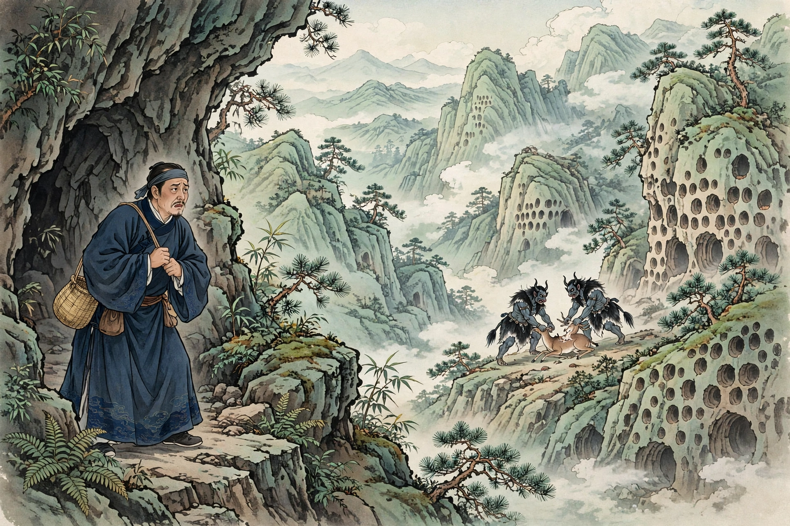
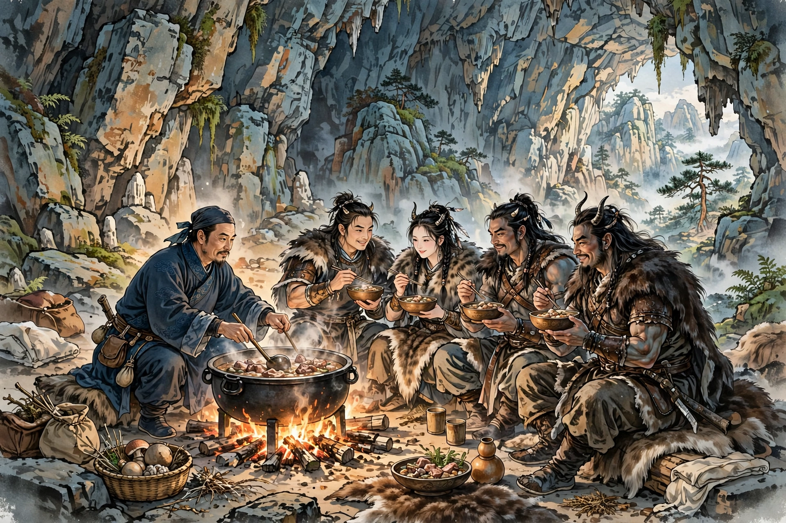
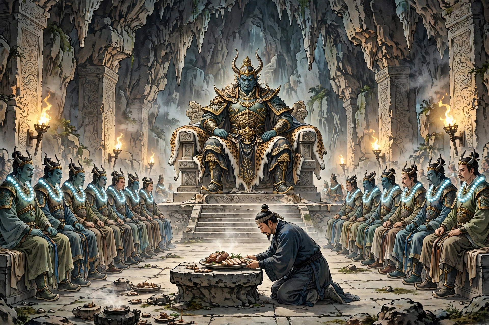
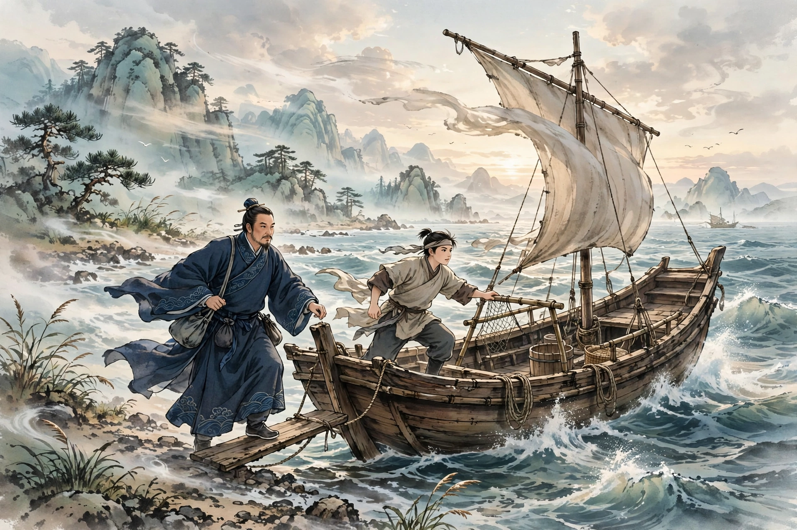

# 100 夜叉国

交州有个姓徐的人，出海经商。忽然被大风吹走。睁开眼来到一处地方，深山苍莽。他希望这里有人居住，便系好船缆登岸，背着干粮腊肉上山。

刚走进去，只见两边山崖上都是洞口，密得像蜂房；洞里隐隐有人声。走到一个洞口，站住向里窥看，洞里有两个夜叉，牙齿森然像排列的刀戟，眼睛闪烁像两盏灯，用爪子撕开活鹿吃肉。徐姓商人吓得魂魄都散了，急忙想跑下山，夜叉已经看见了他，停下进食把他抓进洞里。两个夜叉互相说话，声音像鸟兽鸣叫，争着撕扯徐姓商人的衣服，像是要吃了他。徐姓商人大为恐惧，取出袋子里的干粮和牛肉脯献给它们。夜叉分着吃，觉得味道很好。又翻他的袋子，徐姓商人摇手表示已经没有了。夜叉发怒，又抓住他。徐姓商人哀求说：“放了我吧。我的船里有锅灶，可以烹煮食物。”夜叉听不懂他的话，仍然发怒。徐姓商人再用手势比画，夜叉似乎略略明白了。夜叉跟着他到船上，取了炊具进洞，捆起柴火生火，把剩下的鹿肉煮熟献给它们。两个夜叉吃得很高兴。夜里夜叉用巨石堵住洞门，像是怕徐姓商人逃走。徐姓商人蜷着身体远远躺着，深怕难免一死。天亮了，两个夜叉出去，又堵上洞门。不一会儿，带来一头猎物交给他。徐姓商人剥去皮，在深洞里的流水处取水，煮了好几锅。不久有几个夜叉来到，聚集在一起吃完，又指着锅，像是嫌锅太小。过了三四天，一个夜叉背来一口大锅，像是人平时用的那种。于是群夜叉各自送来狼和麋鹿。煮熟以后，叫徐姓商人一起吃。住了几天，夜叉渐渐和徐姓商人熟了，出门也不再加以禁锢，相处得像一家人。徐姓商人渐渐能听声音辨别意思，便学着它们的声音，说夜叉的话。夜叉更加喜欢他，带来一个雌夜叉给他做妻子。徐姓商人起初害怕，不敢亲近；雌夜叉自己凑近他，徐姓商人便和她结合了。雌夜叉非常欢喜。每次都留下肉给徐姓商人吃，像琴瑟和鸣一样亲好。

有一天，众夜叉早早起来，脖子上各自挂着一串明珠，轮流出门，像是迎接贵客的样子。它们命徐姓商人多煮些肉。徐姓商人问雌夜叉，雌夜叉说：“今天是天寿节。”雌夜叉出去，对众夜叉说：“徐郎没有骨突子。”众人各自摘下五颗，交给雌夜叉。雌夜叉又从自己身上解下十颗，共得到五十颗，用野苎麻作绳子，穿起来挂在徐姓商人的脖子上。徐姓商人一看，一颗珠子可以值一百多两金子。不一会儿众夜叉都出去了。徐姓商人煮好肉，雌夜叉来邀请他去，说：“去迎接天王。”来到一个大洞，宽广有好几亩。洞里有一块石头，光滑平整像几案；四周都有石座；最上面的一个座位蒙着豹皮，其余的都铺着鹿皮。夜叉二三十个，列坐坐满了洞中。不一会儿，大风扬起尘土，夜叉们都慌张地出去了。只见一个巨大的怪物来了，也像夜叉的模样，竟然奔进洞里，踞坐着四处张望。群夜叉跟进来，分东西两边站立，都仰起头，用双臂交叉成十字。大夜叉按着头点数察看，问：“卧眉山的众人，都在这里了吗？”群夜叉哄然应答。大夜叉看着徐姓商人说：“这是从哪里来的？”雌夜叉回答说是女婿。众人又称赞他的烹调。随即有两三个夜叉，跑去取来熟肉摆在几案上。大夜叉抓起来吃饱，极力称赞美味，并且责令以后常常供奉。又看着徐姓商人说：“骨突子为什么这么短？”众人说：“刚来，还没有备齐。”大夜叉从自己脖子上摘下珠串，取下十颗交给他，都大如指尖，圆如弹丸。雌夜叉急忙接过来，替徐姓商人穿挂好。徐姓商人也交叉双臂，用夜叉的话道谢。大夜叉便离去了，踏着风行走，快得像飞一样。众人这才享用剩下的食物，散去了。

住了四年多，雌夜叉忽然生产，一胎生下两个男孩和一个女孩，都长着人的形状，不像母亲。众夜叉都喜欢这些孩子，常常一起抚弄他们。有一天，夜叉们都出去猎食，只有徐姓商人独自坐着。忽然从别的洞里来了一个雌夜叉，想和徐姓商人私通，徐姓商人不肯。那个夜叉发怒，把徐姓商人扑倒在地上。徐姓商人的妻子从外面回来，暴怒地和她搏斗，咬断了她的耳朵。不一会儿，那个雌夜叉的丈夫也回来了，劝解着让她离去。从此以后，徐姓商人的妻子每每守着他，行动起居都不离开。又过了三年，孩子们都能行走了。徐姓商人常常教他们说人话，他们渐渐能说话，啁啾的声音里，有了人的气息。虽然还是孩子，却能在山上奔跑如履平地；对父亲依依不舍，很有父子之情。有一天，雌夜叉带着一个儿子和一个女儿出去，半天没有回来。而北风大作。徐姓商人恻然想念故乡，带着儿子来到海岸，看见旧船还在，便谋划和儿子一起回去。儿子想告诉母亲，徐姓商人制止了他。父子登上船，一昼夜就到达交州。回到家里，妻子已经改嫁了。徐姓商人拿出两颗珠子，卖得了很多金子，家里颇为丰足。儿子取名彪。十四五岁时，能举起一百钧的重物，粗莽好斗。交州主帅觉得他奇特，让他做了千总。遇到边境战乱，他所向有功，十八岁就做了副将。

当时有一个商人出海，也被风吹到卧眉山。刚登岸，看见一个少年，见了吃了一惊。知道他是中国人，便问他的家乡。商人告诉了他。少年把他拉进幽谷里一个小石洞，洞外都是丛生的荆棘；并且嘱咐他不要出来。过了一会儿，少年拿着鹿肉来给商人吃。自己说：“我的父亲也是交州人。”商人问他，才知道他是徐姓商人的儿子。商人在外经商时曾经认识徐姓商人。于是说：“我是你父亲的故人。如今他的儿子做了副将。”少年不明白副将是什么名目。商人说：“这是中国官职的名称。”少年又问：“做官是怎样的？”商人说：“出门有车马，回家住高堂；上面呼唤一声，下面就有上百人答应；看见的人都侧目而视、侧着脚站立；这就叫作官。”少年非常羡慕。商人说：“既然你的父亲在交州，为什么久久滞留在这里？”少年把实情告诉他。商人劝他南归。少年说：“我也常常有这个念头。只是母亲不是中国人，言貌奇异；况且同类发觉了，一定会遭到残害；所以辗转犹豫。”于是少年出去说：“等到北风起的时候，我来送你走。麻烦你在我父亲和哥哥那里，代我问候一声。”商人在洞里躲了将近半年。不时从荆棘外面偷看，看见山里常常有夜叉往来；非常害怕，不敢稍有动静。有一天，北风飒飒作响，少年忽然来到，领着他急忙逃窜。嘱咐说：“我说的话不要忘记。”商人答应了他。少年又把肉放在几案上，商人便回去了。

商人恭敬地到达交州，来到副将府，把所见的情形详细述说。彪听了悲伤，想要前往寻找。父亲担心海上波涛和妖怪出没的地方，险恶难以侵犯，极力阻止。彪抚着胸膛痛哭，父亲不能制止。彪于是告诉交州主帅，带着两个士兵到海里去。逆风阻挡船只，在海里颠簸了半个月。四面望去没有边际，近在咫尺也迷闷昏暗，无从辨别南北。忽然涌起的波浪连接天际，船被掀翻。彪落入海中，随着波浪浮沉。过了很久，被一个怪物拖走；来到一处地方，竟然有房屋。彪一看，一个怪物像夜叉的模样。彪便说夜叉的话。夜叉惊讶地讯问他，彪便告诉他自己要去的地方。夜叉高兴地说：“卧眉山，是我的故乡啊。冒犯了，实在该受责罚！你已经离开正路八千里了。从这里去是毒龙国，去卧眉山不是这条路。”于是找来船送彪。夜叉在水中推着船像箭一样快，转眼就是千里，过了一夜，已经到达北岸。看见一个少年，临水眺望。彪知道山里没有人类，怀疑他是弟弟；走近一看，果然是弟弟。于是握着手哭泣，随后问母亲和妹妹，都说健康平安。彪想和弟弟一起去，弟弟制止了他，匆匆忙忙便走了。彪回去感谢夜叉，夜叉已经走了。不久，母亲和妹妹都来了，看见彪都哭了。彪告诉他们自己的来意。母亲说：“恐怕去了会被人欺凌。”彪说：“儿子在中国非常荣贵，没有人敢欺负。”回去的计议已经决定，只是苦于逆风难以渡海。母子正在徘徊犹豫的时候，忽然看见布帆向南移动，声音瑟瑟作响。彪高兴地说：“这是天助我们啊！”于是相继登船，波浪像箭一样急；三天就到达岸边。看见的人都奔逃。彪脱下袍裤分给三人穿上。回到家里，母夜叉看见丈夫，怒骂他，恨他事先没有商量。徐姓商人谢罪都来不及。家人拜见主母，没有不战栗的。彪劝母亲学习汉话，穿锦衣，厌恶生肉熟肉的饮食，母亲便非常欣慰。

母亲和女儿都穿男子的服装，像满人的式样。几个月以后稍稍能辨别语言，弟弟妹妹也渐渐白皙。弟弟叫豹，妹妹叫夜儿，都强壮有力。彪因为自己不识字而羞耻，教弟弟读书。豹最为聪慧，经史读一遍就明白了。又不想从事儒业；仍然让他拉强弩，骑快马。豹考中武进士。聘娶了阿游击的女儿。夜儿因为是异种，没有人与她成婚。恰逢标下袁守备丧偶，强行娶她为妻。夜儿能拉开一百石的弓，在一百多步外射小鸟，没有虚发。袁守备每次出征，总是带着妻子一起去。历任同知、将军，奇特的功勋有一半出自闺门。豹三十四岁挂印辞官。母亲曾经跟着他南征，每当面临强大的敌人，总是披甲执锐，为儿子接应，看见的人没有不退避的。朝廷下诏封他为男爵。豹代母亲上疏辞谢，朝廷封母亲为夫人。

异史氏说：“夜叉夫人，也是很少听说的，然而仔细想想又并不罕见：家家床头都有一个夜叉在。”

## 原文

交州徐姓，泛海为贾。忽被大风吹去。开眼至一处，深山苍莽。冀有居人，遂缆船而登，负糗腊焉。

方入，见两崖皆洞口，密如蜂房；内隐有人声。至洞处，伫足一窥，中有夜叉二，牙森列戟，目闪双灯，爪劈生鹿而食。惊散魂魄，急欲奔下，则夜叉已顾见之，辍食执入。二物相语，如鸟兽鸣，争裂徐衣，似欲啖。徐大惧，取橐中糗粮，并牛脯进之。分啖甚美。复翻徐橐，徐摇手以示其无。夜叉怒，又执之。徐哀之曰：“释我。我舟中有釜甑，可烹饪。”夜叉不解其语，仍怒。徐再与手语，夜叉似微解。从至舟，取具入洞，束薪燃火，煮其残鹿，熟而献之。二物啖之喜。夜以巨石杜门，似恐徐遁。徐曲体遥卧，深惧不免。天明，二物出，又杜之。少顷，携一来付徐。徐剥革，于深洞处流水，汲煮数釜。俄有数夜叉至，群集吞啖讫，共指釜，似嫌其小。过三四日，一夜叉负一大釜来，似人所常用者。于是群夜叉各致狼麋。既熟，呼徐同啖。居数日，夜叉渐与徐熟，出亦不施禁锢，聚处如家人。徐渐能察声知意，辄效其音，为夜叉语。夜叉益悦，携一雌来妻徐。徐初畏惧，莫敢伸；雌自开其股就徐，徐乃与交。雌大欢悦。每留肉饵徐，若琴瑟之好。

一日，诸夜叉早起，项下各挂明珠一串，更番出门，若伺贵客状。命徐多煮肉。徐以问雌，雌云：“此天寿节。”雌出，谓众夜叉曰：“徐郎无骨突子。”众各摘其五，并付雌。雌又自解十枚，共得五十之数，以野苎为绳，穿挂徐项。徐视之，一珠可直百十金。俄顷俱出。徐煮肉毕，雌来邀去，云：“接天王。”至一大洞，广阔数亩。中有石，滑平如几；四围俱有石座；上一座蒙一豹革，余皆以鹿。夜叉二三十辈，列坐满中。少顷，大风扬尘，张皇都出。见一巨物来，亦类夜叉状，竟奔入洞，踞坐鹗顾。群随入，东西列立，悉仰其首，以双臂作十字交。大夜叉按头点视，问：“卧眉山众，尽于此乎？”群哄应之。顾徐曰：“此何来？”雌以婿对。众又赞其烹调。即有二三夜叉，奔取熟肉陈几上。大夜叉掬尽饱，极赞嘉美，且责常供。又顾徐云：“骨突子何短？”众曰：“初来未备。”物于项上摘取珠串，脱十枚付之，俱大如指顶，圆如弹丸。雌急接，代徐穿挂。徐亦交臂作夜叉语谢之。物乃去，蹑风而行，其疾如飞。众始享其余食而散。

居四年余，雌忽产，一胎而生二雄一雌，皆人形，不类其母。众夜叉皆喜其子，辄共拊弄。一日，皆出攫食，惟徐独坐。忽别洞来一雌，欲与徐私，徐不肯。夜叉怒，扑徐踣地上。徐妻自外至，暴怒相搏，齧断其耳。少顷，其夫亦归，解释令去。自此雌每守徐，动息不相离。又三年，子女俱能行步。徐辄教以人言，渐能语，啁啾之中，有人气焉。虽童也，而奔山如履坦途；依依有父子意。一日，雌与一子一女出，半日不归。而北风大作。徐恻然念故乡，携子至海岸，见故舟犹存，谋与同归。子欲告母，徐止之。父子登舟，一昼夜达交。至家，妻已醮。出珠二枚，售金盈兆，家颇丰。子取名彪。十四五岁，能举百钧，粗莽好斗。交帅见奇之，以为千总。值边乱，所向有功，十八为副将。

时一商泛海，亦遭风飘至卧眉。方登岸，见一少年，视之而惊。知为中国人，便问居里。商以告。少年曳入幽谷一小石洞，洞外皆丛棘；且嘱勿出。去移时，挟鹿肉来啖商。自言：“父亦交人。”商问之，而知为徐。商在客中尝识之。因曰：“我故人也。今其子为副将。”少年不解何名。商曰：“此中国之官名。”又问：“何以为官？”曰：“出则舆马，入则高堂；上一呼而下百诺；见者侧目视，侧足立；此名为官。”少年甚歆动。商曰：“既尊君在交，何久淹此？”少年以情告。商劝南旋。曰：“余亦常作是念。但母非中国人，言貌殊异；且同类觉之，必见残害；用是辗转。”乃出曰：“待北风起，我来送汝行。烦于父兄处，寄一耗问。”商伏洞中几半年。时自棘中外窥，见山中辄有夜叉往还；大惧，不敢少动。一日，北风策策，少年忽至，引与急窜。嘱曰：“所言勿忘却。”商应之。又以肉置几上，商乃归。

敬抵交，达副总府，备述所见。彪闻而悲，欲往寻之。父虑海涛妖薮，险恶难犯，力阻之。彪抚膺痛哭，父不能止。乃告交帅，携两兵至海内。逆风阻舟，摆簸海中者半月。四望无涯，咫尺迷闷，无从辨其南北。忽而涌波接汉，乘舟倾覆。彪落海中，逐浪浮沉。久之，被一物曳去；至一处，竟有舍宇。彪视之，一物如夜叉状。彪乃作夜叉语。夜叉惊讯之，彪乃告以所往。夜叉喜曰：“卧眉，我故里也。唐突可罪！君离故道已八千里。此去为毒龙国，向卧眉非路。”乃觅舟来送彪。夜叉在水中推行如矢，瞬息千里，过一宵，已达北岸。见一少年，临流瞻望。彪知山无人类，疑是弟；近之，果弟。因执手哭，既而问母及妹，并云健安。彪欲偕往，弟止之，仓忙便去。回谢夜叉，则已去。未几，母妹俱至，见彪俱哭。彪告其意。母曰：“恐去为人所凌。”彪曰：“儿在中国甚荣贵，人不敢欺。”归计已决，苦逆风难渡。母子方徊徨间，忽见布帆南动，其声瑟瑟。彪喜曰：“天助吾也！”相继登舟，波如箭激；三日抵岸。见者皆奔。彪向三人脱分袍裤。抵家，母夜叉见翁怒骂，恨其不谋。徐谢过不遑。家人拜见主母，无不战栗。彪劝母学华言，衣锦，厌梁肉，乃大欣慰。

母女皆男儿装，类满制。数月稍辨语言，弟妹亦渐白皙。弟曰豹，妹曰夜儿，俱强有力。彪耻不知书，教弟读。豹最慧，经史一过辄了。又不欲操儒业；仍使挽强弩，驰怒马。登武进士第。聘阿游击女。夜儿以异种，无与为婚。会标下袁守备失偶，强妻之。夜儿开百石弓，百余步射小鸟，无虚落。袁每征，辄与妻俱。历任同知将军，奇勋半出于闺门。豹三十四岁挂印。母尝从之南征，每临巨敌，辄擐甲执锐，为子接应，见者莫不辟易。诏封男爵。豹代母疏辞，封夫人。

异史氏曰：“夜叉夫人，亦所罕闻，然细思之而不罕也：家家床头有个夜叉在。”
