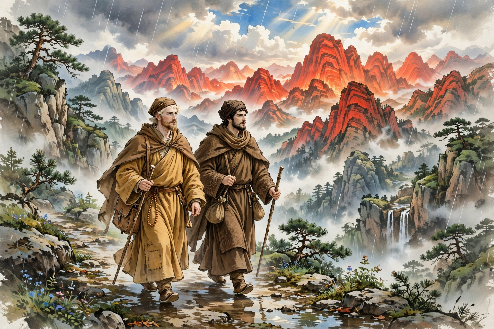
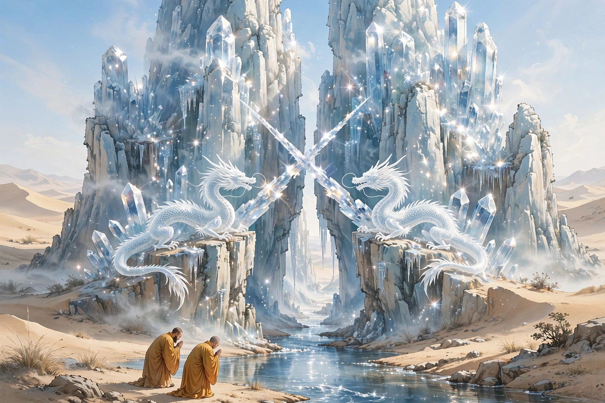

# 102 西僧

有两个僧人从西域来，一个前往五台山，一个在泰山住下。他们的衣服颜色、言语容貌，都和中国人大不相同。他们自己说：“经过火焰山，山峦重重叠叠，热气熏腾得像炉灶一样。凡是行走一定要在雨后，心神凝聚、眼睛注视着脚下，轻轻地迈步走过去；如果误踢到山石，就会飞起火焰灼烧。又经过流沙河，河里有一座水晶山，峭壁直插天际，四面晶莹透澈，像没有什么阻隔一样。还有一处隘口，只能容一辆车通过；两条龙交叉着角、对着口把守着它。经过的人先拜龙；龙允许通过，龙口的角就自己张开。龙的颜色是白的，鳞片和鬣毛都像水晶一样。”僧人说：“在路上已经经历了十八年了。离开西土的时候有十二个人，到达中国只剩下我们两个人。西土流传着中国有四座名山：一座泰山，一座华山，一座五台山，一座落伽山。传说山上遍地都是黄金，观音、文殊还活在世上。能够到达那里，自身就是佛，长生不死。”听他们所说的情形，也就像世人羡慕西土一样。假如有向西游历的人，和向东渡来的人在中途相遇，各自述说自己那里的情形，一定会相视失笑，两边都不用跋涉了。

## 原文

两僧自西域来，一赴五台，一卓锡泰山。其服色言貌，俱与中国殊异。自言：“历火焰山，山重重，气熏腾若炉灶。凡行必于雨后，心凝目注，轻迹步履之；误蹴山石，则飞焰腾灼焉。又经流沙河，河中有水晶山，峭壁插天际，四面莹澈，似无所隔。又有隘，可容单车；二龙交角对口把守之。过者先拜龙；龙许过，则口角自开。龙色白，鳞鬣皆如晶然。”僧言：“途中历十八寒暑矣。离西土者十有二人，至中国仅存其二。西土传中国名山四：一泰山，一华山，一五台，一落伽也。相传山上遍地皆黄金，观音、文殊犹生。能至其处，则身便是佛，长生不死。”听其所言状，亦犹世人之慕西土也。倘有西游人，与东渡者中途相值，各述所有，当必相视失笑，两免跋涉矣。
