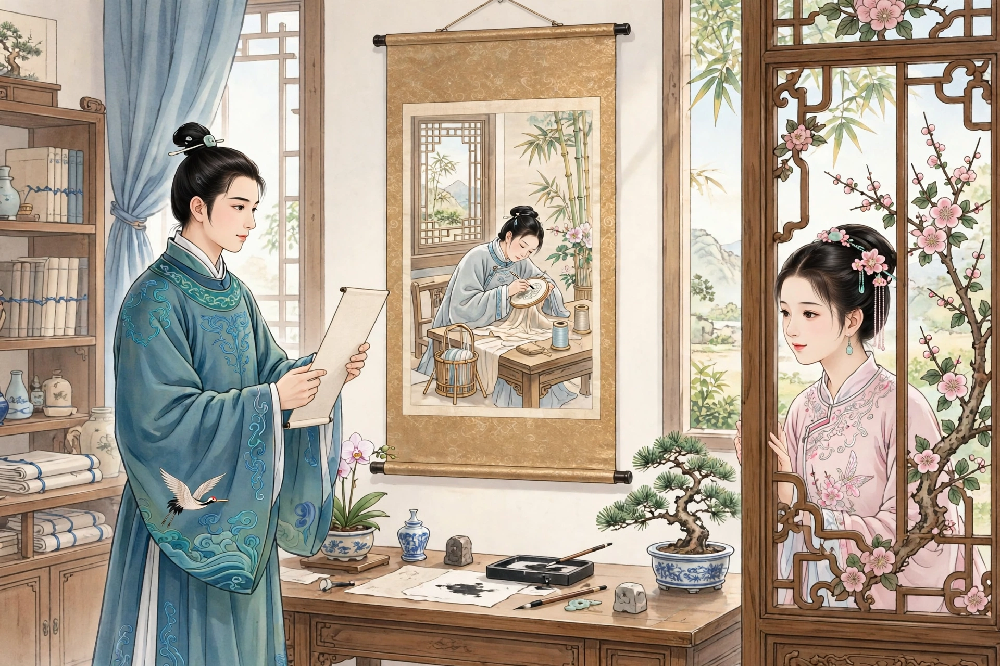
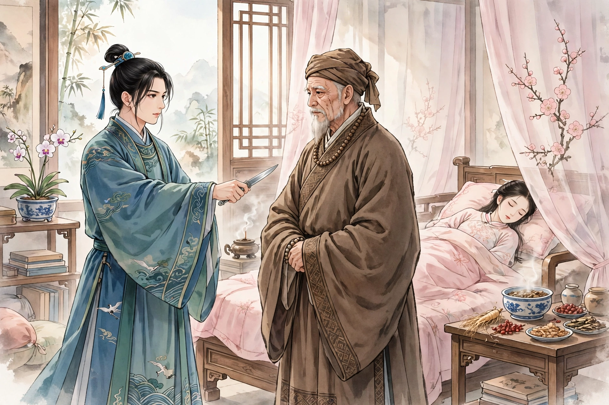
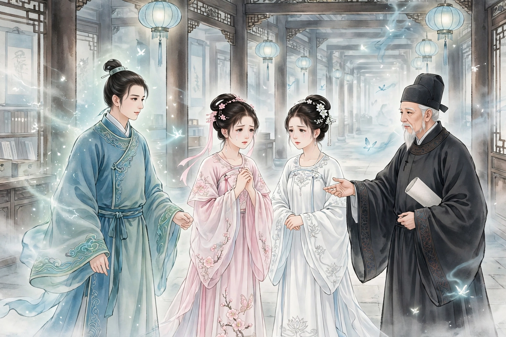
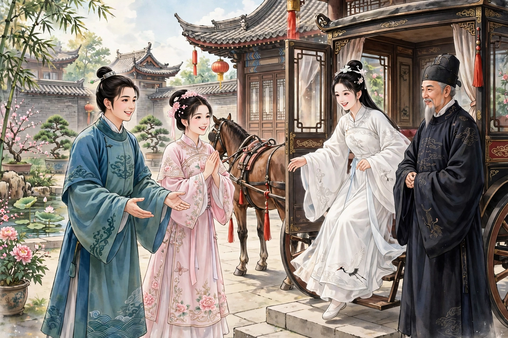

# 103 连城

乔生是晋宁人，少年时就负有才名。二十多岁了，仍然困顿不得志。他为人有肝胆。与顾生交好；顾生去世后，他时常周济顾生的妻子儿女。县令因为文章与他相契而器重他；县令死在任上，家口滞留不能回去，乔生变卖家产扶着灵柩，往返两千多里。因此士林更加器重他，而他的家也由此更加衰落。史孝廉有个女儿，名叫连城，擅长刺绣，知书达理。父亲娇爱她。史孝廉拿出女儿绣的“倦绣图”，征求少年们题诗咏赞，意思是要选择女婿。乔生献上诗说：“慵鬟高髻绿婆娑，早向兰窗绣碧荷；刺到鸳鸯魂欲断，暗停针线蹙双蛾。”又赞美刺绣的精工说：“绣线挑来似写生，幅中花鸟自天成；当年织锦非长技，幸把回文感圣明。”连城得到诗很高兴，对父亲称赞。父亲嫌乔生贫穷。连城逢人就称道这首诗；又派老妇人假托父亲的命令，赠送金子帮助乔生点灯读书。乔生感叹说：“连城是我的知己啊！”满怀思念，像饥饿时想吃东西一样。

不久，连城许配给盐商的儿子王化成，乔生这才绝望；然而在梦魂中还佩戴着她。不久，连城患了痨病，沉疴不起。有一个从西域来的头陀，自称能够治疗；只是需要男子胸脯上的一钱肉，捣碎合入药末。史孝廉派人到王家告诉女婿。女婿笑着说：“痴老头，想要我剜心头的肉啊！”使者回来了。史孝廉便对人说：“有能够割肉的人，就把女儿嫁给他。”乔生听说后前往，自己拿出白刃，割下胸脯上的肉交给僧人。鲜血沾湿了袍裤，僧人敷上药才止住血。配成药丸三颗。三天服完，病就像失去了踪影。史孝廉想要践行自己的话，先告诉王化成。王化成发怒，想要告到官府。史孝廉便设宴请乔生来，把千两金子摆在几案上，说：“深深负了你的大德，请用这些来报答。”于是详细说明了背盟的缘由。乔生愤然说：“我之所以不爱惜胸脯上的肉，只不过是用来报答知己罢了，难道是出卖肉吗！”拂袖而归。连城听说后，心里很不忍心，托老妇人安慰他。并且说：“凭他的才华，应当不久就能摆脱困顿。天下何愁没有佳人？我做的梦不吉利，三年内一定会死，不必和别人争夺这个泉下的人了。”乔生告诉老妇人说：“‘士为知己者死’，不是为了美色。实在担心连城未必真正了解我；不能成婚又有什么妨害呢？”老妇人代替连城发誓，剖白自己的诚意。乔生说：“果然如此，相逢的时候，请为我一笑，我死而无憾。”老妇人离去以后，过了几天，乔生偶然出门，遇见连城从叔父家回来，斜眼看着她。连城秋波流转地回头看他，露出牙齿嫣然一笑。乔生大喜说：“连城真是了解我的人！”恰逢王家来商议吉日，连城先前的病症又发作，几个月后便死了。乔生前往吊唁，痛哭一声便气绝了。史孝廉把他的尸体抬送回家。

乔生自知已经死了，也没有什么悲戚。走出村子去，还希望再见连城一面。远远望见南北一条路上，行人连续像蚂蚁一样，于是也混在人群里走。过了一会儿，进入一座官署，遇见顾生，顾生惊讶地问：“你怎么来到这里？”随即拉着他的手要送他回去。乔生叹息说：“我的心事很没有了结。”顾生说：“我在这里掌管文书，很受委任。如果能够效力，一定不吝惜。”乔生问起连城。顾生便领着乔生转了许多地方，看见连城和一位白衣女郎，眼泪沾湿睫毛、黛眉凄惨，靠坐在廊角。看见乔生来到，连城骤然起身像很高兴，略略问他从哪里来。乔生说：“姑且死了，我又怎么敢活过来！”连城哭着说：“像这样负义的人，还不抛弃他，我为他殉身又是为了什么呢？然而已经不能许给你今生了，只愿发誓到来世吧。”乔生告诉顾生说：“有件事要托付给你，我宁愿死也不愿活了。只是麻烦你查一查连城托生在什么地方，我好跟着一起去。”顾生答应着离去了。白衣女郎问乔生是什么人，连城为她详细讲述了。女郎听了，像是不胜悲伤。连城告诉乔生说：“这位和我同姓，小名宾娘，是长沙史太守的女儿。一路上同来，便互相怜爱。”乔生看着她，神态令人怜爱。正要仔细询问，顾生已经回来了，向乔生祝贺说：“我为你筹划已经确定，就让小娘子跟着你还魂，好吗？”两人都很高兴。正要拜别，宾娘大哭说：“姐姐走了，我到哪里去呢？请求垂怜救我，我愿意为姐姐捧着手巾侍奉。”连城凄然，没有办法可想，转而谋求乔生。乔生又哀求顾生。顾生觉得为难，严词拒绝，认为不可以。乔生坚持恳求。顾生便说：“试着胡乱做一次吧。”过了一顿饭的工夫回来，摇着手说：“怎么样！实在是万分不能办到啊！”宾娘听了，婉转娇啼，只依偎在连城的胳膊下面，恐怕她马上离去。惨痛得没有办法，两人相对默默无言；而看到她愁苦的容颜，让人肺腑酸楚柔软。顾生愤然说：“请带着宾娘一起去。如果有过错，我拼着自己承担！”宾娘便高兴了，跟着乔生出来。乔生担心路远没有伴侣。宾娘说：“我跟着你去，不愿意回去。”乔生说：“你太痴了。不回去，怎么能够活过来呢？他日到了湖南，不要再躲避我，那就是我的大幸了。”恰好有两个老妇人拿着文牒前往长沙，乔生嘱托她们，宾娘哭着告别而去。

路上，连城走得缓慢艰难，走一里多路就要休息一次；一共休息了十多次，才看见里门。连城说：“重生以后，恐怕有反复。请去取我的骸骨来，我既然在你家活过来，就不会后悔。”乔生答应了。两人一起回到乔生家里。女子战战兢兢像不能行走，乔生停下来等她。女子说：“我到了这里，四肢摇摇晃晃，像没有主宰一样。恐怕心愿不能遂意，还应当仔细谋划；不然，活过来以后怎么能够自由呢？”两人一起走进侧厢房里。安静了一会儿，连城笑着说：“你讨厌我吗？”乔生惊讶地问她缘故。连城红着脸说：“恐怕事情不能成，又辜负了你。请先让我以鬼魂报答你吧。”乔生高兴，极尽欢恋。因为徘徊着不敢马上还魂，在厢房里寄住了三天。连城说：“俗话说：‘丑妇终须见姑嫜’。在这里忧愁，也终究不是长久之计。”于是催促乔生进去。刚到灵床前，乔生豁然苏醒过来。家人惊异，送上汤水。乔生便派人请史孝廉来，请求得到连城的尸体，自称能够让她活过来。史孝廉高兴，听从了他的话。刚把尸体抬进屋里，一看已经醒了。连城告诉父亲说：“女儿已经委身乔郎了，再没有回去的道理。如果有变动，我还是一死！”史孝廉回去，派婢女前往服侍供奉。王化成听说后，写了状子申诉。官府接受了贿赂，判决连城归王家。乔生愤懑得想死，也无可奈何。连城到了王家，愤恨得不吃不喝，只求速死。屋里没有人的时候，就用带子悬在梁上。第二天，更加憔悴，几乎要断气了。王化成害怕，把她送回史家。史孝廉又把她抬回乔生家里。王化成知道了，也无可奈何，于是安然了。连城起来以后，常常想念宾娘，想要派信去打听，因为路远而难以前往。有一天，家人进来说：“门外有车马。”夫妇出去看，只见宾娘已经来到庭院中了。相见时悲喜交集。太守亲自送女儿前来，乔生请他进来。太守说：“小女子靠你复活，发誓不再嫁给别人，现在顺从她的心愿。”乔生叩谢行礼。孝廉也来了，叙说两家的友好。乔生名年，字大年。

异史氏说：“一笑之间的了解，就把身体许给了对方，世人也许会议论她痴情；可是田横的五百人，难道都是愚蠢的吗！这就是知己难得的可贵，贤豪所以感奋结交而不能自已的原因。然而茫茫海内，竟然让锦绣才人，只倾心于美人的一笑。悲哀啊！”

## 原文

乔生，晋宁人。少负才名。年二十余，犹偃蹇。为人有肝胆。与顾生善；顾卒，时恤其妻子。邑宰以文相契重；宰终于任，家口淹滞不能归，生破产扶柩，往返二千余里。以故士林益重之，而家由此益替。史孝廉有女，字连城，工刺绣，知书。父娇爱之。出所刺“倦绣图”，征少年题咏，意在择婿。生献诗云：“慵鬟高髻绿婆娑，早向兰窗绣碧荷；刺到鸳鸯魂欲断，暗停针线蹙双蛾。”又赞挑绣之工云：“绣线挑来似写生，幅中花鸟自天成；当年织锦非长技，幸把回文感圣明。”女得诗喜，对父称赏。父贫之。女逢人辄称道；又遣媪矫父命，赠金以助灯火。生叹曰：“连城我知己也！”倾怀结想，如饥思啖。

无何，女许字于鹺贾之子王化成，生始绝望；然梦魂中犹佩戴之。未几，女病瘵，沉痼不起。有西域头陀，自谓能疗；但须男子膺肉一钱，捣合药屑。史使人诣王家告婿。婿笑曰：“痴老翁，欲我剜心头肉也！”使返。史乃言于人曰：“有能割肉者妻之。”生闻而往，自出白刃，刲膺授僧。血濡袍裤，僧敷药始止。合药三丸。三日服尽，疾若失。史将践其言，先告王。王怒，欲讼官。史乃设筵招生，以千金列几上，曰：“重负大德，请以相报。”因具白背盟之由。生怫然曰：“仆所以不爱膺肉者，聊以报知己耳，岂货肉哉！”拂袖而归。女闻之，意良不忍，托媪慰谕之。且云：“以彼才华，当不久落。天下何患无佳人？我梦不祥，三年必死，不必与人争此泉下物也。”生告媪曰：“‘士为知己者死’，不以色也。诚恐连城未必真知我；不谐何害？”媪代女郎矢诚自剖。生曰：“果尔，相逢时，当为我一笑，死无憾。”媪既去，逾数日，生偶出，遇女自叔氏归，睨之。女秋波转顾，启齿嫣然。生大喜曰：“连城真知我者！”会王氏来议吉期，女前症又作，数月寻死。生往临吊，一痛而绝。史舁送其家。

生自知已死，亦无所戚。出村去，犹冀一见连城。遥望南北一道，行人连续如蚁，因亦混身杂迹其中。俄顷，入一廨署，值顾生，惊问：“君何得来？”即把手将送令归。生太息，言：“心事殊未了。”顾曰：“仆在此典牍，颇得委任。倘可效力，不惜也。”生问连城。顾即导生旋转多所，见连城与一白衣女郎，泪睫惨黛，藉坐廊隅。见生至，骤起似喜，略问所来。生曰：“聊死，仆何敢生！”连城泣曰：“如此负义人，尚不吐弃之，身殉何为？然已不能许君今生，愿矢来世耳。”生告顾曰：“有事君自，仆乐死不愿生矣。但烦稽连城托生何里，行与俱去耳。”顾诺而去。白衣女郎问生何人，连城为缅述之。女郎闻之，若不胜悲。连城告生曰：“此妾同姓，小字宾娘，长沙史太守女。一路同来，遂相怜爱。”生视之，意态怜人。方欲研问，而顾已反，向生贺曰：“我为君平章已确，即教小娘子从君返魂，好否？”两人各喜。方将拜别，宾娘大哭曰：“姊去，我安归？乞垂怜救，妾为姊捧帨耳。”连城凄然，无所为计，转谋生。生又哀顾。顾难之，峻辞以为不可。生固强之。乃曰：“试妄为之。”去食顷而返，摇手曰：“何如！诚万分不能为力矣！”宾娘闻之，宛转娇啼，惟依连城肘下，恐其即去。惨怛无术，相对默默；而睹其愁颜戚容，使人肺腑酸柔。顾生愤然曰：“请携宾娘去。脱有愆尤，小生拚身受之！”宾娘乃喜，从生出。生忧其道远无侣。宾娘曰：“妾从君去，不愿归也。”生曰：“卿大痴矣。不归，何以得活也？他日至湖南，勿复走避，为幸多矣。”适有两媪摄牒赴长沙，生嘱之，宾娘泣别而去。

途中，连城行謇缓，里余辄一息；凡十余息，始见里门。连城曰：“重生后，惧有反复。请索妾骸骨来，妾以君家生，当无悔也。”生然之。偕归生家。女惕惕若不能步，生伫待之。女曰：“妾至此，四肢摇摇，似无所主。志恐不遂，尚宜审谋；不然，生后何能自由？”相将入侧厢中。默定少时，连城笑曰：“君憎妾耶？”生惊问其故。赧然曰：“恐事不谐，重负君矣。请先以鬼报也。”生喜，极尽欢恋。因徘徊不敢遽生，寄厢中者三日。连城曰：“谚有之：‘丑妇终须见姑嫜’。戚戚于此，终非久计。”乃促生入。才至灵寝，豁然顿苏。家人惊异，进以汤水。生乃使人要史来，请得连城之尸，自言能活之。史喜，从其言。方舁入室，视之已醒。告父曰：“儿已委身乔郎矣，更无归理。如有变动，但仍一死！”史归，遣婢往役给奉。王闻，具词申理。官受赂，判归王。生愤懑欲死，亦无之奈何。连城至王家，忿不饮食，惟乞速死。室无人，则带悬梁上。越日，益惫，殆将奄逝。王惧，送归史。史复舁归生。王知之，亦无如何，遂安焉。连城起，每念宾娘，欲遣信往侦之，以道远而艰于往。一日，家人进曰：“门有车马。”夫妇出视，则宾娘已至庭中矣。相见悲喜。太守亲诣送女，生延入。太守曰：“小女子赖君复生，誓不他适，今从其志。”生叩谢如礼。孝廉亦至，叙宗好焉。生名年，字大年。

异史氏曰：“一笑之知，许之以身，世人或议其痴；彼田横五百人，岂尽愚哉！此知希之贵，贤豪所以感结而不能自已也。顾茫茫海内，遂使锦绣才人，仅倾心于蛾眉之一笑也，悲夫！”
