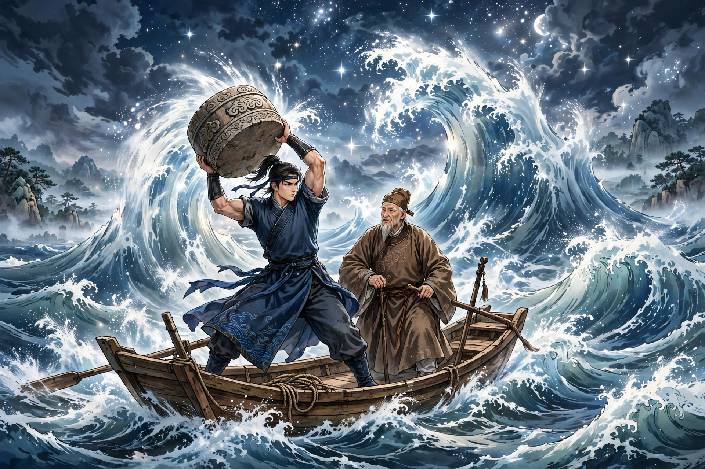

# 105 汪士秀

汪士秀是庐州人，刚强勇猛有力气，能举起石舂。父子两人都善于踢球。父亲四十多岁时，经过钱塘江淹死了。过了八九年，汪士秀因为有事前往湖南，夜里停船在洞庭湖。这时望见月亮从东边升起，澄澈的江水像白绢一样。正在眺望的时候，忽然有五个人从湖里出来，拿着一张大席子，平铺在水面上，大约有半亩大。纷纷摆上酒菜，食器互相磨碰发出声响，然而声音温厚，不像是陶器瓦器。不久三个人踩上席子坐下，两个人侍奉饮酒。坐着的人一个穿黄衣，两个穿白衣；头上的头巾都是皂色的，高高耸起，一直连到肩背，式样非常奇古，只是月色朦胧，看不太清楚。侍奉的人都穿褐衣；一个像是童子，一个像是老头。只听见穿黄衣的人说：“今夜月色非常好，足够痛快饮酒。”穿白衣的人说：“今晚的风景，很像广利王在梨花岛设宴的时候。”三个人互相劝酒，举杯竞相饮尽。只是说话声音稍小，就听不见了。船上的人躲藏着，不敢动弹。

汪士秀仔细审视侍奉的人，老头非常像父亲；可是听他的声音，又不是父亲的声音。快到二更末的时候，忽然有一个人说：“趁着这样的明月，应当踢一次球取乐。”随即看见僮仆从水中汲取，取出一个圆球来，大得可以抱满怀，里面像装满了水银，表里通明。坐着的人都站起来。穿黄衣的人招呼老头一起踢球。球踢起一丈多高，光芒摇摇晃晃射人眼睛。不一会儿球远远飞起，飞落在船里。汪士秀手痒难耐，尽力踢去，觉得异常轻软，用力猛踢像要踢破，球腾起好几丈；球里有光漏出来，向下射出像彩虹一样，嗤然急速落下；又像划过天空的彗星，直投水中，滚滚冒着沸泡的声音而熄灭。席上的人一起发怒说：“什么活人，败坏了我们的清兴！”老头笑着说：“不坏不坏，这是我家的流星拐啊。”穿白衣的人恼怒他说话戏谑，怒道：“大家正在厌烦懊恼，老奴怎么能开玩笑？就和这个小黑皮一起把狂妄小子捉来；不然，你的腿上就要挨棍子了！”汪士秀想着无处可逃，也就不再害怕，拿着刀站在船里。

忽然看见僮仆和老头拿着兵器来了。汪士秀注视一看，真是他的父亲。急忙呼喊：“阿翁！儿子在这里。”老头大惊，两人相顾凄然断肠。僮仆随即转身离去。老头说：“儿子赶快躲藏起来。不然，大家都要死了！”话还没有说完，三个人忽然已经登上船。他们的脸都漆黑，眼睛大如石榴。抓住老头拖出去。汪士秀用力争夺，摇得船断了缆绳。汪士秀用刀砍断了那个人的手臂，黄衣人便逃走了。一个白衣人奔向汪士秀，汪士秀砍下他的头颅，坠入水中有声响；众人哄然都沉没了。正谋划着夜间渡湖，忽然看见巨大的嘴露出水面，深得像井一样。四面湖水奔注而来，砰砰作响。不一会儿喷涌起来，浪涛连接星斗，万只船只颠簸摇荡。湖上的人都非常恐惧。船上有两个石鼓，都重一百斤。汪士秀举起一个投下去，激起的水声像雷鸣一样，浪渐渐平息；又投下另一个，风波完全平定了。

汪士秀怀疑父亲是鬼。老头说：“我本来就没有死啊。溺水而死的有十九个人，都被妖物吃了；我因为踢球得以保全。妖物得罪了钱塘君，所以迁移躲避到洞庭湖罢了。三个坐着的人是鱼精，所踢的是鱼鳔。”父子相聚欢喜，半夜里击着船桨离去。天亮时，看见船里有鱼翅，直径四五尺左右，这才明白是夜间砍断的手臂。

## 原文

汪士秀，庐州人。刚勇有力，能举石舂。父子善蹴鞠。父四十余，过钱塘没焉。积八九年，汪以故诣湖南，夜泊洞庭。时望月东升，澄江如练。方眺瞩间，忽有五人自湖中出，携大席，平铺水面，略可半亩。纷陈酒馔，馔器磨触作响，然声温厚，不类陶瓦。已而三人践席坐，二人侍饮。坐者一衣黄，二衣白；头上由皆皂色，峨峨然下连肩背，制绝奇古，而月色微茫，不甚可晰。侍者俱褐衣；其一似童，其一似叟也。但闻黄衣人曰：“今夜月色大佳，足供快饮。”白衣者曰：“此夕风景，大似广利王宴梨花岛时。”三人互劝，引酹竞浮白。但语略小，即不可闻。舟人隐伏，不敢动息。

汪细审侍者，叟酷类父；而听其言，又非父声。二漏将残，忽一人曰：“趁此明月，宜一击毬为乐。”即见僮汲水中，取一圆出，大可盈抱，中如水银满贮，表里通明。坐者尽起。黄衣人呼叟共蹴之。蹴起丈余，光摇摇射人眼。俄而𥔀然远起，飞堕舟中。汪技痒，极力踏去，觉异常轻软，踏猛似破，腾寻丈；中有漏光，下射如虹，蚩然疾落；又如经天之慧，直投水中，滚滚作沸泡声而灭。席中共怒曰：“何物生人，败我清兴！”叟笑曰：“不恶不恶，此吾家流星拐也。”白衣人嗔其语戏，怒曰：“都方厌恼，老奴何得作欢？便同小乌皮捉得狂子来；不然，胫股当有椎吃也！”汪计无所逃，即亦不畏，捉刀立舟中。

倏见僮叟操兵来。汪注视，真其父也。疾呼：“阿翁！儿在此。”叟大骇，相顾凄断。僮即反身去。叟曰：“儿急作匿。不然，都死矣！”言未已，三人忽已登舟。面皆漆黑，睛大于榴。攫叟出。汪力与夺，摇舟断缆。汪以刀截其臂落，黄衣者乃逃。一白衣人奔汪，汪剁其颅，堕水有声；哄然俱没。方谋夜渡，旋见巨喙出水面，深若井。四面湖水奔注，砰砰作响。俄一喷涌，则浪接星斗，万舟簸荡。湖人大恐。舟上有石鼓二，皆重百斤。汪举一以投，激水雷鸣，浪渐消；又投其一，风波悉平。

汪疑父为鬼。叟曰：“我固未尝死也。溺江者十九人，皆为妖物所食；我以蹋圆得全。物得罪于钱塘君，故移避洞庭耳。三人鱼精，所蹴鱼胞也。”父子聚喜，中夜击棹而去。天明，见舟中有鱼翅，径四五尺许，乃悟是夜间所断臂也。
