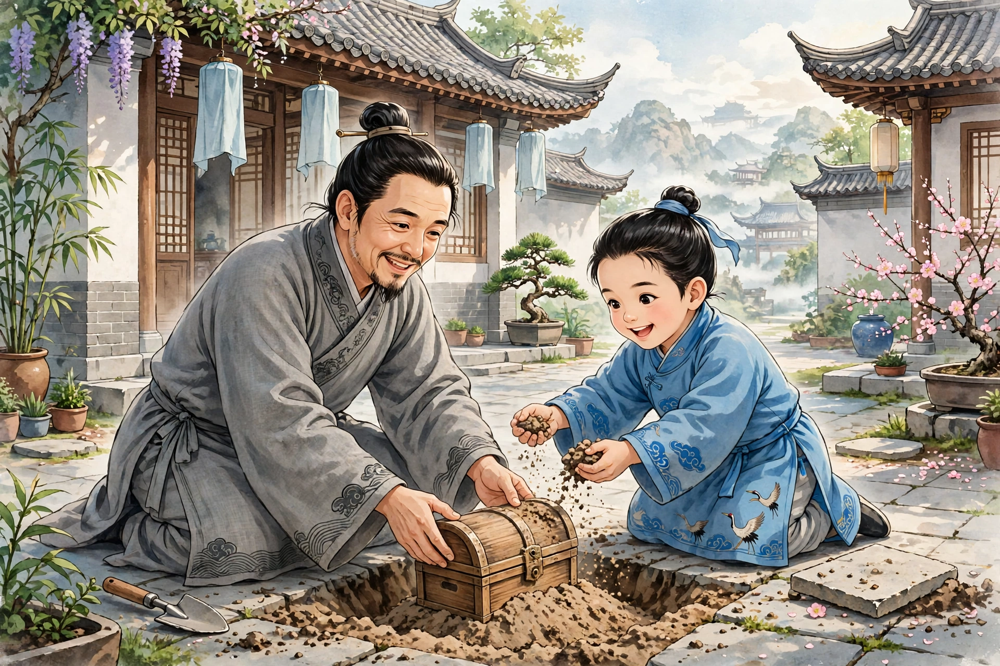

# 110 宫梦弼

柳芳华是保定人，财力雄厚，称雄一乡，慷慨好客，座上常常有上百人；别人有急难，他千金也不吝惜；宾客朋友借贷常常不还。只有一位客人宫梦弼，是陕西人，生平从来不乞求什么，每次来就住上一年，言谈清雅洒脱，柳芳华和他同住的时候最多。柳芳华的儿子名叫和，当时还是总角年纪，称宫梦弼为叔叔，宫梦弼也很喜欢和他玩耍。每当柳和从学堂回来，宫梦弼就和他揭开铺地的砖，埋下石子假装埋金子取笑。五间屋子，掘藏了好几遍。众人都笑他的行为幼稚，只有柳和独自喜爱他，比对其他客人更加亲近。十多年后家业渐渐空虚，不能供给众多客人的索求，于是客人渐渐稀少，然而十几个人通宵谈宴，还是常事。柳芳华年纪已老，日益衰落，还要割卖田地换钱来备办鸡黍。柳和也很挥霍，学着父亲结交小朋友，柳芳华也不禁止。不久，柳芳华病死了，竟然没有钱办理丧事。宫梦弼就自己拿出囊中的金子，为柳芳华经营丧事。柳和更加感激他，事情无论大小，都委托给宫叔。宫梦弼有时从外面进来一定袖着瓦砾，到了屋里就抛掷在阴暗的角落里，更不明白他是什么意思。柳和每次对着宫梦弼忧虑贫穷，宫梦弼说：“你不知道辛苦的艰难。且不说没有金子；即使给你千金也可以立刻花光。男子只怕不能自立，何必怕贫穷呢？”有一天他告辞想要回去，柳和哭着嘱咐他快点回来，宫梦弼答应了，就走了。柳和贫穷得不能自给，典当的东西渐渐空了，天天盼望宫梦弼到来为他经营，而宫梦弼却踪迹全无，像黄鹤一样飞走了。

先前，柳芳华活着的时候，为柳和在无极的黄家论亲，黄家是世代富裕的人家，后来听说柳家贫穷，暗地里有了悔婚的心意。柳芳华去世，把讣告告诉他们，他们竟然也不来吊唁，还用路远来委婉地推托。柳和服丧期满，母亲派他亲自到岳父家去定婚期，希望黄家怜悯照顾。等到了那里，黄家听说他衣履破旧，呵斥看门的人不让他进门。传话说：“回去筹措一百金可以再来，不然，请从此断绝。”柳和听了这话痛哭。对门的刘老婆子，怜悯他给他饭吃，赠给他三百钱，安慰他回去。母亲也很哀愤没有办法，因为想到旧客欠债的人十个里有八九个，就让柳和选择富贵的人去求助。柳和说：“从前和我交往的人都是为了我的钱财，要是我驷马高车，借一千金也不是难事。像现在这样的景象，谁还会念旧恩，想旧情呢？而且父亲给别人的金钱，从来没有契约凭证，索要欠债也难以凭据。”母亲坚持强迫他，柳和听从教导，二十多天都没能得到一文钱。只有优人李四从前受过恩惠，听说这件事，出于义气赠给他一金。母子痛哭，从此绝望了。

黄家的女儿年纪已经到了及笄，听说父亲断绝了和柳和的婚约，私下认为父亲做得不对。黄家想让女儿另嫁他人，女儿哭着说：“柳郎不是生来就贫穷的人。要是将来富裕加倍，难道是仇视我的人所能夺走的吗？现在贫穷就抛弃他，是不仁！”黄家不高兴，百般委婉地劝说，女儿始终不动摇。黄家夫妇一起发怒，早晚唾骂她，女儿也安然处之。不久，夜里遭到强盗抢劫，黄家夫妇被炮烙折磨几乎死去，家中被席卷一空。过了三年，家业更加衰败。有个西边的商人听说女儿美丽，愿意用五十金聘娶。黄家贪图利益答应了他，将要强行夺走女儿的志向。女儿察觉了他们的谋划，毁坏装束涂黑脸面，趁夜逃走，沿途乞食。过了两个月才到达保定，访到柳和的住处，直接来到他家。柳和的母亲以为她是乞丐的妻子，所以呵斥她，女儿呜咽着自陈身份，母亲拉着她的手哭着说：“孩子怎么形骸到了这种地步啊！”女儿又悲惨地告诉了其中的缘故，母子都哭了。便为她洗浴，脸色光泽，眉目焕发，母子都很高兴。然而一家三口，每天只有一顿饭，母亲哭着说：“我们母子本来就应当这样；可怜的是，辜负了我贤惠的儿媳！”女儿笑着安慰她说：“新媳妇在乞丐中间，熟悉其中的滋味，今天看来，觉得有天堂地狱的区别。”母亲因此破涕为笑。

女儿有一天走进闲置的屋子里，看见断草丛丛没有空隙的地方，渐渐走进内室，尘埃积在里面，阴暗的角落里有东西堆积，踢到它绊了脚，捡起来看都是白银。惊慌地跑去告诉柳和，柳和一同去验看，原来是宫梦弼往日抛掷的瓦砾，全部变成了白金。因此想到小时候，常常和宫梦弼把石子埋在屋子里，难道都是金子吗？而原来的地方已经典给了东家，急忙赎回来。断砖残缺，所藏的石子赫然露了出来，很是失望，等到掘开别的砖，都是灿烂的白银。顷刻之间就有了几十万。由此赎回田产，购买奴仆，门庭华美超过了从前。因此自己奋发说：“要是不自立，就辜负了我宫叔！”专心读书，三年中考中了乡试。

于是柳和亲自带着白金，去酬谢刘老婆子。鲜艳的衣服耀眼，十几个仆人都骑着怒马像龙一样。老婆子只有一间屋子，柳和便坐在床上。人声喧哗马声腾沸，溢满了里巷。黄翁自从女儿失踪，西边的商人逼他退还聘财，已经耗去了将近一半，卖掉住宅才得以偿还，因此困窘得像柳和从前一样。听说旧女婿显赫耀眼，闭门独自伤心罢了。老婆子买酒备办饭菜款待柳和，因此述说女儿的贤惠，并且惋惜女儿逃走。问柳和：“娶妻了吗？”柳和说：“娶了。”吃完饭，强迫老婆子去看新妇，载着她一起回去。到了家里，女儿穿着华美的妆饰出来，群婢簇拥着像仙女一样。相见时非常惊骇，于是叙说从前的旧事，殷勤地问候父母的起居。住了几天，款待优厚，制作好衣服，上下都换了新装，才送她回去。

老婆子到黄家报告女儿的消息，兼致问候，夫妇非常惊讶。老婆子劝他们去投奔女儿，黄家面有难色。不久冻饿难以忍受，不得已来到保定。到了门前，看见门闳高大华丽，看门的人怒目圆睁，整天不能通报，有一位妇人出来，黄家温和脸色卑下言辞，告诉她姓氏，请求暗中转达给女儿知道。过了一会儿妇人出来，把他们引进耳房，说：“娘子非常想见一面，然而恐怕郎君知道，还要等机会。翁翁什么时候到这里来的？难道没有挨饿吗？”黄家因此诉说了所受的苦。妇人拿酒一盛、饭菜两簋，端出来放在黄家面前；又赠给五金，说：“郎君在房中设宴，娘子恐怕不能来。明天早上应当早点离去，不要让郎君听见。”黄家答应了。早上起来收拾行装，可是门钥还没有开，只好停留在门里，坐在包袱上等待。忽然喧哗着主人出来了，黄家将要躲避，柳和已经看见了他，奇怪地问是什么人，家人都无法回答。柳和发怒说：“这一定是奸人！可以绑去送官。”众人应声出来，用短绳把他绑在树上，黄家惭愧害怕不知道说什么。没过多久昨夜的妇人出来，跪着说：“这是某人的舅父。因为昨夜来晚了，所以没有告诉主人。”柳和命令解开绑缚。

妇人送他们出门，说：“忘记嘱咐看门的人，于是造成了差错。娘子说：想念的时候可以让老夫人假装成卖花的人，和刘老婆子一起来。”黄家答应了，回去告诉老婆子。老婆子思念女儿像渴了一样，告诉刘老婆子，老婆子果然和她一起来到柳和家，一共打开十几道门，才到达女儿那里。女儿穿着帔子顶着发髻，珠翠绮罗，散发出扑人的香气。嘤咛一声，大小婢女老婆子奔进来站满两旁，搬来金椅床，放置双人夹膝。聪慧的婢女煮茶，各自用隐语道寒暄，互相看着眼泪闪烁。到了晚上腾出屋子安顿两位老婆子，被褥温软，都是从前富贵时所没有经历过的。住了三五天，女儿的心意殷勤优厚。老婆子常常引到空处，哭着说出从前的过错。女儿说：“我母子有什么过错不能忘记呢？只是郎君的忿怒没有消解，怕他听见。”每次柳和来到，她们就躲避起来。有一天正促膝谈话，柳和突然进来，看见她们，怒骂说：“什么村里的老婆子，敢引身和娘子并坐！应当揪住鬓发让它拔光！”刘老婆子急忙进来说：“这是我的亲戚，王嫂卖花的人，千万不要责怪。”柳和于是拱手谢过。随即坐下说：“老婆婆来几天了，我很忙，没有得到叙谈。黄家的老畜产还在吗？”笑着说：“都很好，只是贫穷得不能再过了。官人大富大贵，怎么不想一念翁婿之情呢？”柳和拍着桌子说：“从前要不是老婆婆怜悯赐给我一瓯粥，怎么能回到乡土呢！现在想要得到他并且和他同寝共处，怎么会想念他呢！”说到愤怒的时候，就顿足起身骂人。女儿恼怒说：“他即使不仁，也是我的父母，我迢迢远来，手上生了冻疮，脚趾都磨破了，也自认为没有辜负郎君。怎么能对着女儿骂父亲，让人难堪呢？”柳和这才收敛怒气，起身离去。黄家老婆子羞愧失色，辞别想要回去，女儿私下给了她二十金。

回去之后，音问断绝，女儿深深地思念着。柳和于是派人招请他们，夫妇到了，惭愧得无地自容。柳和谢罪说：“去年辱临，又没有明说，实在是开罪很多。”黄家只是唯唯答应。柳和为他们换了衣服鞋子。留了一个多月，黄家的心始终不能自安，屡次告辞回去。柳和赠给白金一百两，说：“西边的商人五十金，我现在加倍给你。”黄家汗颜接受了。柳和用车马送他们回去，晚年也称得上小有丰足。

异史氏说：“雍门哭泣之后，朱履杳然无踪，让人愤气填膺闭门不出，不想再结交一位客人。然而良朋葬骨，化石成金，不能说不是慷慨好客的报应啊。闺房中的人坐享高贵的供养，俨然像嫔嫱一样，不是贞洁奇异像黄家女儿这样的人，谁能承受这样的待遇而没有愧疚呢？造物主不会无缘无故地降下福泽就是这样啊。”

乡里有个富人，经营积聚谋取盈余，算计到了骨子里。窖藏的银钱有几百，惟恐别人知道，故意穿破絮。吃糠秕来显示贫穷。亲友偶尔到来，也从来没有做鸡黍招待的事。有人说他家并不贫穷，他就怒目相视，仇恨得像不共戴天一样。到了暮年，每天吃榆屑一升，手臂上的皮褶垂下一寸长，而所窖藏的终究不肯拿出来。后来渐渐瘦弱。将要死的时候，两个儿子环绕着问他，他还是没有马上告诉；等到觉得确实危急，想要告诉儿子，儿子到了，他已经舌头僵硬不能说话，只是在心头抓挠，呵呵作声罢了。死后，子孙不能备办棺木，于是用草席葬了他。唉！如果把窖藏的金子就当作富裕，那么大仓库里的几千万，又怎么不可以指为我所有呢？真是愚蠢啊！

## 原文

柳芳华保定人，财雄。一乡，慷慨好客，座上常百人；急人之急，千金不靳；宾友假贷常不还。惟一客宫梦弼，陕人，生平无所乞请，每至辄经岁，词旨清洒，柳与寝处时最多。柳子名和，时总角，叔之，宫亦喜与和戏。每和自塾归，辄与发贴地砖，埋石子伪作埋金为笑。屋五架，掘藏几遍。众笑其行稚，而和独悦爱之，尤较诸客昵。后十余年家渐虚，不能供多客之求，于是客渐稀，然十数人彻宵谈宴，犹是常也。年既暮，日益落，尚割亩得直以备鸡黍。和亦挥霍，学父结小友，柳不之禁。无何，柳病卒，至无以治凶具。宫乃自出囊金，为柳经纪。和益德之，事无大小，悉委宫叔。宫时自外入必袖瓦砾，至室则抛掷暗陬，更不解其何意。和每对宫忧贫，宫曰：“子不知作苦之难。无论无金；即授汝千金可立尽也。男子患不自立，何患贫？”一日辞欲归，和泣嘱速返，宫诺之，遂去。和贫不自给，典质渐空，日望宫至以为经理，而宫灭迹匿影去如黄鹤矣。

先是，柳生时，为和论亲于无极黄氏，素封也，后闻柳贫，阴有悔心。柳卒讣告之，即亦不吊，犹以道远曲原之。和服除，母遣自诣岳所定婚期，冀黄怜顾。比至，黄闻其衣履敝穿，斥门者不纳。寄语云：“归谋百金可复来，不然，请自此绝。”和闻言痛哭。对门刘媪，怜而进之食，赠钱三百，慰令归。母亦哀愤无策，因念旧客负欠者十常八九，俾择富贵者求助焉。和曰：“昔之交我者为我财耳，使儿驷马高车，假千金亦即匪难。如此景象，谁犹念曩恩，忆故好耶？且父与人金资，曾无契保，责负亦难凭也。”母固强之，和从教，凡二十余日不能致一文。惟优人李四旧受恩恤，闻其事，义赠一金。母子痛哭，自此绝望矣。

黄女年已及笄，闻父绝和，窃不直之。黄欲女别适，女泣曰：“柳郎非生而贫者也。使富倍他日，岂仇我者所能夺乎？今贫而弃之，不仁！”黄不悦，曲谕百端，女终不摇。翁妪并怒，旦夕唾骂之，女亦安焉。无何，夜遭寇劫，黄夫妇炮烙几死，家中席卷一空。荏苒三载，家益零替。有西贾闻女美，愿以五十金致聘。黄利而许之，将强夺其志。女察知其谋，毁装涂面，乘夜遁去，丐食于途。阅两月始达保定，访和居址，直造其家。母以为乞人妇，故咄之，女呜咽自陈，母把手泣曰：“儿何形骸至此耶！”女又惨然而告以故，母子俱哭。便为盥沐，颜色光泽，眉目焕映，母子俱喜。然家三口，日仅一啖，母泣曰：“吾母子固应尔；所怜者，负吾贤妇！”女笑慰之曰：“新妇在乞人中，稔其况味，今日视之，觉有天堂地狱之别。”母为解颐。

女一日入闲舍中，见断草丛丛无隙地，渐入内室，尘埃积中，暗陬有物堆积，蹴之迕足，拾视皆朱提。惊走告和，和同往验视，则宫往日所抛瓦砾，尽为白金。因念儿时，常与瘗石室中，得毋皆金？而故地已典于东家，急赎归。断砖残缺，所藏石子俨然露焉，颇觉失望，及发他砖，则灿灿皆白镪也。顷刻间数巨万矣。由是赎田产，市奴仆，门庭华好过昔日。因自奋曰：“若不自立，负我宫叔！”刻志下帷，三年中乡选。

乃躬赍白金，往酬刘媪。鲜衣射目，仆十余辈皆骑怒马如龙。媪仅一屋，和便坐榻上。人哗马腾，弃溢里巷。黄翁自女失亡，西贾逼退聘财，业已耗去殆半，售居宅始得偿，以故困窘如和曩日。闻旧婿烜耀，闭户自伤而已。媪沽酒备馔款和，因述女贤，且惜女遁。问和：“娶否？”和曰：“娶矣。”食已，强媪往视新妇，载与俱归。至家，女华妆出，群婢簇拥若仙。相见大骇，遂叙往旧，殷问父母起居。居数日，款洽优厚，制好衣，上下一新，始送令返。

媪诣黄许报女耗，兼致存问，夫妇大惊。媪劝往投女，黄有难色。既而冻馁难堪，不得已如保定。既到门，见门闳峻丽，阍人怒目张，终日不得通，一妇人出，黄温色卑词，告以姓氏，求暗达女知。少间妇出，导入耳舍，曰：“娘子极欲一觐，然恐郎君知，尚候隙也。翁几时来此？得毋饥否？”黄因诉所苦。妇人以酒一盛、馔二簋，出置黄前；又赠五金，曰：“郎君宴房中，娘子恐不得来。明旦宜早去，勿为郎闻。”黄诺之。早起趣装，则管钥未启，止于门中，坐袱囊以待。忽哗主人出，黄将敛避，和已睹之，怪问谁何，家人悉无以应。和怒曰：“是必奸宄！可执赴有司。”众应声出，短绠绷系树间，黄惭惧不知置词。未几昨夕妇出，跪曰：“是某舅氏。以前夕来晚，故未告主人。”和命释缚。

妇送出门，曰：“忘嘱门者，遂致参差。娘子言：相思时可使老夫人伪为卖花者，同刘媪来。”黄诺，归述于妪。妪念女若渴，以告刘媪，媪果与俱至和家，凡启十余关，始达女所。女着帔顶髻，珠翠绮绔，散香气扑人。嘤咛一声，大小婢媪奔入满侧，移金椅床，置双夹膝。慧婢瀹茗，各以隐语道寒暄，相视泪荧。至晚除室安二媪，裀褥温软，并昔年富时所未经。居三五日，女意殷渥。媪辄引空处，泣白前非。女曰：“我子母有何过不忘？但郎忿不解，防他闻也。”每和至，便走匿。一日方促膝，和遽入，见之，怒诟曰：“何物村妪，敢引身与娘子接坐！宜撮鬓毛令尽！”刘媪急进曰：“此老身瓜葛，王嫂卖花者，幸勿罪责。”和乃上手谢过。即坐曰：“姥来数日，我大忙，未得展叙。黄家老畜产尚在否？”笑云：“都佳，但是贫不可过。官人大富贵，何不一念翁婿情也？”和击桌曰：“曩年非姥怜赐一瓯粥，更何得旋乡土！今欲得而寝处之，何念焉！”言致忿际，辄顿足起骂。女恚曰：“彼即不仁，是我父母，我迢迢远来，手皴瘃，足趾皆穿，亦自谓无负郎君。何乃对子骂父，使人难堪？”和始敛怒，起身去。黄妪愧丧无色，辞欲归，女以二十金私付之。

既归，旷绝音问，女深以为念。和乃遣人招之，夫妻至，惭作无以自容。和谢曰：“旧岁辱临，又不明告，遂是开罪良多。”黄但唯唯。和为更易衣履。留月余，黄心终不自安，数告归。和遗白金百两，曰：“西贾五十金，我今倍之。”黄汗颜受之。和以舆马送还，暮岁称小丰焉。

异史氏曰：“雍门泣后，朱履杳然，令人愤气杜门，不欲复交一客。然良朋葬骨，化石成金，不可谓非慷慨好客之报也。闺中人坐享高奉，俨然如嫔嫱，非贞异如黄卿，孰克当此而无愧者乎？造物之不妄降福泽也如是。”

乡有富者，居积取盈，搜算入骨。窖镪数百，惟恐人知，故衣败絮。啖糠秕以示贫。亲友偶来，亦曾无作鸡黍之事。或言其家不贫，便逋目作怒，其仇如不共戴天。暮年，日餐榆屑一升，臂上皮摺垂一寸长，而所窖终不肯发。后渐尪羸。濒死，两子环问之，犹未遽告；迨觉果危急，欲告子，子至，已舌蹇不能声，惟爬抓心头，呵呵而已。死后，子孙不能具棺木，遂藁葬焉。呜呼！若窖金而以为富，则大帑数千万，何不可指为我有哉？愚已！
