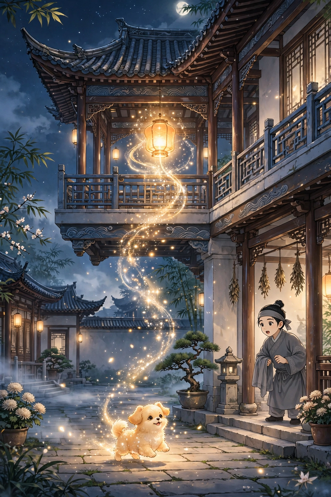
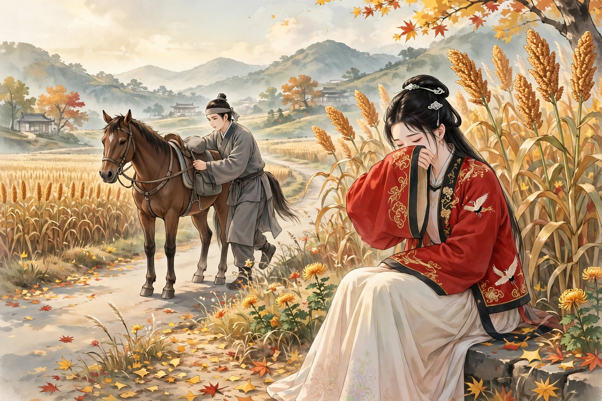

# 116 犬灯

韩光禄大千的仆人，夜里睡在廊屋里，看见楼上有一盏灯，像明星一样。没多久，那灯光荧荧地飘落下来，落到地上变成了一只狗。狗斜眼看着他，转到屋子后面去了。仆人急忙起身，悄悄跟在后面，狗进了园子，变成了一个女子。仆人心里知道她是狐狸，便回到原来的地方躺下。不一会儿，女子从后面自己来了，仆人假装睡着来观察她的变化。女子俯下身来摇晃他。仆人装作醒来的样子，问她是谁。女子不回答，仆人说：“楼上的灯光，不是你吗？”女子说：“既然已经知道了，还问什么呢？”于是两人便同宿在一起。白天分别，夜里相会，习以为常。

主人知道了这件事，派两个人夹着仆人睡；那两个人醒来的时候，却发现自己睡在床下，也不知道是什么时候掉下去的。主人更加生气，对仆人说：“她来的时候，你应当把她捉来；不然，就要受鞭打！”仆人不敢说什么，答应着退了出来。他心里想：捉她很难；不捉，又怕获罪。翻来覆去没有办法。忽然想起女子有一件小红衫，紧紧贴身穿着，不肯片刻脱下。这一定是她的要害。拿住这件衣服就可以要挟她。夜半时分，女子来了，问：“主人嘱咐你捉我吗？”仆人说：“确实有这回事。只是我们两人情意很好，我怎么肯做这种事呢？”等到睡下，仆人暗暗按住了那件红衫。女子忽然惊醒，用力挣脱而去。从此便断绝了来往。

后来仆人从别处回来，远远看见女子坐在路边；走到跟前，女子便举起袖子遮住脸。仆人下了马，喊道：“为什么做出这种样子？”女子这才站起来，握着他的手说：“我以为你已经忘记旧情了。既然还恋恋不舍，存有故人的心意，情意还可以原谅。先前的事是出于主人的命令，我也不怪你。只是缘分已经尽了，现在设一桌小酒，请你进去告别。”当时正是秋天刚开始，高粱正茂盛。女子带着仆人进去，只见里面有一座大宅子。拴了马走进去，厅堂里酒菜已经摆好。刚坐下，成群的婢女端上烤肉。太阳将要落山，仆人有事，想要回去复主人的命，便告别出来。出来之后，却依然是田间地垄罢了。

## 原文

韩光禄大千之仆，夜宿厦间，见楼上有灯，如明星。未几，荧荧飘落，及地化为犬。睨之，转舍后去。急起，潜尾之，入园中，化为女子。心知其狐，还卧故所。俄，女子自后来，仆阳寐以观其变。女俯而撼之。仆伪作醒状，问其为谁。女不答，仆曰：「楼上灯光，非子也耶？」女曰：「既知之，何问焉？」遂共宿焉。昼别宵会，以为常。

主人知之，使二人夹仆卧；二人既醒，则身卧床下，亦不知堕自何时。主人益怒，谓仆曰：「来时，当捉之来；不然，则有鞭楚！」仆不敢言，诺而退。因念：捉之难；不捉，惧罪。展转无策。忽忆女子一小红衫，密着其体，未肯暂脱。必其要害。执此可以胁之。夜分，女至，问：「主人嘱汝捉我乎？」曰：「良有之。但我两人情好，何肯此为？」及寝，阴掩其衫。女忽惊，力脱而去。从此遂绝。

后仆自他方归，遥见女子坐道周；至前，则举袖障面。仆下骑，呼曰：「何作此态？」女乃起，握手曰：「我谓子已忘旧好矣。既恋恋有故人意，情尚可原。前事出于主命，亦不汝怪也。但缘份已尽，今设小酌，请入为别。」时秋初，高粱正茂。女携仆入，则中有巨第。系马而入，厅堂中酒肴已列。甫坐，群婢行炙。日将暮，仆有事，欲覆主命，遂别。既出，则依然田陇耳。
