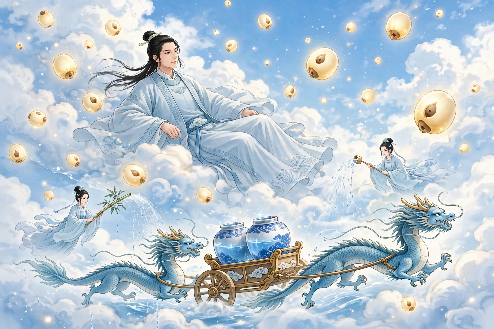

# 119 雷曹

乐云鹤、夏平子，两个人少年时同住一里，长大后同在一斋读书，相交极为亲密。夏平子年少聪慧，十岁就出名。乐云鹤虚心侍奉他，夏平子也互相规劝毫不厌倦，乐云鹤的文思日益进步，因此名声一同显扬。然而在科场上潦倒，屡战屡败。没多久，夏平子染上疫病去世，家里贫穷不能安葬，乐云鹤挺身自己承担下来。夏平子遗留下襁褓中的儿子和未亡人，乐云鹤按时周济他家；每次得到升斗粮食，一定分出一部分给他们。夏平子的妻子把儿子托付给乐云鹤。于是士大夫更加贤明乐云鹤。乐云鹤的恒产不多，又替夏平子操心家事，家计日益窘迫。便叹息说：“文章像平子这样，尚且碌碌无为地死去，何况我呢！人生富贵须要及时，终年忧愁，恐怕先于狗马填满沟壑，辜负此生了，不如早早自己谋划。”于是放弃读书而经商。经营半年，家资稍稍殷实。

一天，乐云鹤在金陵做客，住在旅舍里。看见一个人身材颀长，筋骨隆起，徘徊在座位旁边，脸色黯淡，有忧愁的样子。乐云鹤问：“想要得到食物吗？”那个人也不说话。乐云鹤把食物推给他吃；那个人便用手捧着吃，顷刻之间已经吃完。乐云鹤又给他增加兼人之分的食物，吃完之后还是这样。于是命主人割下猪肩，堆上蒸饼，又吃完了数人的饭量。这才吃饱而谢道：“三年来，不曾这样饱足过。”乐云鹤说：“您本来是壮士，为什么飘泊到这种地步？”那个人说：“罪孽受到天谴，不可以说。”问他的里居，那个人说：“陆地没有房屋，水上没有船只，早上在村里晚上在城郭。”乐云鹤整理行装想要离开，那个人跟随他，恋恋不去。乐云鹤推辞他。那个人告诉他：“您有大难，我不忍心忘记一饭之德。”乐云鹤觉得奇异，便与他同行。途中拉他一起吃饭。那个人推辞说：“我整年仅吃数餐罢了。”乐云鹤更加觉得奇异。第二天，渡江时，风涛突然大作，商船全都倾覆，乐云鹤和那个人都沉没江中。不久风停了，那个人背着乐云鹤踏着波浪出来，登上客船，又破浪而去；过了一会儿，挽着一船来到，扶乐云鹤进去，叫乐云鹤躺着守候，又跃入江中，用两臂夹着货物出来，放在船中；又进入江中，多次进出，货物摆满了船。乐云鹤谢道：“您救活我已经很足够了，哪里还敢指望货物归还呢！”检查货物财物，并没有丢失。更加高兴，惊讶他是神人，放舟想要离开。那个人告辞退去，乐云鹤苦苦挽留他，于是与他一起渡江。乐云鹤笑着说：“这是一次灾厄，只丢失了一支金簪罢了。”那个人想要再去寻找。乐云鹤正劝阻他，他已经投进水中不见了。惊愕了很久。忽然看见他抱着船桨而出，把簪子交给乐云鹤说：“幸好没有辜负使命。”江上的人因此不再惊异。

乐云鹤与他回去，住处在一起。每隔十多天才吃一次饭，一吃就吃得无数。一天，那个人又说要告别，乐云鹤坚决挽留他。正好白天昏暗想要下雨，听见雷声。乐云鹤说：“云间不知道是什么样子？雷又是什么东西？怎么能到天上去看一看，这个疑问才可以解开。”那个人笑着说：“您想要做云中游吗？”过了一会儿，乐云鹤疲倦得很，伏在榻上假睡。醒来之后，觉得身体摇摇晃晃，不像在榻上；睁开眼睛，只见自己在云气之中，周身像絮一样。惊讶地站起来，脚像在船上。踩踏下去，实在没有地面。抬头看星斗，就在眉目之间。于是怀疑是梦。仔细看星星散布在天上，像老莲实长在莲蓬里一样，大的像瓮，次一点的像瓯，小的像盆盂。用手摇撼，大星坚固不能动摇；小星摇动，好像可以摘下来。于是摘下一颗，藏在袖子里。拨开云向下看，只见银海渺茫，看见城郭像豆子一样。茫然地自己想：假如一失足，这个身体怎么还可以再问。忽然看见两条龙矫健地驾着軿车前来。尾巴一摆，像鸣响的牛鞭。车上有器具，圆的都有数丈，贮满了水。有数十个人，用器具掬水，遍洒云间。忽然看见乐云鹤，大家都觉得奇怪。乐云鹤看见所结交的壮士也在其中，壮士告诉众人说：“这是我的朋友。”于是取了一件器具交给乐云鹤，叫他洒水。当时正苦于干旱，乐云鹤接过器具拨开云层，约略对准故乡，尽情倾注。没多久，壮士对乐云鹤说：“我本来是雷曹，先前误行了雨，罚谪三年；今天期限已经满了，请从此告别。”于是把驾车用的绳索革带一尺左右赠给乐云鹤，让他掘着绳端系着下来。乐云鹤觉得危险。那个人笑着说：“没有妨碍。”乐云鹤照他的话做，缓缓地落到了地面。再看那绳索，已经另立于村中，渐渐变细收入壶中，不见了。

当时久旱，十里之外，雨水仅有一指深，只有乐云鹤的乡里沟渠都满了。回家探看袖子里，摘下的星星仍然在。拿出来放在案上，黯淡乌黑像石头；到了夜里，便光明焕发，映照四壁。乐云鹤更加珍爱它，郑重地收藏起来。每次有佳客到来，拿出来照着饮酒。正视它，就条条光芒射目。一夜，妻子坐着对握头发，忽然看见星光渐渐小得像拳头，流动着飞了起来。妻子正觉得奇怪，星光忽然已经进入她的口中，哈不出来，于是吞了下去。妻子怀孕了。乐云鹤三十岁没有儿子，得到妻子怀孕非常高兴。从此妻子的腹部渐渐大了；到了临产，光芒充满屋室，像星星一样共九个时辰，因此起名叫“星儿”。星儿机颖非常，十六岁时，考中进士。

异史氏说：“乐云鹤的文章名扬一世，忽然觉得苍苍的上天安排我的不在这里，于是抛弃毛笔像脱掉鞋子一样，这和班超投笔从戎的人，有什么差别呢？至于雷曹感念一饭之德，稍稍报答良友的知遇，难道是神人的私下报恩吗？这是造物的公正报答贤豪罢了。”

## 原文

乐云鹤、夏平子，二人少同里，长同斋，相交莫逆。夏少慧，十岁知名。乐虚心事之，夏亦相规不勌，乐文思日进，由是名并著。而潦倒场屋，战辄北。无何，夏遘疫卒，家贫不能葬，乐锐身自任之。遗襁褓子及未亡人，乐以时周恤其家；每得升斗，必分而与之。夏妻以子托乐。于是士大夫益贤乐。乐恒产无多，又代夏生忧内顾，家计日蹙。乃叹曰：「文如平子，尚碌碌以没，而况于我！人生富贵须及时，戚戚终岁，恐先狗马填沟壑，负此生矣，不如早自图也。」于是去读而贾。操业半年，家赀小泰。

一日，客金陵，休于旅舍。见一人颀然而长，筋骨隆起，彷徨座侧，色黯淡，有戚容。乐问：「欲得食耶？」其人亦不语。乐推食食之；则以手掬啗，顷刻已尽。乐又益以兼人之馔，食复尽。遂命主人割豚肩，堆以蒸饼，又尽数人之餐。始果腹而谢曰：「三年以来，未尝如此饫饱。」乐曰：「君固壮士，何飘泊若此？」曰：「罪婴天谴，不可说也。」问其里居，曰：「陆无屋，水无舟，朝村而暮郭也。」乐整装欲行，其人相从，恋恋不去。乐辞之。告曰：「君有大难，吾不忍忘一饭之德。」乐异之，遂与偕行。途中曳与同餐。辞曰：「我终岁仅数餐耳。」益奇之。次日，渡江，风涛暴作，估舟尽覆，乐与其人悉没江中。俄风定，其人负乐踏波出，登客舟，又破浪去；少时，挽一船至，扶乐入，嘱乐卧守，复跃入江，以两臂夹货出，橱舟中；又入之，数入数出，列货满舟。乐谢曰：「君生我亦良足矣，敢望珠还哉！」检视货财，并无亡失。益喜，惊为神人，放舟欲行。其人告退，乐苦留之，遂与共济。乐笑云：「此一厄也，止失一金簪耳。」其人欲复寻之。乐方劝止，已投水中而没。惊愕良久。忽见仓筊而出，以簪授乐曰：「幸不辱命。」江上人因不骇异。

乐与归，寝处共之。每十数日始一食，食则啖嚼无算。一日，又言别，乐固挽之。适昼晦欲雨，闻雷声。乐曰：「云间不知何状？雷又是何物？安得至天上视之，此疑乃可解。」其人笑曰：「君欲作云中游耶？」少时，乐倦甚，伏榻假寐。既醒，觉身摇摇然，不似榻上；开目，则在云气中，周身如絮。惊而起，足如舟上。蹈之，实无地。仰视星斗，在眉目间。遂疑是梦。细视星散天上，如老莲实之在蓬也，大者如瓮，次如瓯，小如盆盂。以手撼之，大者坚不可动；小星动摇，似可摘而下者。遂摘其一，藏袖中。拨云下视，则银海渺茫，见城郭如豆。惘然自念：设一脱足，此身何可复问。俄见二龙天矫，驾辒车来。尾一掉，如鸣牛鞭。车上有器，圆皆数丈，贮水满之。有数十人，以器掬水，遍洒云间。忽见乐，共怪之。乐视所与壮士在焉，语众云：「是吾友也。」因取一器授乐，令洒。时苦旱，乐接器排云，约毕故乡，尽情倾注。未几，谓乐曰：「我本雷曹，前误行雨，罚谪三载；今天限已满，请从此别。」乃以驾车之绳革尺许赠前，使掘端系下。乐危之。其人笑言：「不妨。」乐如其言，瞩瞩然随息及地。视之，别屋立村，细渐收入壶中，不可见矣。

时久旱，十里外，雨仅盈指，独乐里沟浍皆满。归探袖中，摘星仍在。出置案上，黯黝如石；入夜，则光明焕发，映照四壁。益宝之，什袭而藏。每有佳客，出以照饮。正视之，则条条射目。一夜，妻坐对握发，忽见星光渐小如拳，流动辄飞。妻方怪，忽已入口中，哈之不出，遂吞之。怀娠。乐三十无子，得妻甚喜。自是妻腹渐大；及临蓐，光禅满室，如星凡九时，因名「星儿」。机颖非常，十六岁，及进士第。

异史氏曰：「乐子文章名一世，忽觉苍苍之位置我者不在是，遂弃毛锥如脱屣，此与燕颔投笔者，何以少异？至雷曹感一饭之德，少微酬良友之知，岂神人之私报恩施哉，乃造物之公报贤豪耳。」
