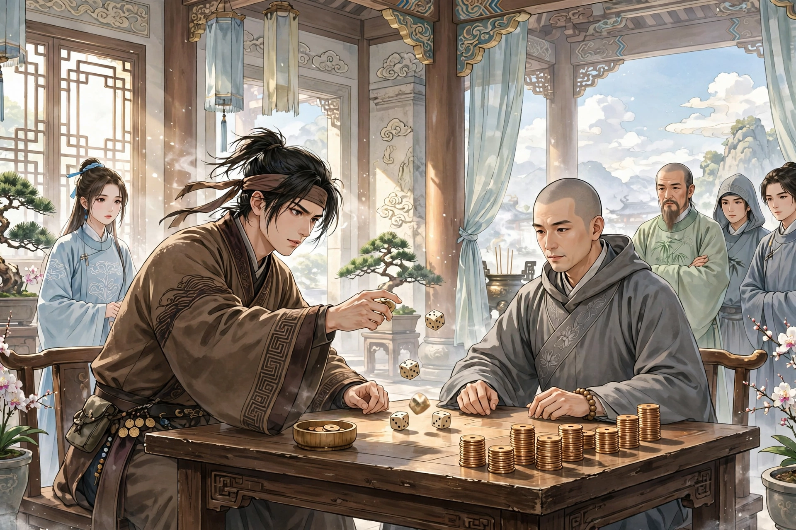

# 120 赌符

韩道士，住在邑中的天齐庙。有很多幻术，大家都称他为“仙”。先父与他最要好，每次到城里，总去拜访他。一天，我与先叔父到邑里去，打算拜访韩道士，正好在路上遇见他。韩道士把钥匙交给我，说：“请先去开门坐着，稍过一会儿我马上就到。”我们便照他的话去做。到了庙里打开门锁，只见韩道士已经坐在屋子里。像这样的事很多。

先前，有一个同族的人嗜好赌博，因为先父的缘故也认识韩道士。正值大佛寺来了一个僧人，专门从事掷骰子赌博，赌得非常豪放。族人见了非常喜欢，倾尽资财去赌，大大亏损；心里更加热切，典当田产，又去赌博，整夜赌下来全部丧失。闷闷不乐没有志气，顺路去拜访韩道士，精神惨淡，言语失次。韩道士问他，他如实告诉了韩道士。韩道士笑着说：“经常赌博没有不输的道理。假如能够戒赌，我为你挽回。”族人说：“假如能够让失去的钱财像合浦明珠一样归还，我一定马上为您铸像报答！”韩道士便用纸写了一道符，交给他让他带上。告诉他说：“只是得胜之后希望立即停止，不要在摊牌之后还想留下。”又给了他一千钱，约定作为赌本。族人大喜而去。僧人验看他的钱财，换了钱，不屑与他赌博。族人勉强他，请求以一掷为期。僧人笑着答应了。于是以一千钱作为孤注。僧人掷骰子没有胜负，族人接过骰子，一掷就成了好彩；僧人又以两千钱为注。又输了；渐渐增加到十余千，明明是枭色，呵着气，骰子都成了卢雉：计算先前所输的钱，顷刻之间全部挽回。族人暗暗想再赢数千钱也不错，僧人因为不胜而羞愧，竟然以此为期。过了一会儿大胜，僧人没有分文了。族人怀疑他没有东西偿还，便放他离去。于是又去赌博，骰子渐渐变差；心里觉得奇怪，起来看带子上的符，符已经不见了，大惊而停止。载着钱回到庙里，除了偿还韩道士之外，追算下来，连同后来所失的钱，正好符合原来的数目。于是惭愧地谢罪丢失符的过错。韩道士笑着说：“符已经在这里了。本来属于不要贪心，而你不听，所以取走了符。”

异史氏说：“天下倾家荡产的人，没有比赌博更快的；天下败坏德行的人，也没有比赌博更严重的。进入其中的人，就像沉迷在大海里，将不知道底在哪里了。商人和农民，都有本业；读书的士人，尤其珍惜分阴。背着犁杖横着经书，本来是成家的正路；清谈薄饮，还算是寄托兴致的生活。你却亲近淫朋，缠绵整夜。倾囊倒箧，把金钱悬在险巇的天命上；呼雉呵卢，向浮屠的骨头乞求灵验。盘旋五木，像走动的圆珠；手握多张牌，像擎着团扇。左顾别人右顾自己，望穿了鬼子的眼睛；表面示弱暗地用强，费尽了罔两的伎俩。门前宾客等待着，还恋恋不舍地留在场上；屋上炊烟升起，还眈眈地注视着盆内。忘记吃饭废弃睡眠，久了就成了迷恋；舌头说干嘴唇焦枯，相看就像鬼一样。等到全军尽没，热眼空空地窥看。看局中就叫号浊骂，技痒的英雄胸臆；顾看囊底贯索已经空了，灰心的壮士心情。引颈徘徊，觉得白手起家没有办法；垂头萧索，这才在深夜回家。幸好遇到谪仙人的眼睛，惊怒了犬吠；苦于长久空虚的腹中饥饿，哪里敢怨恨寒冷残羹。既而卖子借贷田地，希望还珠于合浦；不料火灼毛尽，终究在沧江里捞月。等到失败之后才想起，已经成了下流之物；试问赌博中谁最擅长？不过是无裤的公子。甚至枵腹难堪，于是栖身于暴客；撞头无法度日，至于仰赖香匳。唉！败德丧行，倾产亡身，哪一样不是赌博这一条路造成的呢！”

## 原文

韩道士，居邑中之天齐庙。多幻术，共名之「仙」。先子与最善，每适城，辄造之。一日，与先叔赴邑，拟访韩，适遇诸途。韩付钥曰：「请先往启门坐，少旋我即至。」乃如其言。诣庙发扃，则韩已坐室中。诸如此类。

先是，有敝族人嗜博赌，因先子亦识韩。值大佛寺来一僧，专事樗蒲，赌甚豪。族人见而悦之，罄赀往赌，大亏；心益热，典质田产，复往，终夜尽丧。邑邑不得志，便道诣韩，精神惨淡，言语失次。韩问之，具以实告。韩笑云：「常赌无不输之理。倘能戒赌，我为汝复之。」族人曰：「倘得珠还合浦，花容顿当铸就之！」韩乃以纸书符，授与使带。谓曰：「但得胜后望即止，勿得摊后望留也。」又付千钱，约为赌本。族人大喜而往。僧验其货，易之，不屑与赌。族人强之，请以一掷为期。僧笑而从之。乃以千钱为孤注。僧掷之无所胜负，族人接色，一掷成采；僧复以两千为注。又败；渐增至十余千，明明枭色，呵之，皆成卢雉：计前所输，顷刻尽复。阴念再赢数千亦无佳，僧以不胜为羞，竟以此为期。已而大胜，僧无分文矣。族人疑其无所偿，纵而去。乃复博，则色渐劣；心怪之，起视带上，则符已亡矣，大惊而罢。载钱归庙，除偿韩外，追而计之，并未后所失，适符原数也。已乃愧谢失符之罪。韩笑曰：「已在此矣。固属勿贪，而君不听，故取之。」

异史氏曰：「天下之倾家者，莫速于博；天下之败德者，亦莫甚于博。入其中者，如沉迷海，将不知所底矣。夫商农之人，具有本业；诗书之士，尤惜分阴。负耒横经，固成家之正路；清谈薄饮，犹寄兴之生涯。尔乃狎比淫朋，缠绵永夜。倾囊倒箧，悬金于崄巇之天；呼雉呵卢，乞灵于浮屠之骨。盘旋五木，似走圆珠；手握多张，如擎团扇。左顾人而右顾己，望穿鬼子之睛；阳示弱而阴用强，费尽罔两之技。门前宾客待，犹恋恋于场头；舍上火烟生，尚眈眈于盆内。忘餐废寝，则久入成迷；舌敝唇焦，则相看似鬼。造夫全军尽没，热眼空窥。视局中则叫号浊骂，技痒英雄之臆；顾囊底而贯索空矣，灰寒壮士之心。引颈徘徊，觉白手之无济；垂头萧索，始玄夜以方归。幸交谪之人眼，怒惊犬吠；苦久虚之腹馁，敢怨寒残。既而鬻子贷田，冀还珠于合浦；不意火灼毛尽，终捞月于沧江。及遭败后我方思，已作下流之物；试问赌中谁最善？挈指无袴之公。甚而枵腹难堪，遂栖身于暴客；撞头莫度，至仰给于香匳。嗟呼！败德丧行，倾产亡身，孰非博之一途致之哉！」
