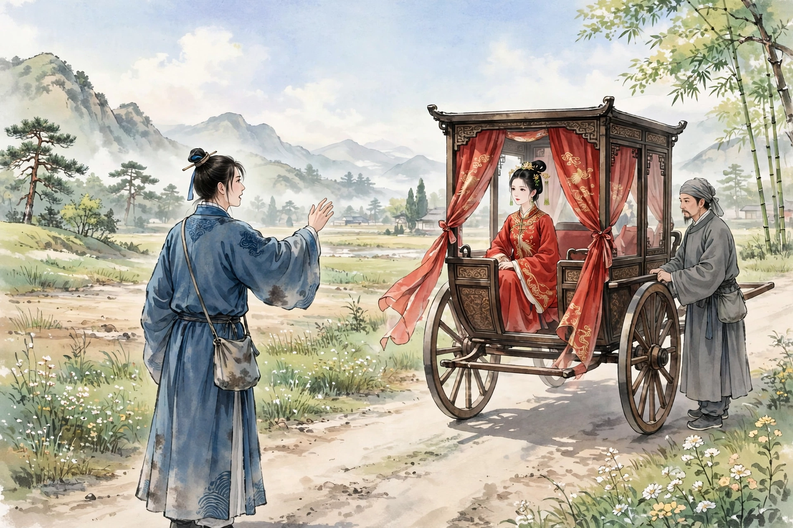

# 121 阿霞

文登的景星，少年时就有重名。与陈生比邻而居，书斋只隔着一堵短墙。一天，陈生傍晚经过荒凉的废墟，听见女子在松柏间啼哭；走近看，只见树横枝上悬着一条带子，好像要自缢。陈生问她，她流着泪回答说：“母亲远出，把我托付给外兄。不料外兄狼子野心，收养我不能始终。孤苦伶仃到这种地步，不如死了！”说完，又哭起来。陈生解下带子，劝她改嫁他人。女子担心没有可以托付的人。陈生请求暂时寄住在他家，女子听从了。回到家，点灯仔细看她，丰韵殊绝。陈生非常高兴，想要侵犯她。女子厉声抗拒，纷乱的声音，传到了隔壁。景生逾墙来窥看，陈生便放开了女子。女子看见景生，凝眸注视了很久，才奔跑离去。两个人一起追赶她，不知去了哪里。景生回去，关上门想要睡觉，只见女子盈盈地从房里走出来。景生惊讶地问她。女子回答说：“那个人德薄福浅，不可以终身托付。”景生大喜。问她的姓字，女子说：“我粗略地住在这里。因为这个姓，小字叫阿霞。”景生用游词试探她，她笑着不很拒绝。于是与她寝处。

书斋里多有朋友来往，女子常常隐闭在深房里。过了数日，女子说：“我暂时离去。这个地方烦杂，很困扰人。今后，请以夜晚来卜问。”景生问：“家在哪里？”女子说：“正不远罢了。”于是早上离去，夜里果然又来了，欢爱绮丽深厚。又过了数日，女子对景生说：“我们两人情好虽然很好，终究属于苟合。家君在西疆做官，明天将要跟随母亲离去，我愿意乘间弃命，而与你相从到终身。”景生问：“几日告别？”约定在旬末。

女子离去之后，景生想书斋居住不可以长久；移到内宅，又担心妻子嫉妒。计谋不如休妻。志向既已决定，妻子到来就辱骂厉责。妻子不堪忍受羞辱，流着泪想要死。景生说：“死恐怕连累我，请早点回去。”于是催促妻子离去。妻子啼哭说：“跟随你十年，不曾有失德的地方，为什么这样决绝呢！”景生不听，催逼更加急迫。妻子便出门离去。从此屋壁清尘，引领翘首等待；不料音信杳无，像青鸾飞去，像石头沉入大海。妻子大归之后，多次请知交请求复婚，景生不接受；妻子于是改嫁夏侯氏。夏侯氏的里居，与景生接壤，因为田畔的缘故，世代有嫌隙。景生听了，更加大为恚恨。然而还希望阿霞再来，差可自我安慰。过了一年多，并没有踪迹。

正值海神寿辰，祠庙内外士女云集，景生也在其中。远远看见一个女子，非常像阿霞。景生走近她，她进入人群中；跟随她，出了门外；又跟随她，她飘然竟离去了。景生追赶不上，恨悒而归。半年之后，正好在路上行走，看见一个女郎，穿着朱衣，跟着苍头，骑着黑卫前来。望去，正是阿霞。于是问跟随的人：“娘子是谁？”回答说：“南村郑公子的继室。”又问：“娶了多久了？”回答说：“半个月罢了。”景生想，难道是母亲误会了吗？女郎听见说话，回眸一睨，景生看去，真是阿霞。见她已经嫁给别人，情意郁结在胸中，大喊：“霞娘！为什么忘记旧约？”跟随的人听见呼喊主妇，想要挥拳打他。女子急忙制止了他。打开帷幕移步说话说：“负心人有什么颜面相见？”景生说：“你自己辜负了我，我何曾辜负你？”女子说：“辜负夫人比辜负我更严重！结发妻子尚且如此，何况其他人呢？从前因为祖德深厚，名字列在桂籍，所以委身相从；现在因为弃妻的缘故，冥中削去你的禄秩，现在科举的亚魁王昌，就是代替你名字的人。我已经归属郑君，不必再思念。”景生俯首帖耳，口中不能说一句话。看着女子，策着蹇驴飞快离去，怅恨而已。

这一科，景生落第，亚魁果然是王氏昌名。郑公子也考中了。景生因此得了薄幸的名声。四十岁没有配偶，家境更加衰败，常常在亲友家混饭吃。偶然去拜访郑公子，郑公子款待他，留他住宿。女子窥见客人，看见他便怜悯他。问郑公子说：“堂上的客人，不是景庆云吗？”问从哪里认识，女子说：“没有嫁给您的时候，曾经在他家避难，也深得他的豢养。他行为虽然低贱，而祖德没有断绝；况且与您是故人，也应该有绨袍的情谊。”郑公子认为她说得对，换去他的破絮，留他住了数日。夜里饮酒罢了，有婢女拿着二十余金赠给景生。女子在窗外说：“这是私自积蓄的，聊且报答旧好，可以拿去，找一个良匹。幸好祖德深厚，还足够惠及子孙。不要再丧失检点，以促短余生。”景生感谢她。回去之后，用十余金买了缙绅家的婢女，非常宠爱怜悯。生了一个儿子，后来考中两榜。郑公子官至吏部郎。去世之后，女子送葬归来，打开车舆里面却空无一人，这才知道她不是人。唉！人的无良，舍弃旧的而谋求新的，最终卵覆而鸟也飞去，上天的报应也是惨烈的！

## 原文

文登景星者，少有重名。与陈生比邻而居，斋隔一短垣。一日，陈暮过荒落之墟，闻女子啼松柏间；近临，则树横枝有悬带，若将自经。陈诘之，挥涕而对曰：「母远出，托妾于外兄。不图狼子野心，畜我不卒。伶仃如此，不如死！」言已，复泣。陈解带，劝令适人。女虑无可托者。陈请暂寄其家，女从之。既归，挑灯审视，丰韵殊绝。大悦，欲乱之。女厉声抗拒，纷纰之声，达于间壁。景生逾垣来窥，陈乃释女。女见景，凝眸伫谛，久乃奔去。二人共逐之，不知去向。景归，阖户欲寝，则女子盈盈自房中出。惊问之。答曰：「彼德薄福浅，不可终托。」景大喜。诘其姓字，曰：「某粗居于兹。以兹姓，小字阿霞。」入以游词，笑不甚拒。遂与寝处。

斋中多友人来往，女恒隐闭深房。过数日，曰：「妾姑去。此处烦杂，困人甚。继今，请以夜卜。」问：「家何所？」曰：「正不远耳。」遂早去，夜果复来，欢爱绮笃。又数日，谓景曰：「我两人情好虽佳，终属苟合。家君宦游西疆，明日将从母去，容即乘间弃命，而相从以终焉。」问：「几日别？」约以旬终。

既去，景思斋居不可常；移诸内，又虑妻妒。计不如出妻。志既决，妻至辄诟厉。妻不堪其辱，涕欲死。景曰：「死恐见累，请蚤归。」遂促妻行。妻啼曰：「从子十年，未尝有失德，何决绝如此！」景不听，逐愈急。妻乃出门去。自是室壁清尘，引领翘待；不意信杳青鸾，如石沉海。妻大归后，数浼知交，请复于景，景不纳；遂适夏侯氏。夏侯里居，与景接壤，以田畔之故，世有郄。景闻之，益大恚恨。然犹冀阿霞复来，差足自慰。越年余，并无踪绪。

会海神寿，祠内外士女云集，景亦在。遥见一女，甚似阿霞。景近之，入于人中；从之，出于门外；又从之，飘然竟去。景追之不及，恨悒而返。后半载，适行于途，见一女郎，著朱衣，从苍头，鞚黑卫来。望之，霞也。因问从人：「娘子为谁？」答言：「南村郑公子继室。」又问：「娶几时矣？」曰：「半月耳。」景思，得母误耶？女郎闻语，回眸一睨，景视，真霞。见其已适他姓，情极胸臆，大呼：「霞娘！何忘旧约？」从人闻呼主妇，欲奋老拳。女急止之。启帏移语曰：「负心人何颜相见？」景曰：「卿自负仆，仆何尝负卿？」女曰：「负夫人甚于负我！结发者如是，而况其他？向以祖德厚，名列桂籍，故委身相从；今以弃妻故，冥中削尔禄秩，今科亚魁王昌，即替汝名者也。我已归郑君，无劳复念。」景俯首帖耳，口不能道一词。视女子，策蹇去如飞，怅恨而已。

是科，景落第，亚魁果王氏昌名。郑亦捷。景以是得薄幸名。四十无偶，家益替，恒趁食于亲友家。偶诣郑，郑款之，留宿焉。女窥客，见而怜之。问郑曰：「堂上客，非景庆云耶？」问所自识，曰：「未适君时，曾避难其家，亦深得其豢养。彼行虽贱，而祖德未斩；且与君为故人，亦宜有绨袍之义。」郑然之，易其败絮，留以数日。夜分饮罢，有婢持廿余金赠景。女在窗外言曰：「此私贮，聊酬夙好，可将去，觅一良匹。幸祖德厚，尚足及子孙。无复丧检，以促余龄。」景感谢之。既归，以十余金买缙绅家婢，甚宠悼。举一子，后登两榜。郑官至吏部郎。既没，女送葬归，启舆则虚无人矣，始知其非人也。噫！人之无良，舍其旧而新是谋，卒之卵覆而鸟亦飞，天之所报亦惨矣！
