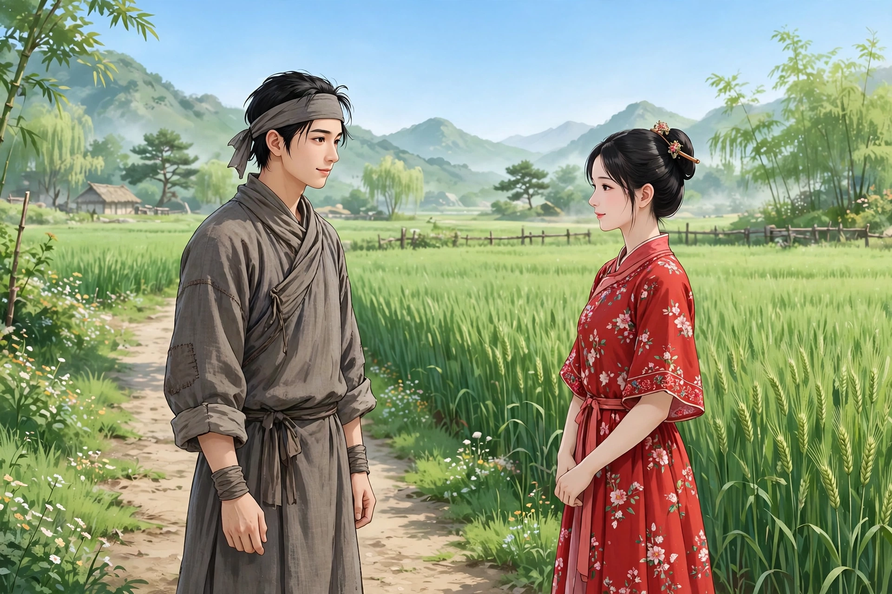
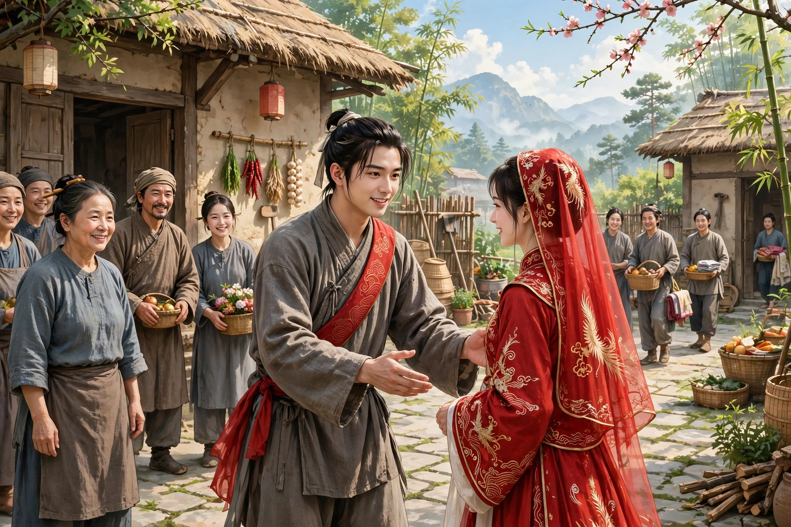

# 124 毛狐

农家子弟马天荣二十多岁，妻子去世了，家里贫穷，娶不起妻子。他在田间除草时，看见一位盛装打扮的少妇，踩着庄稼、越过田埂走过去，脸色红润，举止也很风流。马天荣怀疑她是迷了路，看看四野无人，便开玩笑地去挑逗她，妇人也微微表示接受。马天荣想在野外和她亲热，妇人笑着说：“青天白日，怎么适合做这种事，你回去关上门等着，到了夜里我自然会来。”马天荣不相信，妇人便发誓保证。马天荣就把自家门户的朝向、出入的办法都告诉了她，妇人才离去。到了半夜，妇人果然来了，两人便亲热起来。马天荣觉得她的皮肤非常娇嫩，用火光一照，皮肤红润薄嫩得像婴儿一样，全身长满细毛，他觉得奇怪。又怀疑她的来踪去迹毫无根据，心想这莫非是狐狸吗？于是开玩笑地盘问她，妇人也坦然承认，并不隐瞒。马天荣说：“既然你是仙人，自然是有求必应。既然承蒙你垂爱，难道不拿几两金子来接济我的贫穷吗？”妇人答应了。第二天夜里她来了，马天荣向她要金子，妇人故意惊讶地说：“刚才忘记带了。”临走时，马天荣又嘱咐她。到了夜里，马天荣问：“所求的东西可不要忘了？”妇人笑着说，请改日再给。过了几天，马天荣又索要，妇人笑着从袖子里拿出两锭白金，大约值五六两金子，边沿翘起，纹路细密，十分可爱耐看。马天荣很高兴，把金子深深藏在匣子里。过了半年，偶尔需要用钱，他便拿出来给别人看。别人说：“这是锡。”用牙齿一咬，就应声掉下一块。马天荣大吃一惊，把东西收起来回了家。到了夜里妇人来了，马天荣气愤地责备她，妇人笑着说：“你的命薄，真正的金子你也承受不起。”一笑了之。

马天荣说：“听说狐仙都是绝色美人，怎么竟然不是这样。”妇人说：“我们都是随着人来现化身形的。你连一两金子的福分都没有，沉鱼落雁的美人你怎么能消受得起？以我这样粗陋的姿色固然不足以侍奉上等人物，可是比起大脚驼背的人来，我就是绝色美人了。”过了几个月，她忽然拿三两金子送给马天荣，说：“你屡次向我索要，我看你的命不应当藏有金子。如今媒人说亲的日子近了，请把娶一个妻子的费用送给你，也借此作为赠别。”马天荣自己说并没有聘娶妻子的说法，妇人说：“一两天内自然会有媒人来。”马天荣问：“所说的女子容貌怎么样？”妇人说：“你想着绝色美人，自然就是绝色美人。”马天荣说：“这个我就不敢指望了。只是三两金子怎么能买到妻子呢？”妇人说：“这是月老注定的，不是人力能够做到的。”马天荣问：“为什么突然说要分别？”妇人说：“戴月披星地来往终究不是长久之计。你自己会有妻子，我再这样搪塞下去又有什么意思呢？”天亮后她离去了，交给他一小撮黄色药末，说：“分别之后恐怕你会生病，服下这个就可以治好。”

第二天果然有媒人来，马天荣先问女子的容貌，媒人回答：“在美丑之间。”马天荣问聘金多少，媒人说：“大约四五两。”马天荣不嫌这个价钱贵，却一定要亲自见一见那个人。媒人怕良家女子不肯公开露面，后来便约好和马天荣一起去，相机行事。到了那个村子，媒人先过去，让马天荣在村外等候。过了很久，媒人回来说：“成了！我的表亲和她住在同一个院子里，刚才我去见那女子，她正坐在屋子里，让我请你假装是来拜访表亲的人，从她门前经过，近在咫尺就可以偷看她一眼。”马天荣照着做了。果然看见女子坐在屋子里，伏在床上，让人给她抓背。马天荣快步走过去，用眼睛扫了她一下，容貌确实像媒人说的那样。等到议定聘礼时，他并不争论价钱，只求用一二两金子给女子置办出阁的装束。马天荣越发觉得这桩婚事便宜，于是交了聘金，并酬谢了媒人和写婚书的人，一共三两金子已经用尽，也没有多花一文钱。选了吉日把女子迎娶回家，一进门，只见她胸背都驼着，脖子缩得像乌龟一样，低头看她的裙底，脚大得足有一尺。这才明白狐狸的话是有原因的。

异史氏说：“随着人来现化身形，或许是狐女自己为自己解嘲的话；可是她说的福泽的话，实在值得深信。我常常说：不是祖宗好几代修行，就不能博得高官；不是自己好几代修行，就不能得到佳人。相信因果的人，一定不会把我的话当作荒诞无稽之谈。”

## 原文

农子马天荣年二十余，丧偶，贫不能娶。芸田间，见少妇盛妆，践禾越陌而过，貌赤色，致亦风流。马疑其迷途，顾四野无人，戏挑之，妇亦微纳。欲与野合，笑曰：“青天白日宁宜为此，子归掩门相候，昏夜我当至。”马不信，妇矢之。马乃以门户向背俱告之，妇乃去。夜分果至，遂相悦爱。觉其肤肌嫩甚，火之，肤赤薄如婴儿，细毛遍体，异之。又疑其踪迹无据，自念得非狐耶？遂戏相诘，妇亦自认不讳。马曰：“既为仙人，自当无求不得。既蒙缱绻，宁不以数金济我贫？”妇诺之。次夜来，马索金，妇故愕曰：“适忘之。”将去，马又嘱。至夜，问：“所乞或勿忘也？”妇笑，请以异日。愈数日马复索，妇笑向袖中出白金二锭，约五六金，翘边细纹，雅可爱玩。马喜，深藏于椟。积半岁，偶需金，因持示人。人曰：“是锡也。”以齿龁之，应口而落。马大骇，收藏而归。至夜妇至，愤致诮让，妇笑曰：“子命薄，真金不能任也。”一笑而罢。

马曰：“闻狐仙皆国色，殊亦不然。”妇曰：“吾等皆随人现化。子且无一金之福，落雁沉鱼何能消受？以我陋质固不足以奉上流，然较之大足驼背者，即为国色。”过数月，忽以三金赠马，曰：“子屡相索，我以子命不应有藏金。今媒聘有期，请以一妇之资相馈，亦借以赠别。”马自白无聘妇之说，妇曰：“一二日自当有媒来。”马问：“所言姿貌何如？”曰：“子思国色，自当是国色。”马曰：“此即不敢望。但三金何能买妇？”妇曰：“此月老注定，非人力也。”马问：“何遽言别？”曰：“戴月披星终非了局。使君自有妇，搪塞何为？”天明而去，授黄末一刀圭，曰：“别后恐病，服此可疗。”

次日果有媒来，先诘女貌，答：“在妍媸之间。”聘金几何？”“约四五数。”马不难其价，而必欲一亲见其人。媒恐良家子不肯炫露，既而约与俱去，相机因便。既至其村，媒先往，使马候诸村外。久之来曰：“谐矣！余表亲与同院居，适往见女，坐室中，请即伪为谒表亲者而过之，咫尺可相窥也。”马从之。果见女子坐室中，伏体于床，倩人爬背。马趋过，掠之以目，貌诚如媒言。及议聘，并不争直，但求一二金装女出阁。马益廉之，乃纳金并酬媒氏及书券者，计三两已尽，亦未多费一文。择吉迎女归，入门，则胸背皆驼，项缩如龟，下视裙底，莲船盈尺。乃悟狐言之有因也。

异史氏曰：“随人现化，或狐女之自为解嘲；然其言福泽，良可深信。余每谓：非祖宗数世之修行，不可以博高官；非本身数世之修行，不可以得佳人。信因果者，必不以我言为河汉也。”
