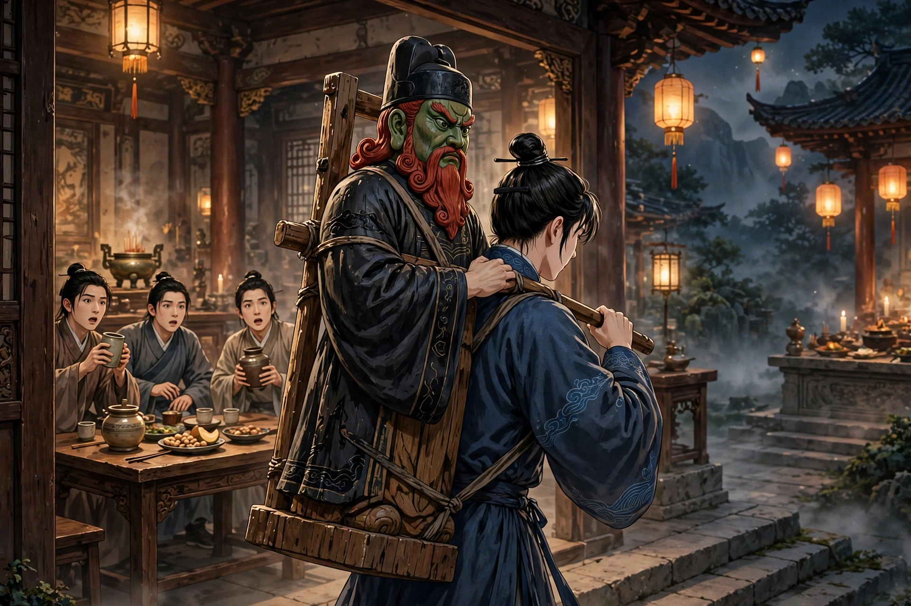
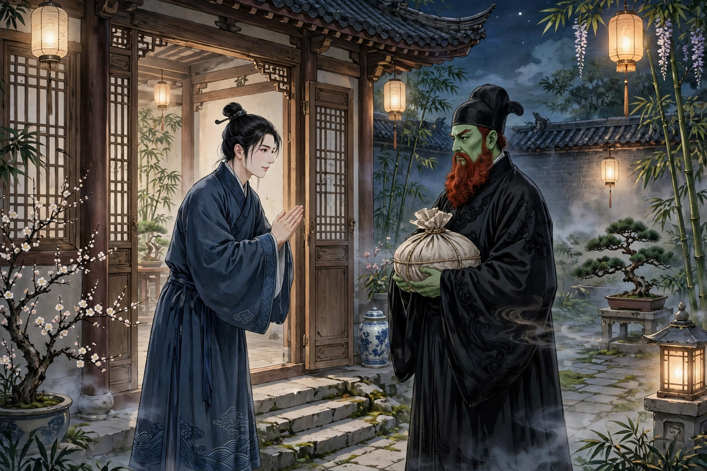
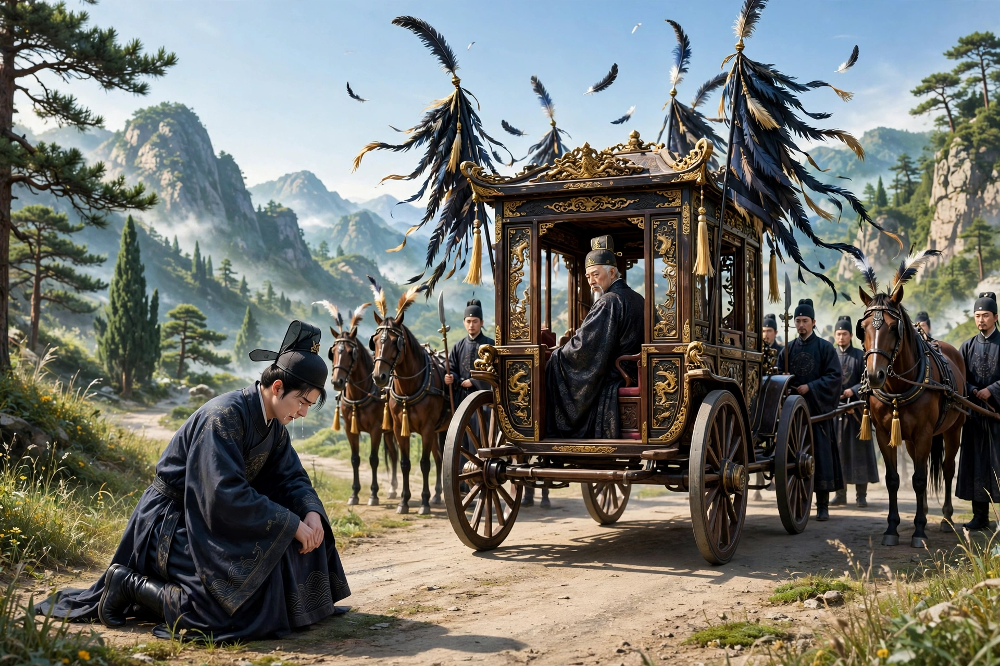

# 047 陆判

陵阳有个叫朱尔旦的人，字小明。性情豪放爽直，只是向来迟钝，读书虽然用功，却还没有出名。一天，文社里众人一起喝酒。有人开玩笑对他说：“你素有豪侠的名声，要是能在深夜到十王殿去，把左廊的判官背回来，大家就凑钱摆酒请你。”原来陵阳有一座十王殿，里面的神鬼都是木头雕成的，装饰得栩栩如生。东廊站着一位判官，绿脸红胡子，相貌格外狰狞凶恶。有人夜里听见两廊有拷打审讯的声音。走进去的人，汗毛都竖了起来。所以众人就拿这件事来为难朱尔旦。朱尔旦笑着站起来，径直去了。没过多久，门外有人大声喊道：“我把长胡子的宗师请来了！”众人都站起身来。不一会儿，朱尔旦背着判官进来，把他放在桌案上，端起酒杯，连敬了他三杯。众人看着判官，缩着身子坐在座位上坐立不安，又请朱尔旦把判官背回去。朱尔旦又拿酒洒在地上，祝告说：“学生狂妄无礼，大宗师想必不会见怪。我的寒舍离得不远，正该趁着兴致来找我喝酒，千万不要见外。”说完就把判官背走了。

第二天，众人果然请他喝酒。到了傍晚，朱尔旦喝得半醉回家，兴致还没有尽，点起灯独自喝酒。忽然有人掀开门帘进来，一看，原来是那位判官。朱尔旦站起来说：“我想我大概快要死了吧！昨天晚上冒犯了您，今天是来对我用刑的吗？”判官露出浓密的胡子微微一笑，说：“不是。昨天承蒙您盛情相约，今天夜里正好有空，特地来履行您这位达人的约定。”朱尔旦非常高兴，拉着他的衣服请他坐下，自己起身洗刷酒器、生起火来。判官说：“天气暖和，可以喝冷酒。”朱尔旦照他的话做，把酒瓶放在桌案上，跑去告诉家人准备酒菜果品。妻子听说了，大吃一惊，告诫他不要出去。朱尔旦不听，站着等酒菜准备好拿出来。两人换着酒杯互相敬酒，这才开始问起姓名。判官说：“我姓陆，没有名字。”两人谈论古代典籍，判官对答如流。朱尔旦问：“您懂得八股制艺吗？”判官说：“文章的好坏，我也还分辨得出来。阴间的诵读，和阳世也差不多。”陆判官酒量很大，一口气能喝十杯。朱尔旦因为整天喝酒，不知不觉就像玉山倒塌一样，趴在桌案上醉睡过去。等他醒来，残烛昏黄，鬼客人已经走了。

从此以后，陆判官每隔两三天就来一次，交情越来越深厚，时常同榻抵足而卧。朱尔旦把自己写的文章拿给陆判官看，陆判官总是用红笔批改，全都说写得不好。一天夜里，朱尔旦喝醉了，先睡下了，陆判官还独自喝酒。朱尔旦忽然在醉梦中觉得肚腹微微疼痛；醒来一看，只见陆判官端坐在床前，剖开他的胸腹取出肠胃，一条一条地整理。朱尔旦惊愕地说：“我们向来没有仇怨，为什么要杀我？”陆判官笑着说：“不要害怕，我是为你换一颗聪明的心。”他从容地把肠子放回腹中，重新合上，最后用裹脚布束住朱尔旦的腰。事情做完，再看床上也没有血迹。朱尔旦只觉得腹间有些麻木。看见陆判官把一块肉放在桌案上，他问那是什么。陆判官说：“这是你的心。你写文章不流畅，是因为你的心窍堵塞了。刚才我在阴间，在成千上万颗心中，挑选了一颗好的，给你换上了，留下这一颗拿回去补上空缺的数目。”说完站起身，掩上门走了。天亮后朱尔旦解开一看，伤口的缝合处已经长好了，只留下一条发红的线。自此以后，朱尔旦文思大进，看过的东西都不会忘记。过了几天，他又拿文章给陆判官看。陆判官说：“可以了。只是你的福分薄，不能大富大贵，也就中个秀才、举人罢了。”朱尔旦问：“什么时候？”陆判官说：“今年一定能考第一。”不久，朱尔旦在科试中考了第一，秋天乡试果然中了经魁。同社的生员们平时都嘲笑他；等到看见他的考场文章，彼此对视，大吃一惊，仔细打听才知道这件奇事。大家一起请求朱尔旦先为他们引见，愿意和陆判官结交。陆判官答应了。众人摆下盛大的酒席等着他。刚入夜，陆判官来了，红胡子微微抖动，眼睛炯炯像闪电一样。众人顿时面无血色，牙齿直打战；渐渐地都悄悄离开了。

朱尔旦于是带着陆判官回家喝酒，喝到醉意上来，朱尔旦说：“换肠剖胃，我受您的恩惠已经很多了。还有一件事想麻烦您，不知道行不行？”陆判官便请他说出来。朱尔旦说：“心肠可以换，想来面貌大概也可以换。我的妻子，是和我结发的原配，下半身倒也不算难看，只是头脸不太美丽。还想麻烦您的刀斧，怎么样？”陆判官笑着说：“答应了，容我慢慢想办法。”过了几天，半夜里陆判官来敲门。朱尔旦赶紧起来请他进来。点灯一看，见他怀里裹着一件东西。朱尔旦问那是什么。陆判官说：“您前些日子托付的事，向来很难找到合适的人选。刚才正好得到一颗美人的头，特地来向您复命。”朱尔旦拨开一看，脖子上的血还温热。陆判官站在那里催他快点进去，不要惊动鸡犬。朱尔旦担心夜里门户紧闭。陆判官走到门前，一手推门，门就从外面往里开了。他领着朱尔旦到卧室，看见夫人侧身睡着。陆判官把那颗头交给朱尔旦抱着；自己从靴子里拿出一把像匕首一样的白刃，按在夫人的脖子上，用力像切豆腐一样，一刀下去，头就落在枕头边；他赶紧从朱尔旦怀里取过美人的头，合在夫人的脖子上，仔细端详是否端正，然后才按紧。过了一会儿，他移过枕头塞在肩膀旁边，叫朱尔旦把原来的头埋在僻静的地方，就走了。朱尔旦的妻子醒来，觉得脖子间微微发麻，脸颊上却有些错乱不平；用手一搓，搓下血片来，非常惊骇。她喊婢女打水洗脸；婢女看见她满脸是血，吓得魂都没了。洗过之后，盆里的水全红了。抬起头来，面貌已经完全变了，又惊骇到了极点。夫人拿起镜子自己照看，错愕得无法理解。朱尔旦进来告诉她原委；于是反复仔细地看，只见长眉遮住鬓角，笑靥衬着颧骨，简直是画中的美人。解开衣领验看，脖子上有一圈红线，上下肉色截然不同。

在这之前，吴侍御有个女儿，非常美丽，还没有出嫁就已经死了两任丈夫，所以十九岁了还没有嫁人。上元节那天她游览十王殿，当时游人十分混杂，其中有个无赖贼子窥见了她的美貌，就暗中打听她的住处，趁夜里架梯子翻进院子，挖开卧室的门，杀了一个藏在床下的婢女，逼迫那女子与他成奸；女子竭力抗拒，大声喊叫，贼子发怒，也把她杀了。吴夫人隐约听见吵闹声，喊婢女去看，婢女看见尸体，吓得魂都没了。全家人都起来了，把尸体停放在堂上，头放在脖子旁边，一家人哭号不止，闹腾了一夜。第二天早上掀开被子一看，身子还在，头却不见了。吴家把侍女们都打了一遍，说她们看守不周到，以致头颅落进了狗腹。侍御向郡里告发。郡里严限捉拿贼人，三个月过去，罪人还是没有抓到。渐渐地有人把朱家换头这件奇事告诉了吴公。吴公起了疑心，派老妈子到朱家探访；老妈子进去看见夫人，吓得跑回来告诉吴公。吴公看着女儿的尸体还在，惊疑得拿不定主意。他猜测朱尔旦用邪术杀了女儿，前去质问朱尔旦。朱尔旦说：“我的妻子梦见换了头，实在不知道是什么缘故；说是我杀了她，那就冤枉了。”吴公不相信，告到官府。官府把朱家的人抓来审问，说的都和朱尔旦一样。郡守也断不了这个案子。朱尔旦回家，向陆判官求计。陆判官说：“不难，应当让那女子自己说出来。”当天夜里吴公梦见女儿说：“女儿是被苏溪的杨大年害死的，和朱孝廉没有关系。朱孝廉本来就不满意自己的妻子，陆判官便取了女儿的头来和她换了头，所以女儿是身子死了，头还活着。希望你们不要互相结仇。”醒来告诉夫人，夫人做的梦也一样。于是把这件事告诉官府。一问，果然有杨大年这个人；把他抓来戴上刑具，他就认了罪。吴公于是到朱家，请见夫人，从此两家成了翁婿。吴家就把朱尔旦妻子的头和女儿的尸身合葬在一起。

朱尔旦三次参加礼部的会试，都因为违反考场规则被放逐。于是他对仕途灰了心，这样过了三十年。一天夜里，陆判官告诉他说：“您的寿命不长了。”朱尔旦问期限，陆判官回答说还有五天。朱尔旦问：“能救吗？”陆判官说：“这全是天命，人怎么能私自改变呢？况且从达观的人看来，生和死是一样的，何必把生当作快乐，把死当作悲伤呢？”朱尔旦觉得他说得有道理。就置备了寿衣、被褥和棺椁；置备齐全之后，穿上盛装去世了。第二天，夫人正扶着灵柩哭泣，朱尔旦忽然慢慢地从外面走进来。夫人害怕了。朱尔旦说：“我确实是鬼，和活着的时候没有什么不同。只是牵挂你们孤儿寡母，实在恋恋不舍。”夫人放声大哭，眼泪流到胸前；朱尔旦依依不舍地安慰她。夫人说：“古时候有还魂的说法，您既然有灵，为什么不再活过来呢？”朱尔旦说：“天数是不能违背的。”夫人问：“在阴间做什么事？”朱尔旦说：“陆判官推荐我主管文案事务，还授给我官爵，也没有什么苦处。”夫人还想再说话，朱尔旦说：“陆公和我一起来了，可以准备酒菜。”说完就走了出去。夫人照他的话准备好。只听见屋子里边笑边喝酒，高声大气，好像他活着的时候一样。半夜里偷偷一看，屋里已经空无一人，悄悄地走了。从此以后，朱尔旦每隔三五天就来一次，有时还留下来过夜亲昵，家里的事情顺便就料理了。儿子朱玮才五岁，朱尔旦来就抱他；到了七八岁，就在灯下教他读书。儿子也很聪明，九岁就能写文章，十五岁进了县学，竟然不知道自己没有父亲。从此以后，朱尔旦来得渐渐稀疏了，只是一两个月来一次。又有一天夜里他来，对夫人说：“现在要和你永远告别了。”夫人问：“到哪里去？”朱尔旦说：“承蒙皇帝的命令去做太华卿，马上就要远行了，事情繁多，路途又远，所以不能再来了。”母子拉着他哭，说：“不要这样！儿子已经长大成人，家里的生计还可以维持，难道有百年不分离的夫妻吗？”朱尔旦看着儿子说：“好好做人，不要败坏父亲的事业。十年以后再相见一次。”说完径直出门走了，从此就断绝了来往。

后来朱玮二十五岁，考中进士，做了行人。奉命祭祀西岳，路过华阴的时候，忽然有一队车马仪仗，飞驰着冲撞他的卤簿。朱玮感到奇怪。仔细看车里的人，原来是他的父亲。他下马哭着跪伏在道旁。父亲停下车说：“你的官声很好，我可以瞑目了。”朱玮跪伏着不起身。朱尔旦催促车马前行，飞驰而去，不回头。走了几步，回头望望，解下佩刀叫人拿去送给儿子。远远地说：“佩带它就会显贵。”朱玮想要追随父亲，看见车马随从，飘忽得像风一样，转眼就不见了。他悲痛了很久。抽出刀来看，制作极其精工，上面刻着一行字：“胆子要大，心思要细；智慧要圆融，行为要方正。”朱玮后来官做到司马。生了五个儿子，名叫沉、潜、沕、浑、深。一天夜里，梦见父亲说：“佩刀应当送给浑。”朱玮照办了。浑后来做了总宪，很有政声。

异史氏说：“把鹤的腿截断去接野鸭的腿，做这种矫揉造作的事的人是荒谬的；把花木嫁接，首创的人却是奇妙的；更何况在肝肠上动刀凿削，在脖子上用刀锥的人呢！陆公这个人，真可以说是丑陋的外皮包裹着美丽的骨相了。从明朝末年到现在，年代并不久远，陵阳的陆公还存在吗？还有灵验吗？如果能为他执鞭随从，那是我所欣慕的啊。”

## 原文

陵阳朱尔旦，字小明。性豪放。然素钝，学虽笃，尚未知名。一日，文社众饮。或戏之云：“君有豪名，能深夜赴十王殿，负得左廊判官来，众当醵作筵。”盖陵阳有十王殿，神鬼皆以木雕，妆饰如生。东庑有立判，绿面赤须，貌尤狞恶。或夜闻两廊拷讯声。入者，毛皆森竖。故众以此难朱。朱笑起，径去。居无何，门外大呼曰：“我请髯宗师至矣！”众皆起。俄负判入，置几上，奉觞，酹之三。众睹之，瑟缩不安于座，仍请负去。朱又把酒灌地，祝曰：“门生狂率不文，大宗师应该不为怪。荒舍匪遥，合乘兴来觅饮，幸勿为畛畦。”乃负之去。

次日，众果招饮。抵暮，半醉而归，兴未阑，挑灯独酌。忽有人搴帘入，视之，则判官也。朱起曰：“意吾殆将死矣！前夕冒渎，今来加斧鑕耶？”判启浓髯微笑曰：“非也。昨蒙高义相订，夜偶暇，敬践达人之约。”朱大悦，牵衣促坐，自起涤器爇火。判曰：“天道温和，可以冷饮。”朱如命，置瓶案上，奔告家人治肴果。妻闻，大骇，戒勿出。朱不听，立俟治具以出。易盏交酬，始询姓氏。曰：“我陆姓，无名字。”与谈古典，应答如响。问：“知制艺否？”曰：“妍媸亦颇辨之。阴司诵读，与阳世略同。”陆豪饮，一举十觥。朱因竟日饮，遂不觉玉山倾颓，伏几醺睡。比醒，则残烛昏黄，鬼客已去。

自是三两日辄一来，情益洽，时抵足卧。朱献窗稿，陆辄红勒之，都言不佳。一夜，朱醉，先寝，陆犹自酌。忽醉梦中，觉脏腹微痛；醒而视之，则陆危坐床前，破腔出肠胃，条条整理。愕曰：“夙无仇怨，何以见杀？”陆笑云：“勿惧，我为君易慧心耳。”从容纳肠已，复合之，末以裹足布束朱腰。作用毕，视榻上亦无血迹。腹间觉少麻木。见陆置肉块几上。问之，曰：“此君心也。作文不快，知君之毛窍塞耳。适在冥间，于千万心中，拣得佳者一枚，为君易之，留此以补阙数。”乃起，掩扉去。天明解视，则创缝已合，有线而赤者存焉。自是文思大进，过眼不忘。数日，又出文示陆。陆曰：“可矣。但君福薄，不能大显贵，乡、科而已。”问：“何时？”曰：“今岁必魁。”未几，科试冠军，秋闱果中经元。同社生素揶揄之；及见闱墨，相视而惊，细询始知其异。共求朱先容，愿纳交陆。陆诺之。众大设以待之。更初，陆至，赤髯生动，目炯炯如电。众茫乎无色，齿欲相去；渐引去。

朱乃携陆归饮，既醺，朱曰：“湔肠伐胃，受赐已多。尚有一事欲相烦，不知可否？”陆便请命。朱曰：“心肠可易，面目想亦可更。山荆，予结发人，下体颇亦不恶，但头面不甚佳丽。尚欲烦君刀斧，如何？”陆笑曰：“诺，容徐图之。”过数日，半夜来叩关。朱急起延入。烛之，见襟裹一物。诘之，曰：“君曩所嘱，向艰物色。适得一美人首，敬报君命。”朱拨视，颈血犹温。陆立促急入，勿惊禽犬。朱虑门户夜扃。陆至，一手推扉，扉自外门内辟。引至卧室，见夫人侧身眠。陆以头授朱抱之；自于靴中出白刃如匕首，按夫人项，着力如切腐状，迎刃而解，首落枕畔；急于生怀，取美人首合项上，详审端正，而后按捺。已而移枕塞肩际，命朱瘞首静所，乃去。朱妻醒，觉颈间微麻，而颊甲错；搓之，得血片，甚骇。呼婢汲盥；婢见面血狼藉，惊绝。濯之，盆水尽赤。举首则面目全非，又骇极。夫人引镜自照，错愕不能自解。朱入告之；因反复细视，则长眉掩鬓，笑靥承颧，画中人也。解领验之，有红线一周，上下肉色，判然而异。

先是，吴侍御有女甚美，未嫁而丧二夫，故十九犹未醮也。上元游十王殿，时游人甚杂，内有无赖贼窥而艳之，遂阴访居里，乘夜梯入，穴寝门，杀一婢于床下，逼女与淫；女力拒声喊，贼怒，亦杀之。吴夫人微闻闹声，呼婢往视，见尸骇绝。举家尽起，停尸堂上，置首项侧，一门啼号，纷腾终夜。诘旦启衾，则身在而失其首。遍挞侍女，谓所守不恪，致葬犬腹。侍御告郡。郡严限捕贼，三月而罪人弗得。渐有以朱家换头之异闻吴公者。吴疑之，遣媪探诸其家；入见夫人，骇走以告吴公。公视女尸故存，惊疑无以自决。猜朱以左道杀女，往诘朱。朱曰：“室人梦易其首，实不解其何故；谓仆杀之，则冤也。”吴不信，讼之。收家人鞫之，一如朱言。郡守不能决。朱归，求计于陆。陆曰：“不难，当使伊女自言之。”吴夜梦女曰：“儿为苏溪杨大年所贼，无与朱孝廉。彼不艳于其妻，陆判官取儿头与之易之，是儿身死而头生也。愿勿相仇。”醒告夫人，所梦同。乃言于官。问，果有杨大年；执而械之，遂伏其罪。吴乃诣朱，请见夫人，由此为翁婿。乃以朱妻首合女尸而葬焉。

朱三入礼闱，皆以场规被放。于是灰心仕进，积三十年。一夕，陆告曰：“君寿不永矣。”问其期，对以五日。“能相救否？”曰：“惟天所命，人何能私？且自达人观之，生死一耳，何必生之为乐，死之为悲？”朱以为然。即治衣衾棺椁；既竟，盛服而没。翌日，夫人方扶柩哭，朱忽冉冉自外至。夫人惧。朱曰：“我诚鬼，不异生时。虑尔寡母孤儿，殊恋恋耳。”夫人大恸，涕垂膺；朱依依慰解之。夫人曰：“古有还魂之说，君既有灵，何不再生？”朱曰：“天数不可违也。”问：“在阴司作何务？”曰：“陆判荐我督案务，授有官爵，亦无所苦。”夫人欲再语，朱曰：“陆公与我同来，可设酒馔。”趋而出。夫人依言营备。但闻室中笑饮，亮气高声，宛若生前。半夜窥之，窅然已逝。自是三数日辄一来，时而留宿缱绻，家中事就便经纪。子玮方五岁，来辄捉抱；至七八岁，则灯下教读。子亦慧，九岁能文，十五入邑庠，竟不知无父也。从此来渐疏，日月至焉而已。又一夕来，谓夫人曰：“今与卿永诀矣。”问：“何往？”曰：“承帝命为太华卿，行将远赴，事烦途隔，故不能来。”母子持之哭，曰：“勿尔！儿已成立，家计尚可存活，岂有百岁不拆之鸾凤耶！”顾子曰：“好为人，勿堕父业。十年后一相见耳。”径出门去，于是遂绝。

后玮二十五，举进士，官行人。奉命祭西岳，道经华阴，忽有舆从羽葆，驰冲卤簿。讶之。审视车中人，其父也。下马哭伏道左。父停舆曰：“官声好，我目瞑矣。”玮伏不起。朱促舆行，火驰不顾。去数步，回望，解佩刀遣人持赠。遥语曰：“佩之当贵。”玮欲追从，见舆马人从，飘忽若风，瞬息不见。痛恨良久。抽刀视之，制极精工，镌字一行，曰：“胆欲大而心欲小，智欲圆而行欲方。”玮后官至司马。生五子，曰沉，曰潜，曰沕，曰浑，曰深。一夕，梦父曰：“佩刀宜赠浑也。”从之。浑仕为总宪，有政声。

异史氏曰：“断鹤续凫，矫作者妄；移花接木，创始者奇；而况加凿削于肝肠，施刀锥于颈项者哉！陆公者，可谓媸皮裹妍骨矣。明季至今，为岁不远，陵阳陆公犹存乎？尚有灵焉否也？为之执鞭，所忻慕焉。”
