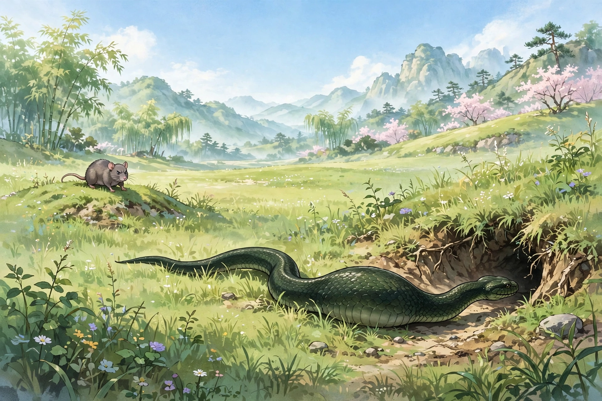
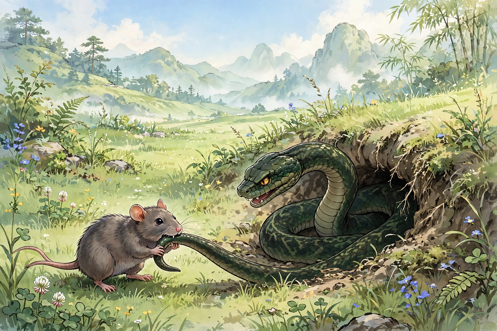

# 050 义鼠

杨天一说：他看见两只老鼠出来，其中一只被蛇吞了；另一只瞪大眼睛，眼睛圆得像花椒粒一样，看上去十分愤恨恼怒，可是只敢远远望着，不敢上前。蛇吃饱了，蜿蜒着爬进洞穴；刚爬进去一半，那只老鼠跑过来，用力啃咬蛇的尾巴。蛇发怒了，退出身子出来。老鼠本来就敏捷轻便，忽然一下子逃走了。蛇追不上，只好返回。等蛇再进洞，老鼠又来了，像前面一样啃咬。蛇进洞老鼠就来，蛇出洞老鼠就走，这样持续了很久。蛇出来后，把死老鼠吐在地上。老鼠走过来嗅了嗅，啾啾地叫着，像是在哀悼叹息，然后衔着死老鼠走了。友人张历友为此作了《义鼠行》。

## 原文

杨天一言：见二鼠出，其一为蛇所吞；其一瞪目如椒，似甚恨怒，然遥望不敢前。蛇果腹，蜿蜒入穴；方将过半，鼠奔来，力嚼其尾。蛇怒，退身出。鼠故便捷，歘然遁去。蛇追不及而返。及入穴，鼠又来，嚼如前状。蛇入则来，蛇出则往，如是者久。蛇出，吐死鼠于地上。鼠来嗅之，啾啾如悼息，衔之而去。友人张历友为作《义鼠行》。
