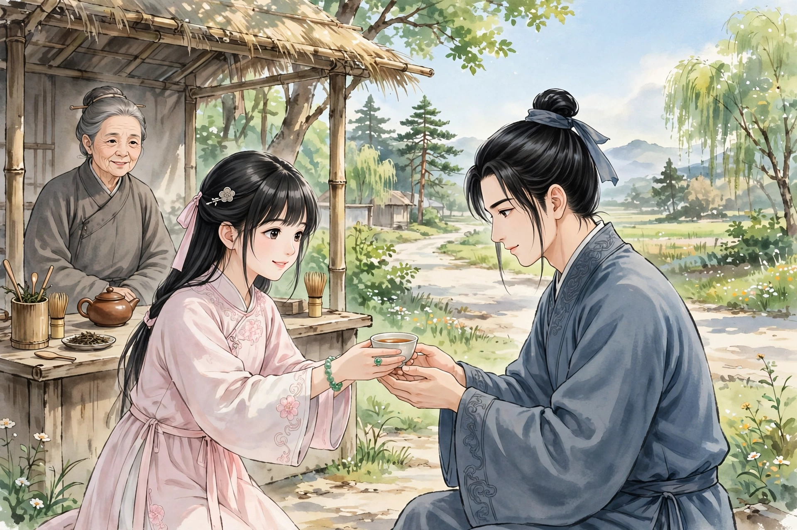
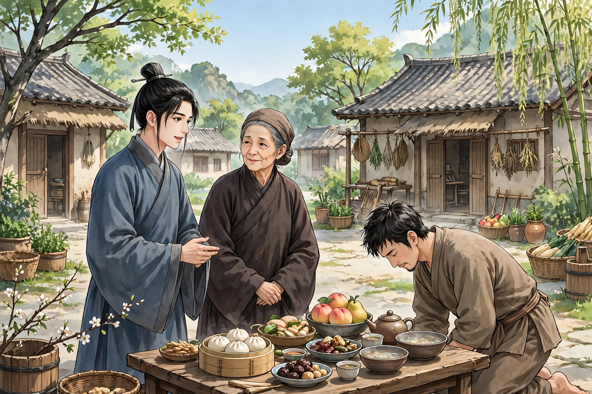
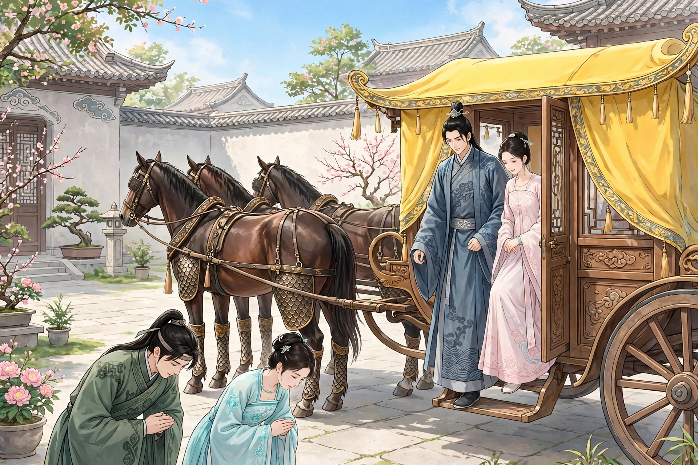

# 056 水莽草

水莽是一种毒草。它的藤蔓像葛藤一样蔓生，开紫色的花，像扁豆的花。人误食了它，立刻就会死去，死后就成了水莽鬼。民间传说，这种鬼不能轮回转生，一定要再有被毒死的人来代替它，它才能脱身。所以楚地桃花江一带，这种鬼尤其多。

楚地的人把同一年出生的人称为同年，互相投递名帖往来，称呼对方为庚兄、庚弟，子侄辈就称呼庚伯，这是当地的习俗。有一个姓祝的书生去拜访他的同年某人，半路上口干舌燥，想找水喝。忽然看见路边有一个老妇人，搭着棚子施舍茶水，他便走了过去。老妇人迎接他进了棚子，招待得十分殷勤。他闻了闻那茶水，有一股异味，不像是茶，放在一边没有喝，起身就要出去。老妇人急忙拦住客人，随即喊道：“三娘，可以拿一杯好茶来。”不一会儿，有一个少女捧着茶从棚子后面出来，年纪大约十四五岁，容貌艳丽绝伦，手指上的戒指、手臂上的手镯晶莹透亮，照出人影。书生接过茶盏，神魂都飞走了；闻一闻那茶，香气浓烈，无与伦比。喝完了又要了一杯。趁老妇人出去的时候，他开玩笑地抓住了少女纤细的手腕，脱下了她的一枚戒指。少女红着脸微微一笑，书生更加迷惑了。他略略问了问少女的家世门户，少女说：“郎君晚上来，我还在这里。”书生向她要了一小撮茶叶，连同藏起来的戒指一起带走了。到了同年家里，他觉得心里发恶，怀疑是茶水作祟，便把实情告诉了同年。同年大惊说：“糟了！这是水莽鬼啊。我的父亲就是死在这里的。这是没法救的，该怎么办呢？”书生大为害怕，拿出茶叶来验看，果然是水莽草。他又拿出戒指，并且讲述了那女子的模样。同年想了想说：“这一定是寇三娘。”书生因为名字正好相符，问：“为什么知道？”同年说：“南村富户寇家的女儿，一向有艳丽的名声。几年前，她误食了水莽而死，一定是她在作祟。”有人说，被迷惑的人如果知道了鬼的姓氏，向她求取她旧裤子的裆部，煮水服下就可以痊愈。同年急忙到寇家去，把实情如实告诉了他们，长跪哀求；寇家因为书生将要代替女儿去死，所以舍不得给。同年愤愤地回来了，把这件事告诉了书生。书生也咬牙切齿地恨寇家，说：“我死了，一定不让他们的女儿脱生！”同年用担架抬着送他回家，快到家门口时他就死了。母亲哭着把他安葬了。他留下一个儿子，才刚满周岁。妻子不能守住寡妇的节操，半年后就改嫁走了。母亲独自留下孤儿自己哺育，劳累困苦得难以忍受，早晚悲啼。有一天，母亲正抱着孩子在屋里哭，书生悄然忽然走了进来。母亲大惊，擦着眼泪问他。他回答说：“儿子在地下听到母亲哭泣，心里十分悲伤，所以来侍奉母亲的早晚。儿子虽然死了，却已经有了家室，就一同来分担母亲的辛劳，母亲不要悲伤。”母亲问：“儿媳是什么人？”他说：“寇家坐视儿子死去，儿子十分恨他们。死后想去找三娘，却不知道她在什么地方；最近遇到了某庚伯，才指点了我。儿子前去时，三娘已经投生到任侍郎家里；儿子赶去，强行把她捉了来，现在做了儿子的妻子，彼此也很相得，并没有什么苦处。”过了一会儿，门外走进一个女子，妆饰华丽艳美，伏在地上拜见母亲。书生说：“这就是寇三娘。”她虽然不是活人，母亲见了她，心情也稍稍得到了安慰。书生便打发三娘去干活。三娘很不习惯做这些活计，可是顺从听话的样子十分惹人怜爱。从此她住在原来的屋子里，就留下来不再离去。女子请母亲把这件事告诉各家。书生本想不要告诉；可是母亲顺从了女子的意思，终于告诉了他们。寇家的老翁和老妇听说了，大为惊骇，命令车马飞快地赶来。一看，果然是三娘。彼此相对哭得失了声，女子劝他们不要哭了。老妇看到书生家里十分贫穷，心里很是忧伤悼念。女子说：“人已经是鬼了，又何必厌恶贫穷呢？看看郎君母子，情义真挚深厚，女儿本来已经安于这里了。”于是问：“施茶的老妇是什么人？”她说：“她姓倪，因为自己惭愧不能迷惑过路的人，所以求女儿帮助她罢了。如今她已经投生在郡城卖浆的人家里。”于是她看着书生说：“既然已经是女婿了，却不拜见岳父，我又是什么心意呢？”书生于是跪拜行礼。女子便走进厨房，代替母亲做饭，侍奉翁媼。老妇看了，心里凄凉。回去之后，立刻派了两个婢女来，为他们服役；又送来黄金一百斤、布帛几十匹；酒肉也时常送来，祝母的生活稍稍富足了。寇家也时常招女儿回娘家。住了几天，女儿就说：“家里没有人，应当早些送女儿回去。”有时候故意拖延不送，她就飘然自己回去了。老翁于是代书生盖起了夏天住的房屋，置办得十分齐全。可是书生始终没有到过翁家一次。

有一天，村子里有一个中了小莽毒的人，死了又活了过来，大家传为奇事。书生说：“是我救活他的。他是被李九害死的，我替他把鬼驱走了。”母亲说：“你为什么不找个人来代替自己呢？”他说：“儿子深深痛恨这一类鬼，正要把他们全部驱除干净，怎么屑于这样做呢！况且儿子侍奉母亲最快乐，并不愿意再活过来。”从此，中毒的人往往备办丰盛的酒席，到他的庭院里祈祷，常常有效验。

积攒了十多年，母亲死了。书生夫妇也悲痛得形体消瘦，可是不接待客人，只命令儿子穿上丧服、顿足捶胸地哭泣，教他按照礼仪行事罢了。安葬母亲之后，又过了两年多，为儿子娶了媳妇。媳妇是任侍郎的孙女。先前，任公的妾生了一个女儿，几个月就夭折了。后来听说了祝生的奇事，于是亲自驾车到他家，订下了翁婿之约。到了这时，就把孙女嫁给了他的儿子，两家往来不断。有一天，书生对儿子说：“上帝因为我在人世有功劳，任命我为四渎牧龙君，现在要走了。”忽然看见庭院下面有四匹马，驾着黄巾盖的车子，马的四条腿上都长着鳞甲。夫妇盛装出来，一同登上一辆车。儿子和媳妇都哭着拜别，转眼之间就不见了。同一天，寇家看见女儿来了，向翁媼拜别，也像书生所说的一样。老妇哭着挽留她，女子说：“祝郎已经先走了。”走出门去，就再也看不见了。

他的儿子名叫鹗，字离尘，请示了寇翁，把三娘的骸骨和书生合葬在一起了。

## 原文

水莽，毒草也。蔓生似葛；花紫，类扁豆。误食之，立死，即为水莽鬼。俗传此鬼不得轮回，必再有毒死者，始代之。以故楚中桃花江一带，此鬼尤多云。

楚人以同岁生者为同年，投刺相遏，呼庚兄庚弟，子侄呼庚伯，习俗然也。有祝生造其同年某，中途燥渴思饮。俄见道旁一媪，张棚施饮，趋之。媪承迎入棚，给奉甚殷。嗅之有异味，不类茶茗，置不饮，起而出。媪急止客，便唤：“三娘，可将好茶一杯也。”俄有少女，捧茶自棚后出。年约十四五，姿容艳绝，指环臂钏，晶莹鉴影。生受盏神驰；嗅其茶，芳烈无伦。吸尽再索。觑媼出，戏捉纤腕，脱指环一枚。女赬颊微笑，生益惑。略诘门户，女曰：“郎暮来，妾犹在此也。”生求茶叶一撮，并藏指环而去。至同年家，觉心头作恶，疑茶为患，以情告某。某骇曰：“殆矣！此水莽鬼也。先君死于是。是不可救，且为奈何？”生大惧，出茶叶验之，真水莽草也。又出指环，兼述女子情状。某悬想曰：“此必寇三娘也。”生以其名确符，问：“何故知？”曰：“南村富室寇氏女，夙有艳名。数年前，误食水莽而死，必此为魅。”或言受魅者，若知鬼姓氏，求其故裆，煮服可痊。某急诣寇所，实告以情，长跪哀恳；寇以其将代女死，故靳不与。某忿而返，以告生。生亦切齿恨之，曰：“我死，必不令彼女脱生！”某舁送之，将至家门而卒。母号涕葬之。遗一子，甫周岁。妻不能守柏舟节，半年改醮去。母留孤自哺，劬瘁不堪，朝夕悲啼。一日，方抱儿哭室中，生消然忽入。母大骇，挥涕问之。答云：“儿地下闻母哭，甚怆于怀，故来奉晨昏耳。儿虽死，已有家室，即同来分母劳，母其勿悲。”母问：“儿妇何人？”曰：“寇氏坐听儿死，儿甚恨之。死后欲寻三娘，而不知其处；近遇某庚伯，始相指示。儿往，则三娘已投生任侍郎家；儿驰去，强捉之来，今为儿妇，亦相得，颇无苦。”移时，门外一女子入，华妆艳丽，伏地拜母。生曰：“此寇三娘也。”虽非女人，母视之，情怀差慰。生便遣三娘操作。三娘雅不习惯，然承顺殊怜人。由此居故室，遂留不去。女请母告诸家。生意勿告；而母承女意，卒告之。寇家翁媼，闻而大骇，命车疾至。视之，果三娘。相向哭失声，女劝止之。媼视生家良贫，意甚忧悼。女曰：“人已鬼，又何厌贫？视郎母子，情义拳拳，儿固已安之矣。”因问：“茶媼谁也？”曰：“彼倪姓，自惭不能惑行人，故求儿助之耳。今已生于郡城卖浆者之家。”因顾生曰：“既婿矣，而不拜岳，妾复何心？”生乃投拜。女便入厨下，代母执炊，供翁媼。媼视之凄心。既归，即遣两婢来，为之服役；金百斤、布帛数十匹；酒胾不时馈送，小阜祝母矣。寇亦时招归宁。居数日，辄曰：“家中无人，宜早送儿还。”或故稽之，则飘然自归。翁乃代生起夏屋，营备臻至。然生终未尝至翁家。

一日，村中有中小莽毒者，死而复苏，相传为异。生曰：“是我活之也。彼为李九所害，我为之驱其鬼而去之。”母曰：“汝何不取人以自代？”曰：“儿深恨此等辈，方将尽驱除之，何屑此为！且儿事母最乐，不愿生也。”由是中毒者，往往具丰筵，祷诸其庭，辄有效。

积十余年，母死。生夫妇亦哀毁，但不对客，惟命儿缞麻擗踊，教以礼仪而已。葬母后，又二年余，为儿娶妇。妇，任侍郎之孙女也。先是，任公妾生女，数月而殇。后闻祝生之异，遂命驾其家，订翁婿焉。至是，遂以孙女妻其子，往来不绝矣。一日，谓子曰：“上帝以我有功人世，策为四渎牧龙君，今行矣。”俄见庭下有四马，驾黄巾詹车，马四股皆鳞甲。夫妻盛装出，同登一舆。子及妇皆泣拜，瞬息而渺。日是，寇家见女来，拜别翁媼，亦如生言。媼泣挽留，女曰：“祝郎先去矣。”出门遂不复见。

其子名鹗，字离尘，请诸寇翁，以三娘骸骨，与生合葬焉。
