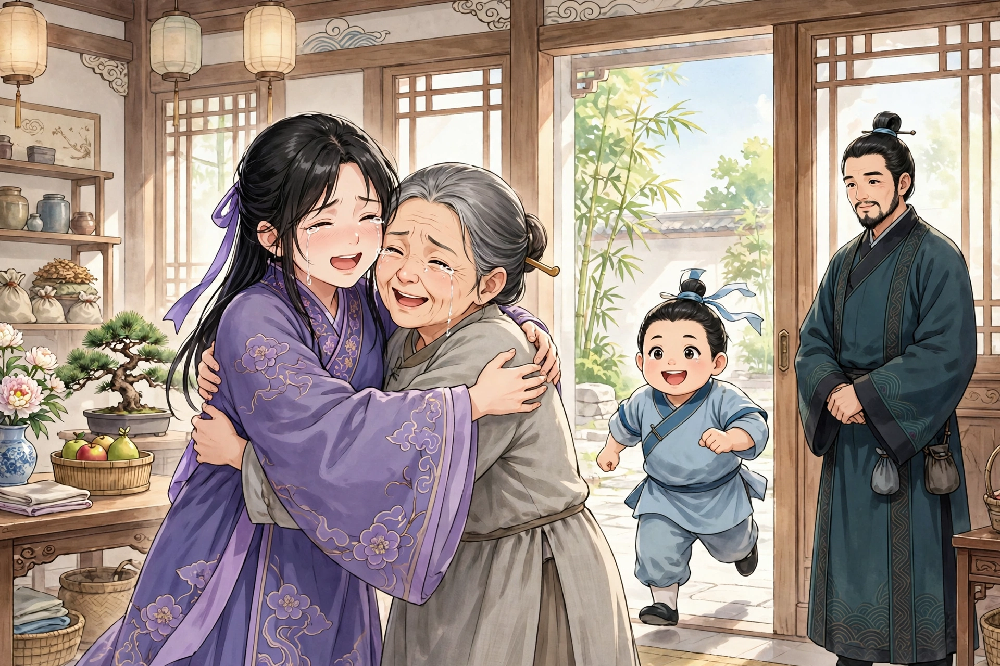

# 060 珠儿

常州有个百姓叫李化，家产丰厚。年过五十，还没有儿子。只有一个女儿，名叫小惠，容貌秀美，夫妻俩最疼爱她。十四岁那年，她突然生病夭折了，庭院冷落下来，夫妻俩越发没有生趣。后来李化纳了一个婢女为妾，过了一年多，生下一个儿子，夫妻俩把他看得像拱璧一样珍贵，给他起名叫珠儿。孩子渐渐长大，身材魁梧，很惹人喜爱。只是性子极其痴傻，五六岁了还分不清菽和麦，说话也结结巴巴。李化却喜欢他，并不觉得他不好。这时有个一只眼睛有毛病的和尚，在市集上募化布施，常常能说出别人家里的私事，于是大家都惊讶地把他当成神人；他还说，自己能主宰人的生死祸福。几十、几百、几千钱，他指名索要，没有人敢违抗。他到李化家募化一百缗钱。李化觉得为难，先给十金，他不接受；渐渐加到三十金。和尚厉声说：“必须一百缗，缺一文也不行！”李化也生气了，把钱收起来就走了。和尚愤愤地站起来说：“不要后悔，不要后悔！”没过多久，珠儿忽然心口剧痛，在床席上翻滚抓挠，脸色像土灰一样。李化害怕了，拿着八十金去找和尚求救。和尚笑着说：“多金可不容易得啊！可是山僧又能做什么呢？”李化回到家，儿子已经死了。李化悲痛极了，把事情告到县令那里。县令拘捕了和尚审问，和尚也能言善辩，说不出什么破绽。县令用鞭子打他，就像打在鞔革上一样。他下令搜和尚的身，搜出木人两个、小棺材一个、小旗帜五面。县令大怒，用手叠起指诀向他示意。和尚这才害怕了，自己一再投案认罪。县令不听，把他杖杀了。李化叩谢之后回家。

天已经黄昏了，李化与妻子坐在床上。忽然一个小孩踉踉跄跄走进屋里，说：“阿翁走得怎么这样快？我拼命追也追不上。”看他的体貌，大概七八岁。李化吃惊，正要盘问，却见他若隐若现，恍惚像烟雾一样，转眼间已经登上床榻坐着。李化把他推下去，他落在地上却没有声响，说：“阿翁怎么这样对我！”一眨眼又登上床来。李化害怕了，和妻子一起奔逃。孩子呼喊着阿父、阿母，呜呜哑哑叫个不停。李化跑进妾室，急忙关上门；回头一看，孩子已经在他膝下。李化惊骇，问他来做什么。孩子回答说：“我是苏州人，姓詹。六岁时失去了父母，不被兄嫂容纳，被赶到外祖家居住。偶然在门外玩耍，被妖僧迷惑杀死在桑树下，像伥鬼一样被他驱使，冤魂被关闭在穷泉之下，不能超脱转生。幸亏阿翁替我昭雪冤情，我愿意做您的儿子。”李化说：“人与鬼道路不同，怎么能相依为命？”孩子说：“只要腾出一间小屋，给我设床铺被褥，每天浇一杯冷浆粥，其余就什么事也没有了。”李化答应了他。孩子很高兴，于是独自睡在那间屋里。早晨来，他出入闺阁，就像家里生养的孩子一样。听到妾哭儿子的声音，他问：“珠儿死了几天了？”回答说七天。他说：“天正严寒，尸体应当还没有腐坏。试着挖开坟墓看一看，如果还没有损坏，孩子就能活过来。”李化高兴了，和孩子一起去，挖开墓穴验看，躯壳还和原来一样。正悲痛的时候，回头一看，孩子已经不见踪影。李化觉得奇怪，把尸体抬回家。刚放在床榻上，眼睛已经动了一下；过了一会儿呼唤要喝汤，喝了汤就出汗，出汗之后就坐起来了。

大家都高兴珠儿复活了，而且他变得比从前聪明伶俐、机灵便利，完全不同于以往。只是到了夜里，他僵硬地躺着，毫无气息，大家翻动他，他也冥然像死了一样。众人大惊，以为他又死了；天将亮时，他才像从梦中醒来一样。大家走过去问他。他回答说：“从前跟从妖僧的时候，有我们两个孩子，其中一个名叫哥子，昨天追赶阿父没有追上，大概是在后面和哥子告别罢了。现在在冥间，我做了姜员外的义子，生活也很优游自在。到了夜半，哥子一定来邀请我去玩耍。刚才就是骑着白鼻騧把我送回来的。”母亲因此问：“在阴司里见到珠儿没有？”他说：“珠儿已经转生了。他和阿翁没有父子缘分，不过是金陵的严子方，来讨要一百多千钱的债罢了。”起初，李化在金陵做买卖，欠了严家的货价没有偿还，而严老翁死了，这件事没有人知道。李化听了，大为惊骇。母亲问：“孩子见到惠姐姐没有？”孩子说：“不知道，下次去的时候应当去访她。”

又过了二三天，他对母亲说：“惠姐姐在冥间过得很好，嫁给了楚江王的小儿子，头上戴满了珠翠；一出门，就有上百人喊着开道声。”母亲说：“为什么不回家省亲一次呢？”他说：“人一旦死了，就和骨肉没有了关切之情。倘若有人细细讲述前生的事，才会豁然动念。昨天我托姜员外引见，才见到了姐姐，姐姐叫我坐在珊瑚床上，和她讲父母悬念的心情，她都像在睡梦中一样。我对她说：‘姐姐在世的时候，喜欢绣并蒂花，有一次剪刀刺破了手指，血沾污了绫子，姐姐就顺势刺成赤水云的图案。现在母亲还把那块绫子挂在床头墙上，时时想念，放不下心。姐姐忘记了吗？’姐姐这才凄然感动，说：‘一定会告诉郎君，回家省视阿母。’”母亲问她回来的日期，他回答说不知道。

一天，他对母亲说：“姐姐很快就要到了，随从非常多，应当多准备浆酒。”过了一会儿，他奔进屋里说：“姐姐来了！”他把床榻移到中堂，说：“姐姐暂且坐下歇息，不要悲啼。”众人却什么也看不见。孩子率领众人到门外焚纸酹酒，回来后说：“随从暂时让他们离开了。姐姐说：‘从前盖的那床绿锦被，曾经被烛花烧了一个像豆子那么大的洞，还在吗？’”母亲说：“在。”就打开箱子拿了出来。孩子说：“姐姐吩咐我把被子陈设在旧时的闺房里。她累了，暂且小睡一会儿，明天再和阿母说话。”

东邻赵家的女儿，从前是小惠在绣阁中的好友。这天夜里，她忽然梦见小惠戴着幞头、穿着紫帔来和她相望，言笑和生前一样。她还说：“我如今已经是异物了，父母见面，中间像隔着河山一样。我想借妹妹的身体和家人说说话，不必惊恐。”天亮的时候，她正和母亲说话，忽然扑倒在地昏厥过去。过了一会儿才醒过来，对母亲说：“小惠和阿婶分别几年了，您一下子就鬓发斑白了！”母亲惊骇地说：“孩子是病得发狂了吗？”女儿拜别了母亲就出门，母亲知道其中有异样，就跟着她。她一直走到李化家，抱着李母哀声啼哭。李母惊讶，不知道这是什么意思。女儿说：“儿昨天回家，很是疲惫，来不及说一句话。儿不孝，中途抛弃了高堂，让父母哀伤挂念，罪过怎么能赎清！”李母一下子明白过来，就哭了起来。过了一会儿又问：“听说儿如今显贵，很安慰母亲的心。只是你栖身在别家，怎么就能来呢？”女儿说：“郎君和儿十分恩爱，公婆也相亲相爱，并不嫌弃我丑陋。”小惠活着的时候，喜欢用手支着下巴，女儿说话的时候，常常做出原来的样子，神情十分相像。没过多久，珠儿奔进来说：“接姐姐的人到了。”女儿于是起身，拜别后流着泪说：“儿要走了。”话说完，又扑倒在地，过了一会儿才苏醒过来。

几个月后，李化病得很重，用药也没有效果。孩子说：“恐怕旦夕之间就救不活了！有两个鬼坐在床头，一个拿着铁杖子，一个挽着苎麻绳，绳子长四五尺，我昼夜哀求他们，他们也不离开。”母亲哭了起来，于是准备好了衣衾。到了傍晚，孩子跑进来说：“闲杂人家的妇人，且先避开，姐夫来看阿翁了。”过了一会儿，他鼓掌大笑。母亲问他，他说：“我笑那两个鬼，听说姐夫来了，都躲到床底下，像龟鳖一样。”又过了一会儿，他望着空中问候寒暄，问姐姐的起居。接着又拍手说：“那两个鬼奴，我哀求他们也不离开，到了这个时候真是大快人心！”于是他走到门外，又折回来，说：“姐夫已经走了。两个鬼被锁在马鞅上了。阿父应当马上就没有大碍了。姐夫说：回去禀告大王，为父母求取百年的寿命。”一家人都很高兴。到了夜里，李化的病大为好转，几天后就痊愈了。

李化延请老师教孩子读书。孩子非常聪明，十八岁就进了县学，还能讲述冥间的事情。见到乡里生病的人，他常常指出鬼祟所在的地方，用火烧灼，往往就能治好。后来他突然生病，皮肤青紫，自己说鬼神责怪他泄露了冥间的事，从此就不再说了。

## 原文

常州民李化，富有田产。年五十余，无子。一女名小惠，容质秀美，夫妻最怜爱之。十四岁，暴病夭殂，冷落庭帏，益少生趣。始纳婢，经年余，生一子，视如拱璧，名之珠儿。儿渐长，魁梧可爱。然性绝痴，五六岁尚不辨菽麦；言语蹇涩。李亦好而不知其恶。会有眇僧，募缘于市，辄知人闺闼，于是相惊以神；且云，能生死祸福人。几十百千，执名以索，无敢违者。诣李募百缗。李难之，给十金，不受；渐至三十金。僧厉色曰：“必百缗，缺一文不可！”李亦怒，收金遽去。僧忿然而起曰：“勿悔，勿悔！”无何，珠儿心暴痛，巴刮床席，色如土灰。李惧，将八十金诣僧乞救。僧笑曰：“多金大不易！然山僧何能为？”李归而儿已死。李恸甚，以状诉邑宰。宰拘僧讯鞫，亦辨给无情词。笞之，似击鞔革。令搜其身，得木人二、小棺一、小旗帜五。宰怒，以手叠诀举示之。僧乃惧，自投无数。宰不听，杖杀之。李叩谢而归。

时已曛暮，与妻坐床上。忽一小儿，㑌儴入室，曰：“阿翁行何疾？极力不能得追。”视其休貌，当得七八岁。李惊，方将诘问，则见其若隐若现，恍惚如烟雾，宛转间，已登榻坐。李推下之，堕地无声。曰：“阿翁何乃尔！”瞥然复登。李惧，与妻俱奔。儿呼阿父、阿母，呕哑不休。李入妾室，急阖其扉；还顾，儿已在膝下。李骇，问何为。答曰：“我苏州人，姓詹氏。六岁失怙恃，不为兄嫂所容，逐居外祖家。偶戏门外，为妖僧迷杀桑树下，驱使如伥鬼，冤闭穷泉，不得脱化。幸赖阿翁昭雪，愿得为子。”李曰：“人鬼殊途，何能相依？”儿曰：“但除斗室，为儿设床褥，日浇一杯冷浆粥，余都无事。”李从之。儿喜，遂独卧室中。晨来出入闺阁，如家生。闻妾哭子声，问：“珠儿死几日矣？”答以七日。曰：“天严寒，尸当不腐。试发冢启视，如未损坏，儿当得活。”李喜，与儿去，开穴验之，躯壳如故。方此忉怛，回视，失儿所在。异之，舁尸归。方置榻上，目已瞥动；少顷呼汤，汤已而汗，汗已遂起。

群喜珠儿复生，又加之慧黠便利，迥异曩昔。但夜间僵卧，毫无气息，共转侧之，冥然若死。众大愕，谓其复死；天将明，始若梦醒。群就问之。答云：“昔从妖僧时，有儿等二人，其一名哥子，昨追阿父不及，盖在后与哥子作别耳。今在冥间，与姜员外作义嗣，亦甚优游。夜分，固来邀儿戏。适以白鼻騧送儿归。”母因问：“在阴司见珠儿否？”曰：“珠儿已转生矣。渠与阿翁无父子缘，不过金陵严子方，来讨百十千债负耳。”初，李贩于金陵，欠严货价未偿，而严翁死，此事无知者。李闻之，大骇。母问：“儿见惠姊否？”儿曰：“不知，再去当访之。”

又二三日，谓母曰：“惠姊在冥中大好，嫁得楚江王小郎子，珠翠满头髻；一出门，便十百作呵殿声。”母曰：“何不一归宁？”曰：“人既死，都与骨肉无关切。倘有人细述前生，方豁然动念耳。昨托姜员外，夤缘见姊，姊姊呼我坐珊瑚床上，与言父母悬念，渠都如眠睡。儿云：‘姊在时，喜绣并蒂花，剪刀刺手爪，血涴绫子上，姊就刺作赤水云。今母犹挂床头壁，顾念不去心。姊忘之乎？’姊始凄感，云：‘会须白郎君，归省阿母。’”母问其期，答言不知。

一日谓母：“姊行且至，仆从大繁，当多备浆酒。”少间，奔入室曰：“姊来矣！”移榻中堂，曰：“姊姊且憩坐，少悲啼。”诸人悉无所见。儿率人焚纸酹饮于门外，反曰：“驺从暂令去矣。姊言：‘昔日所覆绿锦被，曾为烛花烧一点如豆大，尚在否？’”母曰：“在。”即启笥出之。儿曰：“姊命我陈旧闺中。乏疲，且小卧，翌日再与阿母言。”

东邻赵氏女，故与惠为绣阁交。是夜，忽梦惠幞头紫帔来相望，言笑如平生。且言：“我今异物，父母觌面，不啻河山。将借妹子与家人共话，勿须惊恐。”质明，方与母言，忽仆地闷绝。逾刻始醒，向母曰：“小惠与阿婶别几年矣，顿鬖鬖白发生！”母骇曰：“儿病狂耶？”女拜别即出，母知其异，从之。直达李所，抱母哀啼。母惊不知所谓。女曰：“儿昨归，颇委顿，未遑一言。儿不孝，中途弃高堂，劳父母哀念，罪何可赎！”母顿悟，乃哭。已而问曰：“闻儿今贵，甚慰母心。但汝栖身五家，何遂能来？”女曰：“郎君与儿极燕好，姑舅亦相抚爱，颇不谓妒丑。”惠生时，好以手支颐，女言次，辄作故态，神情宛似。未几，珠儿奔入曰：“接姊者至矣。”女乃起，拜别泣下，曰：“儿去矣。”言讫，复踣，移时乃苏。

后数月，李病剧，医药罔效。儿曰：“旦夕恐不救也！二鬼坐床头，一执铁杖子，一挽苎麻绳，长四五尺许，儿昼夜哀之不去。”母哭，乃备衣衾。既暮，儿趋入曰：“杂人妇，且避去，姊夫来视阿翁。”俄顷，鼓掌而笑。母问之，曰：“我笑二鬼，闻姊夫来，俱匿床下如龟鳖。”又少时，望空道寒暄，问姊起居。既而拍手曰：“二鬼奴哀之不去，至此大快！”乃出至门外，却回，曰：“姊夫去矣。二鬼被锁马鞅上。阿父当即无恙。姊夫言：归白大王，为父母乞百年寿也。”一家俱喜。至夜，病良已，数日寻瘥。

延师教儿读。儿甚慧，十八入邑庠，犹能言冥间事。见里中病者，辄指鬼祟所在，以火爇之，往往得瘳。后暴病，体肤青紫，自言鬼神责我绽露，由是不复言。
