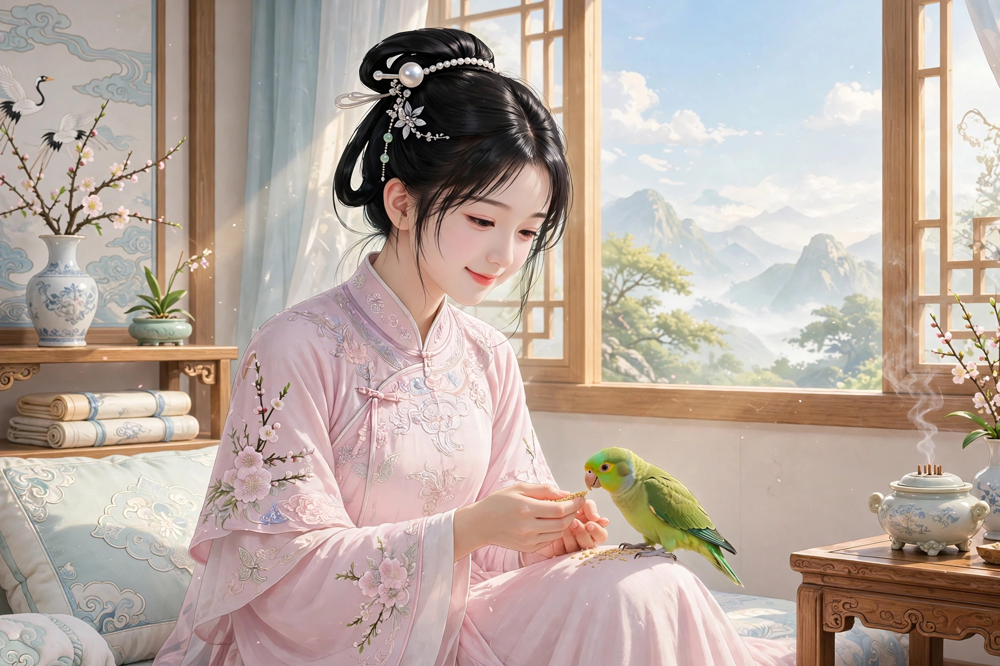

# 070 阿宝

粤西有个叫孙子楚的人，是个有名气的读书人。他生来手上多长了一个手指。性子迂腐迟钝，别人骗他，他总是当真。席间要是有歌妓在场，他一定远远望一眼就转身走了。有人知道他这个毛病，就故意把歌妓引来，让歌妓去亲近调戏他，他就满脸通红，一直红到脖子，汗珠一颗颗往下掉，大家就都笑他。于是有人画下他发呆的样子，互相传看，还编了难听的话取笑他，给他起了个外号叫“孙痴”。

县里有个大商人某翁，富得可以和王侯相比，亲戚也都是贵胄人家。他有个女儿叫阿宝，长得绝色。每天都为她挑选好女婿，各家大户的儿子争着送聘礼、送妆奁，都不合老翁的心意。孙子楚当时刚死了妻子，有人开玩笑劝他去托媒人求亲。孙子楚一点也不掂量自己，真的照着办了。老翁素来听说过他的名声，却嫌他穷。媒婆正要出门，恰好碰见阿宝，阿宝问起这事，媒婆就告诉了她。阿宝开玩笑说：“他要是去掉那个多余的手指，我就嫁给他。”媒婆告诉了孙子楚。孙子楚说：“不难。”媒婆走后，孙子楚拿斧子砍断了自己那个手指，疼得钻心，血流不止，差点死了。过了几天，才勉强起得来床，去见媒婆，把断指给她看。媒婆大吃一惊，跑去告诉阿宝。阿宝也觉得奇特，又开玩笑说请他再去掉他的痴。孙子楚听了大声辩解，说自己并不痴；可是又没办法见面剖白自己。转念一想，阿宝未必就美得像天仙一样，怎么就这样自视甚高呢？于是从前的念头一下子冷了下来。

适逢清明，按当地风俗，这一天妇女都出来游玩，轻薄少年也结队跟随，任意品评，有几个同社的人，硬拉着孙子楚去。有人嘲笑他说：“莫非是想去看一眼可心的人？”孙子楚也知道他们在拿自己开玩笑；可是因为受过阿宝的揶揄，心里也想见一见这个人，就高高兴兴地跟着大家去寻访。远远看见有个女子在树下歇息，一群恶少年像墙一样围着她。大家说：“这一定就是阿宝。”走近一看，果然是阿宝。仔细一看，她娟丽无双。过了一会儿，人越来越多。女子起身，匆匆走了。众人神魂颠倒，品头论足，纷纷像发了狂。只有孙子楚默默不语。等众人往别处去了，回头一看，孙子楚还痴痴地站在原来的地方，叫他也不应。大家拉他说：“魂跟着阿宝去了吗？”他也不回答。众人因为他平时就迟钝，所以不觉得奇怪，有的推他、有的拉他，把他带回家。回到家，他直接上床躺下，整天不起，像醉了一样昏沉，叫也叫不醒。家人疑心他丢了魂，到旷野里去招魂，也不见效。使劲拍他问他，他才迷迷糊糊地应道：“我在阿宝家。”再细问他，他又不说话了。家人惶惑不解。

起初，孙子楚看见女子走了，心里舍不得，觉得自己的身体已经跟着她走了，渐渐贴近她的衣带之间，旁人也没有呵斥他。于是他跟着女子回到她家，坐卧都依傍着她，夜里也亲近相处，十分相得；可是觉得肚子里饿得厉害，想回一趟家门，却迷了路，不知道怎么回去。女子每夜梦见有人与她亲近，问那人的名字，那人说：“我是孙子楚。”她心里觉得奇怪，却没法告诉别人。孙子楚在床上躺了三天，气息微弱得好像快要断绝。家人十分害怕，托人委婉地告诉老翁，想去他家里招一回魂。老翁笑着说：“平日里素不往来，怎么会把魂丢在我家呢？”家人再三哀求，老翁这才答应。巫师拿着孙子楚的旧衣服和草席去了。阿宝问清了缘故，大为惊骇，不让巫师到别处去，直接把巫师领进自己的屋里，任凭巫师招呼着走了。巫师回到孙子楚家门口，床上的孙子楚已经发出呻吟。等他醒来，阿宝屋里的香奁器具，是什么颜色、叫什么名字，他一一说来，分毫不差。阿宝听了，更加惊骇，暗暗感念他用情之深。

孙子楚下了床之后，坐立之间总是凝神沉思，恍恍惚惚好像丢了魂。常常暗中打听阿宝的消息，希望能再见她一面。浴佛节那天，听说阿宝要去水月寺进香，他一大早就到路边等候，眼睛都看花了。到了中午过后，女子才到，从车里窥见孙子楚，用纤手掀起帘子，目不转睛地看着他。孙子楚更加动心，跟在车后。女子忽然派青衣婢女来问他的姓名。孙子楚殷勤地报上自己的姓名，魂更加摇荡。车走了，他才回家。回家后又病倒了，昏昏沉沉地绝食，梦里总是喊着宝的名字。常常恨自己的魂不再像从前那样灵通。家里从前养着一只鹦鹉，忽然死了，小孩子拿着它在床上玩弄。孙子楚心里想：倘若自己能变成鹦鹉，振翅就可以飞到阿宝的屋里。心里正这样想着，身体已经翩然变成了一只鹦鹉，立刻飞走了，直飞到阿宝那里。阿宝高兴地扑住它，锁住它的脚，拿麻子喂它。鹦鹉大声叫道：“姐姐不要锁！我是孙子楚。”阿宝大吃一惊，解开了它的束缚，它也不离开。阿宝祝祷说：“深情已经刻在心里。如今已经人鸟异类，姻缘怎么还能圆满呢？”鹦鹉说：“能亲近你的芳泽，我的心愿就已经满足了。”别人喂它，它不吃；阿宝亲自喂它，它才吃。阿宝坐下，它就落在她的膝上；阿宝躺下，它就依在她的床边。这样过了三天。阿宝十分怜爱它，暗中派人去察看孙子楚，见孙子楚僵卧在床，气已经断了三天，只是心口还没有凉。阿宝又祝祷说：“你要是能重新变成人，我一定誓死跟从你。”鹦鹉说：“你骗我！”阿宝就自己发了誓。鹦鹉侧着眼睛，好像在思索什么。过了一会儿，阿宝裹着双弯，把鞋脱在床下，鹦鹉猛地飞下来，衔起鞋飞走了。阿宝急忙喊它，鹦鹉已经飞远了。阿宝派老妈妈去探看，孙子楚果然已经醒了。家里人看见鹦鹉衔着绣鞋飞来，落在地上死了，大家正觉得奇怪。孙子楚醒来后，立刻索要那只鞋。众人不知道缘故。恰好老妈妈到了，进屋看孙子楚，问鞋在哪里。孙子楚说：“这是阿宝的信誓之物。借个话回覆她：小生不会忘记金诺。”老妈妈回去复命。阿宝更加觉得奇特，于是故意让婢女把这番情意泄露给母亲。母亲核实确实，就说：“这个孩子的才名也不坏，只是像司马相如那样穷。挑选了几年才得了这样一个女婿，恐怕要被显贵人家笑话。”阿宝因为这只鞋的缘故，立誓不嫁别人。老翁和老妈妈都依从了她。赶紧派人报信定亲。孙子楚大喜，病一下子就好了。老翁商议让他入赘到自己家里。阿宝说：“女婿不能长久住在岳父家。况且郎君又穷，住久了越发被人轻贱。我既然已经答应了他，就是住在茅屋里、吃粗茶淡饭，也不怨恨。”孙子楚于是也迎娶成礼，两人相逢，就像隔世重逢一样欢喜。

从此家里得了阿宝的妆奁，家境稍稍殷实，颇添了些产业。而孙子楚痴迷于读书，不知道料理家人生计；阿宝善于积攒家业，也不拿别的事来拖累孙子楚。住了三年，家里越发富裕。孙子楚忽然得了消渴病死了。阿宝哭得痛切，眼睛哭得看不清东西，到了不睡不吃的地步。旁人劝她，她不听，趁夜里上吊自尽。婢女发现了，赶紧救醒她，她最终还是不吃东西。过了三天，亲戚们聚在一起，正要给孙子楚装殓，听见棺材里有呻吟和呼吸声，打开一看，孙子楚已经活过来了。他自己说：“我见到了冥王，冥王因为我平生朴实诚恳，命我做部曹。忽然有人禀报：‘孙部曹的妻子快要到了。’冥王查了鬼录，说：‘她还不应该就死。’又有人禀报：‘她已经三天不吃东西了。’冥王看着我说：‘感念你妻子的节义，暂且赐你再生。’于是派驭卒驾着马送我回来。”从此他的身体渐渐恢复。恰逢大比之年，进考场之前，几个少年戏弄他，一起拟了七道冷僻的题目，把他引到僻静处跟他说：“这是某家的关节，请你秘密收下。”孙子楚相信了，日夜揣摩，写成了七篇文章。众人暗中笑他。当时主考官担心熟悉的题目会有蹈袭的弊病，力求反乎常经，题目发下来，七篇文章全都对上了。孙子楚因此考中了第一名。第二年，考中进士，授官词林。皇帝听说了这件奇事，召见他询问。孙子楚详细地启奏。皇帝十分赞赏。后来又召见阿宝，赏赐格外丰厚。

异史氏说：“性子痴，志向就专一，所以书痴的人文章一定写得好，技艺痴的人手艺一定精良；世上那些落拓而没有成就的人，都是自以为不痴的人啊。况且像为了女色荡尽家产、为了赌博倾家荡产那样，难道是痴人做的事吗！由此可知，聪明过头，才是真正的痴，孙子楚又怎么算痴呢！”

## 原文

粤西孙子楚，名士也。生有枝指。性迂讷，人诳之，辄信为真。或值座有歌妓，则必遥望却走。或知其然，诱之来，使妓狎逼之，则赪颜彻颈，汁珠珠下滴，因共为笑。遂貌其呆状，相邮传作丑语，而名之“孙痴”。

邑大贾某翁，与王侯埒富。姻戚皆贵胄。有女阿宝，绝色也。日择良匹，大家儿争委禽妆，皆不当翁意。生时失俪，有戏之者，劝其通媒。生殊不自揣，果从其数。翁素耳其名，而贫之。媒媪将出，适遇宝，问之，以告。女戏曰：“渠去其枝指，余当归之。”媪告生。生曰：“不难。”媒去，生以斧自断其指，大痛彻心，血益倾注，滨死。过数日，始能起，往见媒而示之。媪惊，奔告女。女亦奇之，戏请再去其痴。生闻而哗辨，自谓不痴；然无由见而自剖。转念阿宝未必美如天人，何遂高自位置如此？由是曩念顿冷。

会值清明，俗于是日，妇女出游，轻薄少年，亦结队随行，恣其月旦，有同社数人，强邀生去。或嘲之曰：“莫欲一观可人否？”生亦知其戏己；然以受女揶揄故，亦思一见其人，忻然随众物色之。遥见有女子憩树下，恶少年环如墙堵。众曰：“此必阿宝也。”趋之，果宝也。审谛之，娟丽无双。少顷，人益稠。女起，遽去。众情颠倒，品头题足，纷纷若狂。生独默然。及众他适，回视，生犹痴立故所，呼之不应。群曳之曰：“魂随阿宝去耶？”亦不答。众以其素讷，故不为怪，或推之、或挽之以归。至家，直上床卧，终日不起，冥如醉，唤之不醒。家人疑其失魂，招于旷野，莫能效。强拍问之，则蒙眬应云：“我在阿宝家。”及细诘之，又默不语。家人惶惑莫解。

初，生见女去，意不忍舍，觉身已从之行，渐傍其衿带间，人无呵者。遂从女归，坐卧依之，夜辄与狎，甚相得；然觉腹中奇馁，思欲一返家门，而迷不知路。女每梦与人交，问其名，曰：“我孙子楚也。”心异之，而不可以告人。生卧三日，气休休若将澌灭。家人大恐，托人婉告翁，欲一招魂其家。翁笑曰：“平昔不相往还，何由遗魂吾家？”家人固哀之，翁始允。巫执故服、草荐以往。女诘得其故，骇极，不听他往，直导入室，任招呼而去。巫归至门，生榻上已呻。既醒，女室之香奁什具，何色何名，历言不爽。女闻之，益骇，阴感其情之深。

生既离床寝，坐立凝思，忽忽若忘。每伺察阿宝，希幸一再遘之。浴佛节，闻将降香水月寺，遂早旦往候道左，目眩睛劳。日涉午，女始至，自车中窥见生，以掺手搴帘，凝睇不转。生益动，尾从之。女忽命青衣来诘姓字。生殷勤自展，魂益摇。车去，始归。归复病，冥然绝食，梦中辄呼宝名。每自恨魂不复灵。家旧养一鹦鹉，忽毙，小儿持弄于床。生自念：倘得身为鹦鹉，振翼可达女室。心方注想，身已翩然鹦鹉，遽飞而去，直达宝所。女喜而扑之，锁其肘，饲以麻子。大呼曰：“姐姐勿锁！我孙子楚也。”女大骇，解其缚，亦不去。女祝曰：“深情已篆中心。今已人禽异类，姻好何可复圆？”鸟云：“得近芳泽，于愿已足。”他人饲之，不食；女自饲之，则食。女坐，则集其膝；卧，则依其床。如是三日。女甚怜之，阴使人瞷生，生则僵卧，气绝已三日，但心头未冰耳。女又祝曰：“君能复为人，当誓死相从。”鸟云：“诳我！”女乃自矢。鸟侧目若有所思。少间，女束双弯，解履床下，鹦鹉骤下，衔履飞去。女急呼之，飞已远矣。女使媪往探，则生已寤。家人见鹦鹉衔绣履来，坠地死，方共异之。生既苏，即索履。众莫知故。适媪至，入视生，问履所在。生曰：“是阿宝信誓物。借口相覆：小生不忘金诺也。”媪反命。女益奇之，故使婢泄其情于母。母审之确，乃曰：“此子才名亦不恶，但有相如之贫。择数年得婿若此，恐将为显者笑。”女以履故，矢不他。翁媪从之。驰报行。生喜，疾顿瘳。翁议赘诸家。女曰：“婿不可久处岳家。况郎又贫，久益为人贱。儿既诺之，处蓬茅而甘藜藿，不怨也。”生乃亦迎成礼，相逢如隔世欢。

自是家得奁妆，小阜，颇增物产。而生痴于书，不知理家人生业；女善居积，亦不以他事累生。居三年，家益富。生忽病消渴卒。女哭之痛，泪眼不晴，至绝眠食。劝之不纳，乘夜自经。婢觉之，急救以醒，终亦不食。三日，集亲党，将以殓生。闻棺中呻以息，启之，已复活。自言：“见冥王，以生平朴诚，命作部曹。忽有人白：“孙部曹之妻将至。”王稽鬼录，言：“此未应便死。”又白：“不食三日矣。”王顾谓：“感汝妻节义，姑赐再生。”因使驭卒控马送余还。”由是体渐平。值岁大比，入闱之前，诸少年玩弄之，共拟隐僻之题七，引生僻处与语，言：“此某家关节，敬秘相授。”生信之，昼夜揣摩，制成七艺。众隐笑之。时典试者虑熟题有蹈袭弊，力反常经，题纸下，七艺皆符。生以是抡魁。明年，举进士，授词林。上闻异，召问之。生具启奏。上大嘉悦。后召见阿宝，赏赉有加焉。

异史氏曰：“性痴则其志凝，故书痴者文必工，艺痴者技必良；世之落拓而无成者，皆自谓不痴者也。且如粉花荡产，卢雉倾家，顾痴人事哉！以是知慧黠而过，乃是真痴，彼孙子何痴乎！”
