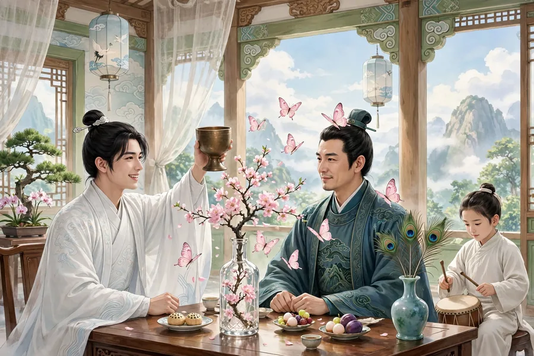

武昌的尹图南有一处别宅，曾经租给一个秀才住，半年来也没有去过问。一天在别宅门口遇见了他，他年纪轻轻，衣着容貌、裘衣骏马，风度翩翩，十分俊美。尹图南走上前去和他说话，他又温文含蓄，十分可爱。尹图南觉得奇怪，回家告诉了妻子，妻子派婢女借口送东西去探看他的屋子。屋里有一位美丽的女子，美艳超过了仙人。一切花草石头和服饰玩物，都是平生没有见过的。尹图南猜不出他是什么人，便上门投递名帖拜访，正好他出去了。第二天他却来回拜，展开名帖通报姓名，才知道他姓余名德。谈话中细问他的家世官职，他说得十分含糊，再三追问，他便说：“想要和您来往，我也不敢自己断绝。您只须知道我不是盗贼和逃犯，何必一定要知道我的来历。”尹图南向他道歉。余德摆酒款待，谈笑十分欢快。到了傍晚，有个昆仑奴牵着马、挑着灯，迎着他、引导他离去了。

第二天余德写了一封短信报答主人。尹图南到了他家，看见屋子的墙壁都用明光纸裱糊，洁净得像镜子一样，金色的狻猊香炉里燃着奇异的香，一个碧玉瓶里插着凤尾和孔雀的羽毛各两根，每根都长二尺多；一个水晶瓶里浸着一树粉色的花，不知道叫什么名字，也高二尺多，垂下的枝条覆到几案外面，叶子稀疏、花朵繁密，含苞还没有开放，花朵的形状像沾了水的蝴蝶收拢翅膀，花蒂就像细须。筵席上不过八样菜肴，却丰美异常。随即命童子击鼓催花行酒令。鼓声一动，瓶中的花就颤颤地像要折断，不一会儿蝶翅渐渐张开，等到鼓声停歇，渊然一声，花蒂细须顿时落下，就变成一只蝴蝶飞落到尹图南的衣服上。余德笑着站起来飞快地干了一大杯，酒刚饮尽，蝴蝶也飞走了。过了一会儿鼓声又响起来，两只蝴蝶飞来落在余德的帽子上。余德笑着说：“作法自毙了。”也干了两杯。第三通鼓打完，花纷纷落下，翩翩地飘下来，沾满了衣袖和衣襟。击鼓的童子笑着来数筹：尹图南得了九筹，余德得了四筹。尹图南已经微醉，不能把筹都喝完，勉强喝了三杯，离席逃走了。从此尹图南更加觉得他奇异。

然而余德这个人很少与人交往，常常闭门独居，不和城里人往来吊唁庆贺。尹图南逢人就宣扬他，听说他奇异的人都争着和余德结交，门外车马来往不断。余德很不耐烦，忽然向主人辞别离去了。他走后，尹图南走进他家，空庭院洒扫得没有一点尘土，烛泪堆积丢弃在青石台阶下，窗户间零碎的丝帛和断绵上，指印还清晰可见。只有屋后遗留着一个小白石缸，能装一石左右的水。尹图南把它带回家，贮水养红色的鱼，过了一年水还清澈得像刚贮进去一样，后来被佣人搬石头时不小心打碎了它，里面的水却并不倾泻流出。看上去缸还完整在那里，用手摸去却虚软无物。手伸进缸里，水就随手流泄出来，把手拿出来水又合拢，冬天也不结冰。一夜忽然结成了晶体，鱼还在里面照常游动。尹图南怕被人知道，常常把它放在密室里，不是儿子和女婿不给看。时间久了渐渐传开，来讨要赏玩的人在门口络绎不绝。腊月里它忽然化成了水，阴湿满地，鱼也不知去向了，只有那口旧缸的残石还在。忽然有个道士上门来求取它，尹图南拿出来给他看，道士说：“这是龙宫里贮水的器具。”尹图南讲了它破了却不漏水的奇异之处。道士说：“这是那口缸的魂。”殷切地讨要了少许。问他拿来做什么用，道士说：“把碎屑合进药里，可以得到长寿。”尹图南给了他一片，道士欢喜地道谢离去了。

原文

武昌尹图南有别第，尝为一秀才税居，半年来亦未尝过问。一日遇诸其门，年最少，而容仪裘马，翩翩甚都。趋与语，却又蕴藉可爱。异之，归语妻，妻遣婢托遗问以窥其室。室有丽姝，美艳逾于仙人。一切花石服玩，俱非耳目所经。尹不测其何人，诣门投谒，适值他出。翼日却来拜答，展其刺呼，始知余姓德名。语次细审官阀，言殊隐约，固诘之，则曰：「欲相还往，仆不敢自绝。应知非寇窃通逃者，何须必知来历。」尹谢之。命酒款宴，言笑甚欢。向暮，有昆仑捉马挑灯，迎导以去。

明日折简报主人。尹至其家，见屋壁俱用明光纸裱，洁如镜，金狻猊爇异香，一碧玉瓶插凤尾孔雀羽各二，各长二尺余；一水晶瓶浸粉花一树，不知何名，亦高二尺许，垂枝覆几外，叶疏花密，含苞未吐，花状似湿蝶敛翼，蒂即如须。筵间不过八簋，丰美异常。即命童子击鼓催花为令。鼓声既动，则瓶中花颤颤欲折，俄而蝶翅渐张，既而鼓歇，渊然一声，蒂须顿落，即为一蝶飞落尹衣。余笑起飞一巨觥，酒方引满，蝶亦扬去。顷之鼓又作，两蝶飞集余冠。余笑云：「作法自毙矣。」亦引二觥。三鼓既终，花乱堕，翩翩而下，惹袖沾衿。鼓童笑来指数：尹得九筹，余得四筹。尹已薄醉，不能尽筹，强引三爵，离席亡去。由是益奇之。

然其为人寡交与，每阖门居，不与国人通吊庆。尹逢人辄宣，闻其异者争交欢余，门外冠盖相望。余颇不耐，忽辞主人去。去后，尹入其家，空庭洒扫无纤尘，烛泪堆掷青阶下，窗间零帛断绵，指印宛然。惟舍后遗一小白石缸，可受石许。尹携归贮水养朱鱼，经年水清如初贮，后为佣保移石误碎之，水蓄并不倾泻。视之缸宛在，扪之虚软。手入其中，水随手泄，出其手则复合，冬月不冰。一夜忽结为晶，鱼游如故。尹畏人知，常置密室，非子婿不以示也。久之渐播，索玩者纷错于门。腊月忽解为水，阴湿满地，鱼亦渺然，其旧缸残石犹存。忽有道士踵门求之，尹出以示，道士曰：「此龙宫蓄水器也。」尹述其破而不泄之异。道士曰：「此缸之魂也。」殷殷然乞得少许。问其何用，曰：「以屑合药，可得永寿。」予一片，欢谢而去。
