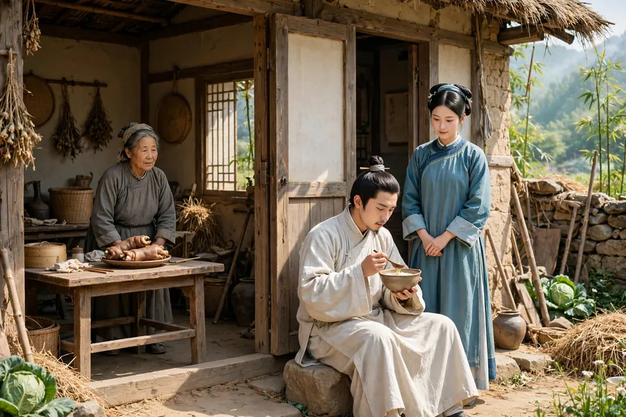
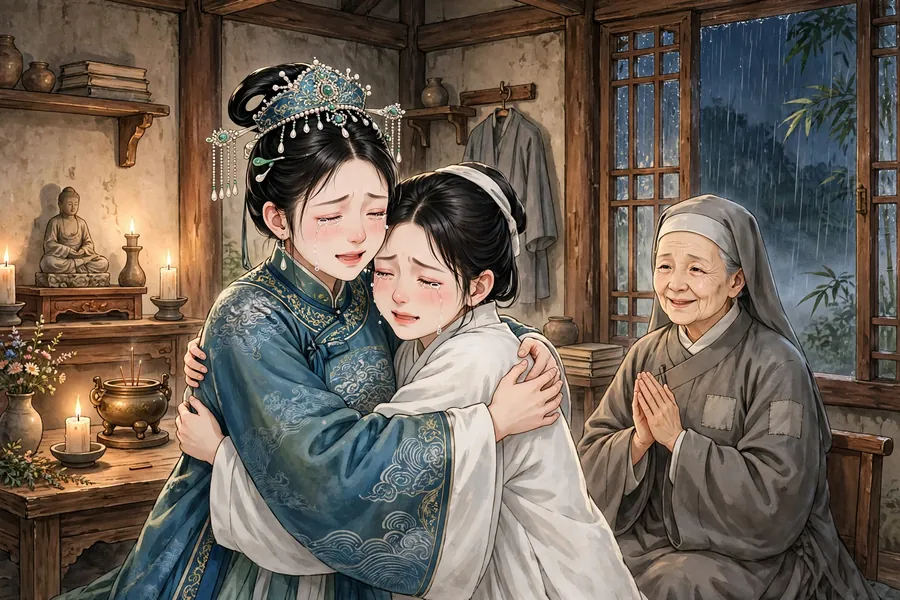

# 130 青梅

南京有个姓程的书生，性情磊落坦荡，不拘泥于世俗的界限。一天他从外面回来，刚解开腰带，觉得腰带沉甸甸的，像有什么东西掉了下来，低头一看，却什么也没有。转身之间，有个女子从他的衣服后面走了出来，拢了拢头发，微微一笑，十分美丽。程生怀疑她是鬼，女子说：“我不是鬼，是狐狸。”程生说：“就算能得到佳人，是鬼我也不怕，何况是狐狸！”于是就和她亲近起来。过了两年，生下一个女儿，取小名叫青梅。狐女常常对程生说：“不要娶妻，我还要为你生儿子。”程生便不再娶妻，亲戚朋友都嘲笑他。后来程生改变了主意，聘娶了湖东王家的女儿。狐女听说了大怒，给女儿喂了奶，把女儿交给程生，说：“这是你家的赔钱货，生也好杀也好都由你，我为什么要替别人当奶妈呢！”说完出门径自离去了。

青梅长大了，又聪明，相貌秀美韶丽，酷似她的母亲。不久程生病死了，王氏又改嫁了。青梅寄住在堂叔家里。堂叔行为放荡没有操守，想把她卖掉来肥自己的腰包。恰好有个王进士，正在家里等候铨选，听说青梅聪明，用重金把她买了下来，让她跟随女儿阿喜当差服役。阿喜十四岁，容貌华美绝代，见了青梅十分高兴，和她同吃同住。青梅也很会伺候人，能用眼神领会意思，用眉毛传达话语，因此全家人都疼爱她。

邑有张生，字介受，家里屡次贫困，没有固定的产业，租住在王进士的宅子里。他生性纯孝，品行端正不苟且，又专心向学。青梅偶然到他家里，看见张生坐在石头上吃糠粥，走进屋里和张生的母亲说话，看见案上放着一副猪蹄。这时张生的父亲卧病在床，张生进屋，抱着父亲去方便，粪水弄脏了衣服，父亲察觉了，自己感到羞愧。张生遮掩住痕迹，急忙出去自己洗干净，怕父亲知道。青梅因此对他大为惊异。回去后把所见告诉阿喜，说：“我们家的这位房客不是平常人啊。小姐要是不想找个好丈夫也就罢了，要想找个好丈夫，张生就是那个人。”阿喜担心父亲嫌他贫穷。青梅说：“不然，这在于小姐自己。如果小姐觉得可以，我就偷偷告诉他，让他来求亲。夫人一定会叫小姐去商量，小姐只回答一个‘诺’字，事情就成了。”阿喜担心终身贫困会被天下人笑话。青梅说：“我自认为能看准天下的人，一定不会错。”第二天青梅去告诉张生的母亲，张母大吃一惊，说她的话不吉利。青梅说：“小姐听说了公子的贤德，我是窥察到她的心意才来说的。媒人去了，我和您两个人坦白商量，事情合得来就能成。纵使不成，对公子又有什么羞辱呢？”张母说：“好。”于是托卖花的侯氏前去提亲。夫人听了笑着告诉王进士，王进士也大笑起来。叫女儿来，把侯氏的意思告诉她。女儿还没来得及回答，青梅极力称赞张生的贤德，断定他将来一定显贵。夫人又问女儿：“这是你一辈子的事。如果能吃糠咽菜，我就为你答应下来。”女儿低头沉默了很久，望着墙壁回答说：“贫富是命。如果命好，贫穷不会太久，而不贫穷的日子却没有尽头；如果命不好，那些穿锦绣的王孙公子，没有立锥之地的难道还少吗？这在于父母做主。”起初，王进士和女儿商量，是想拿这事开玩笑，等听到女儿的话，心里不高兴了，说：“你是想嫁给张家吗？”女儿不回答；再问，还是不回答。王进士怒道：“贱骨头不长进！想提着篮子去做乞丐的媳妇，难道不羞死人！”女儿涨红了脸，气得说不出话，含着眼泪退了出去，媒人也就跑了。

青梅见事情不成，想自己谋划。过了几天，夜里去找张生，张生正在读书，吃惊地问她来做什么，她说话吞吞吐吐。张生神色严正地拒绝了她，青梅哭着说：“我是良家女子，不是私奔的人，只因为敬重您的贤德，才愿意把自己托付给您。”张生说：“你爱我，是说我贤德。深夜前来这样的事，自爱的人不会做，难道说贤德的人会做吗？开头乱来、最后成婚，君子还说不可以，何况成不了婚，你这样做又怎么自处呢？”青梅说：“万一能成，您肯收留我吗？”张生说：“能得到像你这样的人，我还求什么呢？只是有三件不能由我做主的事，所以不敢轻易答应。”青梅问：“是哪三件？”张生说：“不能自己做主，就没办法；就算能自己做主，我父母不高兴，也没办法；就算父母高兴，而你的身价一定很贵，我贫穷拿不出钱来，就更没办法了。你赶快回去，瓜田李下的嫌疑可怕得很！”青梅临走时，又嘱咐说：“如果您有意，请一起想办法。”张生答应了。

青梅回去后，阿喜问她去了哪里，她就跪下来坦白投诚。阿喜生气她私自夜奔，要打她责罚。青梅哭着说没有别的事，于是把实情告诉了她。阿喜叹息说：“不随便苟合，这是礼；一定要禀告父母，这是孝；不轻易许诺，这是信。有这三样品德，上天一定会保佑他，他就不用担心贫穷了。”接着问：“你打算怎么办？”青梅说：“嫁给他。”阿喜笑着说：“痴丫头，你能自己做主吗？”青梅说：“办不成，就用死来接着办。”阿喜说：“我一定让你如愿。”青梅磕头拜谢她。又过了几天，青梅对阿喜说：“前几天说的话是开玩笑，还是真心想成全我？如果是真心，还有一点小事，也请您怜悯我。”阿喜问她是什么事，青梅回答说：“张生拿不出聘礼，我又没有力量为自己赎身，一定要收钱的话，嫁给我就等于不嫁我了。”阿喜沉吟着说：“这不是我能办到的事。我说让你嫁给他，恐怕还办不成，而说一定不收钱，那是父亲一定不答应的，也是我不敢说的。”青梅听了哭了起来，只求阿喜怜悯搭救，阿喜想了很久，说：“没有别的办法了，我私下积蓄了几两银子，应当倾囊相助。”青梅拜谢，于是偷偷告诉张生。张生的母亲大喜，多方借贷，共凑得了若干数目，藏起来等候好消息。正赶上王进士被任命为曲沃县令，阿喜趁机告诉母亲说：“青梅年纪已经长大了，如今将要上任，不如把她打发出去。”夫人本来就觉得青梅太机灵，怕她引导女儿做不合礼义的事，常常想把她嫁出去，又怕女儿不高兴，听到女儿的话十分高兴。过了两天，有个佣妇来传达张家的意思，王进士笑着说：“她只配嫁给婢女的丈夫，先前怎么那样妄想呢！不过把陪嫁的丫鬟卖到高门大户，价钱应当比先前加倍。”女儿急忙进来说：“青梅服侍我很久了，把她卖去做妾，实在不忍心。”王进士于是传话给张家，仍然按原先的价钱立了契约，把青梅嫁给了张生做妻子。

青梅进了张家的门，孝敬公婆，曲意顺从，比张生做得还要周到，操持家务更加勤快，吃糠咽菜也不以为苦。因此家里没有人不疼爱、看重青梅。青梅又以刺绣为生，绣品卖得很快，商人等在门口争相购买，唯恐买不到。得来的钱稍稍可以抵御贫穷。她还劝张生不要因为家里的事耽误读书，家里的生计都由她自己承担。后来因为主人王进士要去上任，青梅前去辞别阿喜。阿喜见了她，哭着说：“你有了好归宿，我实在不如你。”青梅说：“这是谁的恩赐，我怎么敢忘记呢？说我比小姐强，那是折我的寿啊。”于是相对哭着告别了。

王进士到山西上任才半年，夫人就死了，灵柩停放在寺庙里。又过了两年，王进士因为行贿被罢免，罚金以万计，渐渐贫穷得不能自给，随从也都逃散了。这时瘟疫大作，王进士染上疫病死了。只有一个老仆妇跟着阿喜，不久老仆妇也死了，阿喜孤苦伶仃，更加凄苦。有个邻居老妇劝她改嫁，阿喜说：“谁能为我把父母双双安葬，我就跟从谁。”老妇可怜她，送给她一斗米就走了。半个月后又来了，说：“我为娘子尽了力，事情很难办成：贫穷的人不能为你安葬父母，富贵的人又嫌弃你是没落人家的后代。怎么办呢！还有一个办法，只怕你不能接受。”阿喜问：“是什么办法？”老妇说：“这里有个李郎想找个侧室，如果看见你的姿容，肯出厚葬的钱，一定不会吝惜。”阿喜大哭说：“我是缙绅人家的后代，难道要去给人做妾吗！”老妇无话可说就走了，阿喜每天只吃一餐饭，勉强维持着等候买主，过了半年更加支撑不住了。一天老妇来了，阿喜哭着告诉她：“困顿到这个地步，常常想自尽，还恋恋不舍、苟且活着，只是因为有父母的两口棺材在。我自己就要流落沟壑而死，谁来收拾父母的骸骨呢？所以想不如依从你说的话吧。”老妇马上领着李郎来了，偷偷看了一眼阿喜，大为高兴。李郎立刻拿出钱来办理丧葬，两口棺材一起安葬了。办完之后，就载着阿喜去了，领她去见正妻。正妻向来凶悍善妒，李郎起初不敢说是纳妾，只托说是买了个婢女。等见到阿喜，正妻勃然大怒，用杖打她，把她赶了出来，不让她进门。

阿喜披散着头发，流着眼泪，进退无路。有个老尼姑路过，邀请她一起住，阿喜高兴地跟去了。到了庵里，阿喜拜求剃发出家，老尼姑不答应，说：“我看娘子不是久住红尘的人，庵里粗陶器、粗米饭勉强可以维持生活，你暂且寄住在这里等一等。时机到了，你自然会离开。”住了没多久，市里的无赖窥见阿喜的美貌，常常打门说些调戏的话，老尼姑制止不了。阿喜号哭着要自尽。老尼姑去求吏部某公张贴告示严厉禁止，恶少才稍稍收敛。后来有个夜里挖穿寺墙的人，老尼姑惊呼才把他吓走。于是又报告吏部，捉住了为首的恶人，送到郡里笞打责罚，这才渐渐安定下来。又过了一年多，有个贵公子路过，看见阿喜惊为绝色，强迫老尼姑替他传达殷勤，又用厚礼贿赂老尼姑。老尼姑委婉地对他说：“她是簪缨人家的后代，不甘心做人家的妾。公子暂且回去，慢慢地我会想办法回复您。”贵公子走了之后，阿喜想服药自尽。当夜梦见父亲来了，急切地说：“我没有顺从你的心愿，让你落到这个地步，后悔已经晚了。但请你暂缓片刻不要死，过去的愿望还可以实现。”阿喜觉得奇怪。天亮洗漱完毕，老尼姑望着她惊讶地说：“看你的脸上晦气全都消散了，横逆的事不用担心了。福气就要来了，不要忘了我老人家。”话还没说完就听见敲门声。阿喜脸色大变，以为一定是贵人家的奴仆。老尼姑开门一看，果然是。奴仆急切地问有什么打算，老尼姑笑着应承，只请缓三天。奴仆转述主人的话，事情如果不成，就让老尼姑自己去回话。老尼姑连连答应，恭敬地送他走了。阿喜十分悲伤，又想自尽，老尼姑制止了她。阿喜担心三天后又来，没有话可以应付。老尼姑说：“有我老人家在，砍头杀身都由我来承担。”

第二天傍晚时分，暴雨倾盆，忽然听见几个人大声敲门喧哗。阿喜以为事情有变，惊恐得不知怎么办。老尼姑冒雨开门，看见有一顶轿子停在那里，几个女奴簇拥着一位丽人出来，仆从煊赫，车马华贵。老尼姑惊讶地问，说：“这是司李官的内眷，暂时避避风雨。”把她们引进大殿，移来坐榻请她们肃坐。家里的妇人们纷纷跑进禅房，各自找地方休息。女奴进了禅房看见阿喜，觉得她美丽，就跑去告诉夫人。没多久雨停了，夫人起身，请求去看看禅房。老尼姑领她进去，看见阿喜艳丽绝伦，凝视着目不转睛，阿喜也看了她很久。夫人不是别人，正是青梅。两个人失声大哭，于是互道行踪，原来张生的父亲病死了，张生服丧期满后，连连考中，授了司李官。张生先奉母亲到任，后来又接了家眷。阿喜叹息说：“今天相见，真是天壤之别！”青梅笑着说：“幸亏小姐几经挫折没有嫁人，上天正要让我们两个人团聚。如果不是这场雨阻拦，怎么会有这样的邂逅？这里面自有鬼神，不是人力能做到的。”于是取出珠冠锦衣，催阿喜换上妆扮。阿喜低着头徘徊犹豫，老尼姑从中劝说赞成。阿喜担心同住的名分不顺，青梅说：“过去自有定分，我怎么敢忘记您的大恩！想想张郎，难道是负义的人吗？”硬是给她装扮起来，告别老尼姑离去了。到了任上，母子都很高兴。阿喜拜见张母说：“如今没脸见母亲了。”张母笑着安慰她。于是商量选个吉日成婚，阿喜说：“庵里但凡有一丝活路，我也不肯跟夫人到这里来。如果念着旧情，给我一间小屋，能容得下一个蒲团就够了。”青梅笑着不说话。到了成婚那天，青梅抱着艳丽的妆奁来了，阿喜左右为难，不知怎么办。忽然听见鼓乐大作，阿喜也身不由己。青梅率领婢女、老仆妇强行给她穿戴起来，搀扶着她走出去，看见张生穿着朝服行礼拜堂，阿喜不知不觉也盈盈下拜了。青梅把她拉进洞房，说：“这个位置空着等您很久了。”又回头对张生说：“今夜报恩成功，可以好好对待她了。”转身要走。阿喜拉住她的衣襟，青梅笑着说：“不要留我，这里不能由我代替。”解开手指脱身离去了。

青梅侍奉阿喜十分谨慎恭敬，不敢在新婚之夜僭越，而阿喜最终渐渐觉得不安。于是张母命令两个人互相称呼为夫人。青梅始终执守婢妾的礼节，不敢懈怠。三年后张生被召取进京，路过那座庵堂，拿出五百两银子给老尼姑做寿，老尼姑不接受，硬要给她，她才接受了二百两，建起大士祠，立了王夫人碑。后来张生官做到侍郎。程夫人青梅生了两个儿子、一个女儿，王夫人阿喜生了四个儿子、一个女儿。张生上书陈情，两人都被封为夫人。

异史氏说：“上天生出美丽的女子，本来是要报答贤德的男子，而世俗的王公贵族，却把她们留下来送给纨绔子弟，这是造物主一定会争的事。而种种离奇曲折，让撮合她们的人费尽了无限的心思，造化也实在辛苦啊！只有青夫人能在尘埃之中识别英雄，誓死嫁给他的志向，甚至以死来期许——而那些曾经俨然穿着冠裳的人，却抛弃德行去追求膏粱富贵，智慧怎么反而在一个婢女之下呢！”

## 原文

白下程生性磊落，不为畛畦。一日自外归，缓其束带，觉带沉沉，若有物堕，视之，无所见。宛转间，有女子从衣后出，掠发微笑，丽甚。程疑其鬼，女曰：「妾非鬼，狐也。」程曰：「倘得佳人，鬼且不惧，而况于狐！」遂与狎。二年生一女，小字青梅。每谓程：「勿娶，我且为君生子。」程遂不娶，亲友共诮姗之。程志夺，聘湖东王氏。狐闻之大怒，就女乳之，委于程曰：「此汝家赔钱货，生之杀之俱由尔，我何故代人作乳媪乎！」出门径去。

青梅长而慧，貌韶秀，酷肖其母。既而程病卒，王再醮去。青梅寄食于堂叔。叔荡无行，欲鬻以自肥。适有王进士者，方候铨于家，闻其慧，购以重金，使从女阿喜服役。喜年十四，容华绝代，见梅忻悦，与同寝处。梅亦善候伺，能以目听，以眉语，由是一家俱怜爱之。

邑有张生字介受，家屡贫，无恒产，税居王第。性纯孝，制行不茍，又笃于学。青梅偶至其家，见生据石啖糠粥，入室与生母絮语，见案上具豚蹄焉。时翁卧病，生入，抱父而私，便液污衣，翁觉之而自恨。生掩其迹，急出自濯，恐翁知。梅以此大异之。归述所见，谓女曰：「吾家客非常人也。娘子不欲得良匹则已，欲得良匹，张生其人也。」女恐父厌其贫。梅曰：「不然，是在娘子。如以为可，妾潜告使求伐焉。夫人必召商之，但应之曰『诺』也，则谐矣。」女恐终贫为天下笑。梅曰：「妾自谓能相天下士，必无谬误。」明日往告张媪，媪大惊，谓其言不祥。梅曰：「小姐闻公子而贤之也，妾故窥其意以为言。冰人往，我两人袒焉，计合允遂。纵其否也，于公子何辱乎？」媪曰：「诺。」乃托侯氏卖花者往。夫人闻之而笑以告王，王亦大笑。唤女至，述侯氏意。女未及答，青梅亟赞其贤，决其必贵。夫人又问曰：「此汝百年事。如能啜糠核也，即为汝允之。」女俯首久之，顾壁而答曰：「贫富命也。倘命之厚则贫无几时，而不贫者无穷期矣。或命之薄，彼锦绣王孙，其无立锥者岂少哉？是在父母。」初，王之商女也，将以博笑，及闻女言，心不乐曰：「汝欲适张氏耶？」女不答；再问，再不答。怒曰：「贱骨子不长进！欲携筐作乞人妇，宁不羞死！」女涨红气结，含涕引去，媒亦遂奔。

青梅见不谐，欲自谋。过数日，夜诣生，生方读，惊问所来，词涉吞吐。生正色却之，梅泣曰：「妾良家子，非淫奔者，徒以君贤，故愿自托。」生曰：「卿爱我，谓我贤也。昏夜之行，自好者不为，而谓贤者为之乎？夫始乱之而终成之，君子犹曰不可，况不能成，役此何以自处？」梅曰：「万一能成，肯赐援拾否？」生曰：「得人如卿又何求？但有不可如何者三，故不敢轻诺耳。」曰：「若何？」曰：「不能自主，则不可如何；即能自主，我父母不乐，则不可如何；即乐之，而卿之身直必重，我贫不能措，则尤不可如何。卿速退，瓜李之嫌可畏也！」梅临去，又嘱曰：「倘君有意，乞共图之。」生诺。

梅归，女诘所往，遂跪而自投。女怒其淫奔，将施扑责。梅泣白无他，因以实告。女叹曰：「不茍合，礼也；必告父母，孝也；不轻然诺，信也；有此三德，天必祐之，其无患贫也已。」既而曰：「子将若何？」曰：「嫁之。」女笑曰：「痴婢能自主乎？」曰：「不济，则以死继之。」女曰：「我必如所愿。」梅稽首而拜之。又数日谓女曰：「曩而言之戏乎，抑果欲慈悲耶？果尔，尚有微情，并祈垂怜焉。」女问之，答曰：「张生不能致聘，婢又无力可以自赎，必取盈焉，嫁我犹不嫁也。」女沉吟曰：「是非我之能为力矣。我曰嫁且恐不得当，而曰必无取直焉，是大人所必不允，亦余所不敢言也。」梅闻之泣下，但求怜拯，女思良久，曰：「无已，我私蓄数金，当倾囊相助。」梅拜谢，因潜告张。张母大喜，多方乞贷，共得如干数，藏待好音。会王授曲沃宰，喜乘间告母曰：「青梅年已长，今将莅任，不如遣之。」夫人固以青梅太黠，恐导女不义，每欲嫁之，而恐女不乐也，闻女言甚喜。逾两日，有佣保妇白张氏意，王笑曰：「是只合偶婢子，前此何妄也！然鬻媵高门，价当倍于曩昔。」女急进曰：「青梅待我久，卖为妾，良不忍。」王乃传语张氏，仍以原金署券，以青梅嫔于生。

入门孝翁姑，曲折承顺，尤过于生，而操作更勤，餍糠秕不为苦。由是家中无不爱重青梅。梅又以刺绣作业，售且速，贾人候门以购，惟恐弗得。得资稍可御穷。且劝勿以内顾误读，经纪皆自任之。因主人之任，往别阿喜。喜见之，泣曰：「子得所矣，我固不如。」梅曰：「是何人之赐，而敢忘之？然以为不如婢子，是促婢子寿。」遂泣相别。

王如晋半载，夫人卒，停柩寺中。又二年，王坐行赇免，罚赎万计，渐贫不能自给，从者逃散。是时疫大作，王染疾卒。惟一媪从女，未几媪亦卒，女伶仃益苦。有邻媪劝之嫁，女曰：「能为我双葬亲者，从之。」媪怜之，赠以斗米而去。半月复来，曰：「我为娘子极力，事难合也：贫者不能为葬，富者又嫌子为陵夷嗣。奈何！尚有一策，但恐不能从也。」女曰：「若何？」曰：「此间有李郎欲觅侧室，倘见姿容，即遣厚葬，必当不惜。」女大哭曰：「我搢绅裔而为人妾耶！」媪无言遂去，日仅一餐，延息待贾，居半年益不可支。一日媪至，女泣告曰：「困顿如此，每欲自尽，犹恋恋而茍活者，徒以有两柩在。己将转沟壑，谁收亲骨者？故思不如依汝言也。」媪即导李来，微窥女，大悦。即出金营葬，双槥具举。已，乃载女去，入参冢室。冢室故悍妒，李初未敢言妾，但托买婢。及见女，暴怒，杖逐而出，不听入门。

女披发零涕，进退无所。有老尼过，邀与同居，喜从之。至庵中拜求祝发，尼不可，曰：「我视娘子非久卧风尘者，庵中陶器脱粟粗可自支，姑寄此以待之。时至，子自去。」居无何，市中无赖窥女美，每打门游语为戏，尼不能止。女号泣欲自尽。尼往求吏部某公揭示严禁，恶少始稍敛迹。后有夜穴寺壁者，尼惊呼始去。因复告吏部，捉得首恶者，送郡笞责，始渐安。又年余有贵公子过，见女惊绝，强尼通殷勤，又以厚赂啖尼。尼婉语之曰：「渠簪缨胄，不甘媵御。公子且归，迟迟当有以报命。」既去，女欲乳药死。夜梦父来，疾道曰：「我不从汝志，致汝至此，悔之已晚。但缓须臾勿死，夙愿尚可复酬。」女异之。天明盥已，尼望之而惊曰：「睹子面浊气尽消，横逆不足忧也。福且至，勿忘老身。」语未既闻扣户声。女失色，意必贵家奴。尼启扉果然。骤问所谋，尼笑语承迎，但请缓以三日。奴述主言，事若无成，俾尼自复命。尼唯唯敬应，谢令去。女大悲，又欲自尽，尼止之。女虑三日复来，无词可应。尼曰：「有老身在，斩杀自当之。」

次日方晡，暴雨翻盆，忽闻数人挝户大哗。女意变作，惊怯不知所为。尼冒雨启关，见有肩舆停驻，女奴数辈捧一丽人出，仆从煊赫，冠盖甚都。惊问之，云：「是司李内眷，暂避风雨。」导入殿中，移榻肃坐。家人妇群奔禅房，各寻休憩。入室见女，艳之，走告夫人。无何雨息，夫人起，请窥禅室。尼引入，睹女艳绝，凝眸不瞬，女亦顾盼良久。夫人非他，盖青梅也。各失声哭，因道行踪，盖张翁病故，生起复后，连捷授司李。生先奉母之任，后移诸眷口。女叹曰：「今日相看，何啻霄壤！」梅笑曰：「幸娘子挫折无偶，天正欲我两人完聚耳。徜非阻雨，何以有此邂逅？此中具有鬼神，非人力也。」乃取珠冠锦衣，催女易妆。女俯首徘徊，尼从中赞劝。女虑同居其名不顺，梅曰：「昔日自有定分，婢子敢忘大德！试思张郎，岂负义者？」强妆之，别尼而去。抵任，母子皆喜。女拜曰：「今无颜见母。」母笑慰之。因谋涓吉合卺，女曰：「庵中但有一丝生路，亦不肯从夫人至此。倘念旧好，得受一庐，可容蒲团足矣。」梅笑而不言。及期抱艳妆来，女左右不知所可。俄闻乐鼓大作，女亦无以自主。梅率婢媪强衣之，挽扶而出，见生朝服而拜，遂不觉盈盈而自拜也。梅曳入洞房，曰：「虚此位以待君久矣。」又顾生曰：「今夜得报恩，可好为之。」返身欲去。女捉其裾，梅笑曰：「勿留我，此不能相代也。」解指脱去。

青梅事女谨，莫敢当夕，而女终渐沮不自安。于是母命相呼以夫人。梅终执婢妾礼罔敢懈。三年张行取入都，过庵，以五百金为尼寿，尼不受，强之，乃受二百金，起大士祠，建王夫人碑。后张仕至侍郎。程夫人举二子一女，王夫人四子一女。张上书陈情，俱封夫人。

异史氏曰：「天生佳丽，固将以报名贤，而世俗之王公，乃留以赠绔袴，此造物所必争也。而离离奇奇，致作合者无限经营，化工亦良苦矣。独是青夫人能识英雄于尘埃，誓嫁之志，期以必死，曾俨然而冠裳也者，顾弃德行而求膏粱，何智出婢子下哉！」
