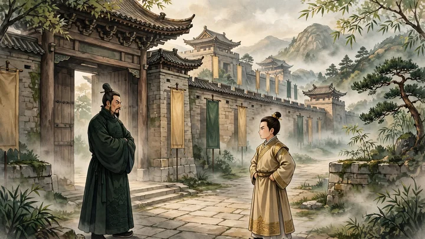

# 001 郑伯克段于鄢

当初，郑武公娶了申国的女儿，叫武姜。武姜生下庄公和共叔段。庄公是倒着生下来的，难产吓着了武姜，所以给他取名叫“寤生”，从此就讨厌他。武姜偏爱共叔段，想立他做太子，多次向武公请求，武公没有答应。

庄公即位后，武姜替共叔段请求封地“制”。庄公说：“制是个险要的城邑，虢叔死在那里，别的地方随你挑。”武姜请求封“京”，庄公就让共叔段住在京，称他为“京城大叔”。祭仲说：“都城超过百雉，是国家的祸害。先王的制度，大都城不能超过国都的三分之一，中等都城不能超过五分之一，小都城不能超过九分之一。现在京城超出了限度，不合制度，您会受不了的。”庄公说：“姜氏想要这样，怎么能躲避祸害呢？”祭仲回答：“姜氏哪里会满足？不如早点给这事定个处置。不要让它滋长蔓延，蔓延了就难办了。蔓草还除不掉，何况是您宠爱的弟弟！”庄公说：“多行不义的人必定自取灭亡，你姑且等着吧。”

不久，共叔段命令郑国西部和北部的边邑同时归顺他。公子吕说：“一个国家容不得有两个主人，您打算怎么办？想把国家让给大叔，我就去侍奉他；如果不让，就请除掉他，不要让百姓生出二心。”庄公说：“用不着，他会自取其祸。”共叔段又把那些两属的边邑收为自己的，一直收到廪延。子封说：“可以动手了，地盘大了会得到民众。”庄公说：“不义的人得不到亲近，地盘再大也会崩溃！”

共叔段修筑城墙、聚集百姓，整治甲兵，备好步兵战车，准备偷袭郑国。武姜打算做内应，打开城门。庄公听到偷袭的日期，说：“可以了。”命令子封率领二百辆战车讨伐京邑。京邑的人背叛了大叔段，段逃到鄢地。庄公又到鄢地讨伐他。五月辛丑日，大叔段逃奔到共国。

《春秋》上写道：“郑伯克段于鄢。”段不像弟弟，所以不称他为弟；像两个国君打仗，所以说“克”。称他为“郑伯”，是讥讽他失去了教导弟弟的责任。这件事出自郑庄公的本意，所以叫“郑志”。不写段“出奔”，是因为兄弟相残，难以启齿。

于是庄公把武姜安置在城颍，并且发誓说：“不到黄泉，永不相见！”过后他又后悔了。颍考叔是颍谷的封人，听说这事后，进献东西给庄公。庄公赐他饭吃，他把肉放在一边不吃。庄公问他为什么，他回答：“我母亲吃过我的饭，却从没尝过国君的肉羹，请让我带回去给她。”庄公说：“你有母亲可以孝敬，唯独我没有！”颍考叔问：“您这话是什么意思？”庄公把事情告诉他，还说了自己的后悔。颍考叔说：“您何必发愁！只要挖地挖到泉水，挖个地道相见，谁能说不是呢？”庄公照做了。庄公走进地道唱道：“大隧之中，其乐也融融。”武姜走出地道唱道：“大隧之外，其乐也泄泄。”于是母子恢复如初。

君子说：“颍考叔是真正的孝子。爱自己的母亲，恩惠也施及庄公。”《诗经》说：“‘孝子不匮，永锡尔类。’说的就是这个吧！”

## 原文

初，郑武公娶于申，曰武姜。生庄公及共叔段。庄公寤生，惊姜氏，故名曰：寤生，遂恶之。爱共叔段，欲立之。亟请于武公，公弗许。

及庄公即位，为之请制。公曰：“制，岩邑也，虢叔死焉，他邑唯命。请京，使居之，谓之京城大叔。祭仲曰：“都城过百雉，国之害也。先王之制，大都不过参国之一，中五之一，小九之一。今京不度，非制也，君将不堪。”公曰：“姜氏欲之，焉辟害？”对曰：“姜氏何厌之有？不如早为之所。无使滋蔓，蔓，难图也。蔓草犹不可除，况君之宠弟乎！”公曰：“多行不义必自毙，子姑待之。”

既而大叔命西鄙北鄙贰于己。公子吕曰：“国不堪贰，君将若之何？欲与大叔，臣请事之；若弗与，则请除之，无生民心。”公曰：“无庸，将自及。”大叔又收贰以为己邑，至于廪延。子封曰：“可矣。厚将得众。”公曰：“不义不昵，厚将崩！”

大叔完聚，缮甲兵，具卒乘，将袭郑。夫人将启之。公闻其期，曰：“可矣。”命子封帅车二百乘以伐京。京叛大叔段。段入于鄢。公伐诸鄢。五月辛丑，大叔出奔共。

书曰：“郑伯克段于鄢。”段不弟故不言弟。如二君，故曰克。称郑伯，讥失教也。谓之郑志。不言出奔，难之也。

遂寘姜氏于城颍，而誓之曰：“不及黄泉，无相见也！”既而悔之。颍考叔为颍谷封人，闻之，有献于公。公赐之食。食舍肉。公问之，对曰：“小人有母，皆尝小人之食矣，未尝君之羹，请以遗之。”公曰：“尔有母遗，繄我独无！”颍考叔曰：“敢问何谓也？”公语之故，且告之悔。对曰：“君何患焉！若阙地及泉，隧而相见，其谁曰不然？”公从之。公入而赋：“大隧之中，其乐也融融。”姜出而赋：大隧之外，其乐也泄泄。遂为母子如初。

君子曰：“颍考叔，纯孝也。爱其母，施及庄公。”《诗》曰：“‘孝子不匮，永锡尔类。’其是之谓乎！”