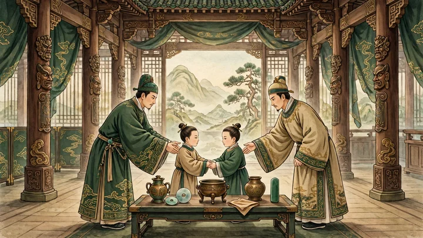

# 002 周郑交质

郑武公、庄公父子先后担任周平王的卿士。平王又信任虢公，郑伯怨恨周王。周王说：“没有这回事。”于是周王室和郑国互相交换人质。王子狐到郑国做人质，郑公子忽到周王室做人质。周平王去世后，周人打算把政权交给虢公。四月，郑国的祭足率兵夺取了温地的麦子。秋天，又夺取了成周的禾谷。周王室和郑国互相交恶。

君子说：“诚信不是发自内心，交换人质也没用。明白道理、体谅别人，照礼去做，再用礼来约束，即使没有人质，谁能离间呢？如果真有诚信，山涧、溪流、池沼里的水草，苹蘩、蕴藻这样的野菜，竹筐、陶釜这样的器具，积水、路边水洼里的水，都可以用来祭祀鬼神、进献王公。何况君子结交两国的盟约，照礼去做，又何必用人质呢。《诗经·风》里有《采蘩》《采苹》，《雅》里有《行苇》《泂酌》，都是表彰忠信的。”

## 原文

郑武公、庄公为平王卿士。王贰于虢。郑伯怨王。王曰：“无之。”故周、郑交质。王子狐为质于郑，郑公子忽为质于周。王崩，周人将畀虢公政。四月郑祭足帅师取温之麦。秋，又取成周之禾。周郑交恶。

君子曰：“信不由中，质无益也。明恕而行，要之以礼，虽无有质，谁能间之？苟有明信，涧、溪、沼、沚之毛，𬞟、蘩、蕴藻之菜，筐、筥锜釜之器，潢污、行潦之水，可荐于鬼神，可羞于王公。而况君子结二国之信，行之以礼，又焉用质。《风》有《采蘩》、《采𬞟》，《雅》有《行苇》、《泂酌》，昭忠信也。