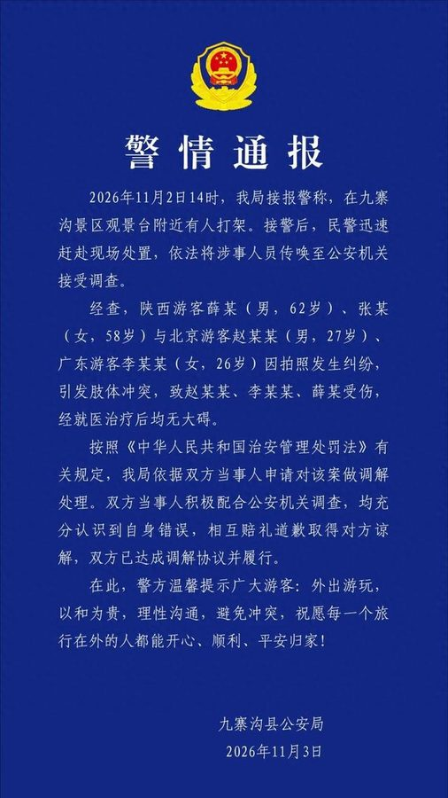

[视频：九寨沟排队起冲突，年轻人挨打不敢还手（网传解说视频，5分钟）](video.mp4)

2026年11月2日14时，九寨沟景区观景台附近有人打架，警方接警后赶到现场，把涉事人员传唤到公安机关接受调查。

11月3日，九寨沟县公安局的通报来了，事情不是视频里看到的那样简单。

经查，陕西游客薛某，62岁，同行的张某，58岁，与北京游客赵某某，27岁，广东游客李某某，26岁，因为拍照发生纠纷，引发肢体冲突。冲突里，赵某某、李某某和薛某三人都受了伤，送医治疗后均无大碍。

警方没有单方面处罚任何一方。按照《中华人民共和国治安管理处罚法》的有关规定，警方依据双方当事人的申请，对这起纠纷做了调解处理。双方都配合调查，都承认自己有错，相互赔礼道歉，取得了对方的谅解，达成了调解协议，并且已经履行完毕。

视频只拍到了老人挥拳的那一段，没有拍到前面发生了什么。此前有媒体援引知情者说法称，纠纷源于拍照站位，年轻男子曾先推搡老人，但这一说法没有出现在警方通报里，通报也没有详述冲突的起因。

警方在通报最后提醒游客：外出游玩，以和为贵，理性沟通，避免冲突，祝愿每一个旅行在外的人都能开心、顺利、平安归家。
