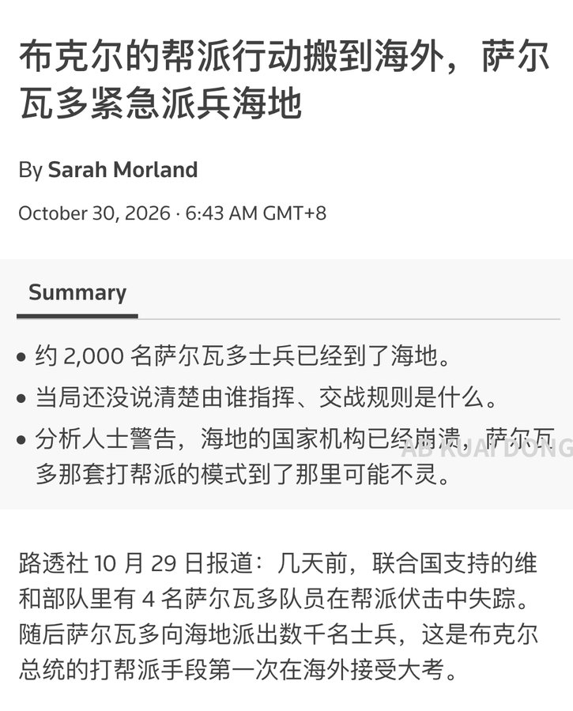
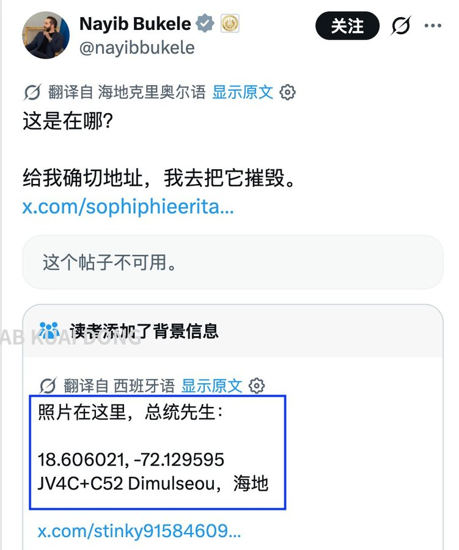

2026年10月18日，4名萨尔瓦多航空技术人员在海地太子港附近的克鲁瓦-德布凯圣托地区遭到帮派伏击。他们是联合国支持的帮派压制部队的成员，乘坐的装甲车被爆炸物击中后起火，4人失踪，至今没有找到。没有组织出面认领这次袭击，海地媒体怀疑是切恩·梅尚帮派干的，这个帮派的地盘就包括圣托。

10月21日，萨尔瓦多总统布克尔宣布展开救援行动，派兵进入海地寻找失踪人员。部队从10月22日开始抵达，10月28日，萨尔瓦多政府确认已有2000名士兵进入海地。11月2日，海地警方与帮派压制部队、萨尔瓦多士兵一起在圣托搜寻，找到了4人乘坐的那辆车的烧毁残骸，4人仍然没有踪影，警方3日公布了这一消息。

同一天，萨尔瓦多装甲纵队进入太子港以北的库尔德萨克平原，对切恩·梅尚和400马沃佐两个帮派展开地面行动。

11月6日，一名网友在X上发了一张多层楼房的照片，旁边还附了海地国家宫废墟的照片，并@了布克尔。布克尔用海地克里奥尔语回复了他：“这栋房子在哪？把确切地址给我们，我们去把它摧毁。”

帖子下面，网友纷纷回复了GPS坐标，多在托马佐、迪米索一带。有读者直接在帖子下补充了一条背景信息，给出坐标：北纬18.606021，西经-72.129595，迪米尔索，海地。当地报道此前把该地区一处类似的楼宇与400马沃佐头目威尔逊·约瑟夫联系起来。

截至11月7日，摧毁行动还没有得到证实，4名技术人员仍然下落不明。400马沃佐头目威尔逊·约瑟夫称4人已经死了，但没有拿出证据；海地当局说4人失踪；萨尔瓦多政府认为他们还活着。
