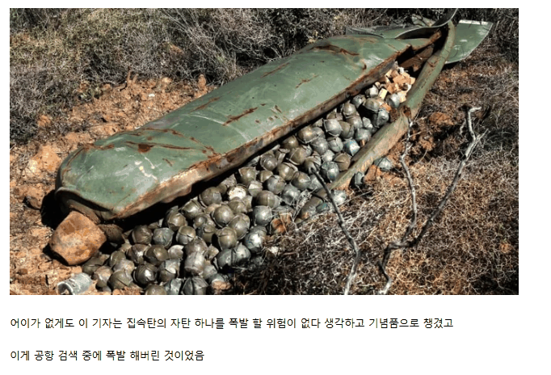
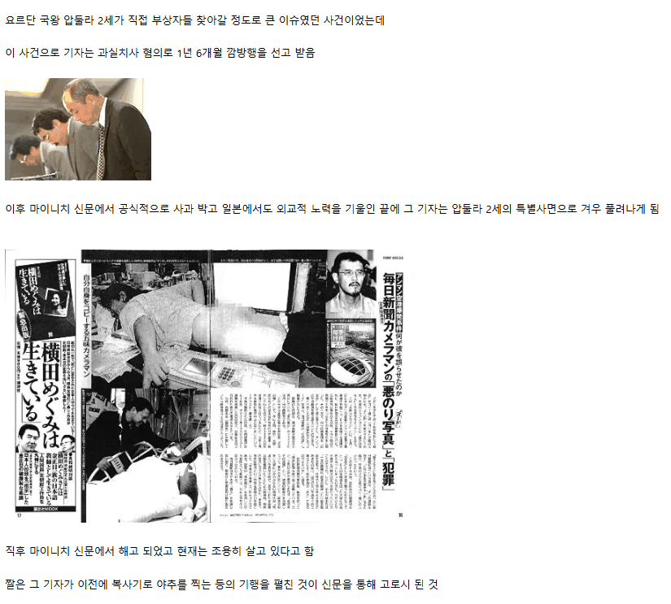

2003年5月1日，星期四，约旦安曼阿利亚王后国际机场北出发厅，行李安检处突然发生爆炸。爆炸造成1人死亡、3人受伤，死者是约旦机场安保警士阿里·萨尔汉。

爆炸物藏在一名日本记者的行李箱里。记者名叫五味宏基，36岁，是日本《每日新闻》的摄影记者。他到伊拉克采访，离开之前，在巴格达从一名伊拉克人手里买下一件爆炸物，打算带回日本，当作战地纪念品。被审讯时他说，自己不知道这件东西会爆炸。

2003年4月28日，五味宏基从伊拉克经卡拉马口岸进入约旦，准备搭乘埃及航空飞往开罗的航班。法新社的报道则说，这只行李箱的目的地是飞往特拉维夫的航班。5月1日那天，行李箱在安检处接受检查，里面的爆炸物突然爆炸。

2003年5月，约旦国家安全法院判处五味宏基监禁18个月。6月11日，约旦内阁通过决议，对他实行特别赦免。6月16日，阿卜杜拉二世国王颁布王令，赦免了他。

