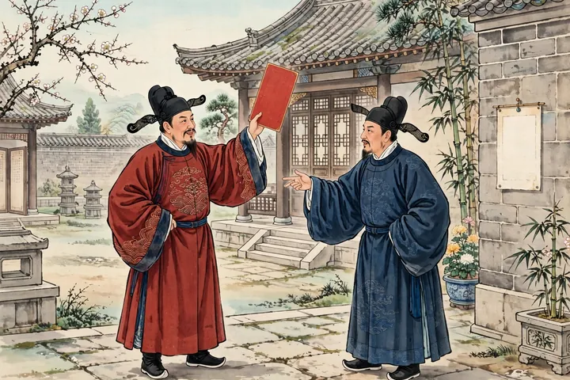

甲和乙同一年考中。甲选了馆职，乙授了县令。一天，甲得意地对乙说：“我位列清华，身在宫禁之中，和年兄你这样做地方官的比起来，资格悬殊得很。别的不说，单是拜客用的大字名帖，身份体面，何止是天上地下的差别。”乙说：“你的帖子上能用几个字，哪比得上我告示上的字，不知要大多少倍？晓谕通衢，百姓没有不敬畏遵守的，年兄的帖子却派不上用场。”甲说：“金瓜黄盖那样显赫威风的东西，兄台可有吗？”乙说：“我出门时牌棍开道，排满整条街，岂止比兄台的多几倍？”甲说：“太史的图章，名标上苑，年兄难道不羡慕吗？”乙说：“我有朝廷的印信，生杀大权都由我掌握；看年兄身居冷衙门，图章是自己私刻的，谁会怕你？”甲一时语塞，只好说：“总之，翰林的名声价值千金。”乙笑着说：“我坐堂的时候，百姓口口声声叫我青天爷爷，岂止千金而已呢？”

