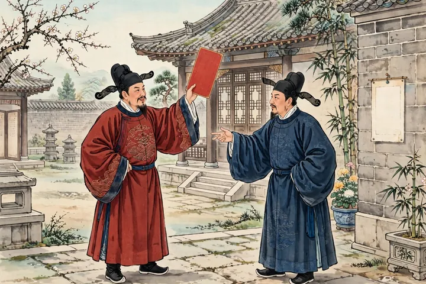

# 002 比职

## 翻译说明（只写在这里，不写进正文文件）

这篇出自清代游戏主人编的《笑林广记》古艳部，篇名《比职》，以下译文是 Muse 的翻译，只把文言换成今天的话来讲，原意、人物、情节顺序和结局都不改，没有增加人物，没有改动结局。

- 底本与来源：原文取自维基文库《笑林广记/古艳部》简体版（zh-hans）直取底本，标点照源；全文 1 段。未抄现代整理本校注、未抄现代译文。
- 正文文件含图片标记：译文正文直接从故事第一句开始，图片标记只插在段落之间；图 1 在第 1 段之后（全文末）。
- 状态：本地草稿，未推 GitHub，未发头条；其他篇未动。

## 人物表（先写人物表，再按人物表生成图片）

- 甲：选了馆职的官员，红袍乌纱。见于图 01（举起名帖与乙争辩）。
- 乙：授了县令的官员，深蓝袍乌纱。见于图 01（指向墙上告示与甲争辩）。

## 图片清单（共 1 张，短篇定数）

- images/01.webp：衙署庭院，红袍的甲高举大红名帖、深蓝袍的乙指向墙上告示，两人争辩，梅竹瓦顶，对应译文第 1 段（甲乙比官职体面）。
- 风格：明代日常生活、清新、明亮干净，不阴森、不血腥；无文字、无水印。
- 克制处理：无亲密或暴力情节。
- 装配位置：图 1 在译文第 1 段之后；图不插在段落中间。
- 同脸同服装：两人只见于图 01，甲红袍、乙深蓝袍。
- 手机尺寸：01 为 720×480、90KB；已去元数据。

## 校验结果（脚本自查）

- 原文段落数：1 段，285 字（不含换行，含标点）。
- 译文正文段落数：1 段，350 字（不含换行，含标点，不含图片标记）。
- 段落数一致：通过，原文 1 段 = 译文 1 段，换行跟原文走，段内句子连续，不按句分行。
- 小标题：通过，译文正文无小标题。
- 新增人物：通过，无新增人物；改结局：通过，结尾仍是“岂止千金而已呢”，顺序未改。
- 正文纯净：通过，两正文文件均不含“白话”二字，不含“Muse”，不含来源说明。
- 简体：通过，原文与译文文件已扫查，无繁体残留。
- 图片标记：通过，译文 .md 含 1 个图片标记 ，与 images/ 内的 1 张图一一对应，位置在段落之间。
- 图片生成：通过，一次生成成功，已目视核对，场景与译文段落对应；文件非零；尺寸与大小见图片清单。

## 失败项

- 无。原文、译文、README、图片齐全，无缺失。

## 文件

- 002-比职-原文.md
- 002-比职.md
- images/01.webp
- README.md（本文件）
