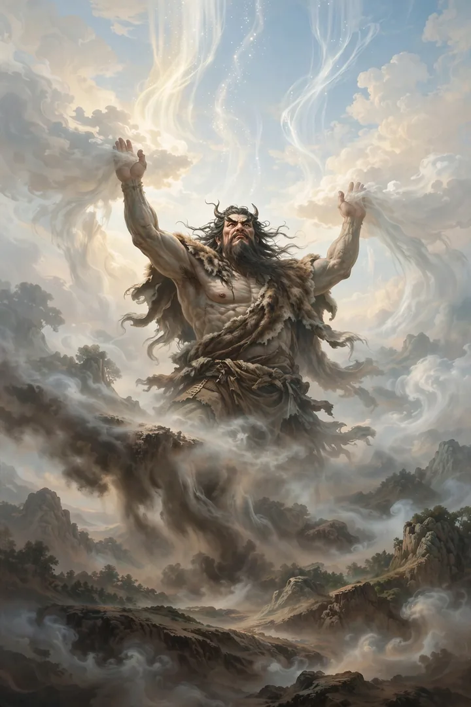

# 001 盘古开辟

起初天地混混沌沌，像一枚鸡蛋，盘古就生在其中。过了一万八千年，天地才分开：轻清的气往上升成了天，重浊的气往下降成了地。盘古夹在天地之间，一天变化九次，神妙通于天，圣明及于地。天每天升高一丈，盘古每天也长高一丈，就这样过了一万八千年。天高到极处，地深到极处，盘古也长到极处，这之后才有了三皇。数目从一起，立于三，成于五，盛于七，处于九。所以天离地有九万里（徐整《三五历纪》）。

## 原文

天地浑沌如鸡子，盘古生其中。万八千岁，天地开辟。阳清为天，阴浊为地。盘古在其中，一日九变，神于天，圣于地。天日高一丈，盘古日长一丈，如此万八千岁。天数极高，地数极深，盘古极长，后乃有三皇。数起于一，立于三，成于五，盛于七，处于九。故天去地九万里（徐整《三五历纪》）。
